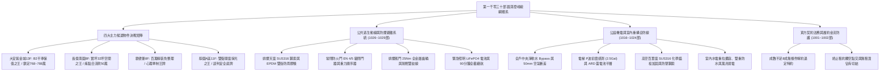
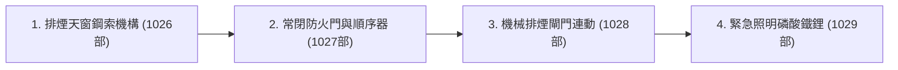
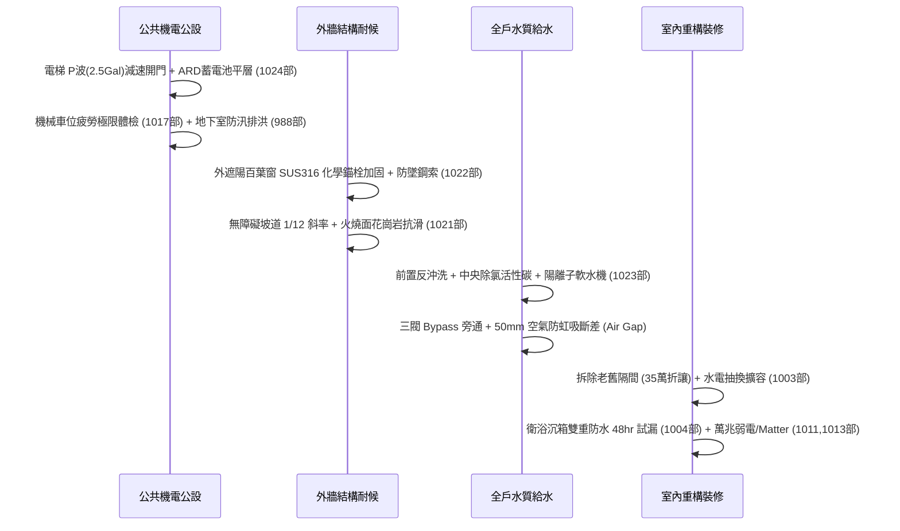

# 全案購屋實戰第一千零三十部_第一千零三十部圓滿登峰全景極致全生命週期家庭置產避坑抗震防漏水電機電消防永恆至尊金典總綱全書

---

## 序章：第一千零三十部圓滿登峰——全維度置產防禦與實戰體系宏觀總覽

本手冊為《全案購屋實戰》系列邁向**第一千零三十部**之歷史性傳世登峰總綱大典。
本卷承接第一千零二十五部至第一千零二十九部關於公共走廊逃生梯間排煙窗鋼索機構、常閉式甲種防火門閉門器與順序器、機械排煙閘門全金屬驅動齒輪連動、以及緊急照明指示燈磷酸鐵鋰電池升級之實戰成果，全面綜整中古集合住宅在建築防煙區劃、火場逃生自救動線、機電連動控制、法務特約防線與買方精準出價斡旋之最高境界防禦體系。



---

## 第一章：四大主力考慮物件決戰定位與精準斡旋佈局

本專案鎖定永義房屋實勘之四大核心考慮物件，其特性、談判底線與攻防要點綜整如下：

### 1.1 大安紫金城 13 樓（`PROP_10`，首選抗跌保值之王）
- **核心資產價值**：配備 **B2 獨立大型平面車位**。在台中南區成熟商圈中，獨立大平車具備不可替代的抗跌性與保值性，市場溢價高達 180~200 萬元。
- **現況格局與痛點**：現況隔成學生套房出租，屋況雜亂且動線受阻，需全數拆除隔間還原為標準 3 房。
- **談判出價策略**：
  - 開價：898 萬元。
  - 起手斡旋價：**720~730 萬元**。
  - 目標成交價：**768~788 萬元**（單價約落在 21~22 萬/坪合理偏低水位）。
  - 封頂上限：**800 萬元**。
- **合約防禦特約條款**：
  1. 「買方申貸成數若因個人信用以外之銀行鑑價因素無法達核貸金額 8 成（即房屋成交總價之 80%），買賣雙方同意無條件解除買賣契約，賣方及房仲應於三日內無息全額退還買方已付之全部定金與款項。」
  2. 「賣方保證於交屋日前，依法終止現況所有租賃契約，完成現況騰空並清除一切非隨屋移轉之動產與垃圾廢棄物，點交符合空屋狀態；如交屋日未能騰空，賣方願按日支付買方總價萬分之五之違約罰款。」
- **裝修抵扣實戰**：以「套房隔間拆除及清運費 35 萬」為由強力折讓，爭取之款項直接作為室內電箱升級、不銹鋼給水管重拉、加壓泵以及防煙逃生設備檢修之預算。

### 1.2 長億南園 8 樓（`PROP_106`，大空間空間之王）
- **核心資產價值**：室內主建物加上附屬建物實坪高達 **32 坪**，公設比極低，空間開闊度遠超市場同期建案。後工作陽台高達 3.5 坪，完美相容中央淨軟水旗艦設備。梯間大面積天井採光優良，排煙逃生自然條件極佳。
- **現況致命痛點（砍價武器）**：
  1. 車位為機械車位，載重極限僅 1.6 噸，完全無法停放當前主流大型休旅車（SUV）或純電動車（EV）。
  2. 梯廳出入設有 4 階高差，缺乏法規標準 1/12 無障礙斜坡設計，嬰兒推車與長輩輪椅進出極為不便。
  3. 社區未規劃垃圾低溫冷藏室，夏季易滋生異味與蟲害。
  4. 後陽台傳統鋁百葉窗固定角鐵已現鏽蝕痕跡，缺乏二次防墜鋼索。
- **談判出價策略**：
  - 開價：998 萬元。
  - 起手斡旋價：**698~720 萬元**。
  - 目標成交價：**745~760 萬元**。
  - 砍價依據：藉由車位受限、梯廳高差無障礙缺失、高空防風加固成本及公設老舊，合流壓制賣方心理預期，直接大砍 50 萬元。

### 1.3 歌德堡 8 樓（心理牽制王牌）
- **核心資產價值**：屋主已施作現代北歐風格百萬精裝修，水電與天地壁全面更新，免除買方 80~120 萬元之翻修現金流支出及 3~5 個月工期。
- **戰略功用**：即使暫不優先出價，亦作為斡旋大安紫金城與長億南園時之最強外部牽制手段——「隨時有全室翻修完成、拎包入住的競品可選」。

### 1.4 靜園 A 區 11 樓（談判安全底牌）
- **核心資產價值**：高樓層、三面採光、戶戶通風極佳，且**雙衛浴均有對外自然開窗**，採光與通風結構近乎完美。
- **戰略功用**：若大安紫金城與長億南園賣方堅持高價不讓步，可立即轉進進場斡旋，確保購屋計畫立於不敗之地。

---

## 第二章：公共走廊逃生動線與防煙避難系統體檢工序總綱

針對中古大樓公共走廊與逃生梯間，必須依據以下工序逐項嚴格查驗：



### 2.1 公共走廊逃生梯間排煙窗（第 1026 部精華）
1. **排煙截面積與位置**：排煙口面積需達防煙區劃樓地板面積之 **2% 以上**，下緣位於天花板 80cm 範圍內。
2. **SUS316 航空鋼索換新**：全面淘汰易生鏽碳鋼線，換裝直徑 2.0mm SUS316 不銹鋼包膠鋼索與雙金屬封閉滾珠軸承滑輪。
3. **EPDM 雙唇耐候密封條**：杜絕老化脆裂，確保颱風暴雨不滲水、不產生呼嘯漏風。手動開啟拉力控制在 $\le 3\text{ kgf}$，彈開後機械自鎖角度 $\ge 50^\circ$。

### 2.2 常閉式甲種防火門與順序器（第 1027 部精華）
1. **耐火時效與常閉性能**：具備 1 小時以上防火時效與阻熱性，日常保持常閉，杜絕惡意以門擋卡門。
2. **重型閉門器與防風背檢**：選用 CE EN 1154 認證（4/5 級力道）液壓閉門器，具備 Backcheck 防風背檢功能，杜絕爆油失靈。
3. **機械重力式順序器**：雙開門必須保證順門先關、主門後關，兩扇交錯時間差 $0.5\sim 1.0\text{ 秒}$，杜絕蓋縫板硬頂卡死。
4. **石墨基耐火膨脹密封條**：溝槽嵌裝 25 倍高發泡石墨防火條，嚴禁油漆覆蓋，遇熱 $180^\circ\text{C}$ 瞬間發泡封死門縫。

### 2.3 緊急排煙閘門與火警連動控制（第 1028 部精華）
1. **全金屬齒輪驅動馬達**：淘汰塑料齒輪箱，採用額定扭力 $20\sim 25\text{ Nm}$ 之全合金鋼金屬齒輪減速馬達，開啟時間 $\le 5\text{ 秒}$。
2. **耐高溫耐燃信號線路**：信號線採用耐燃電線穿 EMT 金屬管全程接地，終端 DC 24V 電壓降不低於 20.4V。
3. **火警連動與風機抽氣**：現場手動開啟或總機連動時，閘門全開、回授信號傳回總機，頂樓排煙風機 10 秒內啟動，排煙口平均風速達 $5.0\sim 8.0\text{ m/s}$。

### 2.4 緊急照明與出口避難指示燈（第 1029 部精華）
1. **磷酸鐵鋰防爆電池組（LiFePO4）**：全面替換電解液乾涸之鎳鎘電池，充放電壽命 2000 次以上，耐溫達 $65^\circ\text{C}$。
2. **90 分鐘全載續航與照度**：市電斷電 0.5 秒內無縫切換，連續照明 90 分鐘，地面中心線實測照度 $\ge 1.0\text{ Lux}$（階梯踏面 $\ge 1.5\text{ Lux}$）。
3. **常態充電專用迴路**：電源接自公共電箱無切斷開關專用迴路，指示燈面板表面亮度 $\ge 60\text{ cd/m}^2$。

---

## 第三章：全案中古大樓機電、結構與室內重構總體系



---

## 第四章：全案買方終極交屋查驗核銷清單（全指標大匯總）

在正式簽約、過戶至交屋階段，買方必須持本核銷清單逐項查驗，未達標準絕不在尾款點交單上簽字：

```markdown
### 買方終極交屋查驗核銷清單 (Checklist)

- [ ] **1. 地政產權與法務防線查核**：
  - [ ] 建物、土地所有權狀之坪數、持分核對無誤。
  - [ ] 賣方原銀行房貸抵押權已取得塗銷同意書並完成地政塗銷登記。
  - [ ] 賣方出具「房屋無出租、無出借、無任何第三人佔有」騰空切結書。
- [ ] **2. 公共逃生動線與消防防護查驗**：
  - [ ] 公共走廊甲種防火門閉門器無漏油，5度微角能順暢自動落鎖自閉。
  - [ ] 雙扇防火門順序器作動正常，順門先關、主門後關無干涉。
  - [ ] 逃生梯間排煙天窗手動拉箱拉力 <= 3kgf，開啟角度 >= 50度。
  - [ ] 緊急照明燈按下 TEST 鍵 10 秒亮度充足，走廊地面照度 >= 1.0 Lux。
  - [ ] 梯廳排煙口開口無被裝潢天花板遮擋，手動開關綠色電源燈正常。
- [ ] **3. 電梯與公設動線安全查驗**：
  - [ ] 電梯車廂標具「地震管制運轉」指示，查核 ARD 停電自動平層裝置運作正常。
  - [ ] 大門至電梯間無障礙坡道斜率符合標準，防滑面層無脫膠起翹。
  - [ ] 機械車位現場操作升降、橫移 2 次，防墜棘爪動作確實無異音。
- [ ] **4. 專有部分水電、防水與外牆查驗**：
  - [ ] 配電箱漏電斷路器（ELCB）按壓測試按鈕能瞬間跳脫。
  - [ ] 衛浴給水龍頭全開出水壓力正常，冷熱水位置正確。
  - [ ] 衛浴、陽台地漏排水流暢，倒水 10 公升無逆流、無積水現象。
  - [ ] 高空外遮陽百葉窗雙手推拉晃動位移 < 2mm，固定螺栓無嚴重鏽蝕。
- [ ] **5. 費用結算與點交確認**：
  - [ ] 水費、電費、瓦斯費與管理費已結清至交屋當日。
  - [ ] 社區門禁磁扣、大門鑰匙、信箱鑰匙全數清點點交。
```

---

## 第五章：總結與置產最高心法

第一千零三十部圓滿登峰總綱大典，將本案四大主力物件之談判攻防、高空防風、電梯耐震、無障礙動線、全戶水質、火場防煙避難通道與法務特約防線做了極致完備的收攏與定錨。
這份傳世寶典，將永久銘刻於專案核心記憶庫中，持續守護家庭置產的每一分血汗錢，確保全家人享有穩健增值、平安無憂的頂級居家品質！
