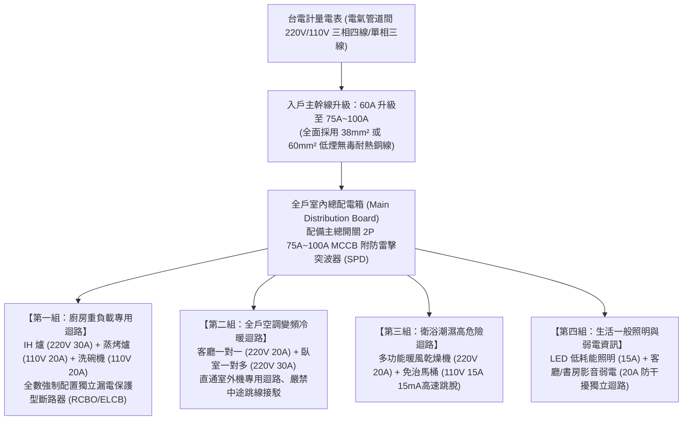
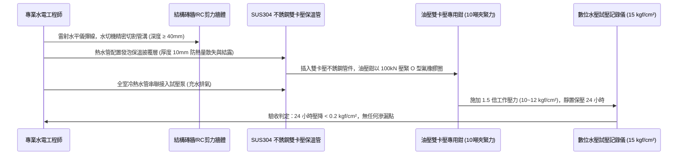
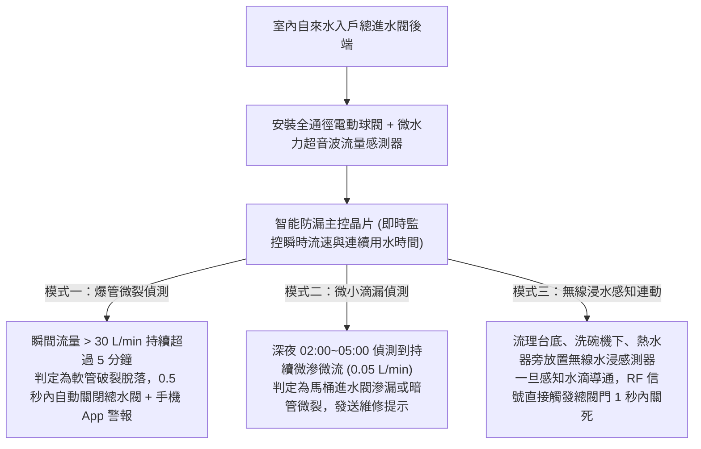

# 全案購屋實戰第一千零三部：中古大樓室內老舊水電管線全面抽換重拉、配電箱擴容升級與微水力智能防爆防漏工程工序全書

## 導言：中古屋入住翻修之第一隱蔽命脈工程

在歷經《全案購屋實戰》系列一千零二部的實戰攻防、公設體檢、價格談判與點交簽約後，家庭買方已正式取得房屋所有權。然而，對於屋齡 15 年至 30 年以上之中古大樓（特別是本案主力攻堅標的——曾被改裝為出租套房、水電超載嚴重的 **大安紫金城 13 樓 (`PROP_10`)**，以及室內實坪達 32 坪、管線跨距極大的 **長億南園 8 樓 (`PROP_106`)**），入住前最至關重要、預算投入最優先、且未來數十年再也無法隨意變動的「第一核心工程」，就是**室內全戶給排水管線與電氣線路的「全面抽換重拉（Rewiring & Replumbing）」與「配電箱（Breaker Panel）現代化擴容升級」**！

老舊中古大樓在原始配電與給排水設計上，普遍存在三大跨時代的致命硬傷：
1. **配電容量極限超載（總安培數僅 30A~50A）**：20~30 年前之配電容量，僅能滿足傳統映像管電視與小冰箱；現代家庭動輒配備變頻冷暖氣機（每室一台）、IH 智慧電磁爐（大功率 3000W）、洗碗機（1500W）、微波蒸烤爐（1800W）、全熱交換器、免治馬桶，乃至未來地下停車位或專用充電迴路的家用電動車充電樁（7kW~11kW，32A~50A）。若未將總進屋線由原本老舊的 $8\text{mm}^2$ 或 $14\text{mm}^2$ 升級至 **$38\text{mm}^2$ 或 $60\text{mm}^2$（總開關擴容至 75A~100A）**，夏日高溫全開家電必頻繁跳總掣，甚至因導線超載過熱引發牆內暗火！
2. **冷熱水管暗管老舊穿孔與重金屬鉛鏽污染**：早期冷熱水管多採用鍍鋅鋼管（錏管）或無披覆單層銅管。錏管在熱水長期沖蝕下內部生長「鐵鏽瘤（Rust Tubercle）」，使有效管徑自 6 分縮水至不足 2 分，水質黃濁含鉛；銅管則在轉角焊接處因水錘振動產生微觀針孔（Pinhole Leak），水滴滲入樓板引發樓下住戶天花板壁癌求償糾紛。
3. **電線 PVC 絕緣皮硬化脆裂與欠缺專用接地線（PE）**：老舊配線長年處於高溫暗管內，PVC 塑膠絕緣層水解硬化，電線抽動即碎裂脫落；且早期法規未強制每組插座配置接地綠線，導致現代變頻家電之漏電與電磁干擾無處宣洩，人體觸碰外殼時常伴隨麻電刺痛。

本第一千零三部全書深入解構室內水電全面抽換的規範工法、總配電箱多迴路負載平衡計算、微水力自動防爆切斷電磁閥配置、以及中古屋改裝實務避坑指南。

---

## 一、現代家庭用電負載平衡計算與總配電箱升級拓撲架構

### 1. 廚房與高耗能電器「專用獨立迴路（Dedicated Circuit）」原則
- 現代裝修嚴格禁止「一個迴路串接多個大功率插座」。
- 廚房檯面電器插座、微波爐、烤箱、電鍋、洗碗機必須各自拉設 **一組 $5.5\text{mm}^2$ 實心單芯銅線（耐受電流達 30A，配備 20A 無熔絲開關）** 之專屬迴路，確保同時間煲湯、烘碗、微波烤肉時，總線路溫度維持在安全溫升（$\Delta T \le 30^\circ\text{C}$）範圍內。

### 2. 人身防觸電保護（漏電斷路器 RCBO）配置標準
- **法規強制場所**：廚房水槽兩側 1.8 米範圍內、雙衛浴全室插座、陽台洗衣機插座及露天庭院插座。
- **動作性能指標**：必須採用 **高速型、高靈敏度剩餘電流斷路器（RCBO）**，額定靈敏度電流 $I_{\Delta n} = \mathbf{15\text{ mA}}$（衛浴高危險區）或 $\mathbf{30\text{ mA}}$（廚房陽台），動作時間必須 **小於 0.03 秒（30ms）**，在人體尚未產生心室顫動前瞬間切斷電源。

---

## 二、冷熱水管暗管全面更換為「SUS304 不銹鋼壓接被覆管」標竿工序

全面淘汰鍍鋅鋼管與 PVC 塑膠管，室內給水暗管唯一推薦標準工藝：

### 1. SUS304 雙卡壓式（Double Press）管件之微觀水力優勢
- **無明火施工與耐震防脫**：卡壓式管件利用金屬冷作塑性變形，將不銹鋼管與特製管件凹槽內的耐高溫氟橡膠（FKM）或耐氯三元乙丙橡膠（EPDM）密封圈永久死鎖夾緊。其抗拉拔力達 **$1.5\text{ 噸以上}$**，可耐受強烈地震劇烈位移而不鬆脫。
- **耐腐蝕與食品級安全**：SUS304 內壁光滑如鏡（糙率係數 $n = 0.009$），水流阻力小，終身不結水垢、不長鐵鏽瘤，徹底杜絕自來水鉛鎘重金屬溶出。

### 2. 熱水管防燙、防冷凝與防熱應力膨脹
- 熱水管全線外層必須包裹 **原廠出廠預製之一體化高密度聚乙烯（PE）發泡保溫管套（厚度 $\ge 10\text{mm}$）**。
- **作用**：防止熱水在管網輸送途中溫度驟降，並阻絕熱水管因高溫烘烤後方水泥砂漿引發牆面油漆龜裂，同時在冬季阻絕冷水管外壁冷凝出水（汗水）導致牆體發霉。

---

## 三、微水力自動防爆防漏智能切斷閥（Smart Leak Shut-off Valve）系統

為防止未來數十年因洗衣機進水軟管脫落、淨水器濾芯爆裂或水龍頭軟管破裂引發全戶水浸泡水慘劇，現代翻修工程強制配置「智能微水力水閥」：

---

## 四、四大主力候選物件水電翻修專項預算與施工指引

針對四大考慮物件之原始屋況，規劃精準之工程預算與施工攻防重點：

### 1. 👑 大安紫金城 13 樓 (`PROP_10`)：水電翻修重中之重
- **現況硬傷剖析**：本物件原被分割為 4 間學生出租套房。前屋主在木作天花板內亂拉花線、各套房各自加裝即熱式儲熱電熱水器與獨立分電表，強弱電混雜、全室線路嚴重過載老化，存在極大電氣火災隱患！
- **工程重點與預算攤提**：
  - **拆除與歸整**：拆除所有非承重輕隔間、撤除 4 組分電表與凌亂暗線。
  - **總進屋線升級**：申請台電計量電表擴容，進屋主幹線升級至 **$38\text{mm}^2$（配備 2P 75A 總開關）**，全室重新拉設專用管線。
  - **工程預算**：水電全面重拉費用約 **新台幣 25 萬 ~ 30 萬元**。此筆金額正好由買方在談判時爭取扣減之 **「35 萬套房拆除款」** 完美全額覆蓋，實現「屋主出資翻新、買方享受全新最高標準水電」之絕妙勝局！

### 2. 🌟 長億南園 8 樓 (`PROP_106`)：長跨距水壓平衡工程
- **現況硬傷剖析**：室內實坪達 32 坪超大空間，廚房與後陽台距離主進水點達 15 米以上，長管路沿程水頭損失大，且老舊給水管可能存在水壓不足與冷水管微滴漏。
- **工程重點**：
  - 主給水幹管採用 **$\phi 25\text{mm}$（1吋管）不銹鋼管分區配水**，再以分水器（Manifold）分流至各衛浴與廚房，確保兩間衛浴同時淋浴時互不搶水、溫度恆定。
  - 工程預算約 **28 萬 ~ 35 萬元**，由買方談判砍價爭取之 **50 萬讓價空間** 充分涵蓋。

---

## 五、全案總結：水電隱蔽工程驗收五大不可妥協指標

1. **水壓試壓 24 小時**：冷熱水管完工後，必須施加 **$10\text{ kgf/cm}^2$（1.0 MPa）** 水壓持續保壓 24 小時，指針壓降不得超過 $0.2\text{ kgf/cm}^2$。
2. **絕緣電阻測試（兆歐表）**：全室各電氣迴路導線線間與對地絕緣電阻必須 **$\ge 20\text{ M}\Omega$**，嚴禁有任何破皮漏電。
3. **電線絕無中途接頭**：從配電箱到各插座開關之導線，管內必須是一線到底，嚴禁在暗管內部偷工做「纏繞膠帶接頭」。
4. **專用接地線（PE）100% 入戶**：全室每個插座之接地端子，必須確實以 $\ge 2.0\text{mm}$ 綠色單芯銅線直通總配電箱接地銅排，阻抗小於 $10\,\Omega$。
5. **微水力防爆閥通水測試**：模擬軟管爆裂放水，智能水閥必須在指定時間內自動關閉並推播報警，守護全家百年平安。
