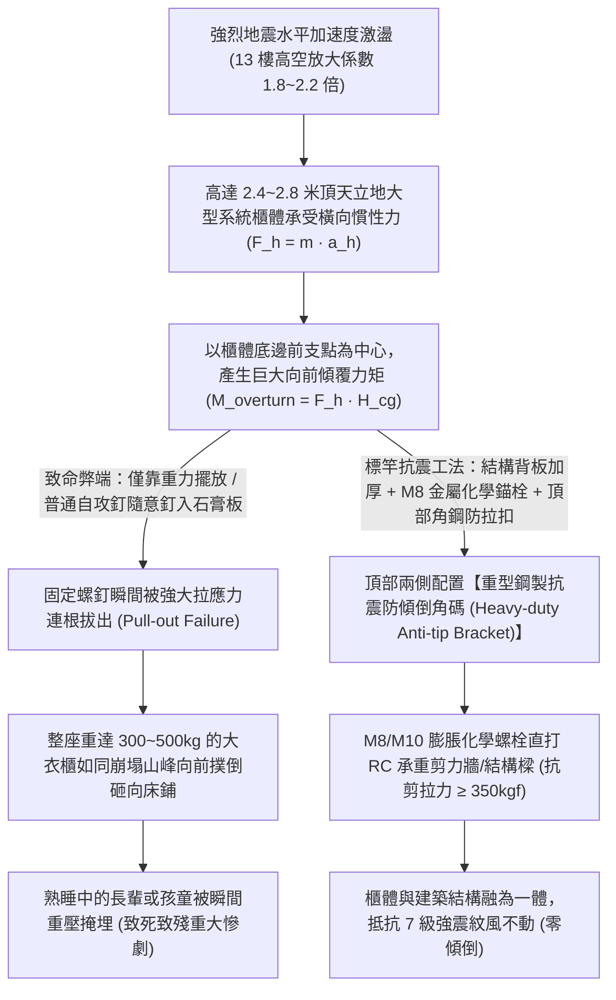
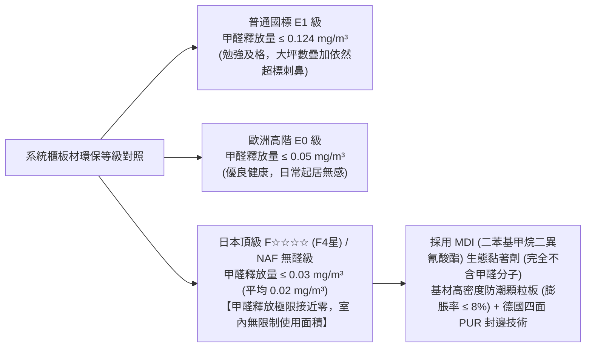
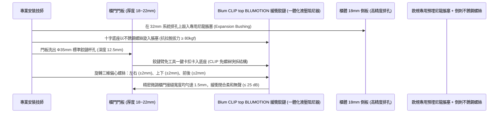
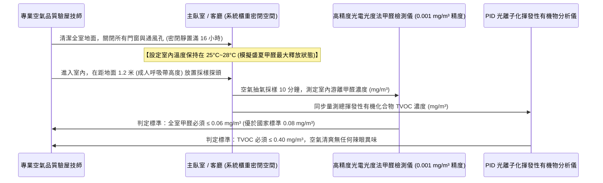

# 全案購屋實戰第一千零九部：中古大樓全室系統收納櫃抗震防傾倒拉爆固定、E0/F4星頂級防潮環保板材與五金靜音緩衝鉸鏈工序全書

## 導言：高空室內空間之收納美學、抗震防砸與室內空氣品質安全防線

在集合住宅中古大樓之室內精裝工程中，從客廳電視牆系統櫃、玄關穿鞋收納櫃、主臥頂天立地大衣櫃，到廚房吊櫃與書房整面書牆，「系統收納櫃工程（Custom Cabinetry & Joinery System）」佔據了全屋室內空間垂直立面面積的 40% 以上。它不僅是家庭維持長年整潔、井然有序的起居收納中樞，更是全家人長年朝夕相處的「超大面積室內空氣接觸面」與強烈地震來臨瞬間的「重力防護屏障」。

特別是針對本案兩大主力攻堅標的——位處 13 樓頂層、受強烈地震高空水平擺幅劇烈晃動的 **大安紫金城 13 樓 (`PROP_10`)**，以及室內實坪達 32 坪、櫃體收納總長度超過 25 米的超大空間 **長億南園 8 樓 (`PROP_106`)**，系統櫃工程若施工工藝低劣或材料選型不當，普遍會在入住後引發三大致命危機：
1. **強震下頂天立地大型櫃體「整體傾倒撲倒（Toppling Over）」**：許多傳統裝潢木工為了追求快速施工，僅以普通自攻螺絲將高達 2.4 米至 2.8 米的大型衣櫃隨意釘在薄型石膏板、矽酸鈣板隔間或粉化劣質紅磚牆上，甚至「完全不打背牆固定螺栓，僅靠櫃體自身重力靠牆放置」！一旦遭遇 5 級以上強烈地震，高樓層的劇烈晃動會在櫃體頂部產生巨大的傾覆力矩（Overturning Moment）。重達數百公斤、裝滿厚重衣物與書籍的重型高櫃會瞬間如同巨石般「整座向前撲倒砸落」，將走道、臥室床鋪瞬間壓成粉碎，直接壓死壓傷熟睡中的家人或正在地面玩耍的幼童！
2. **劣質板材釋放超標甲醛（Formaldehyde）與 TVOC 毒氣，引發兒童白血病與全家慢性中毒**：部分不良系統家具商為壓低成本，採用未達國家標準之 E2/E3 級劣質刨花板（顆粒板）或密集板（MDF），內部大量使用廉價的「脲醛樹脂（Urea-Formaldehyde Resin）」膠水。甲醛釋放半衰期長達 3 至 15 年，在夏季室內開冷氣緊閉門窗時，室內甲醛濃度可飆升至法定標準（$0.08\text{ mg/m}^3$）的 5 至 8 倍以上，刺鼻辣眼、喉嚨痛、免疫力崩潰，甚至大幅增加幼童罹患惡性淋巴瘤與急性白血病之風險！
3. **欠缺防潮防變形膨脹力，五金鉸鏈在數年內鬆動脫落、櫃門下垂咬合不正**：海島型潮濕氣候下，廉價板材在梅雨季瘋狂吸水膨脹，導致木螺絲孔周邊刨花結構碎裂滑牙；且若採用劣質鐵皮五金鉸鏈，在數萬次開關後疲勞變形、油壓緩衝棒漏油失效，櫃門關閉時發出「砰！砰！」的刺耳巨響，甚至整扇厚重門板突然脫扣砸傷手指。

為此，本第一千零九部全書深入解構高櫃抗震防傾倒之結構力學錨固工藝、國際最高等級日本 F4 星（F☆☆☆☆）與 EN 13986 超低甲醛防潮板材認證標準、德國進口三維可調隱藏式阻尼鉸鏈技術、以及現場甲醛 TVOC 光電光度計化學驗收標準。

---

## 一、高櫃抗震防傾倒翻倒力學計算與結構化錨固工藝

### 1. 櫃體傾覆力矩（Overturning Moment）力學公式
- 假設系統衣櫃高度 $H = 2.4\text{m}$，深度 $D = 0.6\text{m}$，連同內部收納衣物總質量 $M = 300\text{kg}$（重心高度 $H_{\text{cg}} \approx 1.2\text{m}$）。
- 地震水平峰值加速度 $a_h = 0.4g$（強烈地震）：
  - 水平慣性力 $F_h = M \cdot a_h = 300\text{ kg} \times 0.4 \times 9.8\text{ m/s}^2 \approx 1176\text{ N}$。
  - 向前傾覆力矩 $M_{\text{overturn}} = F_h \times H_{\text{cg}} = 1176\text{ N} \times 1.2\text{m} = \mathbf{1411.2\text{ N}\cdot\text{m}}$。
  - 抵抗自重穩定力矩 $M_{\text{stabilize}} = M \cdot g \times (D/2) = 300 \times 9.8 \times 0.3 = \mathbf{882\text{ N}\cdot\text{m}}$。
- **結論**：$M_{\text{overturn}} > M_{\text{stabilize}}$，傾覆安全係數 $SF = 882 / 1411.2 \approx \mathbf{0.625 < 1.0}$！櫃體**絕對必倒無疑**！
- 櫃體頂部必須至少承受拉應力 $T_{\text{pull}} = (1411.2 - 882) / 2.4 \approx 220\text{ N}$。頂部必須至少配置 **2 組高抗拉鋼製抗震角碼**，死死錨固於建築主結構混凝土牆體上。

### 2. 實心背板加厚（$\ge 18\text{mm}$）結構工法
- 傳統廉價系統櫃背板僅採用 $3\text{mm} \sim 5\text{mm}$ 薄夾板（一捅即破），所有受力全由側板承擔。
- **標竿工藝**：系統高櫃背板全面升級為 **$18\text{mm}$ 實心厚背板（嵌入式開槽榫卯結構）**，錨固角碼可直接穿透 18mm 背板牢固鎖入後方 RC 牆體，使整座櫃體形成剛性箱形結構（Rigid Box Structure），抗扭曲抗剪切強度提升 500% 以上。

---

## 二、E0 / 日本 F4 星（F☆☆☆☆）頂級環保防潮板材認證標準

徹底杜絕毒氣侵害，全室櫃體板材唯一指定採用符合 **日本最高環保級別 JIS A 5905/5908「F☆☆☆☆（F4星）」** 或 **歐洲最高「EN 13986 Super E0（減醛/無醛添加 NAF）」** 認證之原裝進口板材：

### 1. 德國 PUR（Polyurethane）熱熔封邊工藝之微觀防潮防氣化
- **傳統 EVA 封邊之致命硬傷**：傳統 EVA 熱熔膠受熱易軟化、耐候性差，在梅雨季受潮後膠線發黑脫膠，板材邊緣吸水膨脹，內部微量甲醛氣體沿著縫隙瘋狂向外逸散。
- **PUR 無縫封邊技術**：
  - 採用單組份濕氣固化型聚氨酯（PUR）熱熔膠，膠層厚度僅 $0.1\text{mm}$，與木質纖維發生化學不可逆交聯反應。
  - 耐溫範圍達 **$-40^\circ\text{C} \sim +140^\circ\text{C}$**，耐水煮 72 小時不脫膠，形成極致的「微觀分子級氣密水密封邊線」，將板材邊緣 100% 封死，杜絕甲醛釋放與水氣侵入。

---

## 三、德國原裝進口三維可調隱藏式阻尼鉸鏈（Hinges）與抽屜滑軌工藝

淘汰廉價易生鏽鬆脫之雜牌五金，全面升級為 **「德國 Blum / Hettich 原裝進口集成油壓緩衝鉸鏈與同步全展阻尼滑軌」**：

### 1. 20 萬次耐疲勞與鹽霧測試極限
- **規格標準**：五金鉸鏈必須通過 **DIN EN 15570 Level 3（20 萬次開關循環耐久試驗）** 與 **96 小時中性鹽霧防鏽測試（NSS Test）**。
- 內部配置高科技流體油壓阻尼器（Hydraulic Damper），無論以多大力度推甩櫃門，門板在關閉至最後 $30^\circ$ 角時自動柔和減速、靜音吸合，徹底消除門扇撞擊噪音與夾傷孩童手指的危險。

---

## 四、現場甲醛 TVOC 密閉十六小時化學檢測驗收標準（CNS 16034）

系統櫃安裝完畢後，在家具進場前，**必須強制實施嚴格之室內空氣品質化學驗收**：

---

## 五、四大主力候選物件系統收納櫃專項預算與施工攻防

### 1. 👑 大安紫金城 13 樓 (`PROP_10`)：頂樓抗震防傾倒高櫃工程
- **現況挑戰**：本物件為 **13 樓頂層**，強震高空擺幅巨大。前屋主出租套房時遺留的多座老舊夾板衣櫃均未固定於牆體，搖搖欲墜。
- **翻修方案**：
  - 主臥與次臥全面規劃 **日本 F4 星環保板材頂天立地抗震收納系統**，頂部全數加裝 **M8 鋼製抗震防傾倒化學角碼** 直鎖 RC 樑體。
  - 客廳電視主牆配置隱藏式收納吊櫃，採用德國 Blum 緩衝五金。
  - 總收納櫃長度約 18 米，工程預算約 **22 萬 ~ 26 萬元**。此筆費用直接自買方談判斬獲之 **「35 萬套房拆除翻修折讓款」** 中充裕支出，零額外支出為家庭打造頂級抗震無毒豪宅！

### 2. 🌟 長億南園 8 樓 (`PROP_106`)：32 坪超大收納容量分區規劃
- **現況挑戰**：室內實坪達 32 坪大空間，玄關、走道、三大臥室均需海量收納（總櫃體長度超過 25 米），若板材甲醛超標，全室甲醛疊加效應將極度嚴重。
- **翻修方案**：
  - 強制全室採用 E0/F4星 德國進口 PUR 封邊防潮顆粒板，嚴格控制全室板材總載荷率。
  - 預算約 **25 萬 ~ 30 萬元**，由買方談判砍價爭取之 **50 萬讓價款** 充裕分攤。

---

## 六、全案總結：系統收納櫃驗收五大不可妥協鋼鐵防線

1. **查防傾倒角碼**：高於 1.8 米之所有高櫃，頂部兩側必須以 **金屬膨脹螺栓死死錨固於承重牆**，手拉櫃頂必須紋風不動，嚴禁虛接。
2. **查板材鋼印**：板材邊緣必須具備原廠清晰之 **「F☆☆☆☆」或「Super E0」噴墨防偽標識**，嚴禁無標三無板材。
3. **驗 PUR 封邊膠線**：板材四周封邊膠線厚度必須 $\le 0.1\text{mm}$，無黑線、無溢膠、無脫膠毛邊。
4. **測五金緩衝靜音**：快速推關櫃門與抽屜，最後 3cm 必須自動柔和吸合，碰撞噪聲 $\le 25\text{ dB(A)}$，無彈跳現象。
5. **甲醛密閉實測 $\le 0.06\text{ mg/m}^3$**：密閉 16 小時後儀器實測數值合格，鼻子深呼吸完全無任何酸味、辣眼或刺鼻感，守護全家百年健康！
