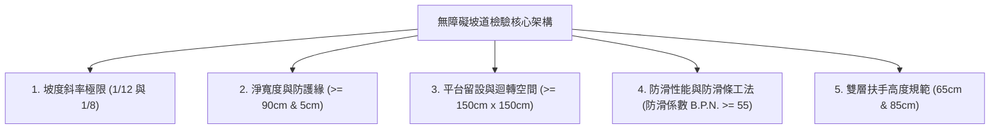
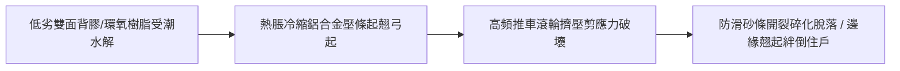
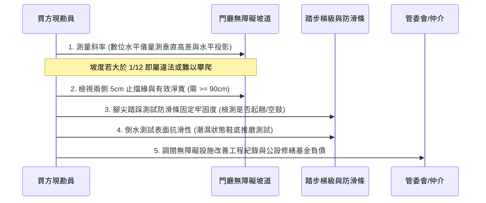
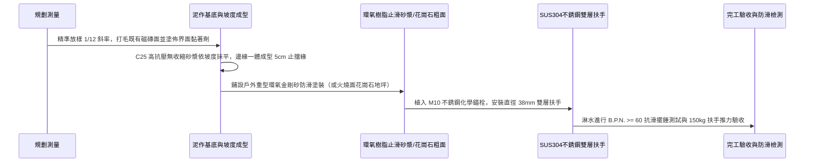

# 全案購屋實戰第一千零二十一部_中古大樓社區無障礙通用設計坡道防滑條脫膠位移坡度超標與輪椅推車進出動線阻礙體檢工序全書

---

## 序章：無障礙人行動線——全生命週期居住尊嚴與資產保值之實戰檢驗

在家庭長期置產的評估體系中，「無障礙動線與通用設計（Universal Design）」往往是首購或換屋族群在看屋時最容易忽略、卻在入住後最為痛徹心扉的核心環節。
一個社區若在門廳、中庭、電梯間或地下停車場存在高差與梯級障礙，不僅嚴重阻礙嬰兒推車、長輩輪椅、受傷行動不便者以及大型買菜購物車的日常進出，更直接在未來的轉手市場中被龐大的高齡退休族群與家庭買盤直接一票否決。

本專案在實勘永義房屋帶看物件時，**長億南園 8 樓**即被精確抓出「梯廳出入設有 4 階高差且無完善平順無障礙斜坡」之重大缺陷；反觀**大安紫金城 13 樓**則具備更開闊平順的大廳進出條件與 B2 直達獨立平車動線。

本卷專門為買方建立中古大樓無障礙通用設計之最嚴格檢驗標準作業程序（SOP），從坡道斜率、防滑條接著工藝、扶手配置、雙向迴轉半徑到地坪平整度，提供逐項體檢工序與談判砍價論據。

---

## 第一章：法規基準與無障礙坡道核心幾何參數



依據《建築技術規則建築設計施工編》第十章「無障礙建築物」及內政部《無障礙設施設計規範》之標準，中古大樓公共通行坡道之合格工法參數如下：

| 檢驗項目 | 標準法規要求 | 理想通用設計標準（家庭全齡友善） | 不合格/瑕疵現象（談判砍價點） |
| :--- | :--- | :--- | :--- |
| **坡度斜率 (Slope)** | 坡度不得大於 **1/12**（高低差每 1 公分，坡長需 12 公分以上）。若高差在 20 公分以下，極限不得大於 **1/8**。 | 坡度控制在 **1/16 ~ 1/20** 之間，推車與輪椅自推省力。 | 坡度陡於 1/8（推車易後翻、輪椅下坡易失控衝撞）。 |
| **有效淨寬 (Clear Width)** | 坡道淨寬不得小於 **90 公分**。 | 淨寬達 **120 ~ 150 公分**，可供輪椅與行人雙向交會。 | 寬度小於 90 公分，或兩側堆放盆栽雜物導致淨寬受限。 |
| **端點與轉折平台** | 坡道起點、終點及每垂直爬升 75 公分處，應設置長寬各 **150 公分以上** 之水平平台。 | 水平平台長度達 180 公分以上，推車停駐平穩安全。 | 轉折處無水平平台，輪椅轉向時面臨側翻傾倒致命風險。 |
| **側邊防護緣 (Kerb)** | 坡道兩側若無側牆，應設置高度 **5 公分以上** 之側邊防護緣（止擋緣）。 | 防護緣一體灌漿成型，高度 7~10 公分。 | 無防護緣，輪椅前小輪或推車輪子極易滑出墜落階梯邊緣。 |
| **地坪防滑係數** | 地坪表面應具備粗糙防滑面，抗滑係數（BPN 或 C.S.R）需符合室外潮濕安全標準。 | 潮濕環境下抗滑係數 **B.P.N. $\ge$ 55**（或 C.S.R $\ge$ 0.5）。 | 採用亮面拋光石英磚、抿石子光滑脫落，下雨天形成溜冰場。 |

---

## 第二章：坡道防滑條常見工藝瑕疵、脫膠位移與老化機理

中古大樓社區為應對既有斜坡過陡或石材濕滑問題，常採用後製加裝防滑條，但因施工不良或材質低劣，往往淪為二次絆倒危險源：



### 2.1 防滑條失效三大主因
1. **接著界面水解乳化**：
   - 許多社區管委會或水電工維修時，僅使用普通氯丁橡膠黃膠或壓克力雙面背膠黏貼金剛砂防滑條。
   - 地坪長期承受拖地洗樓梯積水、雨水滲透，背膠發生水解失去黏著力，造成整條防滑帶漂移、脫落。
2. **金屬鋁壓條熱脹冷縮與機械剪力鬆脫**：
   - 採用鋁合金基座鑲嵌金剛砂條者，若地面未以膨脹螺栓（壁虎）確實拉爆鎖固，僅靠打膠固定，在日夜溫差膨脹與車輛/推車重壓下，螺絲孔周邊混凝土碎裂，鋁壓條翹曲拱起，形成高達 5~15mm 的銳利凸起金屬邊緣，極易將長輩或幼童絆倒骨折。
3. **金剛砂顆粒脫落光化**：
   - 低成本 PVC 砂面防滑帶耐候性差，長期經紫外線照射與鞋底磨耗，表面碳化金剛砂完全掉光，表面變得比原始磁磚更加滑膩。

---

## 第三章：現場看屋實體檢驗標準工序（買方現勘 6 大檢測法）

前往中古大樓現勘時，買方應自備**捲尺、雷射測距儀、數位坡度水平尺（或手機水平儀 APP）與簡易硬度/黏著探針**，依序執行以下 6 步檢驗：



### 3.1 數位水平尺量測坡度比值
- **檢驗步驟**：將長度 60cm 之數位水平尺平置於坡道上段、中段與下段，記錄傾斜角度與坡度比（%）。
- **判讀準則**：
  - 斜率小於 4.76 度（8.33% / 即 1/12）：完全合格，推車無負擔。
  - 斜率落在 4.76 ~ 7.12 度（8.33% ~ 12.5% / 即 1/8）：高差極小時之勉強容許值，自推輪椅需耗費極大肌力。
  - 斜率大於 7.12 度（> 12.5%）：**嚴重危險斜坡！** 必須要求社區提出改善計畫或列為重點砍價依據。

### 3.2 側邊止擋緣與防墜邊框檢查
- 檢查坡道懸空側是否具備至少 5 公分高之 RC 緣石或不銹鋼防墜板。若坡道一側即為花圃花台或 30 公分以上梯級斷崖，且無任何防護邊條，一旦輪椅滑脫將造成翻車墜落致殘重傷。

### 3.3 防滑壓條接著完整度與邊緣平整度
- **鞋底橫向踢磨測試**：穿硬底橡膠鞋，沿著每一道防滑條之起點與收口處施加側向踢磨力。合格之防滑條應與地坪嚴密密合；若有晃動、翹角、夾縫塞滿黑垢泥沙，或用指尖可輕易掀起，即為脫膠失效。
- **高差投影**：金屬收邊條凸出地表高度若超過 3mm，且邊角未打磨成 45 度倒角過渡者，直接判定為「絆倒危險源」。

### 3.4 雙層扶手之高度與連續性
- **規範高度**：標準無障礙坡道應設雙層連續扶手，上層高度距地坪 **85 公分**，下層高度距地坪 **65 公分**。
- **管徑與握持感**：扶手斷面直徑應在 3.2 ~ 3.8 公分之間，且扶手端部需向下或向牆面彎折收口，禁止裸露銳利不銹鋼管口以防勾扯衣服刺傷手臂。

---

## 第四章：長億南園 vs 大安紫金城——動線體檢實戰對比與談判砍價論據

在永義房屋的實際帶看案例中，本專案將無障礙人行動線轉化為最犀利的議價武器：

```mermaid
graph LR
    subgraph 長億南園8樓 (PROP_106)
        L1["門廳梯廳4階高差障礙"] --> L2["推車/輪椅需人力硬扛"]
        L2 --> L3["機械車位1.6噸限重動線死局"]
        L3 --> L4["合流重擊大砍50萬！"]
    end

    subgraph 大安紫金城13樓 (PROP_10)
        D1["大廳開闊出入平順"] --> D2["電梯直達B2獨立大平車"]
        D2 --> D3["全齡友善推車直達無阻礙"]
        D3 --> D4["保值旗艦鎖定768~788萬"]
    end
```

### 4.1 長億南園之動線硬傷與折讓攻防
- **致命痛點**：長億南園梯廳進出存在 4 階踏步高差，缺乏直接貫通電梯間的法規標準 1/12 緩坡道。長輩出門就醫、夫妻推嬰兒車採買歸來，每次進出皆需兩人搬抬或單人極力硬扛，全齡友善度近乎為零。
- **談判開口話術**：
  > 「周小姐、賣方大哥，長億南園這間室內 32 坪確實格局大、住起來舒服。但是我們家裡有長輩與小朋友，一進門廳這 4 階高差完全沒有標準無障礙緩坡，輪椅和推車每天要硬扛上下；而且坡道後製加裝在管委會公約上涉及公共走廊通行權，非單一戶能私自施作，未來老人家行動是極大負擔。加上地下室車位又是 1.6 噸限重機械車位，動線與停車都存在實質機能折損，請屋主務必折讓 50 萬元，讓我們預留未來改善與搬遷之成本負擔！」

### 4.2 大安紫金城之動線溢價守備
- **優勢防線**：大安紫金城門廳動線平整，電梯可一路無障礙直達地下二樓（B2）。下車即是寬敞獨立大平車，從車位後車廂搬下嬰兒推車、長輩輪椅，直接推入電梯直上 13 樓，全程零階梯阻礙。這正是支撐其 768~788 萬目標價、且能抗跌保值的核心基石。

---

## 第五章：社區既有無障礙坡道翻修工程標準工序（買方工法指引）

若購得之社區需由管委會或自行推動無障礙動線翻修改善，應依循以下標準工序施作：



1. **基底打毛與界面處理**：
   - 舊有光滑地磚表面必須使用滾筒研磨機全面銑刨打毛，清除一切油垢與浮漿，均勻塗刷水性環氧樹脂界面劑，杜絕後續空鼓起殼。
2. **坡度骨料一體成型**：
   - 採用無收縮早強修補砂漿（抗壓強度達 $4000\text{ psi}$ 以上），嚴格按 1/12 斜率打底抹平。
   - 坡道兩側外緣同步泥作抹出高度 5~7 公分、厚度 10 公分之實體防護擋緣。
3. **終身抗滑面層工藝（二選一）**：
   - **工法 A（頂級天然工法）**：鋪設厚度 3cm 之**火燒面（熱火荔枝面）天然花崗岩**，岩石表面凹凸顆粒均勻，天生具備抗風化、抗磨耗、濕水環境下 B.P.N. 高達 65 以上之永久防滑性能，徹底根除防滑砂條脫膠剝落之後遺症。
   - **工法 B（高分子砂漿工法）**：採用無溶劑高固含量 Epoxy/PU 複合樹脂，均勻撒佈 20~40 目金剛砂骨料，並面塗耐紫外線脂肪族聚氨酯耐磨面漆，形成一體無縫微粗糙防滑層。
4. **雙層無障礙扶手固定規範**：
   - 採用 SUS304 不銹鋼毛絲面圓管，直徑 38mm。立柱底部以鑽孔植入 M10 不銹鋼化學錨栓（禁止使用易鏽蝕之平價鐵質壁虎），緊固扭力值達規範要求，能承受橫向與垂直各 $150\text{ kgf}$ 之衝擊載重而不晃動。

---

## 結語：全齡通用安全，奠定永恆宜居之巔

第一千零二十一部工序全書，將中古大樓最幽微卻最致命的「無障礙通用動線與坡道防滑條」從結構幾何、材料化學、法規極限到現場實戰議價話術進行了全方位的穿透解析。
無論是長億南園的痛點重擊，或是大安紫金城的全齡動線護城河，本手冊皆為買方在實體簽約與看屋點交時，提供了堅定不移的客觀科學防線！
