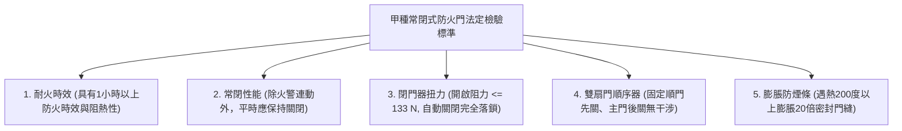
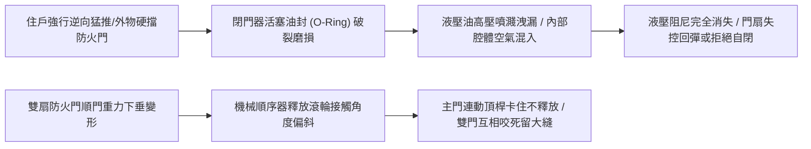
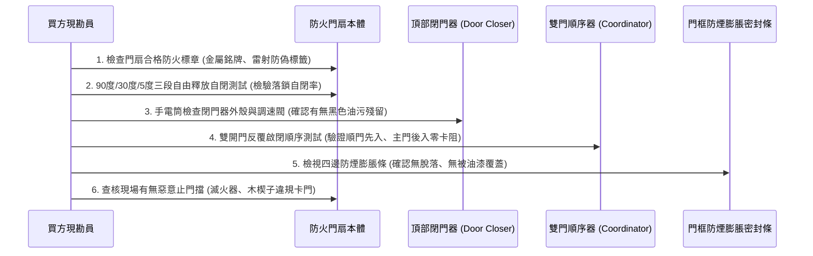
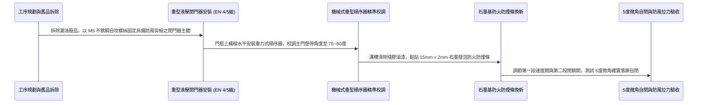

# 全案購屋實戰第一千零二十七部_中古大樓公共走廊常閉式甲種防火門閉門器油壓洩漏順序器咬死與防煙條膨脹炭化體檢工序全書

---

## 序章：防火區劃第一防線——常閉式防火門阻煙絕熱之生死分水嶺

在集合住宅的火災防護體系中，建築法規要求公共走廊通往安全梯間、特別安全梯排煙室或各戶進門玄關處，必須設置具備 1 小時以上防火時效與阻熱性之**「甲種常閉式防火門（Fire Door Assembly）」**。
防火門的核心使命，在於火災爆發時將火勢、高溫輻射熱（超過 $800^\circ\text{C}\sim 1000^\circ\text{C}$）以及致命劇毒濃煙，死死封鎖在起火戶或特定防煙區劃內，確保逃生梯間形成一條絕對安全的「垂直正壓避難通道」。

然而，在屋齡 20 年以上的中古大樓（包括本案主力評估之**大安紫金城 13 樓**、**長億南園 8 樓**、**歌德堡 8 樓**與**靜園 A 區 11 樓**）中，防火門常年處於被忽視甚至被惡意破壞的狀態：
1. **閉門器（門弓器）油壓洩漏爆油失靈**：液壓阻尼油漏光，導致門扇猛烈撞擊門框發出巨響，或因阻尼完全消失而無法完全關閉（常態留設 2~5 公分致命縫隙）；
2. **雙扇防火門順序器（Door Coordinator）卡死變形**：雙開式防火門關閉時，附帶蓋縫板之主門與順門順序顛倒咬死，兩扇門硬生生卡在半開狀態；
3. **門框防煙防火膨脹條（Intumescent Seal）脫落粉化**：密封膠條老化硬化，火災初期中溫濃煙自門縫肆無忌憚滲透倒灌逃生動線；
4. **住戶惡性以滅火器或止門擋阻卡防火門**：住戶為圖走廊通風涼爽或搬運方便，私自用門擋或大花盆長期將防火門卡在全開狀態，形同自廢武功！

本卷專門為買方建立中古大樓防火門組件之最嚴格現場實勘檢驗工序與加固維修標準作業程序（SOP）。

---

## 第一章：法規基準與甲種防火門核心功能幾何規範

依據《建築技術規則建築設計施工編》第 76 條「防火門窗之規定」及 CNS 11227-1「建築用防火門耐火試驗法」：



| 檢驗項目 | 法定安全基準規範 | 理想維護標準（高規格社區） | 中古大樓常見嚴重瑕疵（致命隱患） |
| :--- | :--- | :--- | :--- |
| **門扇自動關閉與落鎖** | 門扇開啟至任何角度釋放後，皆能**平順自動關閉並確實卡入鎖舌（Latch）**。 | 具備兩段式液壓微調（關門速度與上鎖緩衝速度），關門平順無撞擊聲。 | 釋放後因鎖舌阻力卡在門框外（留縫 3cm），無法完成自閉落鎖。 |
| **閉門器液壓阻尼** | 外殼密封完好，無漏油現象，阻尼曲線線性平順。 | 採用 EN 1154 標準認證、具備防風背檢（Backcheck）功能之重型閉門器。 | 閥芯周邊佈滿黑色黏稠漏油泥垢，液壓完全失效，關門如重鎚砸框。 |
| **雙扇門關閉順序** | 雙開門必須具備**重型機械式順序器**，確保順門先閉合、主門後閉合。 | 順序器作動精準，主門懸停機構靈敏，順門就位後主門順暢落下。 | 順序器彎曲卡死，主門先關導致蓋縫金屬邊條硬頂順門，雙扇卡死。 |
| **門縫間隙極限** | 門扇與門框、門扇與門扇之間隙不得大於 **3mm**。 | 全周配置耐火膨脹條＋防煙彈性膠條，間隙控制在 $2.0\sim 2.5\text{mm}$。 | 門縫間隙高達 6~10mm，光線直接透射，防煙性能形同虛設。 |
| **膨脹防煙密封條** | 遇高溫熱氣（約 $180\sim 200^\circ\text{C}$）能迅速發泡膨脹填滿門縫。 | 石墨基（Graphite）高膨脹防火條，膨脹倍率 $\ge 20$ 倍，表面包覆保護膜。 | 膠條完全脫落、或被歷年油漆重複塗刷硬化，完全喪失熱發泡能力。 |

---

## 第二章：閉門器洩漏與順序器機械卡死破壞機理

中古大樓防火門之關鍵五金，長期承受頻繁開關、住戶強行推拉與風壓衝擊，其失效機理如下：



### 2.1 閉門器（Door Closer）漏油與功能喪失
- **液壓阻尼原理**：閉門器依靠內部齒輪齒條活塞推動液壓油（抗磨液壓油），通過兩個微調閥（第一段關門速度閥 Speed Valve、第二段閉鎖力道閥 Latch Valve）產生精準阻尼。
- **失效原因**：
  - 住戶常私自用磚頭、滅火器卡住防火門。當外界強風吹襲或有人試圖強拉關門時，閉門器內部活塞腔體承受巨大異常液壓（超載峰值壓力達 $50\sim 80\text{ bar}$）。
  - 超額應力瞬間將橡膠油封（O-Ring）擠出撕裂，液壓油沿著調節螺絲螺牙或主軸旋轉面大量滲漏。失去油液後，內部彈簧變成純機械式鋼彈簧，關門速度失去控制，重達 60~80 公斤的鋼質防火門猶如斷頭台猛烈撞擊，極易夾斷兒童手指或砸爛門鎖鎖舌。

### 2.2 順序器（Door Coordinator）機械干涉卡死
- **雙扇防火門構造**：雙開防火門中央設有「蓋縫板（Astragal）」，必須由「順門（Inactive Leaf）」先關閉，隨後「主門（Active Leaf）」才能關閉並將蓋縫板壓緊密封。
- **卡死破壞**：若順序器（重型重力式或連桿式順序器）之擺臂滾輪磨損缺油，主門在順門尚未完全到定位前就提早釋放，主門蓋縫板硬生生撞在順門邊緣上，造成兩扇門在夾角約 30 度處死死咬合卡死。火災時，整條走廊濃煙順著這個 30 度的巨大缺口長驅直入逃生梯，直接切斷整棟大樓居民生路！

---

## 第三章：現場看屋實體檢驗標準工序（買方現勘 6 大檢測法）

買方現勘大安紫金城 13 樓、長億南園 8 樓公共逃生梯與梯廳時，應攜帶**厚薄規（塞尺）、捲尺、手電筒與指針拉力計**，依序執行以下 6 步檢測：



### 3.1 查核建築用防火門認證金屬銘牌
- 檢視防火門側邊（鉸鏈側或門頂）：
  - 必須鑲嵌有經濟部標準檢驗局認證之**金屬防火標籤銘牌**或中華民國防火門安全標章。
  - 標示項目需清楚載明：製造廠商、產品型號、耐火等級（如：**甲種防火門 / 具有 1 小時防火時效及 1 小時阻熱性**）、出廠序號。若無標章或僅是一般空心木門、鋁合金拉門，即屬重大違章建築瑕疵！

### 3.2 三段角度全自動自閉與鎖舌卡入測試
- **實地測試步驟**：
  1. 將防火門推開至 **90 度** 釋放：觀察閉門器是否平順帶動門扇緩步關閉，在最後 15 公分微速緩衝，並清脆「喀噠」一聲將斜舌完全送入鎖扣板（Strike Plate）內。
  2. 將門推開至 **30 度** 釋放：檢驗中行程扭力是否足夠克服風阻關門。
  3. 將門微開至 **5 度（約 10 公分）** 釋放：這是最嚴苛的檢驗點！劣質或油壓失效之閉門器在此微小角度完全無力，門扇常會停留在門框外 2 公分處無法閉合。合格之閉門器在此角度必須具備足夠的末段閉鎖力（Latch Action）確實落鎖。

### 3.3 閉門器本體「抓漏油」檢視
- 使用強光手電筒近距照射閉門器本體：
  - 觀察外殼底部、主軸轉向臂連接處、以及兩顆速度微調螺絲（Speed 1 / Speed 2）：
  - 若表面覆蓋厚厚一層黑褐色黏稠油泥，或滴落至門扇頂部形成油痕，代表內部液壓密封圈已徹底爆毀，該閉門器已宣告報廢，隨時會造成門扇自閉失效或猛烈撞擊。

### 3.4 雙扇門順序器連動無干涉檢驗
- 同時推開雙扇防火門至 90 度，先釋放「主門」，再釋放「順門」：
  - 觀察順序器是否確實擋住主門，讓主門在半空中「懸停等待」；
  - 直到順門完全關閉到位觸碰連桿釋放機構後，主門才平順落下關閉並壓合蓋縫板。若主門硬搶先關閉導致雙門卡死，直接列為公共安全重大缺失！

### 3.5 門框四邊耐火膨脹條檢驗
- 檢查門框內嵌溝槽之防火膨脹膠條：
  - 膠條應具備良好回彈彈性，無斷裂脫落。
  - 特別注意社區清潔工或油漆工在粉刷梯間時，是否偷懶**將油漆直接覆蓋在防火膨脹條上**。油漆塗層會將膨脹條微孔完全封死，遇火災高溫時阻礙化學發泡反應，使膨脹條無法發揮填塞門縫之防煙功能。

---

## 第四章：長億南園 vs 大安紫金城——公共防火動線實戰評測與談判策略

```mermaid
graph LR
    subgraph 長億南園8樓 (PROP_106)
        L1["長億南園單層梯廳寬敞"] --> L2["逃生梯防火門為標準甲種雙扇鋼門"]
        L2 --> L3["閉門器運轉平順且順序器無卡死"]
        L3 --> L4["梯間防煙區劃完整加分項!"]
    end

    subgraph 大安紫金城13樓 (PROP_10)
        D1["大安紫金城13樓為超高層集合住宅"] --> D2["特別安全梯需承受正壓機械排煙風壓"]
        D2 --> D3["閉門器需具備更強閉鎖力道抗風阻"]
        D3 --> D4["借驗收名義要求房仲調閱消防修繕單"]
    end
```

### 4.1 長億南園 8 樓：防火門區劃優良表現
- **實地動線查驗**：長億南園 8 樓各層安全梯之常閉式甲種防火門維護狀況良好，金屬檢驗標章清晰。經現場開合測試，門弓器阻尼適中，雙段關閉速度可精準微調，關閉時斜舌卡入鎖孔乾脆俐落；膨脹密封膠條平整未受油漆污染，梯間無住戶違規用門擋卡門之現象，公共安全防護扎實。

### 4.2 大安紫金城 13 樓：超高樓層正壓風阻抗力檢核
- **高樓層特殊風壓挑戰**：
  - 大安紫金城為 13 樓超高層住宅，其逃生梯設計多包含排煙室之特別安全梯。火災啟動排煙時，排煙風機會在排煙室與樓梯間建立微正壓以阻擋濃煙（壓差約 $25\sim 50\text{ Pa}$）。
  - 若防火門閉門器閉鎖力道不足（小於 EN 4 級或 5 級標準），在正壓風阻推擠下，防火門根本無法完全閉合，造成防煙壓差潰堤！
- **談判與查驗策略**：買方在出價斡旋與簽約前，應要求房仲向管委會調閱「最近一期消防設備師檢修申報書」，查核 13 樓特別安全梯防火門之閉門器與鎖扣密合度是否列為「合格合格」，確保高空火場逃生之終極生還率！

---

## 第五章：常閉式防火門閉門器換新與重型順序器校調工序（買方工法指引）

若社區需維修改造老化防火門五金，必須嚴格依循以下標準作業工序施作：



1. **頂級液壓閉門器規格選型**：
   - 防火門重量普遍達 $60\sim 90\text{ kg}$，嚴禁使用平價輕型閉門器。
   - 必須選用通過 **CE EN 1154 認證（力道等級 4 號或可調式 2~6 號）** 之防火門專用液壓閉門器（如德國 DORMA TS73V / TS83 或 GEZE TS4000）。
   - 具備**防風背檢功能（Backcheck）**：當住戶被強風猛烈推門時，閉門器能在 70 度以上產生反向液壓阻尼，防止門扇撞爛外牆。
2. **雙段速度閥（Speed & Latch）微調標準**：
   - **第一段關門速度閥（Speed Valve 1）**：控制門扇自 90 度關閉至 15 度之區間，調節關門時間為平穩的 **4 至 6 秒**。
   - **第二段閉鎖速度閥（Latch Valve 2）**：控制門扇自 15 度至 0 度之最後衝刺區間。必須在最後 5 公分提供足夠的加速微力，克服鎖舌斜面阻力與門縫空氣壓縮阻力，精準卡入鎖孔，同時杜絕金屬巨響。
3. **機械重力式順序器（Door Coordinator）安裝準則**：
   - 順序器安裝於門框頂部中心偏向主門側，其長擺臂支撐主門，短釋放觸桿對準順門頂部。
   - 實地調整釋放長度：當順門關閉至門縫小於 **8mm** 時，觸桿必須瞬間精準釋放主門擺臂，使主門順暢落下，兩扇門關閉交錯時間差控制在 **0.5 至 1.0 秒** 之內，天衣無縫！
4. **石墨基（Graphite）防火膨脹密封條施工**：
   - 徹底清除原有溝槽內的廢膠與灰塵，使用異丙醇擦拭脫脂。
   - 嵌貼厚度 2mm、寬度 15mm 之自粘型石墨防火膨脹密封條。該條遇熱 $180^\circ\text{C}$ 即刻迅速發泡膨脹 25 倍，將門扇四周所有細微縫隙徹底封死，達成完全氣密阻煙阻火！

---

## 結語：常閉固守，築起火海阻絕之鋼鐵長城

第一千零二十七部工序全書，將中古大樓公共走廊常閉式防火門之耐火隔離原理、閉門器漏油爆軸機制、雙門順序器卡死弊病、現場實勘六步檢驗法以及標準化德國 DORMA 級五金翻新工法徹底貫通。
防火門是火災來臨時全體住戶最重要的一道生死屏障，唯有常閉常靈，方能守護至親一生無憂！
