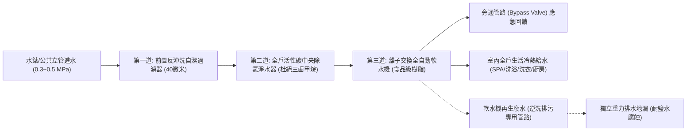
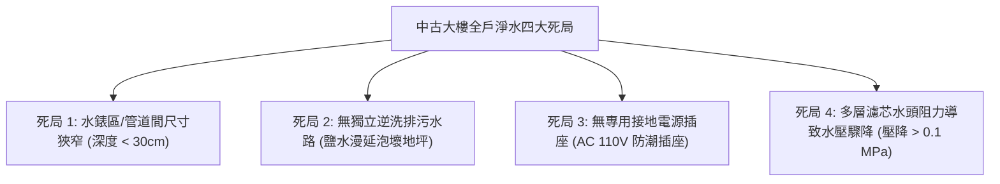
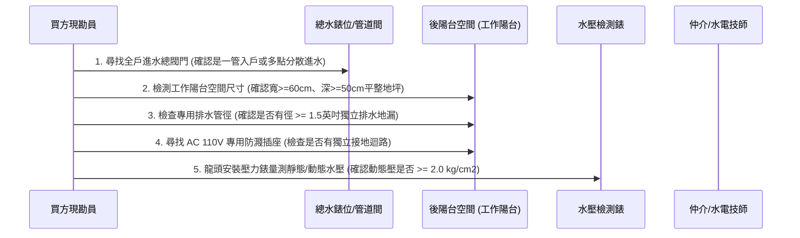
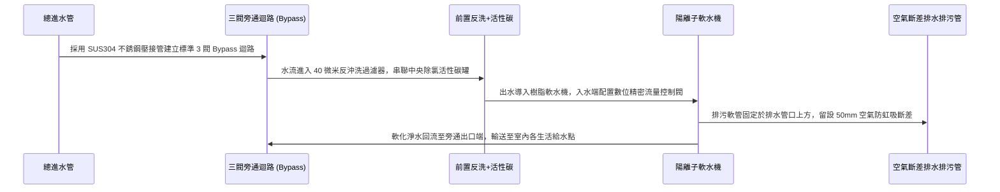

# 全案購屋實戰第一千零二十三部_中古大樓全戶中央淨水軟水與除氯系統安裝評估管道間進水主管空間狹窄逆洗排污管路缺乏與水壓衰減體檢工序全書

---

## 序章：全戶水質防禦——由源頭杜絕水垢、重金屬與氯氣傷害之實戰考驗

水是家庭日常生活的命脈。在台中都會區（特別是南區與周邊行政區），自來水主要取自大安溪、大甲溪或地下水源，原水硬度普遍偏高（總硬度常達 $150\sim 220\text{ mg/L}$，屬於中硬水至硬水範圍）。
高硬度水質與自來水廠消毒殘留之餘氯，在中古大樓中會產生三大長期危害：
1. **管線與設備結垢堵塞**：碳酸鈣與碳酸鎂在加熱設備（熱水器、電熱水瓶、洗碗機）內部迅速析出硬質水垢，降低熱效率達 30% 以上，並加速銅管或不銹鋼電熱管乾燒爆裂。
2. **衛浴龍頭與玻璃水斑**：淋浴拉門、精品水龍頭與磁磚縫隙沉積難以清除之白色石灰垢，縮短高級衛浴五金壽命。
3. **洗浴經皮吸收毒性**：自來水加熱至 40℃ 沐浴時，水中餘氯快速轉化為三鹵甲烷（THMs）揮發至浴室密閉空氣中，透過呼吸道與皮膚黏膜大量吸收，長期易引發過敏性皮膚炎、氣喘與落髮。

因此，為居家安裝一套「全戶中央淨水＋軟水系統（中央除氯微濾淨水器＋陽離子交換樹脂軟水機）」是現代高質感住宅翻修的核心標配。
然而，在購買中古大樓（如本案主力評估之**大安紫金城 13 樓**、**長億南園 8 樓**）時，許多買方往往在簽約交屋後才赫然發現：**公共管道間總進水管閥門周邊空間極度狹窄無法容納設備、陽台無進水水源、管道間缺乏專用排水口供軟水機定時逆洗排鹽水、以及加裝過濾筒後造成全室出水水壓嚴重衰減**，導致斥資數萬至十數萬元的淨水系統根本無法落地安裝！

本卷專門為買方建立全戶中央淨水軟水系統安裝可行性之最嚴格體檢工序與水路重構標準作業程序（SOP）。

---

## 第一章：全戶淨水軟水系統水力學架構與安裝硬體門檻

一套完整之全戶中央水處理系統，其標準水路拓撲與管路連接關係如下：



### 1.1 系統三大硬體設備規格與體積參數
1. **前置反沖洗過濾器（40 微米）**：
   - 功能：攔截自來水管網輸送過程中的泥沙、鐵鏽、懸浮物及大顆粒雜質，保護後端閥芯與樹脂。
   - 體積：約 $15\times 35\text{ cm}$，安裝於總進水管第一關。
2. **全戶中央活性碳除氯淨水器**：
   - 功能：內填進口椰殼顆粒活性碳（GAC）或壓縮碳棒，吸附自來水中之殘留餘氯、農藥、三鹵甲烷及揮發性有機物（VOCs）。
   - 體積：直徑約 $20\sim 25\text{ cm}$，高度約 $90\sim 120\text{ cm}$。
3. **全自動微電腦陽離子交換軟水機**：
   - 功能：利用鈉型陽離子交換樹脂（強酸性苯乙烯系樹脂），將水中的鈣離子（$\text{Ca}^{2+}$）、鎂離子（$\text{Mg}^{2+}$）置換為鈉離子（$\text{Na}^+$），達成全戶水質完全軟化（硬度降至 $0\sim 30\text{ mg/L}$）。
   - 配件：包含微電腦流量控制閥、樹脂罐及再生專用鹽箱（裝載高純度食品級軟水鹽錠）。
   - 體積：寬度約 $35\sim 45\text{ cm}$，深度約 $45\sim 55\text{ cm}$，高度約 $100\sim 120\text{ cm}$。

---

## 第二章：中古大樓安裝四大致命物理死局（買方痛點）

中古大樓設計之初往往未預留全戶淨軟水設備空間，現場普遍面臨以下四大結構性障礙：



### 2.1 死局 1：進水總管閥門空間不足
- **問題特徵**：在許多舊式大樓中，戶別水錶設於頂樓水錶區，或隱藏於樓梯間公共管道間內，進入室內的自來水總管僅露出一個 6 分或 1 英吋之閘閥（Gate Valve），管路緊貼壁面或被消防管、污水管重重包夾，四周淨空間深度小於 20 公分，根本無法容納直徑 40 公分以上之軟水機。
- **後果**：若強行安裝，必須破壞外牆公共管道間磚牆，遭管委會制止拆除；或只能退而求其次，在廚房流理台下方安裝小流量末端軟水機，無法實現衛浴泡澡及全室軟水。

### 2.2 死局 2：缺乏逆洗排污水路（致命缺失）
- **軟水機再生原理**：軟水機每處理 3~8 噸水後（約每週 1~2 次），控制閥會啟動「反洗（Backwash）、吸鹽（Brine Draw）、正洗（Fast Rinse）」之再生循環。每次再生過程需排出約 **150~250 公升** 夾帶高濃度鹽水與鈣鎂雜質之廢水，排放瞬間水流達 $10\sim 15\text{ L/min}$。
- **後果**：若管道間或安裝點附近沒有獨立排水地漏，再生廢水無法排出。若隨意引流至陽台雨水落水管，高濃度鹽水會腐蝕金屬落水頭，且一旦管道回堵，腐蝕性鹽水將漫延至室內木地板造成毀滅性泡水損壞！

### 2.3 死局 3：電源缺乏與高濕漏電風險
- 軟水機之全自動電腦控制閥需 24 小時供應交流電源（AC 110V/60Hz）。
- 頂樓水錶區或公共管道間通常完全沒有專屬電源插座；若由公共樓梯間照明電路私接偷電，涉及觸犯刑法竊盜公電罪，並極易遭鄰居投訴檢舉。

### 2.4 死局 4：濾芯阻力造成全室洗澡水壓衰減
- 自來水流經反沖洗濾網、高密度碳濾芯與緊密堆疊之陽離子樹脂顆粒層時，會產生高達 **$0.08\sim 0.15\text{ MPa}$（約 $0.8\sim 1.5\text{ kg/cm}^2$）** 的動態水頭壓力損失。
- 中古大樓高樓層（如 13 樓或 8 樓）原先水壓若僅有 $1.2\sim 1.5\text{ kg/cm}^2$，加裝軟水系統後，出水水壓直接腰斬至不到 $0.6\text{ kg/cm}^2$。結果導致強排熱水器無法點火、溫控水龍頭出水量變成涓涓細流、頂噴 SPA 花灑完全癱瘓。

---

## 第三章：現場看屋實體檢驗標準工序（買方現勘 5 步審查法）

買方現勘大安紫金城 13 樓、長億南園 8 樓時，應依據以下工序逐項核對安裝環境：



### 3.1 判別總進水管路拓撲（單點入戶 vs 多點入戶）
- **關鍵核對**：打開公共管道間檢修門或陽台總開關，確認全室生活用水是否由單一冷水總管進入室內。
- **老舊大樓隱性地雷**：部分 25 年以上早期大樓採用「前陽台進廚房、後陽台進衛浴」之雙向分散進水設計。若屬分散進水，除非在室內翻修時將給水總管重新刨地引導整合至工作陽台，否則無法以單一設備實現全戶過濾。

### 3.2 工作陽台實體安裝空間量測
- **安裝黃金點位**：工作陽台（後陽台）是全戶淨軟水系統的最佳安放位置（通風良好、便於搬運軟水鹽錠、維護保養直觀）。
- **空間尺寸極限**：
  - 淨寬度需 $\ge 65\text{ cm}$，淨深度需 $\ge 55\text{ cm}$，上方垂直高度需 $\ge 140\text{ cm}$（預留掀開鹽箱蓋倒鹽錠之操作空間）。
  - 設備不得阻礙洗衣機擺放、強排熱水器維修通道或遮擋瓦斯錶讀數。

### 3.3 逆洗排污水路落水孔檢驗
- 檢查陽台地漏是否具備**存水彎防臭機構**與**防蟲逆止閥**。
- 軟水機排污軟管出口必須以專用固定夾固定於排水管口上方，且管口與地漏液面之間必須保持至少 **5 公分之「空氣斷差（Air Gap）」**，嚴禁將排污軟管直接深插插入排污管底部，否則污水下水道在負壓抽吸時會產生虹吸逆流，將骯髒污水回吸倒灌至軟水機樹脂罐內，造成致命生活飲用水重度污染！

### 3.4 靜態水壓與動態壓降實測
- **操作方式**：將指針式水壓測試錶旋緊於洗衣機龍頭，打開龍頭記錄靜態水壓；隨即將廚房與淋浴龍頭同步全開，記錄動態水壓值。
- **判定標準**：
  - 靜態水壓若 $< 2.0\text{ kg/cm}^2$（$0.2\text{ MPa}$）：加裝淨軟水系統後必定水壓不足，必須將「增設全不銹鋼變頻靜音加壓泵」列入必要改裝清單。
  - 靜態水壓若在 $2.5\sim 3.5\text{ kg/cm}^2$ 之間：最理想工作壓力區間，無需加壓泵即可完美推動多級濾芯。

---

## 第四章：長億南園 vs 大安紫金城——水質水路實戰對比與談判策略

```mermaid
graph LR
    subgraph 長億南園8樓 (PROP_106)
        L1["後陽台面積達3.5坪極為寬敞"] --> L2["進水主管位於工作陽台轉角"]
        L2 --> L3["具備獨立洗衣機排水孔與專用電插"]
        L3 --> L4["完美相容旗艦級中央軟水設備!"]
    end

    subgraph 大安紫金城13樓 (PROP_10)
        D1["現況學生套房水路被分拆成多組"] --> D2["進水管線遭多道隔間牆掩埋"]
        D2 --> D3["需藉拆除翻修契機重新整合管線"]
        D3 --> D4["借35萬拆除折讓款全面重拉明管入陽台"]
    end
```

### 4.1 長億南園 8 樓：空間優勢之完美利用
- **實地水路評估**：長億南園室內主附 32 坪，其後工作陽台面積高達 3.5 坪，格局方正。自來水總管自後陽台管道間進入，轉角處擁有長 120cm、深 60cm 之充裕設備平台，旁側即有獨立地漏與 110V 接地插座，為安裝「前置反沖洗＋大通量活性碳＋25 升食品級樹脂全自動軟水機」之天選格局！
- **置產加分項**：大空間陽台使屋主無需犧牲洗衣晾衣空間，即可享受五星級飯店等級的絲滑軟水沐浴體驗。

### 4.2 大安紫金城 13 樓：翻修水路重建攻防
- **實地水路現況**：大安紫金城 13 樓現況為學生隔間套房出租，原有水路遭前手屋主改裝拆分為多條支管通往各分租套房衛浴，進水總閥被木作包覆隱蔽，且高樓層 13 樓水壓略顯疲軟。
- **談判與裝修結合戰術**：
  > 買方在斡旋時死咬「現況隔間破壞原始水路管線平衡、水電必須全面重新抽換」，成功爭取到 **35 萬元之隔間拆除折讓款**。
  > 接手後，拆除工程直接打除混亂暗管，由水錶端重新拉設一條 1 英吋熱浸鍍鋅外覆披覆不銹鋼（或白鐵披覆保溫管）進水主管，直通後陽台設備區；並加裝一台 **1/2HP 變頻恆壓靜音加壓泵（如葛蘭富 Scala2 或木川 KQ 系列）**，徹底解決 13 樓水壓問題，一次性建構出頂級中央水質處理體系！

---

## 第五章：標準化中央淨軟水管路施工標準工序（買方工法指引）



1. **三閥旁通管路（Bypass Manifold）標準工法**：
   - 設備進出水端必須施作標準「三閥旁通控制組」（進水閥、出水閥、旁通跨接閥）。
   - 當設備更換濾芯、樹脂反洗檢修或臨時缺鹽時，只需關閉進出水閥並開啟中央旁通閥，全戶供水立即切換為市政自來水直供，全屋用水 1 秒都不中斷。
2. **管材嚴格規範**：
   - 設備外露明管部分一律採用 **SUS304 不銹鋼雙卡壓管（壓接管）**，外包防結露保溫泡棉，嚴禁使用易受紫外線照射脆化之 PVC 塑膠管。
3. **食品級專用軟水鹽錠要求**：
   - 軟水機鹽箱內嚴禁添加食用精鹽、粗鹽或工業海鹽（因含碘化鉀、抗結塊劑及泥沙雜質，會使樹脂中毒劣化結塊）。
   - 必須使用純度 $\ge 99.5\%$ 之高壓成型球型食品級軟水專用高純度鹽錠，避免鹽箱底部形成鹽橋硬塊。
4. **水質硬度現場滴定校驗驗收**：
   - 完工後使用德國 Merck 或專用硬度滴定試劑（EDTA 滴定法）檢測出水硬度。合格標準：加入指示劑後水樣瞬間呈現清澈天藍色（總硬度 $< 17.1\text{ mg/L}$ 即 $1\text{ GPG}$），無任何紫紅色反應，方准點交驗收。

---

## 結語：源頭純淨，賦予生活無微不至的頂級呵護

第一千零二十三部工序全書，將全戶中央淨水軟水系統之水力學原理、空間尺寸極限、逆洗防虹吸排污規範、台中水質硬度因應以及水壓衰減補償徹底剖析。
透過在簽約前對水路條件的精準現勘，買方能提前避開「買了設備卻無法安裝」之尷尬窘境，更能巧妙將管線缺陷轉化為實質談判讓價籌碼，打造純淨無垢的健康居家堡壘！
