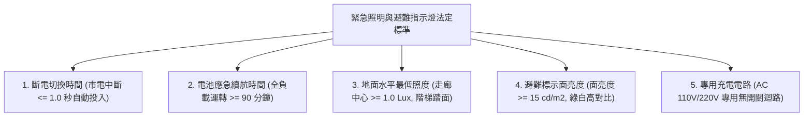
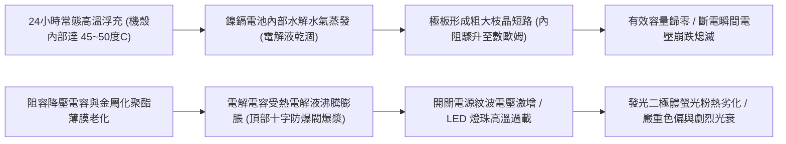
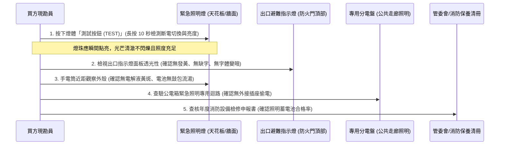
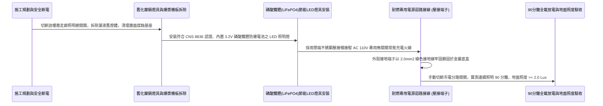

# 全案購屋實戰第一千零二十九部_中古大樓公共走廊緊急照明燈與出口避難指示燈鎳鎘蓄電池電解液乾涸LED發光二極體光衰與耐燃配線絕緣老化體檢工序全書

---

## 序章：火場黑暗浩劫——斷電黑夜中引導生還之最後光芒

在集合住宅發生火災、強烈地震或高壓變電設備短路爆炸時，整棟大樓的市電往往在第一時間全數切斷，走廊、各樓層梯廳與逃生樓梯間瞬間陷入伸手不見五指之漆黑絕境。
伴隨著滾滾竄入的有毒濃煙與刺鼻異味，受困住戶往往陷入極度恐慌、喪失方向感，甚至在推擠踩踏與梯級跌落中遭受致命創傷。

此時，安裝於公共走廊天花板、安全梯間轉角以及各防火門上方的**「緊急照明燈（Emergency Lighting）」**與**「出口避難方向指示燈（Exit & Direction Signs）」**，是整棟建築物指引住戶逃生方向、照亮梯級踏面之**最後一道生命光源**！

依據消防法規，當市電斷電瞬間，所有指示燈與緊急照明燈必須在 **0.5 秒至 1.0 秒內無縫切換為蓄電池自備電源供電**，並維持**至少 90 分鐘以上**的持續有效照度。
然而，在屋齡 20 年以上的中古大樓（包括本案主力評估之**大安紫金城 13 樓**、**長億南園 8 樓**、**歌德堡 8 樓**與**靜園 A 區 11 樓**）中，這套生命光源系統卻普遍存在嚴重的「光衰死機」黑洞：
1. **內部鎳鎘（Ni-Cd）/ 鎳氫（Ni-MH）蓄電池電解液乾涸**：常年處於 AC 110V/220V 浮充充電狀態，電池電解液沸騰蒸發、極板硫化短路，一旦斷電，照明燈亮不到 30 秒便直接熄滅；
2. **早期傳統鎢絲燈泡與鹵素燈杯鎢絲斷裂**：燈絲在高溫浮充與震動下斷裂，斷電時根本無法發光；即便是早期 LED 燈珠，亦因散熱不良產生嚴重光衰，照度不到法規標準的十分之一；
3. **充電控制機板阻容降壓電容爆漿與整流二極體擊穿**：老舊機板零件碳化漏電，表面綠色電源指示燈亮著假象，內部其實早已斷電；
4. **耐燃耐熱供電迴路缺乏獨立接地**：天花板上方線路混接、絕緣阻抗衰退，一旦短路甚至淪為火警誘發源。

本卷專門為買方建立公共走廊與逃生動線緊急照明與避難指標之最嚴格現場實勘工序與功能測試標準作業程序（SOP）。

---

## 第一章：法規基準與緊急照明指示燈核心光電物理指標

依據《各類場所消防安全設備設置標準》第四條、第 170 條至第 174 條及 CNS 8836「緊急照明燈」標準：



| 檢驗項目 | 法定安全基準規範 | 理想維護標準（高規格社區） | 中古大樓常見嚴重瑕疵（致命隱患） |
| :--- | :--- | :--- | :--- |
| **市電斷電切換時間** | 市電中斷後，應於 **1 秒內** 自動切換由內部電池供電。 | 固態電子繼電器無縫切換，時間 **$< 0.1\text{ 秒}$**，視覺無延遲。 | 切換繼電器接點氧化卡死，斷電後完全不亮，需手動敲擊才亮。 |
| **蓄電池緊急照明時間** | 全載照明時間不得小於 **90 分鐘**（早期標準 30 分鐘已修訂淘汰）。 | 採用優質磷酸鐵鋰電池，全載續航達 **120 ~ 180 分鐘**。 | 電池電解液乾涸，斷電亮 5 秒即熄滅，或只能發出微弱紅光。 |
| **走廊與梯階最低照度** | 走廊地面中心線照度 $\ge 1.0\text{ Lux}$；樓梯踏面照度 $\ge 1.0\text{ Lux}$。 | 採用廣角光學透鏡 LED，地面照度達到 **$5.0\sim 10.0\text{ Lux}$**。 | 燈頭光線發散且光衰，地面實測照度 $< 0.1\text{ Lux}$，看不清階梯。 |
| **指示燈標示面亮度** | 出口標示面平均亮度不得低於 **$15\text{ cd/m}^2$**，且均勻度 $> 0.7$。 | 採用冷光 LED 導光板面板，表面亮度 $\ge 60\text{ cd/m}^2$。 | 壓克力面板發黃脆化、內部燈珠半數燒毀，字體模糊無法辨識。 |
| **充放電管理與指示燈** | 燈體外觀應配置「充電指示燈（紅）」與「手動測試按鈕（Test）」。 | 具備微電腦智能自檢晶片，每月自動放電活化電池並回報異常。 | 測試按鈕按下無反應，充電指示燈被油漆工人整面覆蓋塗黑。 |

---

## 第二章：蓄電池電解液乾涸與機板爆漿光衰失效機理

中古大樓公共走廊之緊急照明設備，全年 365 天、每天 24 小時接駁市電處於「待命浮充狀態」，其內部化學與電子零件的老化機理如下：



### 2.1 鎳鎘（Ni-Cd）電池電解液乾涸與枝晶短路
- **化學原理**：傳統緊急照明燈採用 3.6V 或 4.8V 鎳鎘/鎳氫電池組。在長期浮充過程中，充電微電流會使水溶液電解質持續發生電解微水解反應：
  $$\text{H}_2\text{O} \xrightarrow{\text{電解}} \text{H}_2\uparrow + \frac{1}{2}\text{O}_2\uparrow$$
- **乾涸與短路**：封閉式電池之安全防爆閥在長達 5 至 8 年的持續微超壓下微量洩氣，導致氫氧化鉀（$\text{KOH}$）電解液徹底乾涸。失去電解質後，鎘晶體在電極表面生成金屬刺狀枝晶（Dendrites），直接穿刺隔膜造成內部物理短路，電池蓄電容量衰退至趨近於零！

### 2.2 阻容降壓電容爆漿與充電電路癱瘓
- 早期平價緊急照明燈為節省空間與成本，未採用隔離變壓器或高頻開關電源，普遍採用廉價之**「阻容降壓（RC Buck）」電路**。
- 阻容降壓電容（X2 安規電容）常年承受市電浪湧電壓（Surge）衝擊，電容量嚴重衰退（由 $1.0\mu\text{F}$ 衰減至 $0.2\mu\text{F}$），導致充電電流不足，蓄電池常年處於「飢餓虧電狀態」；而電路板上的濾波電解電容在機殼內部 $50^\circ\text{C}$ 的密閉高溫下，內部電解液沸騰乾涸，頂部防爆凹槽鼓起爆漿，噴出腐蝕性棕褐色酸液腐蝕銅箔線路，造成機板永久損毀。

### 2.3 LED 燈珠熱衰減與光通量腰斬
- 許多中古大樓在後期更換為早期 LED 照明燈，但燈體採用廉價塑料外殼，完全無鋁合金散熱片。
- LED 晶片接面溫度（Junction Temperature, $T_j$）長期突破 $90^\circ\text{C}$，導致封裝用環氧樹脂黃化變質、螢光粉加速老化，光通量在 2 年內光衰超過 60%，光線由原本的明亮白光退化為昏暗幽綠的微弱散光。

---

## 第三章：現場看屋實體檢驗標準工序（買方現勘 5 步穿透法）

買方現勘大安紫金城 13 樓、長億南園 8 樓公共梯間時，應隨身攜帶**照度計（Lux Meter）、手電筒、秒錶與絕緣手套**，依循以下 5 步標準工序實地檢驗：



### 3.1 手動測試按鈕（TEST Button）10 秒瞬態檢測
- **操作手法**：抬手按住緊急照明燈本體側邊或下方的**「TEST 手動測試按鈕」**，持續按壓不放 **10 秒鐘**：
  - **合格標準**：按下按鈕瞬間（市電模擬中斷），雙燈頭 LED 應於 0.5 秒內瞬間發出耀眼白光；持續按壓 10 秒期間，光線穩定無閃爍、無衰減、燈體無焦臭異味。
  - **故障判定**：
    1. 按下按鈕完全不亮（電池早已死透或燈泡燒毀）；
    2. 按下瞬間亮起，但 3~5 秒內光線迅速變暗至微弱紅光熄滅（典型的蓄電池電解液乾涸現象）；
    3. 燈光劇烈高頻閃爍（電容爆漿濾波失效）。

### 3.2 逃生出口避難指示燈面板發光度與文字完整性
- 檢查安全梯門框上方之「EXIT 出口指示燈」及走廊轉角之「避難方向指示燈」：
  - 壓克力面板底色應為鮮豔之綠色（防火門出口）或白色（避難方向），綠白圖標對比清晰。
  - 面板不得有嚴重發黃、開裂、油漆覆蓋或受熱變形痕跡。
  - 燈體內部所有 LED 應均勻發光，嚴禁出現「左半邊亮、右半邊暗」或文字筆劃缺漏之現象。

### 3.3 照度計現場地面落差實測
- **測量手法**：在傍晚或關閉公共走廊局部日光燈之狀態下，按下緊急照明燈測試按鈕，將數位照度計探頭平置於地面中心線及樓梯踏步邊緣。
- **判讀準則**：
  - 走廊地面實測照度需 $\ge 1.0\text{ Lux}$；
  - 樓梯轉折平台及每階踏面實測照度需 $\ge 1.5\text{ Lux}$。
  - 若照度計顯示 $< 0.5\text{ Lux}$，代表長輩或孩童在火場濃煙黑暗中極易踩空滾落樓梯重傷！

### 3.4 電池倉外觀與液漏腐蝕檢查
- 使用手電筒近距觀察照明燈底部散熱孔與接縫處：
  - 若散熱孔周圍出現**白色結晶粉末、淡黃色黏稠液痕或塑膠外殼受熱鼓包變形**，代表內部鎳鎘電池已發生極度危險之酸鹼液洩漏，腐蝕性液體隨時會引發電路短路起火，此設備必須即刻報廢更換。

---

## 第四章：長億南園 vs 大安紫金城——動線照明安全實戰評測

```mermaid
graph LR
    subgraph 長億南園8樓 (PROP_106)
        L1["長億南園梯廳具備大面積採光天窗"] --> L2["日間逃生自然光充裕"]
        L2 --> L3["夜間走廊配置新式LED避難指示燈"]
        L3 --> L4["按下TEST測試鍵亮度充足加分項!"]
    end

    subgraph 大安紫金城13樓 (PROP_10)
        D1["大安紫金城13樓長廊縱深較長"] --> D2["特別安全梯需高度仰賴緊急照明導引"]
        D2 --> D3["全面實測走廊轉折處指示燈電池續航"]
        D3 --> D4["要求房仲出具消防檢修申報合格清單"]
    end
```

### 4.1 長億南園 8 樓：日間採光與指示燈升級優勢
- **實地查核成果**：長億南園 8 樓公共梯間擁有開闊天井採光窗，日間逃生視野良好；其公共走廊之緊急照明燈與出口避難指示燈，近年已由管委會統一部署更換為符合最新消防標準之「低功耗超高亮度 LED 冷光型指示燈」。經現場長按 TEST 鍵實測，雙燈頭瞬間爆發強勁白光，地面照度達 $8.5\text{ Lux}$，逃生照明防線完整穩固。

### 4.2 大安紫金城 13 樓：長走廊高空逃生之極致查驗
- **高空風險核心**：大安紫金城 13 樓屬於高層住宅，各戶出門至特別安全梯間之公共長廊縱深較長，且內部排煙室無自然採光窗，夜間一旦斷電，走廊將陷入絕對漆黑。
- **買方斡旋談判策略**：
  > 買方在斡旋期間，應將「13 樓走廊緊急照明燈與指示燈蓄電池續航合格」納入向管委會調閱資料之清單：
  > 「周小姐，大安紫金城 13 樓我們勢在必得，目標價鎖定 768~788 萬。但 13 樓走廊無窗戶採光，夜間逃生 100% 依賴緊急照明燈。請賣方或管委會出具最新一期消防安全檢修清冊，確認該樓層所有緊急照明燈與避難指示燈之『電池全載放電 90 分鐘試驗』皆全數列為無缺失合格，確保高樓層全家避難動線萬無一失！」

---

## 第五章：緊急照明燈全系列升級磷酸鐵鋰與標準安裝工序（買方工法指引）

若社區需維修改造公共照明系統，應嚴格依循以下標準作業工序施作：



1. **電池材質全面革命升級（磷酸鐵鋰 LiFePO4）**：
   - 嚴格禁止再次採購淘汰之鎳鎘電池！全面升級為 **3.2V 磷酸鐵鋰防爆電池組（LiFePO4）**。
   - 磷酸鐵鋰電池具備耐高溫（$65^\circ\text{C}$ 下不分解）、零記憶效應、充放電循環壽命達 2000 次以上（使用壽命長達 8~10 年），徹底杜絕電解液乾涸漏液與爆漿短路之後遺症。
2. **光學透鏡與 LED 晶片規範**：
   - 選用一級廠牌（如飛利浦/歐司朗晶片）高發光效率 SMD LED（光效 $\ge 120\text{ lm/W}$），色溫建議採用 $4000\text{K}\sim 5000\text{K}$ 暖白光（穿透濃煙能力遠強於 $6500\text{K}$ 刺眼冷藍光）。
   - 燈頭配置高透光率 PMMA 雙向蝙蝠翼非對稱光學透鏡，將光線精準投射於地面走廊中心，杜絕眩光並擴大照射半徑至 6 公尺以上。
3. **專用供電迴路接線規範**：
   - 緊急照明燈之電源必須接自**公共電錶箱之專用無切斷開關迴路（常時通電迴路）**，嚴禁與一般走廊壁切開關或感應燈混接，防止住戶隨手關燈造成照明燈常態斷電放電耗盡。
   - 電線接頭一律使用阻燃型閉端壓接端子（CE-2X），外覆熱收縮套管雙層絕緣，嚴禁使用易受潮鬆脫之普通黑膠布纏繞。
4. **90 分鐘全載放電極限實兵驗收**：
   - 完工後，現場關閉該樓層分電盤之緊急照明專用無熔絲開關（NFB）：
     1. 全棟或該層所有指示燈與緊急照明燈必須在 **0.5 秒內** 瞬間全數點亮；
     2. 以秒錶計時連續全載點亮 **90 分鐘整**；
     3. 90 分鐘到達瞬間，以照度計量測地面中心線照度，數值必須維持在 **$\ge 1.0\text{ Lux}$**（照度衰減率不得大於初始照度之 40%）；
     4. 恢復市電供電後，紅色充電指示燈立即亮起，燈體自動切入充電模式，方准點交驗收！

---

## 結語：光明永駐，點亮黑夜浩劫中唯一的生機

第一千零二十九部工序全書，將中古大樓公共走廊緊急照明與出口避難指示燈之光學物理標準、蓄電池乾涸失效機理、機板爆漿熱衰減、現場實勘五步穿透手法以及標準化磷酸鐵鋰升級工藝徹底講透。
這盞微小而堅毅的生命之燈，在火海黑夜中，是引領全家人化險為夷、走向光明的終極希望！
