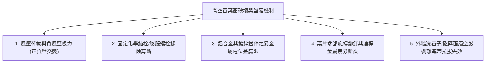
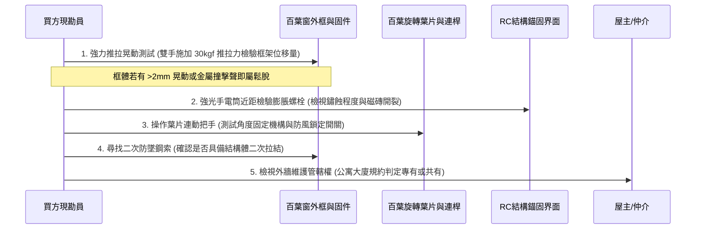
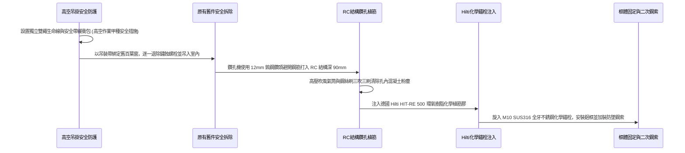

# 全案購屋實戰第一千零二十二部_中古大樓外牆高空外遮陽防颱百葉窗抗風壓脫落固定膨脹螺栓金屬疲勞與高空墜落傷人防護體檢工序全書

---

## 序章：高空百葉窗防護——極端氣候風壓與高空墜落安全之實戰檢驗

在台灣氣候環境中，中古大樓長期面臨夏季強烈颱風、梅雨季暴雨以及強烈季風之侵襲。
許多中古大樓在興建時或住戶在後期裝修時，廣泛在冷氣室外機格柵、工作陽台外圍、衛浴排風口或採光遮陽外牆上，安裝「鋁合金固定/活動式外遮陽防颱百葉窗」。

然而，百葉窗長期懸掛於 8 至 15 樓高空（如本專案主力關注之**大安紫金城 13 樓**、**長億南園 8 樓**、**歌德堡 8 樓**與**靜園 A 區 11 樓**），其迎風面瞬間陣風風壓極為驚人（強颱瞬間陣風常達 16~17 級，風壓高達 $300\sim 500\text{ kgf/m}^2$）。
一旦固定框架之膨脹螺栓（壁虎）發生電化學鏽蝕、外牆 RC 結構孔洞崩裂，或是百葉葉片鉚釘金屬疲勞脫落，整座重達數十公斤的金屬百葉窗將自高空瞬間墜落，造成樓下行人傷亡或砸毀停放車輛之重大公共安全災難，其刑事過失致死罪責與數百萬民事侵權賠償責任，將直接由所有權人（買方）全權承擔！

本卷專門為買方建立中古大樓「外牆高空外遮陽防颱百葉窗」之最嚴格檢驗工序與加固驗收標準作業程序（SOP）。

---

## 第一章：高空風壓動力學與百葉窗破壞機理



### 1.1 高樓層正壓與背風側渦旋負風壓（吸拔效應）
- **高空風速梯度**：建築物高度越高，風速受地面摩擦阻力越小，風速呈指數級上升。10 樓以上之風壓往往是 1 樓地表的 1.8 至 2.5 倍。
- **正負交變動態衝擊**：當颱風氣流吹過建築物轉角處時，會在百葉窗外側產生極大的「負風壓吸力」（吸拔效應），其數值往往超過迎風面正壓的 1.5 倍。這種高頻率的正推、負吸交變震盪，會在固定螺栓與結構體之間形成反覆的剪切與拉拔疲勞應力。

### 1.2 異金屬電位差腐蝕（Galvanic Corrosion）
- 中古大樓外遮陽百葉窗框架本體多為**鋁合金（6063-T5）**，但昔日水電工或鐵工在安裝時，為圖省工與低成本，往往使用廉價的**鍍鋅鐵質壁虎（膨脹螺栓）或一般碳鋼自攻螺絲**。
- 鋁與鐵的標準電極電位差達 $1.22\text{ V}$。當雨水、酸雨或空氣中的氯離子（台中都會區空氣中懸浮微粒與水氣）滲入螺栓孔隙時，鋁與鐵接觸面形成原電池效應，活性較高之鋁金屬迅速成為陽極發生劇烈電蝕穿孔、粉化，而鐵質螺栓則氧化膨脹鏽死、有效截面積縮減，最終在強颱陣風下拉拔剪斷。

---

## 第二章：法規結構抗風壓標準與合格工藝幾何規範

依據《建築技術規則建築構造編》第四章「風力工程」及 CNS 11526「門窗抗風壓性試驗法」：

| 檢驗項目 | 中高樓層法定耐風壓基準 | 頂級安全防護設計標準 | 中古大樓常見嚴重瑕疵（致命隱患） |
| :--- | :--- | :--- | :--- |
| **抗風壓強度等級** | 需達 **$360\text{ kgf/m}^2$ ($3600\text{ Pa}$)** 以上（承受 16 級強陣風）。 | 採用高抗風型鋁百葉，耐風壓達 **$450\text{ kgf/m}^2$ ($4500\text{ Pa}$)**。 | 採用室內用輕型格柵百葉充當外遮陽，耐風壓不到 $160\text{ kgf/m}^2$。 |
| **結構固定件材質** | 必須全面採用 **SUS304（或 SUS316）不銹鋼** 膨脹螺栓或化學錨栓。 | 採用德國 Fischer / Hilti SUS316 結構化學錨栓，抗拉拔力 $\ge 1500\text{ kgf}$。 | 採用電鍍鋅平價鐵壁虎，螺絲頭已鏽蝕成黑褐色鐵屑。 |
| **螺栓錨固深度** | 錨固於 RC 結構實體層深度不得小於 **65mm**。 | 錨固深度達 **80 ~ 100mm**，避開表面磁磚粉刷層。 | 螺栓僅打入外牆粉刷層或磁磚（深度僅 20~30mm），手搖即鬆動。 |
| **固定點間距** | 外框四周固定點間距不得大於 **50 公分**，四角轉角處 15 公分內必設。 | 固定點間距控制在 **40 公分以內**，雙螺栓並聯固定。 | 1.5 米長之百葉窗兩側僅各打 2 顆螺絲，中間跨距過大。 |
| **防墜鋼索配置** | 應配置獨立之 **不銹鋼防墜安全鋼索（Safety Wire）**。 | 外框與主樑結構以 $\phi 4\text{mm}$ SUS316 鋼索二次拉結。 | 完全無二次防墜鋼索，螺栓一斷整扇窗直接砸向地面。 |

---

## 第三章：現場看屋實體檢驗標準工序（買方現勘 5 大穿透手法）

買方現勘高樓層物件（如大安紫金城 13 樓、長億南園 8 樓工作陽台與外牆）時，應依照以下 5 步標準工序嚴格查驗：



### 3.1 雙手雙向推拉晃動測試（動態結構檢驗）
- **操作手法**：打開陽台窗戶，雙手握住外遮陽百葉窗框架兩側中段，分別向外用力推、向內用力拉（施加約 $20\sim 30\text{ kgf}$ 之交變力量），同時上下垂直晃動。
- **合格標準**：框體與牆體之間必須紋絲不動，無任何相對位移，螺栓連接處不得發出「喀喀」金屬鬆動摩擦聲。
- **不合格判定**：若推拉時框架有明顯位移（超過 2mm），或看見螺栓周邊有粉刷白灰、水泥碎屑掉落，代表錨固端已經粉化鬆脫，屬於極度危險之墜落前兆！

### 3.2 錨固螺栓金屬鏽蝕與介面開裂檢查
- **檢驗要點**：使用高流明強光手電筒搭配放大鏡，近距離觀察固定角鐵與膨脹螺栓頭部：
  1. **螺栓外觀**：螺栓頭若已產生厚重紅褐色鐵鏽膨脹，甚至螺牙已經風化，代表內部螺桿截面已被腐蝕殆盡。
  2. **磁磚與混凝土開裂**：檢查螺栓打入處周圍半徑 10 公分內的外牆磁磚或水泥，是否出現放射狀裂紋（蜘蛛網狀開裂）或磁磚空鼓隆起。若有裂紋，風雨浸泡下混凝土握裹力歸零，隨時可能連磚帶窗整面扯脫。

### 3.3 葉片翻轉機構與防風自鎖功能
- **連桿機構體檢**：操作百葉窗手搖把手或角度調節連桿。翻轉葉片至全閉狀態時，檢查葉片重疊密合度（Overlap 应 $\ge 15\text{mm}$），並確認防風自鎖定位銷是否確實卡入止動槽。
- **防止風嘯噪音**：若葉片軸套塑料襯套老化碎裂，葉片將處於自由晃動狀態。當風速達到 5 級以上時，葉片將產生劇烈高頻震顫撞擊，發出震耳欲聾的尖銳金屬嘯叫聲，嚴重破壞夜間睡眠品質。

### 3.4 二次防墜安全鋼索（Safety Tether）核查
- 檢查百葉窗鋁合金主框架是否以直徑至少 $3.0\sim 4.0\text{mm}$ 之 SUS304 不銹鋼包膠鋼索，穿過框體預留加強孔，並牢牢錨固在室內側樑柱實體 RC 上。
- 具備二次防墜鋼索之百葉窗，即使外牆固定螺栓因不可抗力強烈地震或極端颱風全數拔出，整扇百葉窗仍會被鋼索緊緊拉住懸掛於窗內，絕不會墜落地面傷人，此為高樓層防護之終極保險。

---

## 第四章：長億南園 vs 大安紫金城——高空防風抗災實戰比對與談判策略

```mermaid
graph LR
    subgraph 長億南園8樓 (PROP_106)
        L1["工作陽台加裝傳統鋁百葉"] --> L2["角鐵螺栓已現鏽蝕黃斑"]
        L2 --> L3["無二次防墜鋼索存在安全疑慮"]
        L3 --> L4["要求扣除高空防墜加固費3萬元"]
    end

    subgraph 大安紫金城13樓 (PROP_10)
        D1["13樓高空風壓強勁"] --> D2["檢視冷氣外機格柵原廠錨固"]
        D2 --> D3["全面要求更換SUS316化學錨栓"]
        D3 --> D4["安全防線萬無一失"]
    end
```

### 4.1 長億南園 8 樓之百葉老化與折讓攻防
- **實況查驗發現**：長億南園 8 樓之後陽台外側安裝有後期加裝之活動防颱百葉窗，經現場實測，固定角鐵採用平價鍍鋅鐵片，螺絲周邊已有明顯黃褐色鐵鏽滲流痕跡，且未設置二次防墜鋼索，於高空 8 樓迎風面存在高空墜落風險。
- **談判開口話術**：
  > 「周小姐、賣方屋主，這間 8 樓後陽台加裝的防颱百葉窗，我們用強光手電筒看得很清楚，固定角鐵用的是一般會生鏽的鐵壁虎，現在螺絲周圍已經有鏽蝕流黃水的狀況，而且完全沒有做防墜拉繩。8 樓高度如果颱風天吹落下去，砸到樓下中庭或行人，法律責任非常重大。重新請專業高空蜘蛛人施作不銹鋼化學錨栓全面加固或拆除，至少要花 2~3 萬元。這個安全隱患屋主必須在總價上直接折讓給我們，由我們買方接手後全面重新加固！」

### 4.2 大安紫金城 13 樓之超高空風壓防護
- **防禦策略**：大安紫金城位處 13 樓超高樓層，周邊無更高建物遮蔽，風壓直擊室內。簽約前除確認冷氣室外機懸掛處之原廠格柵百葉錨固牢固外，更應在交屋後室內裝修期間，同步委由施工隊將外牆所有百葉窗固定點全面升級為 SUS316 不銹鋼化學錨栓，並增設 $\phi 4\text{mm}$ 不銹鋼防墜鋼索，達成百年不墜之極致安全標準。

---

## 第五章：高空百葉窗拆卸換新與抗颱加固標準工序（買方工法指引）

若買方購入中古物件後需對外遮陽百葉窗進行安全加固或翻新，必須嚴格依據以下高空作業安全工序施工：



1. **高空作業安全規範**：
   - 凡於外牆 2 公尺以上高空進行百葉窗施工，施工人員必須具備高空繩索作業證照，並架設**雙獨立錨點生命線**與全身防墜安全帶。
   - 地面作業區下方垂直投影半徑 5 公尺範圍內必須拉設警戒帶，並派專人指揮警戒，嚴防工器具或螺絲墜落。
2. **鑽孔與清孔工序（化學錨栓核心成敗）**：
   - 使用金屬探測器避開樑柱主筋，於堅實 RC 結構面鑽孔，鑽孔直徑 12mm、深度至少 **90mm**。
   - **嚴格執行「三吹三刷」**：使用高壓無油吹塵氣筒與專用圓形鋼絲刷，反覆吹出孔內粉塵並刷除孔壁殘留浮灰，確保化學膠體能與混凝土晶體形成分子級緊密咬合。
3. **注入化學錨固膠與固化**：
   - 採用結構用注射式環氧樹脂化學膠（如 Hilti HIT-RE 500 或 Fischer FIS EM Plus）。
   - 膠體由孔底均勻注至孔深 2/3 處，隨即旋轉推入 M10 SUS316 不銹鋼全牙螺桿。在室溫 25℃ 下嚴格靜置固化至少 4 小時，固化期間嚴禁碰觸或晃動螺桿。
4. **外框加裝耐震彈性墊片與防墜鋼索**：
   - 鋁合金外框固定孔與不銹鋼螺栓墊圈之間，加裝 **EPDM 耐候三元乙丙橡膠減震墊片**，隔絕鋁鐵異金屬直接接觸，阻斷電化學腐蝕路徑，並吸收強風高頻震動。
   - 於鋁窗頂部兩端穿入兩條 $\phi 4\text{mm}$ SUS316 軟性包膠鋼索，另一端利用膨脹吊環螺栓固定於室內頂樑結構，預留 5 公分微鬆弛量，完成雙重高空防墜安全網。

---

## 結語：固若金湯之高空防禦，杜絕天降橫禍之風險

第一千零二十二部工序全書，將高空外遮陽防颱百葉窗之抗風壓動力學、電化學腐蝕破壞、現場推拉晃動檢驗手法以及標準化化學錨栓加固工序徹底貫通。
這份防護指南不僅為您的家庭置產構築起抵禦極端颱風暴雨的堅實屏障，更從法務與安全根本上，彻底杜絕高空墜物傷人毀車的致命隱患！
