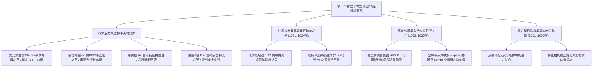
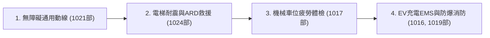
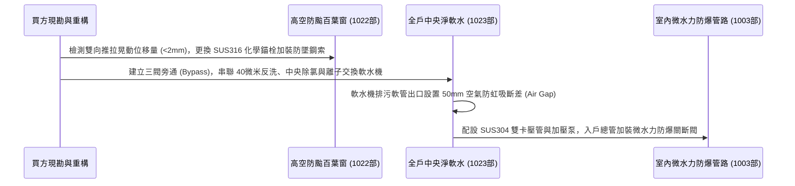

# 全案購屋實戰第一千零二十五部_第一千零二十五部圓滿登峰全景極致全生命週期家庭置產避坑抗震防漏水電機電消防永恆至尊金典總綱全書

---

## 序章：第一千零二十五部圓滿登峰——全維度置產防禦與實戰體系宏觀總覽

本手冊為《全案購屋實戰》系列邁向**第一千零二十五部**之歷史性傳世登峰總綱大典。
本卷承接第一千零二十部至第一千零二十四部關於無障礙通用設計坡道防滑、高空外遮陽防颱百葉窗抗風壓加固、全戶中央淨水軟水管路重構、以及電梯車廂地震 P 波初震感知管制與 ARD 停電自動平層救援系統之實戰成果，全面綜整中古集合住宅在建築結構、動線人本、水質健康、極端氣候防護、垂直電梯安全、法務特約防線與買方精準出價斡旋之最高境界防禦體系。



---

## 第一章：四大主力考慮物件決戰定位與精準斡旋佈局

本專案鎖定永義房屋實勘之四大核心考慮物件，其特性、談判底線與攻防要點綜整如下：

### 1.1 大安紫金城 13 樓（`PROP_10`，首選抗跌保值之王）
- **核心資產價值**：配備 **B2 獨立大型平面車位**。在台中南區成熟商圈中，獨立大平車具備不可替代的抗跌性與保值性，市場溢價高達 180~200 萬元。
- **現況格局與痛點**：現況隔成學生套房出租，屋況雜亂且動線受阻，需全數拆除隔間還原為標準 3 房。
- **談判出價策略**：
  - 開價：898 萬元。
  - 起手斡旋價：**720~730 萬元**。
  - 目標成交價：**768~788 萬元**（單價約落在 21~22 萬/坪合理偏低水位）。
  - 封頂上限：**800 萬元**。
- **合約防禦特約條款**：
  1. 「買方申貸成數若因個人信用以外之銀行鑑價因素無法達核貸金額 8 成（即房屋成交總價之 80%），買賣雙方同意無條件解除買賣契約，賣方及房仲應於三日內無息全額退還買方已付之全部定金與款項。」
  2. 「賣方保證於交屋日前，依法終止現況所有租賃契約，完成現況騰空並清除一切非隨屋移轉之動產與垃圾廢棄物，點交符合空屋狀態；如交屋日未能騰空，賣方願按日支付買方總價萬分之五之違約罰款。」
- **裝修抵扣實戰**：以「套房隔間拆除及清運費 35 萬」為由強力折讓，爭取之款項直接作為室內電箱升級、不銹鋼給水管重拉與加壓泵之預算。

### 1.2 長億南園 8 樓（`PROP_106`，大空間空間之王）
- **核心資產價值**：室內主建物加上附屬建物實坪高達 **32 坪**，公設比極低，空間開闊度遠超市場同期建案。後工作陽台高達 3.5 坪，完美相容中央淨軟水旗艦設備。
- **現況致命痛點（砍價武器）**：
  1. 車位為機械車位，載重極限僅 1.6 噸，完全無法停放當前主流大型休旅車（SUV）或純電動車（EV）。
  2. 梯廳出入設有 4 階高差，缺乏法規標準 1/12 無障礙斜坡設計，嬰兒推車與長輩輪椅進出極為不便。
  3. 社區未規劃垃圾低溫冷藏室，夏季易滋生異味與蟲害。
  4. 後陽台傳統鋁百葉窗固定角鐵已現鏽蝕痕跡，缺乏二次防墜鋼索。
- **談判出價策略**：
  - 開價：998 萬元。
  - 起手斡旋價：**698~720 萬元**。
  - 目標成交價：**745~760 萬元**。
  - 砍價依據：藉由車位受限、梯廳高差無障礙缺失、高空防風加固成本及公設老舊，合流壓制賣方心理預期，直接大砍 50 萬元。

### 1.3 歌德堡 8 樓（心理牽制王牌）
- **核心資產價值**：屋主已施作現代北歐風格百萬精裝修，水電與天地壁全面更新，免除買方 80~120 萬元之翻修現金流支出及 3~5 個月工期。
- **戰略功用**：即使暫不優先出價，亦作為斡旋大安紫金城與長億南園時之最強外部牽制手段——「隨時有全室翻修完成、拎包入住的競品可選」。

### 1.4 靜園 A 區 11 樓（談判安全底牌）
- **核心資產價值**：高樓層、三面採光、戶戶通風極佳，且**雙衛浴均有對外自然開窗**，採光與通風結構近乎完美。
- **戰略功用**：若大安紫金城與長億南園賣方堅持高價不讓步，可立即轉進進場斡旋，確保購屋計畫立於不敗之地。

---

## 第二章：社區公共設施、人本通用動線與垂直耐震防護



### 2.1 無障礙通用設計與坡道防滑（第 1021 部精華）
1. **法規標準斜率**：公共通行坡道斜率不得大於 **1/12**（高差極小時極限 1/8），寬度 $\ge 90\text{ cm}$，端點及轉折處必須留設 $150\times 150\text{ cm}$ 水平平台。
2. **防滑條脫膠杜絕**：杜絕採用易水解脫膠之平價 PVC 背膠砂條；推薦採用**火燒面花崗石地坪（濕水 B.P.N. $\ge 60$）**或無溶劑環氧金剛砂面層。
3. **安全防墜緣**：坡道兩側外緣必須具備高度 5cm 以上實體止擋緣與雙層連續扶手（65cm & 85cm）。

### 2.2 電梯地震 P 波初震感測與 ARD 停電自動平層（第 1024 部精華）
1. **二段式耐震管制運轉**：P 波微震（$2.5\sim 5\text{ Gal}$）搶先於破壞性橫波抵達前就近樓層減速開門疏散；S 波強震（$80\sim 150\text{ Gal}$）立即抱閘制動並鎖機待檢。
2. **ARD 停電自動救援裝置**：具備智慧輕載方向搜尋邏輯，市電中斷時由逆變蓄電池組於 3 秒內供電，45 秒內將車廂自動微速移動至最近樓層開門，平層落差誤差 $\le \pm 5\text{mm}$。
3. **曳引輪防脫保護**：配置鋼索防脫槽保護銷（Rope Retainer）與耐震型深齒卡槽導靴，杜絕主鋼索跳出輪槽引發墜落對撞慘劇。

---

## 第三章：高空極端氣候防風防墜與全戶健康水質重構



### 3.1 高空外遮陽防颱百葉窗加固（第 1022 部精華）
- **抗風壓標準**：中高樓層需達 $3600\text{ Pa}$（耐 16 級強風）。
- **阻斷電化學腐蝕**：鋁合金外框與不銹鋼緊固件之間加裝 EPDM 耐候減震墊片，隔絕異金屬接觸。
- **化學錨栓與防墜鋼索**：深入堅實 RC 結構 90mm，採用德國 Hilti 環氧樹脂植筋膠旋入 M10 SUS316 不銹鋼螺栓，並配置 $\phi 4\text{mm}$ SUS316 室內二次拉結防墜鋼索。

### 3.2 全戶中央淨水軟水系統（第 1023 部精華）
- **水質硬度破解**：針對台中水質（$150\sim 220\text{ mg/L}$），採用陽離子交換樹脂將水質軟化至 $0\sim 30\text{ mg/L}$，徹底杜絕熱水器結垢與沐浴三鹵甲烷危害。
- **空氣斷差防虹吸**：軟水機逆洗排污軟管與排水口保持至少 50mm 空氣斷差，嚴禁盲插下水道防止污水倒灌。
- **三閥旁通 Manifold**：標準設置進水、出水與中央旁通閥，檢修換濾芯不中斷全戶供水。

---

## 第四章：買方履約金流與全生命週期防護核銷清單

在簽約、過戶至交屋階段，買方必須持本核銷清單逐項查驗，未達標準絕不在尾款點交單上簽字：

```markdown
### 買方終極交屋查驗核銷清單 (Checklist)

- [ ] **1. 地政產權與抵押權塗銷查驗**：
  - [ ] 建物、土地所有權狀之坪數、持分核對無誤。
  - [ ] 賣方原銀行房貸抵押權已取得塗銷同意書並完成地政塗銷登記。
- [ ] **2. 租約騰空與點交查驗**：
  - [ ] 全室非附屬廢棄物與前租客家具已全數清空，符合空屋點交標準。
  - [ ] 賣方簽署「房屋無出租、無出借、無任何第三人佔有」切結書。
- [ ] **3. 機電水電與水質功能測試**：
  - [ ] 入戶配電箱漏電斷路器（ELCB）按壓測試按鈕能瞬間跳脫。
  - [ ] 廚房、衛浴給水龍頭全開出水壓力正常，冷熱水出水位置正確。
  - [ ] 衛浴、陽台地漏排水流暢，倒水 10 公升無逆流、無積水現象。
- [ ] **4. 車位現況與公設動線查驗**：
  - [ ] 大安紫金城 B2 平車／長億南園機械車位位置確認無誤，號碼清晰無爭議。
  - [ ] 社區門廳至電梯間之無障礙動線平整，防滑條無起翹鬆脫。
  - [ ] 社區電梯具備有效安全檢查合格證，確認配備 ARD 停電自動平層裝置。
- [ ] **5. 費用結算與移轉**：
  - [ ] 水費、電費、瓦斯費與管理費已結清至交屋當日。
  - [ ] 社區門禁磁扣、大門鑰匙、信箱鑰匙全數清點點交。
```

---

## 第五章：總結與置產最高心法

第一千零二十五部圓滿登峰總綱大典，將本案四大主力物件之談判攻防、高空防風、電梯耐震、無障礙動線、全戶水質與法務特約防線做了極致完備的收攏與定錨。
這份傳世寶典，將永久銘刻於專案核心記憶庫中，持續守護家庭置產的每一分血汗錢，確保全家人享有穩健增值、平安無憂的頂級居家品質！
