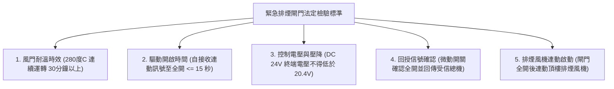
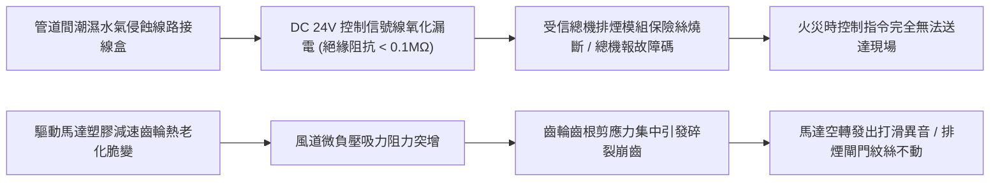
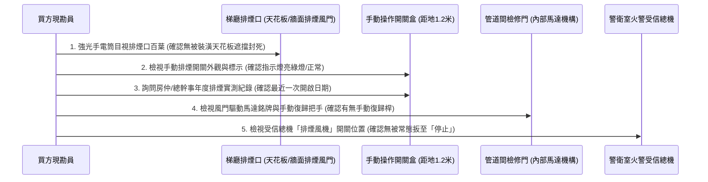
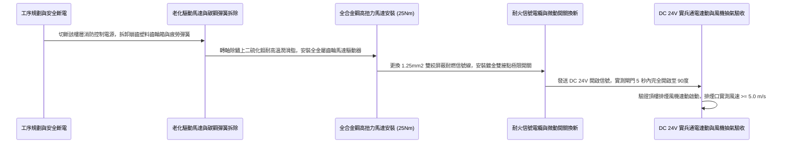

# 全案購屋實戰第一千零二十八部_中古大樓公共走廊緊急排煙閘門馬達齒輪崩齒扭力彈簧疲勞與受信總機連動信號線對地短路體檢工序全書

---

## 序章：高層排煙心臟——火場排毒通道與排煙閘門之連動生死線

在高層集合住宅（如本案主力考慮之**大安紫金城 13 樓**與其他高樓層物件）中，由於樓層超過 10 樓以上，法規強制要求設置「特別安全梯」與「緊急昇降機間之排煙室」，並配置大型**機械排煙系統（Mechanical Smoke Exhaust System）**。
當梯廳或各戶偵煙感知器探測到火警信號時，火警受信總機必須在 **5 秒至 10 秒內**，向該起火樓層之**「緊急排煙閘門（Motorized Smoke Damper / 排煙口風門）」**發出 DC 24V 連動訊號，命令排煙口馬達旋轉開啟、排煙閥板瞬間彈開，並同步啟動頂樓大功率排煙風機，將逃生通道內的高溫劇毒濃煙以每秒數十立方米之抽吸量排向天際。

然而，在屋齡 20 年以上的中古大樓中，機械排煙閘門長年深藏於公共走廊天花板暗處或排煙管道間內部，屬於管委會與房仲最容易隱蔽、也最鮮為人知的公共安全死角：
1. **排煙馬達減速齒輪塑料粉化與崩齒**：驅動排煙閘門開啟之小型直流馬達減速箱，齒輪常年受熱膨脹，齒面塑膠脆裂崩齒，火災時馬達空轉發出刺耳嘶吼卻根本打不開閘門；
2. **扭力彈簧（Torsion Spring）金屬疲勞**：採彈簧釋放型閘門，其強力扭力彈簧長年處於高張力蓄能狀態，金屬晶格發生蠕變疲勞，電磁閥釋放後彈簧彈力不足，閥門僅微開一條小縫便被煙道風阻死死頂住；
3. **受信總機連動信號控制線絕緣老化與對地短路**：連動信號線穿行於潮濕未封堵之管道間，線皮氧化脆化破皮，造成 DC 24V 控制迴路電壓降過大或直接對地短路（Ground Fault），導致總機下達開啟指令時，現場閘門完全毫無反應（死機）；
4. **閥門軸承生鏽咬死與葉片變形卡住**：煙道內部積累 20 年之油污灰塵，軸承缺少耐高溫潤滑脂，金屬葉片鏽死卡在鋼框內。

本卷專門為買方建立高層集合住宅公共排煙閘門與火警連動控制之最嚴格現場實勘工序與功能測試標準作業程序（SOP）。

---

## 第一章：法規基準與機械排煙閘門電氣機械規範

依據《各類場所消防安全設備設置標準》第 188 條至第 190 條、第 234 條及 CNS 15821「建築通風與排煙風門耐火性能試驗法」：



| 檢驗項目 | 法定安全基準規範 | 理想維護標準（高規格社區） | 中古大樓常見嚴重瑕疵（致命隱患） |
| :--- | :--- | :--- | :--- |
| **閘門開啟時間** | 自火災感知器觸發或手動開關動作至閘門完全開啟，時間需 **$\le 15\text{ 秒}$**。 | 採用重型電磁閥搭配高扭力彈簧，**3 秒內瞬間彈開**並鎖定。 | 馬達齒輪空轉磨損，開門耗時超過 40 秒，或卡在 15 度角不動。 |
| **連動控制電壓** | 火警受信總機輸出 DC 24V，抵達現場風門線端電壓降不得低於 **額定值之 85%（即 $\ge 20.4\text{V}$）**。 | 配備獨立後備蓄電池組，終端實測電壓穩定於 **$23.5\sim 24.2\text{V}$**。 | 線路老化漏電阻抗過大，終端電壓僅剩 $14\sim 16\text{V}$，無法驅動電磁閥。 |
| **狀態回授信號** | 閘門完全開啟後，其機械極限微動開關（Limit Switch）必須立即向受信總機回傳「已開啟」確認信號。 | 雙迴路微動開關，開關動作靈敏，總機面板對應樓層指示燈即刻轉為恆亮紅燈。 | 微動開關接觸點氧化生鏽，閘門雖開但總機收不到回授，風機無法連動。 |
| **手動操作機構** | 必須設置手動操作裝置，距樓地板面高度為 **$80\text{cm}\sim 150\text{cm}$**，拉力 $\le 5\text{kgf}$。 | 手動操作箱附帶壓克力保護罩，拉繩平順，手感阻力 $< 2.5\text{kgf}$。 | 手動操作拉繩脫落、被裝潢包覆封死在木作內，完全無法觸及。 |
| **耐高溫耐漏風性** | 閥門葉片與邊框在 $280^\circ\text{C}$ 氣流衝擊下維持結構完整，漏風量符合標準。 | 配置特製不銹鋼雙層葉片搭配耐火石棉矽酸鋁密封編織帶。 | 鍍鋅鐵皮閥片遇熱扭曲變形，邊緣卡死在風道內。 |

---

## 第二章：排煙閘門驅動機構崩齒與線路短路失效機理

中古大樓排煙風門系統長年置於非受控環境中，其電氣控制與機械傳動失效機理如下：



### 2.1 驅動馬達減速齒輪箱碎裂崩齒
- **機械原理**：排煙閘門多採用小型永磁直流伺服馬達（DC 24V），配合多級行星齒輪或蝸輪蝸桿減速箱輸出大扭矩（約 $15\sim 25\text{ Nm}$），克服排煙閥板重力與風道氣流負壓。
- **崩齒原因**：
  - 早期建商為節省成本，減速齒輪箱內之中間傳動齒輪多採用工程塑料（如 POM 或尼龍）。
  - 在長達 20 年的高溫管道間烘烤環境下，塑膠增塑劑揮發，材料硬化發脆。當消防年度檢修進行全動態測試時，馬達啟動瞬間之衝擊扭矩直接將塑膠齒輪的齒根全部剪斷崩齒，馬達高速空轉旋轉，但輸出軸毫無動力，風門葉片徹底癱瘓！

### 2.2 扭力彈簧蠕變與電磁釋放閥卡死
- **彈簧釋放型風門機理**：平時以電磁扣件（Solenoid Latch）扣住風門，將重型扭力彈簧維持在拉伸蓄能狀態；通電或斷電時電磁鐵動作釋放卡榫，彈簧瞬間發力將閥板推開。
- **金屬蠕變疲勞**：彈簧在常年高應力拉伸狀態下，鋼材晶格產生不可逆之「永久塑性蠕變」，有效彈性扭矩衰減達 40% 以上。加上轉軸處灰塵與潤滑脂乾涸結塊形成油泥阻力，電磁閥釋放後，弱化的彈簧根本推不動厚重的鋼質閥板，閥門僅能微開 5 度，隨即被煙道風阻死死卡住。

### 2.3 信號線破皮對地短路與總機過載燒毀
- 穿行於各樓層公共管道間之消防信號電纜（HIV 耐熱線或耐燃線），常因管線施工拉扯、鼠咬或管道間貫穿孔未封堵摩擦，導致外皮破損。
- 當線芯與大樓接地鋼筋或鍍鋅金屬線槽碰觸時，造成對地短路。若受信總機輸出模組缺乏自恢復過載保護電路，短路電流會瞬間燒毀總機排煙控制主機板之驅動繼電器或保險絲，使該迴路全棟各樓層之排煙閘門集體陷入死機狀態！

---

## 第三章：現場看屋實體檢驗標準工序（買方現勘 5 步審查法）

買方現勘大安紫金城 13 樓等高樓層物件時，應依照以下 5 步標準工序查核排煙閘門與排煙室之公共安全防線：



### 3.1 排煙口物理截面積與裝潢遮擋查驗
- **檢驗重點**：抬頭觀察 13 樓公共梯廳或排煙室的天花板：
  - 許多中古大樓管委會或同層鄰居在施作梯廳木作矽酸鈣板造型天花板時，為了美觀，將大尺寸的排煙風門（通常為 $60\times 60\text{ cm}$ 或更大）包覆在天花板內部，外表僅留設一個極小的裝飾空格或甚至直接封死！
  - 排煙口開口必須直接面向逃生通道，有效開口截面積嚴禁受到任何裝潢構件之折減遮蔽。

### 3.2 手動排煙操作開關外觀與通電狀態
- 尋找牆面距地 1.2 米處之「緊急排煙手動開啟開關」：
  - 開關盒外觀應完好，紅色壓扣按鈕（Push Button）或拉拔拉環應具備透明防誤觸壓克力護蓋。
  - 觀察盒面之「電源監視燈」（通常為綠色 LED 燈）：若監視燈恆亮綠燈，代表現場 DC 24V 控制迴路通電正常；若監視燈熄滅，代表該樓層連動線路斷線或總機保險絲已燒毀！

### 3.3 驅動機構全金屬化與手動復歸把手查驗
- 若梯廳管道間檢修門可開啟，以手電筒照射排煙風門驅動器外殼：
  - 合格之驅動器應為**全金屬壓鑄鋁外殼（Metal Gear Box）**，內部齒輪全數為合金鋼材質。
  - 外殼必須附帶**「手動復歸操作桿（Manual Reset Lever）」**或復歸六角板手孔，確保年度檢修開啟後能手動順暢扳回閉合鎖定狀態。

### 3.4 總機開關常態設定查核（致命管理黑洞）
- 前往 1 樓警衛室或防災中心，檢視火警受信總機操作面板：
  - **最大管理黑洞**：許多中古大樓管委會因走廊排煙口老化、經常誤動作或連動誤啟動引發狂風巨響，總幹事私自**將受信總機面板上的「排煙風機連動開關」由「自動」扳至「停止（手動）」位置**！
  - 一旦開關被切至「停止」，火災發生時即使探測器測到濃煙、現場警鈴大作，排煙閘門與排煙風機亦絕對不會連動運轉，整棟大樓瞬間陷入毒煙籠罩之致命絕境！

---

## 第四章：長億南園 vs 大安紫金城——高樓層排煙防禦實戰對比

```mermaid
graph LR
    subgraph 長億南園8樓 (PROP_106)
        L1["長億南園8樓採用大面積自然排煙"] --> L2["公共梯間設有直接對外天窗"]
        L2 --> L3["無繁複機械排煙馬達老化風險"]
        L3 --> L4["維護成本低且自救可靠度高!"]
    end

    subgraph 大安紫金城13樓 (PROP_10)
        D1["大安紫金城13樓為法規高層特別安全梯"] --> D2["高度依賴機械排煙閘門與風道抽氣"]
        D2 --> D3["需嚴格查證13樓排煙口馬達開啟功能"]
        D3 --> D4["要求房仲出具消防檢修申報合格書保障生命"]
    end
```

### 4.1 長億南園 8 樓：自然排煙構造之高可靠性
- **結構優勢**：長億南園 8 樓樓層未達超高層機械排煙之強制門檻，建築物充分利用中庭天井與梯間開闊窗戶，採用大截面之「自然排煙系統」。無繁雜的馬達減速箱、電磁閥與控制模組老化問題，依靠高溫熱浮力即可自然排煙，系統單純、故障率極低，具備長期居住之高安全性。

### 4.2 大安紫金城 13 樓：超高樓層機械排煙之生死防禦
- **高空風險核心**：大安紫金城 13 樓屬於高層集合住宅，逃生梯間與梯廳必須依賴機械排煙系統維持安全。一旦 13 樓排煙閘門因馬達崩齒或線路短路打不開，起火時整層走廊將被有毒濃煙在 60 秒內完全封死，逃生無門。
- **買方斡旋談判策略**：
  > 買方在斡旋期間，應將「13 樓排煙風門連動啟動確認」正式列為看屋與簽約前向管委會調閱資料之清單：
  > 「周小姐，大安紫金城 13 樓我們非常滿意它的 B2 大平車與高樓景觀，出價也很有誠意（目標 768~788 萬）。但 13 樓梯廳的機械排煙風門攸關全家高空逃生安全，請賣方與管委會務必出具最近一期消防設備師的『排煙風門連動測試合格紀錄聯』。確認設備運轉無虞，我們買方立即簽字成交！」

---

## 第五章：排煙閘門驅動機構全金屬換新與控制迴路工序（買方工法指引）

若社區需維修改造排煙閘門，應嚴格依循以下標準作業工序施作：



1. **驅動器全金屬齒輪規格要求**：
   - 全面淘汰塑料齒輪箱，選用通過消防耐高溫認證（$280^\circ\text{C} / 30\text{min}$）之**全合金鋼金屬齒輪減速馬達**。
   - 額定扭力需達 **$20\sim 25\text{ Nm}$** 以上，輸出功率充足，確保在煙道強大氣流阻力下仍能強行頂開閘門。
2. **耐燃耐熱信號線與獨立接地佈設**：
   - 控制信號線採用符合 CNS 14705 標準之 **耐燃電線（FR-Cable / 耐火 840℃ 30 分鐘）**，線徑規格不得小於 $1.25\text{ mm}^2$ 雙絞屏蔽線。
   - 信號線全程穿行於熱浸鍍鋅金屬導線管（EMT 管）內，嚴禁與強電動力纜線共管共槽，金屬管路全程確實接地，徹底阻絕電磁干擾與絕緣破皮短路。
3. **軸承耐高溫潤滑工法**：
   - 閘門百葉轉軸軸承必須全面清洗積垢，塗抹**二硫化鉬（$\text{MoS}_2$）極壓耐高溫複合鋰基潤滑脂**（耐溫達 $-30^\circ\text{C}\sim +350^\circ\text{C}$），確保長期處於高溫煙道環境下油脂不碳化、不流失、不咬死。
4. **實兵連動抽風全功能驗收標準**：
   - 現場按下 13 樓手動開啟開關：
     1. 風門必須在 **$3\sim 5\text{ 秒}$** 內平順開啟至 90 度全開位置；
     2. 閘門極限微動開關動作，現場指示燈與受信總機 13 樓火警面板對應紅燈同時點亮；
     3. 頂樓大型機械排煙風機在 **10 秒內** 自動全載運轉投入；
     4. 使用熱線式風速儀量測排煙口各點進風風速，平均風速必須達到 **$5.0\sim 8.0\text{ m/s}$**，且手掌能清晰感受到排煙口的強烈負壓抽吸力，方准點交驗收！

---

## 結語：風門全開，闢出生死交界之淨朗生路

第一千零二十八部工序全書，將高層集合住宅公共排煙閘門之驅動馬達崩齒機理、受信總機 DC 24V 線路壓降短路病因、手動控制盒查核要領、現場五步穿透手法以及標準化全金屬齒輪翻新工藝徹底剖析。
排煙風門是火災高溫下的第一呼氣孔，唯有齒輪堅韌、信號暢通，方能將全體家人的生命航線，安然引渡出毒煙茫茫的火場危局！
