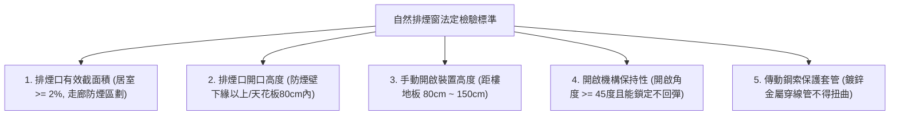
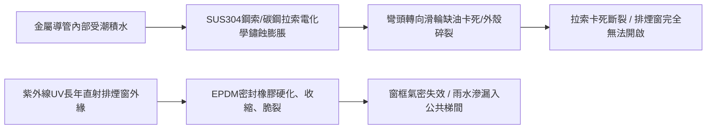
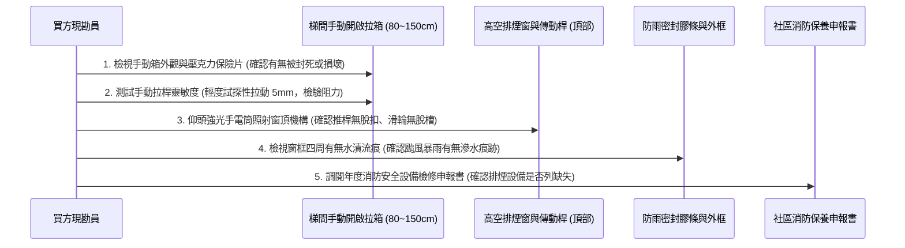
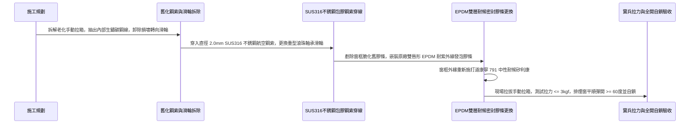

# 全案購屋實戰第一千零二十六部_中古大樓公共走廊逃生梯間排煙窗手動開啟裝置鋼索卡死與自然排煙口防雨密封老化漏風體檢工序全書

---

## 序章：高空垂直排煙——火場窒息浩劫下的生命排毒天窗

在集合住宅的火災傷亡統計中，超過 **80% 至 85%** 的罹難者並非直接死於高溫火勢灼傷，而是死於火場燃燒塑膠、泡棉、塗料所產生的濃煙與致命有毒氣體（如一氧化碳 CO、氰化氫 HCN、氯化氫 HCl）引發之窒息休克。
濃煙在垂直管道與樓梯間具有極強的「煙囪效應（Stack Effect）」，其向上蔓延擴散速度高達每秒 **3 至 5 公尺**，可在數十秒內將整棟大樓的垂直避難逃生動線完全吞噬。

因此，設置於中古大樓公共走廊、安全梯間與特別安全梯之**「排煙窗（自然排煙口 / 機械排煙窗）」**及其連動之**「遠端手動開啟裝置（拉索箱）」**，是火災初期迅速排出高溫濃煙、阻絕煙囪效應、為逃生住戶爭取黃金 15 至 30 分鐘撤離時間的最核心生命天窗。

然而，在屋齡 20 年以上的中古大樓（如本案主力評估之**大安紫金城 13 樓**、**長億南園 8 樓**、**歌德堡 8 樓**與**靜園 A 區 11 樓**）中，排煙窗系統往往面臨嚴重維護黑洞：
1. **手動開啟鋼索生鏽卡死斷裂**：平時無人拉動，埋在牆內或明敷於金屬導管內的包膠鋼索受潮生鏽膨脹，火災時拉環根本拉不動，天窗形同虛設；
2. **三元乙丙（EPDM）密封膠條硬化碎化**：高空外牆排煙窗長年承受紫外線曝曬，密封條失去彈性，造成雨天滲水、平日颱風天尖銳呼嘯漏風；
3. **推桿機構齒輪崩齒脫扣**：連動推桿在開窗重力下彎曲變形，或防蟲紗網積聚厚重油垢泥沙導致排煙截面積嚴重縮減。

本卷專門為買方建立公共走廊與逃生梯間排煙窗之最嚴格現場實勘工序與安全驗收標準作業程序（SOP）。

---

## 第一章：法規基準與自然排煙窗核心物理幾何規範

依據《各類場所消防安全設備設置標準》第四條、第 188 條至第 190 條及《建築技術規則建築設計施工編》第 102 條之標準：



| 檢驗項目 | 法定安全基準規範 | 理想維護標準（高規格社區） | 中古大樓常見嚴重瑕疵（談判缺失） |
| :--- | :--- | :--- | :--- |
| **排煙口有效面積** | 樓地板面積之 **2% 以上**（以防煙區劃計算）。 | 淨排煙截面積達 3% 以上，通風阻力極低。 | 窗戶被裝潢天花板遮擋超過一半，有效面積不足 1%。 |
| **開口垂直高度** | 排煙口下緣應位於**天花板高度 80 公分以內**，或防煙壁下緣以上。 | 排煙口緊貼天花板頂層，第一時間排出熱浮力濃煙。 | 窗戶開在牆面中下段（距地 1.2 米），濃煙蓄積於頭頂無法排出。 |
| **手動裝置安裝高度** | 距樓地板面高度應在 **80 公分至 150 公分** 之間。 | 安裝於 110~120 公分（人體最自然施力高度），標示清晰。 | 安裝過高（>180cm）需踩梯，或被公告欄、配電箱隱蔽遮擋。 |
| **開啟角度與自鎖** | 開啟角度應達到 **45 度以上**，且開啟後能機械自鎖不回落。 | 開啟角度達 60~70 度，具備風力推擠防反彈自鎖卡榫。 | 拉開後鬆手立即因重力自動下墜關閉，無法維持通暢。 |
| **操作拉力極限** | 手動拉環拉力不得大於 **5 公斤（50 N）**。 | 單手輕拉（拉力 $< 3\text{ kg}$ / 30 N）即可瞬間平順全開。 | 鋼索鏽蝕卡死，雙手使出全力（>20 kg）仍拉不動，拉環斷裂。 |

---

## 第二章：排煙窗拉索傳動機構故障與密封老化機理

中古大樓排煙窗系統多採用「手動箱鋼索遙控機構」或「電動推桿連動機構」，其常見機械與材料失效路徑如下：



### 2.1 傳動鋼索卡死與斷裂三大死因
1. **導管內部冷凝水鏽蝕**：
   - 鋼索套管多穿行於非空調之梯間牆體內，冬夏溫差導致套管內部凝結水珠。
   - 早期建商多採用廉價外包 PVC 之鍍鋅鋼絲繩，內部鋼絲若未經充分浸油防鏽，數年後內部鋼絲受潮全面生鏽斷股，鋼絲毛刺刺破外皮，死死咬住金屬導管內壁。
2. **導向滑輪（Pulley Box）崩壞**：
   - 鋼索在直角轉彎處必須依賴 90 度轉向滑輪。低劣尼龍塑料滑輪經數年重力拉扯後發生碎裂，或黃銅滑輪缺潤滑油鏽死，鋼索直接在金屬轉角處硬性刮擦，產生極大磨擦阻力。
3. **手動操作箱內部棘輪機構鏽死**：
   - 手動拉箱常年未依規定每年至少保養測試兩次，箱內釋放彈簧失去彈性，保險插銷與卡爪鏽合在一起。

### 2.2 防雨密封膠條脆化與高空漏水
- 梯間排煙窗長年朝外暴露於狂風暴雨中，窗框接縫之發泡橡膠密封條（EPDM 或橡膠條）若發生老化粉化，暴雨時雨水順著窗框縫隙大量滲入逃生梯間，導致梯階積水、長輩失足滑倒；強風天更會產生劇烈氣流嘯叫聲，嚴重干擾高樓層住戶安寧。

---

## 第三章：現場看屋實體檢驗標準工序（買方現勘 5 步穿透法）

買方現勘大安紫金城 13 樓、長億南園 8 樓公共梯間時，應依循以下 5 步標準工序查核公共安全排煙機能：



### 3.1 手動開啟拉箱（Release Box）實況檢視
- **外觀檢查**：確認拉箱外殼上的紅色「排煙窗手動開啟裝置」中文字樣清晰，指示方向明確。
- **保險機構核查**：檢視箱體正面之壓克力保護蓋板或易碎玻璃。若發現保護蓋板已被膠帶封死、或甚至被住戶私自以鐵絲綁住防止小孩玩耍，此為重大消防違規！

### 3.2 鋼索阻力與手動試拉檢測
- **輕拉試探手法**：在不破壞壓克力易碎片的前提下（或在管委會陪同下打開檢修扣），以指尖握住拉環，試探性向下微拉 5~10mm，感受鋼索回彈張力。
- **正常合格**：手感平滑帶有適度彈性，無乾澀刮擦聲。
- **嚴重故障**：手感如同死硬鐵棒完全無法拉動，或拉環鬆垮垮毫無張力（代表上方鋼索早已脫落或斷裂）。

### 3.3 仰角檢驗開口連桿與防鳥防蟲網
- 使用強光手電筒照射天花板排煙窗本體：
  1. **連桿鉸鏈**：排煙窗鉸鏈與四連桿機構是否變形、有無嚴重黃油乾涸或鐵鏽；
  2. **防蟲防鳥網**：排煙口外側之金屬防鳥網是否完好。若防鳥網破損，鴿子或麻雀在排煙窗機構上築巢，鳥糞與乾草枝條將直接卡死推窗滑軌，火災時排煙窗開不到 10 度即被硬生生卡住！

### 3.4 窗邊牆面滲水與雨水倒灌痕跡
- 仔細觀察排煙窗正下方梯間牆面與天花板：
  - 若磁磚或水泥漆出現大片**黃褐色水痕、起泡壁癌、或地坪踢腳板發黑發霉**，代表排煙窗外框填縫矽利康（Silicone）老化開裂，或是窗扇關閉時密封條未完全壓緊，颱風天暴雨直接倒灌梯間。

---

## 第四章：長億南園 vs 大安紫金城——公共安全排煙實戰評測

```mermaid
graph LR
    subgraph 長億南園8樓 (PROP_106)
        L1["長億南園梯間採光良好"] --> L2["安全梯設有獨立外向自然排煙窗"]
        L2 --> L3["手動拉箱保養標籤齊全"]
        L3 --> L4["排煙通風條件優良安心保障!"]
    end

    subgraph 大安紫金城13樓 (PROP_10)
        D1["大安紫金城13樓為超高層特別安全梯"] --> D2["設有機械排煙風道與電動防火風門"]
        D2 --> D3["需特別查驗手動排煙開關與風機連動"]
        D3 --> D4["借驗收名義要求房仲提供消防安檢合格聯"]
    end
```

### 4.1 長億南園 8 樓：自然排煙通風優勢
- **實地動線查驗**：長億南園 8 樓公共梯間設有直接面對戶外天井之中大型鋁合金自然排煙天窗，配備手動鋼索拉箱。現場觀察窗戶開闊、通風極佳，梯間無悶熱異味，手動開啟機構外觀維護良好，無雨水滲漏痕跡，具備極佳的火場逃生自救排煙能力。

### 4.2 大安紫金城 13 樓：高樓層機械排煙與連動查證
- **實地動線查驗**：大安紫金城標的物位於 13 樓，屬於法規嚴格管制之超高層集合住宅。其逃生梯多規劃為「特別安全梯（附設排煙室）」，除自然排煙窗外，更配置**排煙風機機械排煙風道與耐高溫排煙防火閘門**。
- **談判與查驗策略**：買方在斡旋期間，應要求房仲向管委會調閱「最近一期消防設備師年度檢修申報書」，特別確認 **13 樓排煙閘門之手動開啟器與頂樓排煙風機連動信號** 是否全數合格列為「無缺失」，確保超高樓層住戶之生命防線固若金湯！

---

## 第五章：排煙窗鋼索翻新與高抗風密封維修工序（標準施工工序）

若社區需推動排煙窗修繕，應依據以下標準工序進行全面換新：



1. **鋼索材質全面升級**：
   - 嚴格禁止使用易生鏽之鍍鋅鋼索。全面升級為 **SUS316 不銹鋼航空級 7x7 結構鋼索**，外包覆透明尼龍抗磨層，耐鹽霧防腐蝕壽命達 20 年以上。
2. **轉向滑輪採用全不銹鋼封閉軸承**：
   - 所有轉向滑輪盒（Pulley Box）全面更換為 SUS304 外殼搭配**雙金屬封閉精密深溝滾珠軸承（Shielded Ball Bearing）**，出廠預填高低溫潤滑脂，杜絕卡滯缺油。
3. **EPDM 雙唇形耐候密封條嵌裝**：
   - 窗框周邊溝槽以專用溶劑清潔後，嵌裝原廠進口三元乙丙（EPDM）雙唇發泡彈性密封膠條。該材質耐溫範圍達 $-40^\circ\text{C} \sim +120^\circ\text{C}$，能有效阻隔風雨滲透達 15 年不硬化。
4. **拉力計現場拉拔驗收**：
   - 使用數位拉力計鉤住手動拉環，均勻向下拉動：
     1. 觸發拉力必須控制在 **$2.5\sim 4.0\text{ kgf}$（$25\sim 40\text{ N}$）** 之內，確保女性或長輩單手即可輕鬆拉開；
     2. 釋放卡榫後，排煙窗在重力配重或助推氣壓棒作用下，應於 **3 秒內** 平順開啟至最大角度（$\ge 50^\circ$）；
     3. 雙手在外側用力推壓窗扇，防反彈鎖定機構必須牢固咬死，絕不回彈閉合，方准點交驗收！

---

## 結語：垂直逃生之生命天窗，火場爭鋒之最後底線

第一千零二十六部工序全書，將中古大樓公共梯間排煙窗之煙囪動力學、鋼索卡死腐蝕機理、防雨密封老化、現場五步穿透手法以及標準化 SUS316 航空鋼索翻新工藝徹底講透。
這份指引為買方在穿梭梯間現勘時，點亮了最容易被忽略卻關乎全體家庭生死的安全之眼！
