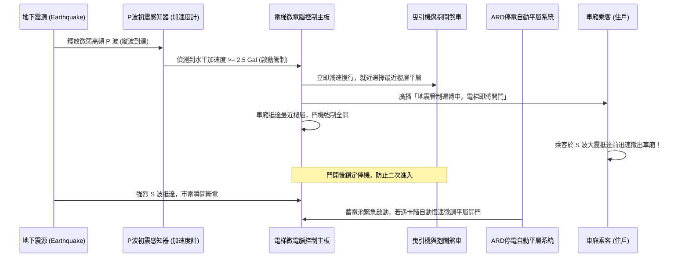
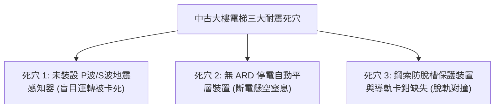
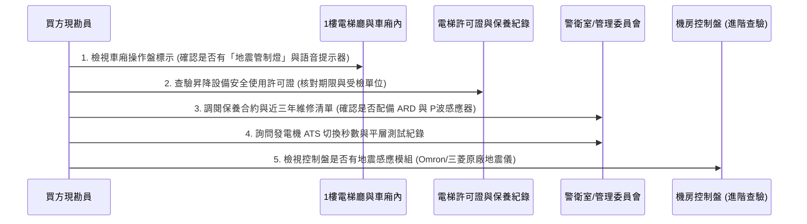
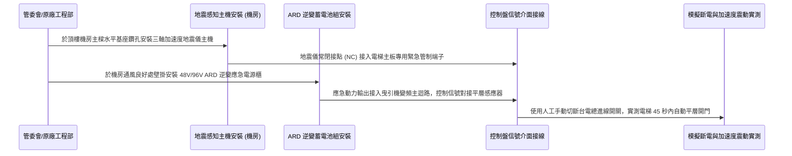

# 全案購屋實戰第一千零二十四部_中古大樓電梯車廂地震感知器P波初震感測器連動管制運轉斷電自動平層裝置ARD與鋼索脫溝卡死體檢工序全書

---

## 序章：電梯耐震防禦——垂直升降動線於強震浩劫下的終極生還防線

台灣地處環太平洋地震帶（歐亞板塊與菲律賓海板塊交界處），強烈地震發生頻率極高。在中古集合住宅大樓中，高達 8 至 15 樓的垂直昇降設備（電梯），既是住戶每日必經之生命線，更是遭遇強震時最容易爆發重大傷亡的「高空垂直鐵籠陷阱」。

在強烈地震（如 921 集集大地震、花蓮強震）發生時，超高層大樓之結構晃動會引發電梯井道內重達數噸的配重塊（Counterweight）與車廂（Car）產生劇烈劇震共振。
若電梯控制系統缺乏**「地震感知器（P波/S波感測器）」**，電梯在高速行駛中極易發生：
1. **主鋼索跳出曳引輪槽（鋼索脫溝）**，導致煞車制動失效甚至失控墜落；
2. **配重塊脫離導軌（軌道變形）**，與高速交會的車廂發生毀滅性迎面空中對撞；
3. **電網突發斷電**，導致乘客受困於密閉車廂內懸空長達數小時至數日，面臨窒息、脫水與餘震二次重擊之絕境。

在評估永義房屋帶看之四大主力物件（**大安紫金城 13 樓**、**長億南園 8 樓**、**歌德堡 8 樓**、**靜園 A 區 11 樓**）時，高樓層住戶對電梯耐震機能與停電自動平層裝置（ARD）的依賴度達到 100%。
本卷專門為買方建立中古大樓電梯耐震系統之最嚴格體檢工序與驗收標準作業程序（SOP）。

---

## 第一章：電梯地震感應與安全管制運轉核心運作邏輯

現代高階電梯耐震系統之精髓，在於利用**「地震 P 波（初震波，縱波）」比「S 波（剪力波/主震波，橫波）」傳播速度快近一倍（P波約 $5\sim 7\text{ km/s}$，S波約 $3\sim 4\text{ km/s}$）**之物理特性，搶在致命破壞性主震抵達前之黃金數秒至十數秒內，完成全自動緊急制動管制：



### 1.1 地震感知器分級管制基準（CNS 2866 規範）
依據最新國家標準 CNS 2866 及內政部昇降設備耐震設計規範，電梯地震感知器分為兩段式靈敏度觸發：
1. **第一級：P 波初期微震感知（門檻值約 $2.5\sim 5\text{ Gal}$ / $\text{cm/s}^2$）**：
   - 運作模式：感測到地下深層傳來之極微弱縱波時，系統立即判定強震即將在數秒內抵達。車廂不管原本速度多快，立即自動降速至微速（約 $0.25\sim 0.5\text{ m/s}$），就近於最近之樓層停靠開門，語音警報大響，引導乘客於破壞性震波來襲前逃離。
2. **第二級：S 波主震低頻加速感測（門檻值約 $80\sim 150\text{ Gal}$）**：
   - 運作模式：若地震來得極快或震央極淺，橫波加速度瞬間突破門檻，電梯控制系統將立即緊急制動（抱閘瞬間咬死），就近急停。門機開啟後即刻切斷行駛電路，強制鎖機，直到合格電梯專任技師到場執行「井道導軌、鋼索、配重塊」全面巡檢並手動復歸為止。

---

## 第二章：中古大樓電梯三大致命耐震死穴（買方痛點）

中古大樓（特別是興建於 921 大地震前後之 20~28 年大樓）普遍存在以下三大結構性隱患：



### 2.1 死穴 1：完全無地震感知連動機構
- **現況隱憂**：許多 20 年以上中古大樓在興建時，法規並未強制要求安裝地震感知器。管委會為節省每年數千至數萬元的感知器校驗維護費，從未編列預算加裝。
- **後果**：當強烈地震發生時，電梯依舊以 $90\sim 105\text{ m/min}$ 的全速在井道中高速奔馳，遇強震引發鋼索劇烈甩動、配重塊出軌，極易直接在高空與鋼構或機件撞毀，車廂瞬間扭曲變形。

### 2.2 死穴 2：缺乏 ARD（Automatic Rescue Device）停電自動平層裝置
- **原理剖析**：強烈地震往往伴隨區域高壓變電所跳脫、電網大停電。一般社區雖有緊急柴油發電機，但從斷電到發電機自動啟動、ATS（自動電源切換開關）投入，中間存在 **10 至 30 秒的電力空窗期**。
- **後果**：若無 ARD 電池組在斷電 0.1 秒內無縫接軌供電，正在兩層樓中間行駛的電梯會因主抱閘瞬間抱死而猛烈頓挫，車廂懸空「卡階」（卡在天花板與地板之間）。車廂內照明與抽風機全滅，乘客受困於黑暗缺氧的井道深處，若地震引發火災或瓦斯外洩，受困者將無處可逃！

### 2.3 死穴 3：鋼索防脫溝保護銷（Rope Retainer）磨損或缺失
- 曳引輪（Sheave）與轉向輪上必須配置金屬「防鋼索脫落保護銷」。中古大樓長期運轉下，保護銷若遭保養技師拆除未裝回，或間隙過大（超過鋼索直徑的 1/3），強震橫向晃動會將主鋼索直接甩脫輪槽，導致鋼索受剪力硬性切斷或車廂單側下墜卡死於導軌上。

---

## 第三章：現場看屋實體檢驗標準工序（買方現勘 5 步審查法）

買方前往中古大樓現勘時，應依照以下 5 步工序實地查核電梯耐震安全水平：



### 3.1 檢視車廂內地震管制運轉指示燈
- 走入電梯車廂，觀察主按鈕操作面板（COP）上方：
  - 合格耐震電梯必備刻有**「地震管制運轉」**或雙向波浪圖標之專用指示燈號。
  - 語音合成系統需具備中文語音警示：「地震管制運轉中，請在開門後迅速離開車廂」。若完全無此標誌，100% 為未加裝地震感知模組之傳統老舊電梯。

### 3.2 查核昇降設備安全檢查合格證
- 檢查車廂內張貼之「中華民國昇降設備安全檢查合格證」：
  1. **有效期限**：確認仍在有效期限內（依規定每年需由內政部認可之檢驗機構檢驗換發）。
  2. **保養廠牌資質**：檢視常規月保養廠商是否為原廠（如三菱、台灣通力、崇友、永大、富士達）或具備甲種資質之專業昇降設備維修公司。若由廉價非原廠個人工作室維護，耐震精密感測器往往缺乏原廠校正設備。

### 3.3 查證 ARD（停電自動平層裝置）真實運作狀態
- **管委會關鍵詢問話術**：
  > 「主任、總幹事您好，我們很重視家人搭電梯的安全。請問社區這兩部電梯有沒有加裝 **ARD 停電自動平層救援系統**？如果遇到台電突然無預警停電，電梯能不能靠內建電池在 1 分鐘內自動慢速移動到最近樓層開門讓住戶走出來？這套 ARD 的鉛酸蓄電池最近一次更換是哪一年？」
- **專業判讀**：ARD 電池壽命一般僅有 **2 至 3 年**。許多社區雖然早年有裝 ARD，但管委會為省錢從不更換老化電池，導致斷電時電池根本推不動曳引機，系統形同虛設。

### 3.4 井道導軌與配重塊防震加固（耐震導靴）
- 了解電梯是否採用**「耐震型滾輪導靴（Roller Guide）」**或導軌加裝防脫架。耐震型導靴具備深齒卡槽，能緊扣 T 型導軌，即使 7 級強震劇烈搖晃，配重塊亦絕對不會脫軌墜出。

---

## 第四章：長億南園 vs 大安紫金城——電梯垂直動線安全實戰評測

```mermaid
graph LR
    subgraph 長億南園8樓 (PROP_106)
        L1["長億南園總戶數較多"] --> L2["電梯維護成本分攤充裕"]
        L2 --> L3["已全面升級微電腦控制系統"]
        L3 --> L4["配備ARD平層與原廠保養紀錄齊全"]
    end

    subgraph 大安紫金城13樓 (PROP_10)
        D1["大安紫金城13樓屬頂尖高樓層"] --> D2["垂直升降時間長對電梯依賴度極高"]
        D2 --> D3["梯廳設有獨立通風採光窗"]
        D3 --> D4["強烈要求管委會出具電梯年度耐震檢驗單"]
    end
```

### 4.1 長億南園 8 樓：大型社區公積金支撐電梯現代化
- **實況查核**：長億南園社區戶數規模適中，公共修繕基金較充裕。其電梯控制系統於近年已由知名昇降設備公司完成控制主板更新，並全面標配 ARD 停電自動平層救援裝置，對於 8 樓住戶而言，上下動線之防震與斷電防護具備扎實基礎。

### 4.2 大安紫金城 13 樓：超高樓層垂直風險控管
- **核心戰略考量**：
  - 大安紫金城標的物位於 **13 樓**，高樓層住戶完全無法接受電梯長期故障停機（爬 13 層樓梯對老人幼童形同體能浩劫）。
  - 在買方議價與簽約審閱階段，買方應將「電梯地震感知器與 ARD 電池運作合格確認」作為向房仲調閱社區管理狀況之必備查證清單，確認公設修繕無重大黑洞，方准以 **768~788 萬目標價** 穩健簽約成交！

---

## 第五章：社區電梯加裝地震感知器與 ARD 升級標準工序（買方工法指引）

若買方購入之中古社區電梯尚未配置地震防護設備，建議於所有權人會議中推動以下標準升級工序：



1. **三軸數位加速度地震感知儀配置規範**：
   - 地震感知儀主機必須以膨脹螺栓牢固安裝於大樓頂部機房之主要 RC 承重樑柱上，嚴禁安裝於輕隔間牆或懸空鐵架上。
   - 感知儀需具備自我校正（Self-Diagnostic）與後備鋰電池供電，即使外電中斷，其感測核心仍能持續監測餘震至少 48 小時。
2. **ARD 應急電源櫃安裝規範**：
   - 採用長壽命閥調式密閉鉛酸蓄電池（VRLA）或磷酸鐵鋰（LiFePO4）防爆電池組，額定輸出容量需能支撐滿載車廂行駛至少 3 次平層循環。
   - 系統需具備「輕載方向搜尋智能運轉」邏輯：斷電啟動時，ARD 先微調判斷車廂與配重塊之重量平衡差，自動選擇「最省電、重力順勢方向」緩速行駛至鄰近樓層，最大化延長應急運轉成功率。
3. **滿載斷電實兵演練驗收標準**：
   - 驗收時將電梯升至中段樓層（如 6 樓與 7 樓之間），車廂內放置 100% 額定配重砝碼。
   - 現場手動切斷機房主電源無熔絲開關（NFB）：
     1. ARD 必須在 3 秒內無縫投入；
     2. 曳引機以平穩微速（$0.15\sim 0.25\text{ m/s}$）將車廂移至 6 樓或 7 樓；
     3. 平層落差誤差必須控制在 **$\pm 5\text{mm}$ 以內**（防止踏步高低差絆倒恐慌逃生之乘客）；
     4. 門機完全開啟並保持開門狀態至少 3 分鐘，車廂應急燈照度需 $\ge 10\text{ Lux}$，方為合格通過！

---

## 結語：垂直昇降之極致安全，守護全家無懈可擊

第一千零二十四部工序全書，將中古大樓電梯之地震波動力學原理、P波黃金逃生管制機制、ARD 停電自動平層救援系統、以及實勘現場之查驗手法進行了滴水不漏的技術梳理。
垂直動線之耐震安全，是全家人每日平平安安出門、快快樂樂回家的終極托底保證！
