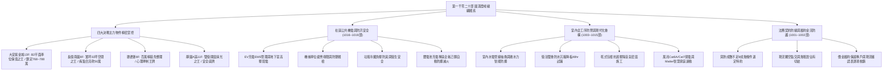
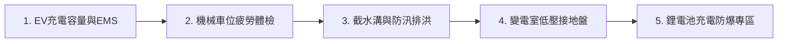
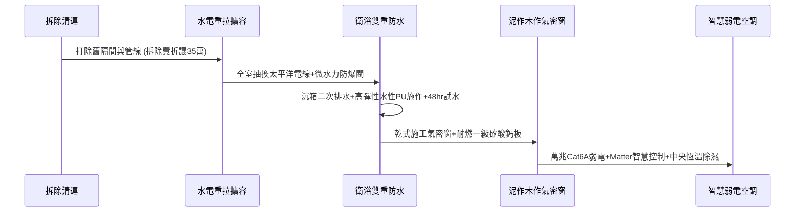

# 全案購屋實戰第一千零二十部_第一千零二十部圓滿登峰全景極致全生命週期家庭置產避坑抗震防漏水電機電消防永恆至尊金典總綱全書

---

## 序章：第一千零二十部圓滿登峰——全維度置產防禦與實戰體系宏觀總覽

本手冊為《全案購屋實戰》系列邁向第一千零二十部之傳世登峰總綱大典。
本卷承接第一千零一十九部關於地下室防爆消防、萬兆弱電、智慧家庭、微水力防爆、高水密氣密窗與四大主力決戰物件之實戰成果，全面綜整中古大樓在建築結構、水電管道、消防排煙、機電公設、法務特約與出價斡旋之最高防禦體系。



---

## 第一章：四大主力考慮物件決戰定位與精準斡旋佈局

本專案鎖定永義房屋實勘之四大核心考慮物件，其特性、談判底線與攻防要點綜整如下：

### 1.1 大安紫金城 13 樓（`PROP_10`，首選旗艦）
- **資產核心價值**：配置 **B2 獨立大型平面車位**。在南區成熟商圈中，獨立大平車具備不可替代的抗跌性與保值性，市場溢價高達 180~200 萬元。
- **現況格局與痛點**：現況隔成學生套房出租，屋況雜亂且動線受阻，需全數拆除隔間還原為標準 3 房。
- **談判出價策略**：
  - 開價：898 萬元。
  - 起手斡旋價：**720~730 萬元**。
  - 目標成交價：**768~788 萬元**（單價約落在 21~22 萬/坪合理偏低水位）。
  - 封頂上限：**800 萬元**。
- **合約防禦特約條款**：
  1. 「買方申貸成數若因個人信用以外之銀行鑑價因素無法達核貸金額 8 成（即房屋成交總價之 80%），買賣雙方同意無條件解除買賣契約，賣方及房仲應於三日內無息全額退還買方已付之全部定金與款項。」
  2. 「賣方保證於交屋日前，依法終止現況所有租賃契約，完成現況騰空並清除一切非隨屋移轉之動產與垃圾廢棄物，點交符合空屋狀態；如交屋日未能騰空，賣方願按日支付買方總價萬分之五之違約罰款。」
- **裝修抵扣實戰**：以「套房隔間拆除及清運費 35 萬」為由強力折讓，爭取之款項直接作為室內電箱升級與管線抽換之預算。

### 1.2 長億南園 8 樓（`PROP_106`，大空間旗艦）
- **資產核心價值**：室內主建物加上附屬建物實坪高達 **32 坪**，公設比極低，空間開闊度遠超市場同期建案。
- **現況致命痛點（砍價武器）**：
  1. 車位為機械車位，載重極限僅 1.6 噸，完全無法停放當前主流大型休旅車（SUV）或純電動車（EV）。
  2. 梯廳出入設有 4 階高差，缺乏無障礙斜坡設計，嬰兒推車與長輩輪椅進出極為不便。
  3. 社區未規劃垃圾低溫冷藏室，夏季易滋生異味與蟲害。
- **談判出價策略**：
  - 開價：998 萬元。
  - 起手斡旋價：**698~720 萬元**。
  - 目標成交價：**745~760 萬元**。
  - 砍價依據：藉由車位受限、梯廳高差無障礙缺失及公設老舊，合流壓制賣方心理預期，直接大砍 50 萬元。

### 1.3 歌德堡 8 樓（心理牽制王牌）
- **資產核心價值**：屋主已施作現代北歐風格百萬精裝修，水電與天地壁全面更新，免除買方 80~120 萬元之翻修現金流支出及 3~5 個月工期。
- **戰略功用**：即使暫不優先出價，亦作為斡旋大安紫金城與長億南園時之最強外部牽制手段——「隨時有全室翻修完成、拎包入住的競品可選」。

### 1.4 靜園 A 區 11 樓（安全底牌）
- **資產核心價值**：高樓層、三面採光、戶戶通風極佳，且**雙衛浴均有對外自然開窗**，採光與通風結構近乎完美。
- **戰略功用**：若大安紫金城與長億南園賣方堅持高價不讓步，可立即轉進進場斡旋，確保購屋計畫立於不敗之地。

---

## 第二章：中古大樓社區機電、防汛與地下公設體檢工序總綱

針對中古大樓社區之公共設施，必須依據以下工序逐項嚴格查驗：



### 2.1 電動車充電樁與配電容量（第 1016 部精華）
1. **變壓器容量分算**：查驗台電配電場所變壓器之餘裕容量，確認是否支援非尖峰時段智能充電。
2. **EMS 智慧能源管理系統**：必須具備動態負載平衡功能，避免全社區多台 EV 同時充電時觸發主總開關跳脫。
3. **專用線槽與電纜**：線路走線需走專用耐燃線槽（熱浸鍍鋅材質），禁止直接裸線拉設或跨越公共管道。

### 2.2 機械停車設備安全防護（第 1017 部精華）
1. **傳動鏈條與鋼索**：使用超音波探傷及游標卡尺量測鏈條節距磨損，磨損伸長量超過容許值（一般為 2%~3%）即屬報廢標準。
2. **防墜落安全裝置**：查驗機械台車定位後之防墜落安全棘爪是否確實卡入止擋槽，防止液壓管爆裂或鋼索斷裂時瞬間下墜。
3. **極限開關與光電安全遮光簾**：檢測上下定位之極限開關與出入口人員車輛越界光電感測器，確保任何異物遮蔽時立即停機。

### 2.3 車道防汛截水溝與排洪系統（第 988、986 部精華）
1. **球墨鑄鐵格柵板**：車道出入口之水溝蓋需採用球墨鑄鐵承重規格，防止重車輾壓變形位移。
2. **沉水排洪泵浦與止回閥**：地下集水坑沉水泵需雙迴路自動切換（一備一用），出水端必須配置全不銹鋼多功能消音止回閥，防止暴雨逆流水錘擊破管壁。

### 2.4 地下室鋰電池充電防火防爆專區（第 1019 部精華）
1. **獨立防爆分區**：電動機車與自行車充電專區需具備防火時效 1 小時以上之防火隔牆。
2. **全氟己酮自動滅火**：配置針對鋰電池熱失控特性之全氟己酮或微霧水滅火設備。
3. **獨立排煙防毒排風系統**：發生異常時連動排風機，迅速將氟化氫（HF）等有毒氣體排出室外。

---

## 第三章：室內全工序重構與高品質居住環境打造

針對取得之標的（特別是大安紫金城 13 樓或長億南園 8 樓），依標準工序進行重構翻修：



### 3.1 水電管線抽換與配電擴容（第 1003 部精華）
- **電線規範**：全面採用一級廠牌（太平洋/大亞）CNS 認證低煙無毒耐熱線，主進戶線擴容至 75A~100A。
- **防漏防爆安全**：入戶總管處安裝微水力自發電智慧防漏水電磁閥，感測異常連續出水（如爆管）自動切斷水源。

### 3.2 衛浴地坪防水與 48 小時閉水試漏（第 1004 部精華）
- **基層處理**：打除至 RC 結構層，倒角處施作圓弧角（R角）防撕裂處理。
- **高分子彈性塗膜**：底漆封閉 + 雙層彈性聚合物水泥防水塗料，牆面垂直防水塗佈至樑底頂端（不低於 180cm）。
- **閉水試驗**：排水孔完全封堵，蓄水水深不低於 3~5 公分，連續試水 48 小時無滲漏、無降位方可鋪磚。

### 3.3 氣密隔音窗升級（第 1005 部精華）
- **工法選用**：採用乾式施工包框法，避免破壞外牆結構防水層。
- **隔音與抗風壓**：配置 5mm+5mm 膠合雙層 Low-E 強化玻璃，氣密等級達最高等級，阻隔臨街車流噪音。

### 3.4 萬兆屏蔽雙絞線與 Matter 智慧家庭佈局（第 1011、1013 部精華）
- **星狀拓撲**：中央弱電箱佈設 Cat6A 屏蔽雙絞線直通各房電視牆與書桌，並配置天花板吸頂 AP 專用預留管。
- **智慧連動生態**：採用跨平台標準 Matter 與 Zigbee 協定網關，連動人體存在感測器、溫濕度感測器與智能開關，打造無感智能生活。

---

## 第四章：全案買方終極交屋查驗核銷清單

在正式簽約、過戶至交屋階段，買方必須持本核銷清單逐項查驗，未達標準絕不在尾款點交單上簽字：

```markdown
### 買方交屋終極查驗清單 (Checklist)

- [ ] **1. 地政謄本核對**：
  - [ ] 建物所有權狀、土地所有權狀之坪數、持分核對無誤。
  - [ ] 他項權利部原賣方抵押權（銀行房貸）已取得塗銷同意書並完成塗銷登記。
- [ ] **2. 現場現況與點交確認**：
  - [ ] 附屬動產清單（冷氣、熱水器、廚具五金等）逐項清點功能正常。
  - [ ] 全室現況完全騰空，所有非標的廢棄物已清理完畢。
  - [ ] 水電錶、瓦斯錶指針抄錄，水費、電費、瓦斯費與管理費已結清至交屋當日。
- [ ] **3. 專有部分水電功能測試**：
  - [ ] 配電箱迴路標籤完整，漏電斷路器（ELCB）按壓測試按鈕能瞬間跳脫。
  - [ ] 廚房、衛浴給水龍頭全開出水壓力正常，冷熱水出水位置正確。
  - [ ] 衛浴、陽台地漏排水流暢，倒水 10 公升無逆流、無積水現象。
- [ ] **4. 車位現勘實測**：
  - [ ] 大安紫金城 B2 平車／長億南園機械車位位置確認無誤，號碼清晰無爭議。
  - [ ] 機械車位現場操作升降、橫移至少 2 次，確認運轉平穩、無刺耳金屬摩擦聲且防墜棘爪動作確實。
- [ ] **5. 公共設施與管理委員會**：
  - [ ] 磁扣、鑰匙、信箱鑰匙全數點交並現場測試開門正常。
  - [ ] 向管委會確認原屋主無欠繳公共基金或管理費，並完成住戶資料變更登記。
```

---

## 第五章：總結與後續推進指示

第一千零二十部圓滿登峰總綱大典，將本案之買方談判策略、資產優勢分析、機電公設體檢工序、室內重構標竿與法務安全網做了全生命週期的無縫整合格局。

後續將依照既定進度，依序編撰推進第 1021 部至第 1025 部頂峰全書，聚焦高空外遮陽防颱百葉窗抗風壓、社區全戶中央軟水淨水除氯設備逆洗、電梯 P 波地震感測器連動等實務專項，持續守護家庭購屋之最高價值。
