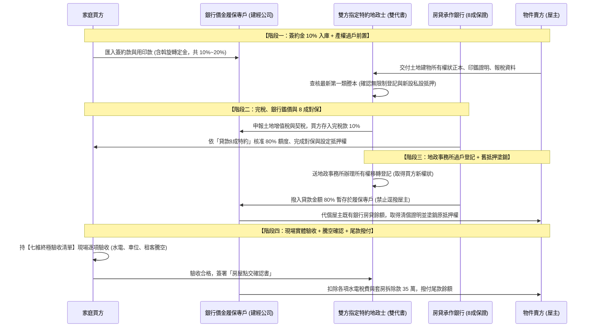
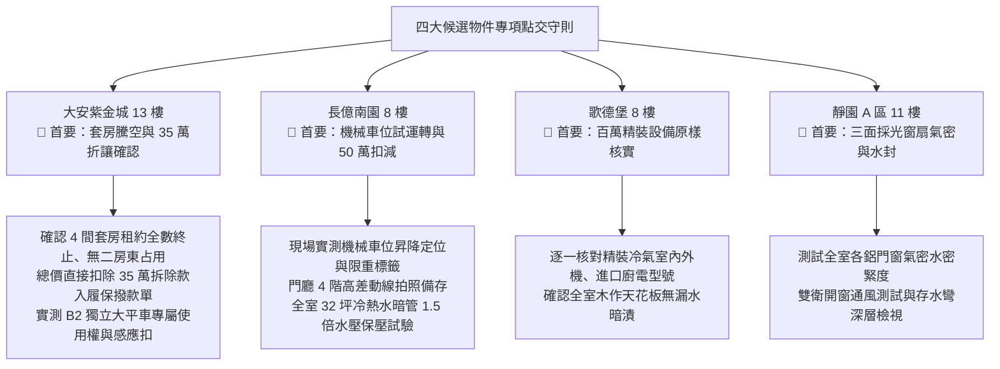

# 全案購屋實戰第一千零二部：中古大樓成屋買賣簽約點交全流程法務防線、履約保證金流管控與買方終極交屋查驗清單

## 導言：由談判勝局跨入法律產權交割的終極守護

在經歷《全案購屋實戰》系列一千零一部的精密洗禮後，家庭買方已在實體屋況快篩、結構公設體檢與價格斡旋博弈中確立了無可撼動的優勢。然而，在台灣不動產成屋交易的實務歷程中，「談好價格」僅僅完成了置產征途的 50%。從簽署《成屋買賣契約書》、支付各期自備款、銀行申貸對保、完稅完契、產權過戶登記，直至最後的「現場實體點交與履約保證專戶結案撥款」，整個法律與金流交割期長達 30 至 60 天。

在這段跨度長、資金流動龐大的法務交付期間，買方家庭隨時面臨著幾大致命的法律與財務地雷：
1. **屋主一屋二賣、抵押權私設或在途假扣押查封**：簽約後若未強制承作合法之「第一類建經公司買賣價金履約保證」，買方已付之數百萬元頭期款極易被不肖屋主或惡質代書捲款潛逃；或屋主在外積欠民間高利貸，在過戶在途期間房屋突遭法院查封貼封條，導致買方血本無歸。
2. **前手租客賴著不走或二房東糾紛（大安紫金城 13 樓專屬風險）**：原為學生出租套房之物件，若合約未嚴格約定「騰空點交前置條件與高額遲延罰則」，產權過戶後買方可能面臨「買賣不破租賃」之惡性占有，耗費數年進行遷讓房屋民事訴訟。
3. **屋主故意以現況交屋免除滲漏水擔保責任**：賣方於特約條款中私自偷渡「本買賣標的以現況交屋，賣方不負瑕疵擔保責任」之免責霸王條款，試圖將暗管爆裂、壁癌漏水與機電老化成本全數轉嫁給買方。
4. **驗收瑕疵未除卻遭強制代書撥款**：點交時發現嚴重結構滲漏或附贈設備遭偷換，若履保合約欠缺「買方未親簽點交單前絕對禁止擅自撥款之不可撤銷指示」，建經公司常迫於賣方壓力逕行放款，使買方喪失最後的尾款扣留制衡權。

為此，本第一千零二部全書深入解構買賣簽約至點交之全流程法務閉環防線、銀行申貸履保實戰金流圖譜、以及買方交屋必備的「七維終極驗收實體清單」，為全家資產交割築起堅不可摧的法律鋼鐵護城河。

---

## 一、成屋買賣法律交付全流程與履保金流控管圖譜

---

## 二、買賣契約書四大核心法律條款深度解構與排坑指南

在簽約當日，買方必須在代書桌前嚴格審閱契約內容，堅決剔除所有對買方不利的陷阱條文：

### 1. 履約保證（Escrow）之排他與安全規範
- **條款必備文字**：
  > 「本契約之全部買賣價金（包含定金、簽約款、用印款、完稅款、銀行貸款及尾款），雙方合意委任 **第一類金融機構（如兆豐、合庫、台銀之指定建經公司）** 辦理『買賣價金履約保證』。買方所有款項一律直接電匯至履約保證專屬虛擬帳號；非經買方親自完成實體驗收並簽署『買賣標的物點交確認書』前，代書與建經公司絕不得以任何理由擅自將專戶款項提前撥付賣方或其指定第三人。賣方若要求動用專戶款項，買方有絕對否決權。」
- **避坑核心**：絕不採用房仲自營未受銀行信託保障之二類履保，防止建經公司挪用款項。

### 2. 現況交屋條款之破除與法定瑕疵擔保維護
- **陷阱辨識**：仲介契約常印有「買方同意按現況點交，交屋後賣方免除民法物之瑕疵擔保責任」。
- **反制修改**：強制劃掉該句，並加註以下防護文字：
  > 「本買賣契約所稱『現況點交』，僅指買賣標的物之室內格局、隔間與附贈設備按簽約當日看屋之現狀交付。**賣方依《民法》第 354 條至第 365 條所應負之法定物之瑕疵擔保責任（包含但不限於房屋結構安全、非凶宅、非海砂輻射、以及全室暗管與牆體之防滲漏水擔保責任）絕不因現況點交而免除或縮減**。自交屋日起算壹年內，若標的物發生滲漏水或非自然身故等重大瑕疵，賣方仍應負完全修復與損害賠償之責。」

### 3. 大安紫金城專用：租賃契約終止與騰空點交強制執行條款
- **條款必備文字**：
  > 「賣方保證於所有權移轉登記前，現有各出租套房之所有租賃契約（含口頭與書面）必須合法終止，租客全部遷出，室內留置物與廢棄物徹底清空。若於約定點交日仍有租客占用或雜物留置，視同賣方給付遲延，每逾一日賣方應按買賣總價萬分之五支付遲延違約金；若逾期超過十四日仍未騰空，買方得逕行解除契約，賣方除應無條件全額退還專戶款項外，並應支付同額違約罰金。」

### 4. 產權登記與車位分管協議核實條款
- **條款必備文字**：
  > 「賣方保證配賦之停車位（大安紫金城 B2 獨立平面車位；長億南園機械車位），其專屬使用權之『規約分管協議書』正本、車位編號竣工圖說與車位鑰匙/感應扣於點交時齊備交付。賣方保證該車位無積欠公共管理費、無被管委會強制法拍或挪移之情事，且產權持分無任何查封限制登記。」

---

## 三、買方現場實體驗收「七維終極驗收清單」

交屋當天，買方家庭應攜帶工具包，按照以下七個維度進行地毯式逐項勾稽：

| 驗收維度 | 實地查驗重點與操作工序 | 合格判定標準 | 瑕疵處理對策 |
| :--- | :--- | :--- | :--- |
| **一、結構與牆體** | 以強光手電筒照射大樑兩端、柱頂柱底塑性鉸接區及外牆角隅。 | 主要樑柱無 0.3mm 結構裂縫；窗框無對角斜裂紋。 | 拍照記錄，要求賣方出具結構安全技師鑑定書。 |
| **二、給水與水壓** | 水壓錶接蓮蓬頭，全開全關水龍頭測動壓，全關測靜壓保壓 15 分鐘。 | 靜水壓恆定於 $1.8 \sim 2.5\text{ kgf/cm}^2$，無超壓漂移（防 PRV 穿孔）。 | 暫扣尾款 5 萬元，要求更換管道間減壓閥組。 |
| **三、排水與存水彎** | 廚房洗碗槽、雙衛面盆蓄水 8 分滿瞬間拔塞放水；馬桶連沖 3 次。 | 排水順暢渦流強勁；存水彎無「咕嚕」破封吸乾聲。 | 要求賣方僱工通管並排查通風呼吸閥。 |
| **四、電力與接地** | 相位測試器插入全室插座按 GFCI 鈕；配電箱觸摸無溫升與焦味。 | 三孔插座接地正常，漏電斷路器瞬態跳脫，外殼無漏電。 | 要求水電技師重新壓接接地銅排並補設地線。 |
| **五、消防與避難** | 抬頭檢視灑水頭玻璃球液體；按壓梯間緊急照明燈 TEST 鈕。 | 灑水頭紅色液體清澈未遭油漆污染；緊急照明亮強光 ≥ 3 分鐘。 | 扣留公設維修款，通報管委會更換鋰鐵燈具。 |
| **六、車位與動線** | 親自試停大安 B2 平車或長億機械車位，操作升降台車。 | 平車倒車順暢無死角；機械車位昇降鏈條運作平穩無異響。 | 車位若有尺寸爭議或機電卡滯，拒簽車位點交單。 |
| **七、騰空與清潔** | 巡視所有房間、衣櫥、陽台、天花板維修孔與管道間。 | 租客全數遷離；無廢棄家具雜物，清潔至掃清狀態。 | 若有留置物，依特約自尾款扣除 2 萬元清運費。 |

---

## 四、四大主力候選物件交屋點交專項攻防守則

### 1. 👑 大安紫金城 13 樓 (`PROP_10`) 點交核武器
- **租約騰空現場見證**：點交當天，買方必須要求賣方出示「所有套房租戶之租賃終止解約協議書」與「押金退還簽收單」，並親自更換全戶大門玄關門鎖鎖芯（C 級防盜鎖芯），徹底杜絕前租客持有舊鑰匙擅自闖入。
- **35 萬拆除款實扣驗收**：在建經公司的履約保證最終撥款結算單上，明確載明成交總價扣減 35 萬元，由買方實質取得該筆翻修現金。
- **B2 獨立大平車點交**：領取車道感應磁扣（至少 2 份），親自將車輛停入車位，並要求管理室完成車位承租使用人車號異動登記。

### 2. 🌟 長億南園 8 樓 (`PROP_106`) 點交核武器
- **機械車位實動驗收**：要求大樓配合之機械車位保養廠商技師到場，現場操作機械台車上升、下降與橫移各 2 次，確認限位極限開關無失靈、鋼索無斷絲、馬達無高溫異音。
- **50 萬讓價落實**：以車位規格與公設梯廳缺失爭取之折讓金額，確保於履保尾款結算時全額扣減。

---

## 五、全案總結：守住最後防線，迎向百年安居

買賣房屋簽約點交，是所有工程體檢與談判博弈的最後收割戰場。買方家庭只要**死守「買賣價金履保專戶」、嚴格落實「貸款八成不成解約退定」、堅持「騰空點交與法定瑕疵擔保不可免除」、並手持「七維驗收清單」寸步不讓**，便能在最後關頭阻絕一切法律與實體風險，圓滿實現全家資產保值、生命安全與世代安居之終極願景！
