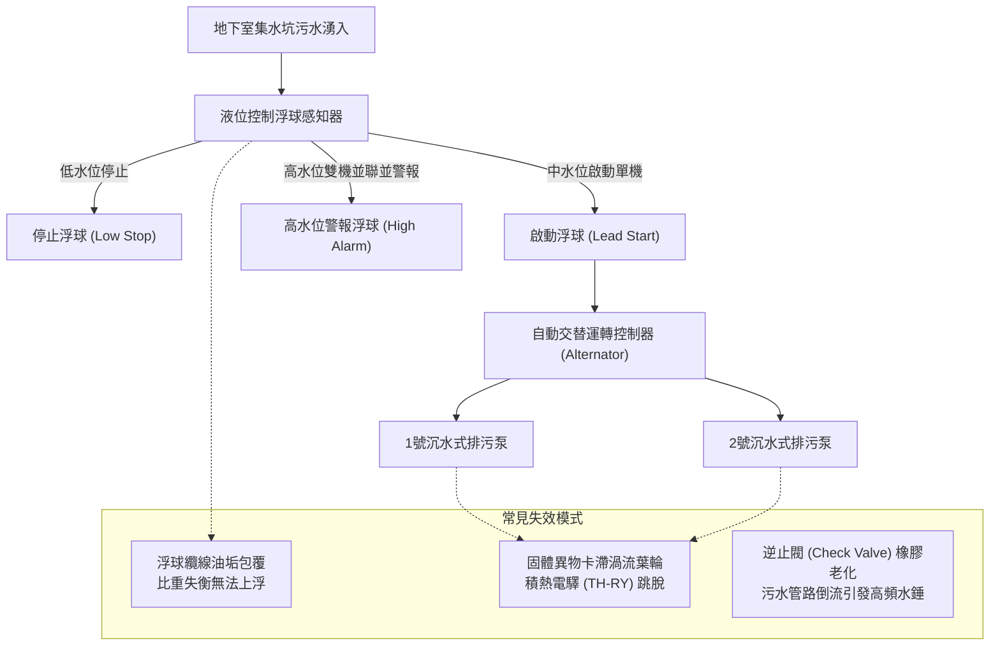
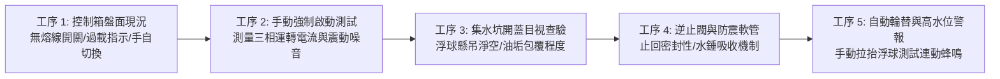
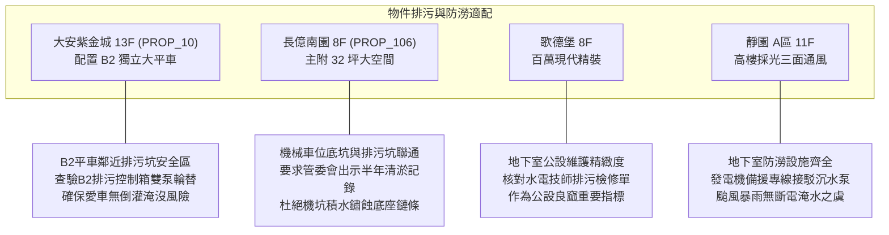

# 全案購屋實戰第一千零五十一部：中古大樓地下室集水坑沉水式排污泵自動液位控制浮球開關結垢失靈與過載跳脫體檢工序全書

## 前言：地下生命線的心臟——排污防澇與液位聯防極致體檢

在中古大樓全生命週期安全體系中，地下室集水坑（Sump Pit）與沉水式排污泵（Submersible Sewage Pumps）承擔了整棟建築雨水滲流、洗車廢水、地面排水乃至污水溢流的最終抽排重任。一旦浮球開關（Float Switch）因長期浸泡於油污、泥沙與化學雜質中發生結垢黏滯、浮力失衡，或沉水泵馬達葉輪遭異物卡死導致過載熱跳脫，極易引發地下室嚴重倒灌淹水，直接危及發電機房、高低壓變電盤及停放車輛。

本手冊為《全案購屋實戰》系列第 1051 部，深入解析中古大樓地下室集水坑沉水排污泵、三段式浮球液位控制、自動交替切換控制器（Alternating Relay）之機電體檢與買方防禦實務，並對接永義房屋周小姐實勘之決戰考慮物件。

---

## 第一章 地下室集水坑與沉水排污泵系統架構與失效機理

### 1.1 三段式水銀/微動浮球開關之工作極限
1. **停止水位（Stop Level）**：沉水泵馬達頂部通常須維持最小淹沒深度（Submergence Depth，約 15~25 cm），以利用坑內水體為馬達外殼進行水冷散熱。浮球纜線若過度垂墜導致排乾水位過低，沉水馬達將面臨無水乾燒燒燬。
2. **第一段啟動水位（Start Level）**：水位上升觸發單台泵浦啟動。大樓應配置交替繼電器，讓 1 號泵與 2 號泵輪流運轉，平衡磨損。
3. **第二段緊急/高水位警報（High Water Alarm Level）**：當暴雨或大量廢水湧入單台泵不及抽排，液位升至此點時，兩台泵浦強制雙開並聯抽水，同時向警衛室中央監控盤與受訊總機發出警報蜂鳴。

### 1.2 浮球結垢失靈之致病過程
- **油脂結晶附著**：洗車排水與油水混流時，高分子油脂附著於浮球塑料外殼，使浮球自重增加，浮力不足以驅動內部微動開關導通，造成水位暴漲卻完全不抽水。
- **纜線纏繞打結**：抽水時產生的局部渦流，容易使多根相鄰的浮球懸吊纜線相互纏繞扭結，開關卡死於特定角度，造成泵浦持續乾抽運轉不休或全無反應。

---

## 第二章 現場查驗沉水排污泵與控制箱五大工序

### 2.1 控制箱與保護電驛查驗（工序 1 & 2）
- **手動/自動選擇開關（Manual-Off-Auto）**：切至手動（MANUAL），確認泵浦立即運轉，聽音辨識軸承運轉聲是否有研磨卡死雜音。
- **過載保護器（TH-RY / OLR）**：檢視盤內積熱電驛設定值是否精確匹配馬達額定滿載電流（FLA）。若曾跳脫，不得強行重置，需以鉤錶實測運轉電流是否在正常規格範圍內。
- **三相絕緣電阻測試**：使用 500V 高阻計（Megger）測量馬達繞組對地絕緣阻抗，標準值須大於 5 MΩ（不得低於 1 MΩ）。

### 2.2 集水坑內部與管閥件檢驗（工序 3 & 4）
- **沉水泵起吊導軌（Guide Rail System）**：沉水泵是否配有雙軌式不銹鋼快拆座與吊索，以利故障時不必抽乾污水即可直接吊起維修。
- **出水管逆止閥（Check Valve）**：排污立管底部必須配置球型或全通徑旋啟式逆止閥。停機瞬間，觀察逆止閥閥瓣是否精準閉合；若逆止閥橡膠老化漏水，立管蓄存之污水將全數倒灌回集水坑，形成頻繁啟動循環並產生猛烈水錘。
- **防震金屬軟管**：排污泵出口段須具備 SUS304 雙波金屬軟管，隔離泵體運轉震動，避免管震沿著結構樑傳導至一樓住戶客廳引發低頻共振噪音。

---

## 第三章 永義房屋實勘主力物件地下室排水防護體檢

### 3.1 大安紫金城 (`PROP_10`) —— B2 獨立大型平面車位之安全防禦
- **資產防護核心**：B2 獨立大平車為本案溢價核心（價值 180~200 萬）。車位鄰近區域之集水坑與排污泵浦若失靈，地下二層積水首當其衝。
- **實地查驗指針**：
  1. 檢視地下室配電室內「污水/雨水排污泵控制盤」，確認運轉指示燈號均為綠燈正常（非紅燈故障）。
  2. 確認台電停電時，緊急發電機動力匯流排已自動旁路供電給地下室排污沉水泵，防止停電時暴雨淹沒車道。

### 3.2 長億南園 (`PROP_106`) —— 機械車坑與地下排水系統串聯體檢
- **痛點轉化籌碼**：長億南園配置機械車位（限重 1.6 噸），機械坑底若因鄰近集水坑浮球結垢回湧，坑底鏈條與油壓缸將迅速鏽蝕爛穿。
- **談判籌碼運用**：實地抽查地下室集水坑沉澱池，若有厚重油泥未清或單泵故障待料，立即記錄作為與屋主議價之實體公設維護瑕疵，力壓開價 998 萬往 745~760 萬靠攏。

---

## 第四章 買方購屋驗收與管委會管理合約檢驗條款

1. **地下室集水坑定期清淤與泵浦檢測特約**：
   > 「賣方應向管委會調閱近一年地下室化糞池、集水坑抽除清淤紀錄及沉水排污泵例行維護報告；買方交屋驗收時，得要求社區機電廠商現場操作手動強制排水與高水位蜂鳴警報測試。」
2. **共用排水設施修繕責任釐清**：
   > 「地下室公共排污系統若於交屋日前已列入管委會待修決議或重大瑕疵待更換事項，相關維修分攤款項應由賣方全額結清負擔。」

---

## 結語

地下室排污防澇系統是大樓隱蔽無聲但至關重要的心臟。買方掌握浮球控制、交替運轉與過載保護之核心細節，不僅徹底杜絕車輛財產泡水之災，更能從公設維護細膩度精準判斷大樓管委會體質，出價談判胸有成竹。
