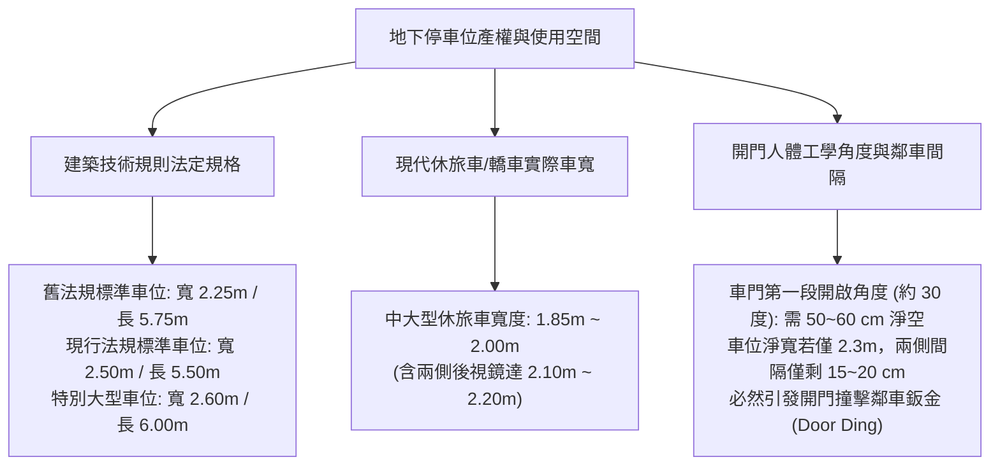
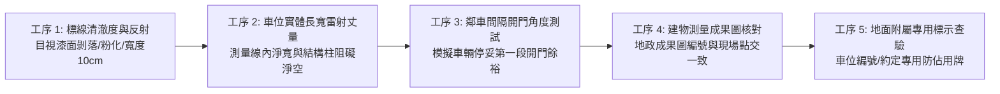
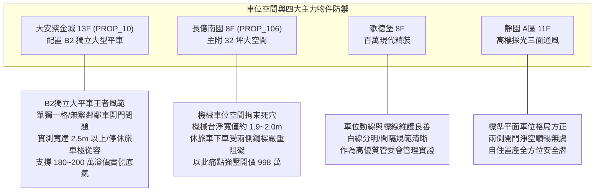

# 全案購屋實戰第一千零五十七部：中古大樓地下室車位界線標線漆面磨損粉化車位淨寬不足鄰車開門碰撞與產權權利範圍鑑界體檢工序全書

## 前言：寸土必爭的私有空間——地下車位淨寬標線、開門餘裕與產權鑑界極致體檢

在中古大樓地下室公共設施與約定專用空間中，汽車停車位之「劃線標界（Parking Stall Markings）」不僅標定了每一位住戶的每日停車邊界，更是防範鄰車開門撞擊鈑金（Door Ding）、保障上下車人行動線以及釐清共有專用權利範圍的**核心產權界線防線**。然而，多數屋齡 15~30 年的中古社區，因地下室潮濕、輪胎反覆輾壓研磨，車位標線漆面多已粉化磨損模糊；更常見的是早期建商為塞入更多車位，將車位淨寬壓縮至 2.25~2.3 公尺（甚至因大柱擠壓僅剩 2.1 公尺），導致休旅車停入後左右兩側完全無法正常開啟車門，引發無休止的鄰里刮車糾紛與產權鑑界訴訟。

本手冊為《全案購屋實戰》系列第 1057 部，深入解析建築技術規則車位法定尺寸演進、現代車寬與人體工學開門角度幾何學、熱熔反光標線漆（Thermoplastic Paint）與環氧樹脂標線耐磨工藝、專用車位地政鑑界測量與買方防禦實務，並深度對接永義房屋周小姐實勘帶看之四大決戰考慮物件。

---

## 第一章 車位標線規格力學與空間干涉機理

### 1.1 法定尺寸演進與中古大樓空間先天硬傷
1. **舊制規範（民國 102 年前）**：
   - 標準停車位寬度僅規定為 **2.25 公尺**，長度 5.75 公尺；若緊鄰結構柱或牆壁，得放寬為 2.3~2.4 公尺。
   - 早期以 1.6~1.7 公尺之傳統四門轎車為基準設計。
2. **現代車型擴大趨勢**：
   - 現代熱銷之休旅車（如 RAV4、CR-V、Model Y、Lexus RX、Benz GLC 等），車寬普遍達 **1.85 ~ 1.95 公尺**（若展開後視鏡則達 2.15 公尺）。
   - 當 1.9 米車寬停入 2.25 米之舊式車位時，左右剩餘總寬僅 **35 公分**（每側僅 17.5 公分），成人根本無法側身下車，駕駛人被迫貼緊鄰車停放，稍有不慎即敲擊鄰車車門。

### 1.2 標線材質與磨損粉化公害
- **熱熔反光標線（Thermoplastic Paint）**：內含玻璃珠與合成樹脂，厚度約 2~3 mm，耐磨性強。但若地坪為環氧樹脂（Epoxy），熱熔高溫易破壞環氧樹脂塗層。
- **冷塗環氧樹脂標線漆（Two-pack Epoxy Marking Paint）**：與地坪結合力強，耐油耐化學品。劣質壓克力水性漆 1~2 年即磨耗斑駁，一旦邊界模糊，即衍生「吃線停車」爭議。

---

## 第二章 現場實地查驗車位標線與空間五大工序

### 2.1 車位實體長寬雷射測距（工序 1 & 2）
- **標線寬度與內徑淨寬**：標準車位白線寬度為 **10 cm ~ 15 cm**。測量車位淨寬時，必須以**兩側標線內緣（Inside-to-Inside）**為準，不得將白線寬度膨風計入。
- **結構柱干涉扣除**：若車位側面緊鄰結構柱，必須丈量柱體突出標線之尺寸。若柱體侵入車位內部，實質可用淨寬小於 **2.20 公尺**者，即屬重大空間瑕疵。

### 2.2 模擬實車開門下車極限（工序 3）
- **第一段開門定位點**：請家人或仲介將車輛停入鄰車位，買方將中大型車輛開入目標車位中央停妥。
- **下車人體工學實測**：
  - 開啟駕駛座車門至第一段卡位點（約開門 30 度，開門寬度約需 **50~60 cm**）。
  - 檢視車門最外緣凸點（門腰線）距離鄰車車身或結構柱是否至少保有 **10~15 cm** 之安全間隔。若車門開至第一段即直接撞擊鄰車，日後每日返家將痛苦不堪。

### 2.3 產權成果圖與現地鑑界核對（工序 4 & 5）
- **建物測量成果圖套繪**：調閱謄本所附之「地下室建物測量成果圖」，核對該車位號碼於地政圖面之相對幾何位置（靠柱、靠牆、第幾格），防止管委會私下塗改車位號碼導致買到「幽靈車位」或「縮水車位」。

---

## 第三章 永義房屋實勘主力考慮物件車位空間適配與談判籌碼

### 3.1 大安紫金城 13 樓 (`PROP_10`) —— B2 獨立大型平面車位的絕佳優勢
- **資產核心價值**：配置 B2 獨立大型平面車位（資產溢價高達 180~200 萬）。
- **實勘標線空間指標**：
  1. 該車位為**獨立大平車**（非連夾三台之夾心餅乾車位），一側靠牆或靠大柱，另一側為開闊走道或保留獨立緩衝區。
  2. 實測淨寬達 **2.50 公尺**以上，即使停放大型休旅車，左右車門皆可大角度開啟，完全免除與鄰車互相碰撞開門之夢魘，此點是支撐該案保值抗跌之核心台柱。

### 3.2 長億南園 8 樓 (`PROP_106`) —— 機械車位淨寬拘束與議價必殺技
- **空間致命缺憾**：長億南園車位為機械式，機械載台兩側均有防墜鋼板、傳動鏈條與立柱，實質開門淨寬被壓縮至極限。休旅車停入後，駕駛與乘客下車時車門必受機械立柱阻擋，若身形稍胖甚至需在車道先行下車才能將車駛入機械台。
- **議價策略運用**：將機械車位進出極度不便、開門空間嚴重受阻，與機械限重 1.6 噸合流，向賣方表明日後轉手性抗性極高，力壓開價 998 萬，強攻 745~760 萬之合理成交區間。

---

## 第四章 買方購屋特約防護與交屋鑑界點交清單

1. **車位標界與權利範圍無爭議特約**：
   > 「賣方保證本買賣契約所附之車位（編號：B2-XX），其現地劃設之標線位置與地政機關核發之建物測量成果圖及社區規約約定專用圖面完全相符，無越界佔用、私自變更尺寸或侵占公共走道之情事；點交時若發現標線不清或產權範圍不符，賣方應負責重新鑑界劃線並負擔全部費用。」
2. **交屋前車位鑑界點交三部曲**：
   - 第一步：手持捲尺現場丈量長寬，確認線內淨寬達到契約承諾規格。
   - 第二步：核對車位編號噴漆與現行產權謄本及管理費繳納單一致。
   - 第三步：白天與夜間各勘查一次，確認車位周圍照明充足，地面無油漬覆蓋標線。

---

## 結語

車位標線雖僅寥寥數筆，卻劃分出了家庭每日用車的尊嚴與平靜。買方以專業工序檢驗標線清澈度、扣除柱體後實質淨寬與開門人體工學餘裕，不僅能避開「買得起車、停不進位、下不了車」的痛苦陷阱，更能以此精準洞悉物件真實資產價值，在價格談判中牢牢佔據絕對主動！
