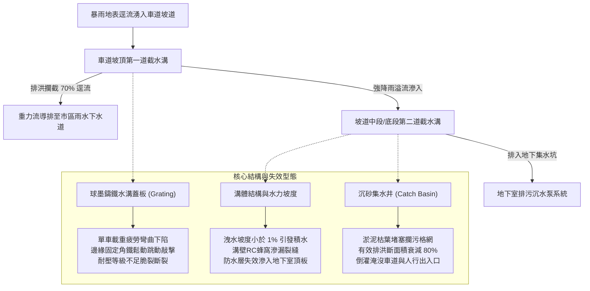
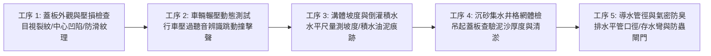
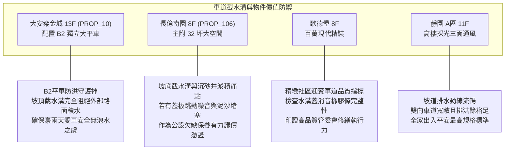

# 全案購屋實戰第一千零五十三部：中古大樓地下室車道截水溝鑄鐵水溝蓋變形跳動排水斜度不足倒灌與沉沙泥淤積體檢工序全書

## 前言：暴雨防澇的第一道咽喉防線——地下車道坡道截水與導排極致體檢

在中古大樓地下停車場防洪系統中，地下車道出入口之「坡道截水溝（Trench Drain / Interceptor Drain）」是抵禦地表逕流與強烈暴雨湧入地下室的**第一道核心生命防禦線**。一旦鑄鐵水溝蓋板因長期承受重型休旅車與垃圾車輾壓發生金屬疲勞彎曲、螺栓鬆脫導致車輪壓過時發出劇烈金屬撞擊跳動聲，或溝體洩水坡度不足、沉砂池（Catch Basin）常年堆滿泥沙落葉導致暴雨時排水不及逆向倒灌，極易引發地下室嚴重積淹水，危及地下發電機、變電室及所有停放車輛。

本手冊為《全案購屋實戰》系列第 1053 部，深入解析中古大樓車道截水溝結構強度、水力坡降計算、重型球狀石墨鑄鐵蓋板耐壓等級（D400/C250）、沉砂集水井清淤工序與防臭落水設計，並精準對接永義房屋周小姐實勘帶看之四大決戰考慮物件。

---

## 第一章 地下車道截水溝系統架構與水力失效機理

### 1.1 截水溝位置與多階防禦水力學
1. **坡頂第一道截水溝（Top Interceptor Drain）**：位於建築基地紅線與車道下坡交界處，其坡度必須呈微凸形雙向截水，阻絕道路側溝溢流之洪水。
2. **坡底第二道緩衝截水溝（Bottom Sump Drain）**：位於坡道與地下室平坦地面之過渡段，負責收集雨天車輪夾帶之雨水、坡道側壁滲水及第一道截水溝溢流之殘水，其排水立管直通地下室集水坑。

### 1.2 蓋板耐壓等級與跳動金屬噪音之公害
- **耐壓載重等級（EN 124 / CNS 標準）**：
  - **C250 級（25 噸）**：僅適用於慢速轎車通道。
  - **D400 級（40 噸）**：標準重型車道適用，能承受垃圾車、消防車與重型 SUV 長期反覆重載衝擊。
- **跳動噪音（Rattling Noise）機理**：溝體兩側預埋之 L 型鍍鋅角鐵因車輪剪力衝擊導致化學錨栓鬆脫脫層；蓋板未具備高強度螺栓鎖固或防震防噪音橡膠條（EPDM Cushion Strip），每當車輛經過即產生 80~90 分貝金屬撞擊巨響，嚴重干擾一樓與低樓層住戶安寧。

---

## 第二章 現場實勘車道截水溝五大檢驗工序

### 2.1 蓋板變形與動態跳動實測（工序 1 & 2）
- **目視與平整度查驗**：使用金屬直規測量水溝蓋板中心跨距之撓度變形量，若中心下陷超過 3 mm 或表面鑄鐵有剪切裂紋，代表材料已達疲勞極限，隨時有被重車壓穿風險。
- **實車輾壓試音**：請代書或仲介開車以 10~15 km/h 速度駛過截水溝，仔細聆聽是否有清脆金屬敲擊聲或晃動位移；合格之重型截水溝蓋板應具備螺栓鎖緊機構或沉頭定位槽，車過平穩無聲。

### 2.2 溝底水力坡降與排洪斷面（工序 3 & 4）
- **洩水坡度檢驗**：截水溝底縱向坡度至少需達 **1/100 (1%)** 以上。現場若發現溝底長期殘留死水、黑臭青苔或乾涸泥痕，即表示水力坡度不足或中段下陷，強降雨時排水斷面將大打折扣。
- **沉砂井攔污提籃（Silt Basket）**：掀開沉砂井蓋板，檢查是否配置 SUS304 不銹鋼攔污提籃；若淤泥堆積厚度超過井深 1/3，顯示社區長期忽視公共排水維護，颱風季極易瞬間癱瘓。

### 2.3 導水管徑與防臭防蟲（工序 5）
- **重力導水管口徑**：坡底截水溝通往地下集水坑之排水分管，口徑不得小於 4 吋（100 mm）或 6 吋（150 mm），管壁不得有結晶碳酸鈣垢縮小通水斷面。
- **存水彎防臭與防氣蝕**：地下室截水溝排入雨水坑或污水池處，應設有深水封存水彎或單向防臭閥，防止集水坑化糞池之硫化氫臭氣與蚊蟲順著車道截水溝竄出地面。

---

## 第三章 永義房屋實勘主力考慮物件車道排水適配與議價籌碼

### 3.1 大安紫金城 (`PROP_10`) —— 頂級大平車的防洪命脈
- **資產保護焦點**：配置 B2 獨立大型平面車位（資產溢價高達 180~200 萬）。地下二樓車位最忌外部豪雨倒灌。
- **實地查驗重點**：
  1. 大安紫金城車道出入口位於大慶街/復興路商圈地勢相對平坦處，坡頂必須具備連續且完整的重型截水溝，並確認市政雨水側溝無倒灌現象。
  2. 車道坡道防滑金剛砂（Ramp Grooving）與截水溝交接處無破損碎裂，維持進出安全。

### 3.2 長億南園 (`PROP_106`) —— 公設機電與排水維護折讓戰術
- **談判切入點**：長億南園主建物大（32 坪），但若地下車道水溝蓋板鬆動發出擾人跳動噪音，或坡底水溝滿是淤泥，將直接加劇地下室潮濕與蚊蟲問題。
- **出價壓制策略**：將水溝蓋翻修費用（每米更換防震球墨鑄鐵蓋板約 4,000~6,000 元）及集水坑清淤工程納入瑕疵評估，強化開價 998 萬大砍至 745~760 萬之技術論點。

---

## 第四章 買方購屋特約防護與交屋驗收確認條款

1. **地下室車道與公共排水暢通保證特約**：
   > 「賣方保證本社區地下停車場車道截水溝及附屬排水管道通暢無阻，無常態性倒灌或積水不退情事；交屋驗收前若管委會已有重大排水修繕決議或水溝蓋板更換案，所生公攤費用由賣方全額負擔。」
2. **車道噪音公害排查要點**：
   - 買方在實地勘查時，應選在上下班通勤尖峰時段（上午 7:30~8:30 或傍晚 17:30~18:30），駐足於車道口一樓大廳或一樓中庭，實地感受車輛碾過水溝蓋板時是否引發結構共振轟鳴聲。

---

## 結語

車道截水溝雖伏於地表，卻是捍衛整棟大樓地下資產免遭洪水吞噬的守門員。買方學會以專業工序檢驗水溝蓋抗壓強度、洩水坡度與沉砂井淤積，不僅能在看屋時洞察大樓管理體質，更能精準壓制不合理開價，捍衛一生置產血汗錢！
