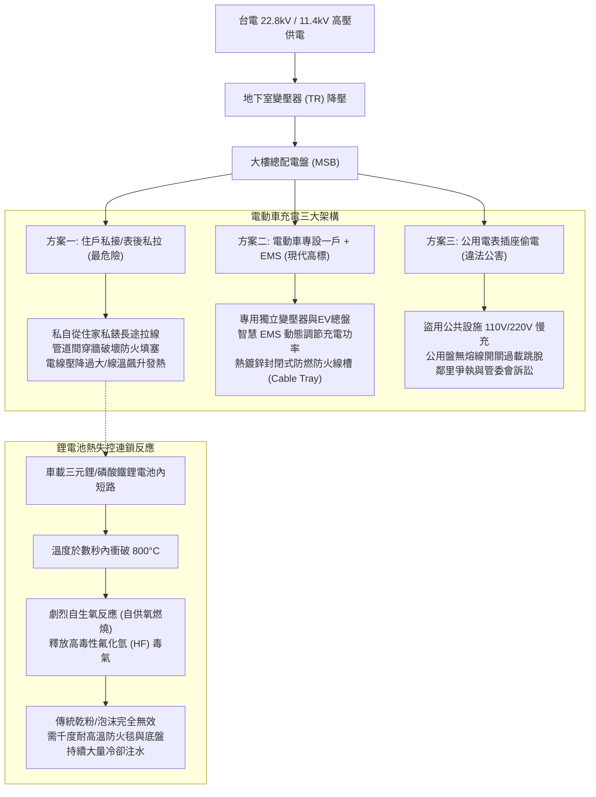
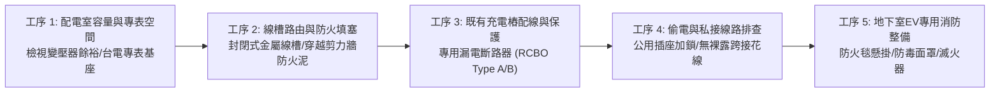
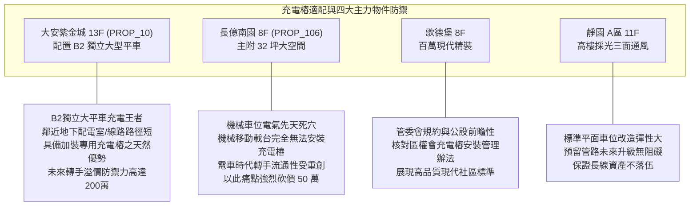

# 全案購屋實戰第一千零五十九部：中古大樓地下室車位電動車充電樁EMS能源管理系統配電容量不足私設飛線偷電與消防鋰電池熱失控滅火體檢工序全書

## 前言：迎向能源轉型的大考驗——地下車位電動車充電樁、配電盤負載與消防熱失控極致體檢

在現代中古大樓全生命週期轉型中，地下停車場「電動車（EV）充電設備與能源管理系統（EMS / Energy Management System）」已成為決定大樓未來 10~20 年資產流動性與抗跌保值能力的**關鍵機電指標**。然而，多數屋齡 15~30 年的中古社區，在興建之初完全未預留電動車充電容量，導致部分車主私自從公用插座或私接電線「飛線偷電」，造成大樓公用配電盤過載跳脫、電線發熱短路；更為嚴峻的是，充電樁若缺乏全社區智慧 EMS 削峰填谷負載調控，或地下室缺乏針對「鋰電池熱失控（Thermal Runaway）」的專用防火毯與大量注水冷卻系統，一旦起火將在地下封閉密室引發難以撲滅之化學毒氣烈焰，直接威脅全棟建築結構安全。

本手冊為《全案購屋實戰》系列第 1059 部，深入解析中古大樓地下室表後拉電（台電電動車專設一戶專用電表）與 EMS 系統架構、線槽防燃塗料、過載斷路保護、鋰電池熱失控滅火工法（浸水水箱/防火毯/底盤注水），並精準對接永義房屋周小姐實勘帶看之四大決戰考慮物件。

---

## 第一章 地下車位充電樁電氣架構與火災熱失控機理

### 1.1 台電「電動車專設一戶」與 EMS 系統核心準則
- **專設一戶獨立電表**：台電針對集合住宅推動之專屬受電架構，在地下室配電室設置獨立的「EV 專用總配電盤與計費電表槽」，徹底將電動車用電與住戶日常生活用電、公共設施動力用電（電梯、抽水機）實體隔離。
- **EMS 智慧能源管理核心**：
  - 尖峰離峰電價動態排程：引導車輛於深夜離峰時段（深夜 00:00~06:00）充電。
  - 動態負載調節（Dynamic Load Management）：當同時充電車輛過多、總電流接近變壓器安全閾值（通常為額定容量的 80%）時，EMS 自動調降各充電樁輸出電流（由 32A 降至 16A 或 8A），杜絕跳電危機。

### 1.2 鋰電池熱失控與地下密室火災之極限防禦
- **自生氧連鎖反應**：鋰電池單體熱失控後，正極材料在高溫下自分解釋放氧氣，即使完全隔絕外部空氣（窒息法無效），火焰仍會在電池包內部持續噴射燃燒。
- **地下室消防黃金配備**：
  1. **車用耐高溫防火毯（EV Fire Blanket）**：需耐溫達 **1,000°C ~ 1,300°C**，覆蓋全車以阻絕火焰向上蔓延至天花板消防撒水管與電纜線架，抑制有毒氟化氫濃煙。
  2. **底盤注水搶救裝置或移動式水箱**：直接向車底電池包以每分鐘數百公升清水持續冷卻降溫數小時，徹底吸收熱能。

---

## 第二章 現場實地查驗地下車位充電環境五大工序

### 2.1 變電室容量與線槽防火工藝（工序 1 & 2）
- **大樓餘裕用電容量**：調閱大樓水電竣工圖與契約容量，確認公設動力變壓器是否尚有 50kVA ~ 100kVA 以上之餘裕；若容量已被電梯與空調吃滿，未來全社區將無法安裝充電樁，除非斥資百萬升級變壓器。
- **金屬封閉線槽與防火填塞**：車道頂部走線必須為熱浸鍍鋅「封閉式蓋板金屬線槽（Cable Trunking）」，不得使用廉價 PVC 管或外露穿線。線槽穿透各防火區劃 RC 剪力牆時，貫穿孔周圍必須以具備 2 小時以上耐燃時效之「防火泥／防火發泡塞（Firestop Mortar）」緊密填實，防止火煙跨區竄流。

### 2.2 充電樁迴路漏電保護與私接線排查（工序 3 & 4）
- **專用漏電斷路器規格**：每具充電樁迴路分電盤內，必須配置獨立之「過電流保護兼漏電斷路器（RCBO）」，因電動車充電具備直流分量，規範要求採用 **Type A 或 Type B（具直流 6mA 平滑漏電檢測）** 規格，一般便宜的交流專用 Type AC 斷路器無法有效保護。
- **公用插座巡檢**：車道結構柱上的公用 110V 工務插座，管委會是否加裝「防盜金屬保護蓋鎖」，杜絕私接延長線慢充引發配電盤保險絲燒斷。

### 2.3 地下室專屬消防裝備（工序 5）
- **防火毯與排煙聯動**：車位步行距離 30 公尺內，是否設有專屬「電動車滅火毯保管箱」，並標註明確使用 SOP；地下室排風機是否與火警總機連動，具備將熱失控有毒氣體強制抽出地面的緊急排煙能力。

---

## 第三章 永義房屋實勘主力考慮物件充電樁適配與資產防禦

### 3.1 大安紫金城 13 樓 (`PROP_10`) —— B2 獨立大型平面車位的電動車升級優勢
- **資產核心價值**：配置 B2 獨立大型平面車位（市場溢價 180~200 萬）。
- **充電樁架設優勢**：
  1. 獨立平面車位後方靠結構柱，空間開闊，具備直接向管委會申請「表後專用金屬管線引至車位壁掛安裝 7kW / 11kW 充電樁」的絕佳物理條件。
  2. 車位位於 B2，若鄰近配電室，拉線距離短（工料成本省下數萬元），日後若轉手給特斯拉或各大品牌電動車主，將是全台中南區最搶手的頂級物件，抗跌保值實力無敵。

### 3.2 長億南園 8 樓 (`PROP_106`) —— 機械車位無法充電的時代致命傷
- **時代淘汰痛點**：長億南園配置機械車位，因載台隨時上下移動、左右橫移，金屬導線隨車台運動極易拉扯疲勞斷線引發電弧火花，全台消防法規與設備廠商均**嚴禁在移動式機械載台上安裝充電設備**。
- **談判籌碼運用**：在電動車市佔率高速突破的未來 5~10 年，無充電能力的機械車位物件將面臨嚴重的買盤萎縮。將「無法升級電動車充電、未來轉手折舊極大」作為致命破綻，合流 1.6 噸限重與 32 坪大空間修繕，對 998 萬開價痛下殺手，強壓至 745~760 萬。

---

## 第四章 買方購屋特約防護與管委會充電規約查核

1. **車位充電樁安裝權益保證特約**：
   > 「賣方應向管委會確認本社區現行規約是否已通過『住戶設置電動車充電設備管理辦法』，並保證本買賣契約所附之車位（編號：B2-XX）具備依大樓規約合法向台電及管委會申請申設充電設備之權利；若社區規約明文禁止任何形式之車位充電設備安裝，買方有權重新評估買賣條件或請求折讓價金。」
2. **看屋與簽約前管委會查核三問**：
   - 第一問：社區目前是否有住戶成功安裝充電樁？走專設一戶還是住家表後拉線？
   - 第二問：管委會是否已規劃全社區統一之 EMS 能源管理系統？
   - 第三問：地下室是否已配備耐高溫電動車專用防火毯？

---

## 結語

電動車充電樁已從「科技新潮的選配」轉化為「中古大樓資產保值的必備基石」。買方以專業工序檢驗大樓配電容量、線槽防火工藝與熱失控滅火整備，不僅能為全家長遠的用車生活超前部署，更能精準洞察社區管委會的遠見與活力，在資產保衛戰中永遠搶先一步！
