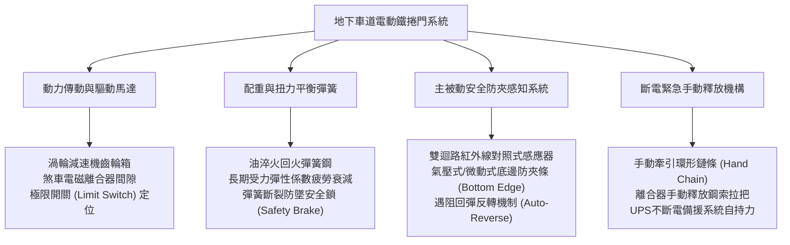
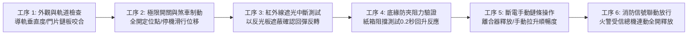
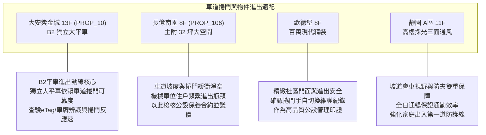

# 全案購屋實戰第一千零五十二部：中古大樓地下室車道電動鐵捲門防壓防夾紅外線感知器斷線扭力彈簧金屬疲勞與緊急手動鍊條卡死體檢工序全書

## 前言：車道咽喉要道——車輛人身安全防護與逃生通行極致體檢

在中古大樓地下室公設系統中，地下停車場坡道之「電動快速鐵捲門／防颱型捲門」是全體住戶每日進出頻率最高、機電耗損最劇烈之關鍵咽喉動線。一旦安全防夾（Safety Reverse / Photocell Sensor）失效、配重扭力彈簧（Torsion Spring）金屬疲勞斷裂，或台電斷電時緊急手動鍊條（Emergency Hand Chain）因久未潤滑氧化咬死，輕則砸毀愛車擋風玻璃與車頂，重則引發人員夾傷甚至在火災斷電時阻絕地下室人車逃生。

本手冊為《全案購屋實戰》系列第 1052 部，全面剖析中古大樓地下停車場電動捲門、紅外線對照式感知器、防夾底邊接觸感知帶、扭力彈簧平衡配重與手動釋放機構之查驗工序，並深度連結永義房屋周小姐實勘帶看之四大決戰考慮物件。

---

## 第一章 地下室車道電動捲門系統結構與致命風險機理

### 1.1 扭力彈簧疲勞與重力自由墜落風險
- **扭力平衡原理**：捲門門片重量動輒達 300~800 公斤，完全依靠上方橫軸兩側高張力油淬火回火彈簧（Oil-tempered Torsion Spring）提供抵消扭矩。正常設計壽命為 20,000 ~ 50,000 次升降循環。
- **金屬疲勞斷裂**：超過 15~20 年中古大樓，若未定期更換彈簧，彈簧鋼絲因應力腐蝕與剪切疲勞而突然斷裂。若捲門未配置「防墜安全剎車器（Spring Break Safety Device）」，門片將在重力加速度下如同斷頭台般瞬間砸下，致死致殘率極高。

### 1.2 主動與被動防夾安全機制
1. **對照式紅外線感應器（Through-Beam Photoelectric Sensors）**：安裝於車道兩側距地 30~50 cm（偵測車體）及 15~20 cm（偵測兒童與寵物）。光軸若遭灰塵泥沙覆蓋或震動偏移，捲門可能無法正常下放或誤判常開。
2. **接觸式底緣防夾膠條（Safety Sensing Edge）**：門片底端橡膠條內部配置導電橡膠或氣壓波導管。當門片下壓觸及障礙物阻力超過 5~10 kgf 時，需在 0.2 秒內觸發反向回彈上升至少 1.5 公尺。

---

## 第二章 現場實地查驗地下車道捲門六大工序

### 2.1 導軌與門片鏈板磨損檢驗（工序 1 & 2）
- **兩側導軌間隙**：兩側 SUS304 或鍍鋅導軌內部防風倒鉤與消音尼龍條是否完好；門片兩側端蓋與滾輪（Rollers）磨損間隙不得大於 5 mm，防止強風倒灌時門片脫軌脫出。
- **煞車滑行位移量**：按下「停止」鈕，門片慣性滑行距離不得大於 50 mm；若滑行過長，代表馬達煞車碟片（Brake Disk）來令片磨損殆盡或彈簧失效。

### 2.2 防夾反彈靈敏度實測（工序 3 & 4）
- **紅外線光幕測試**：在門片下放過程中，手持檢測板迅速切斷兩側紅外線光束，門片必須「立即停止並自動反轉全開」，不得有延遲或頓挫。
- **物理底邊防夾測試**：於車道中央放置高度 10 cm 之發泡膠墊或標準檢測塊，當門片碰觸檢測塊瞬間，底邊開關必須在下壓深度小於 20 mm 內感應並反彈上升。

### 2.3 斷電手動釋放與消防連動（工序 5 & 6）
- **手動牽引鏈條拉力**：切斷控制箱電源，拉動離合鋼索切換為手動模式，徒手拉動環形鐵鏈，門片應能以平穩力道（單人拉力小於 15 kgf）緩緩升起；鏈條軸承若嚴重卡死生鏽，即為重大消防安全缺失。
- **受信總機連動強制開啟**：大樓發生火災時，火警受信總機常開乾接點閉合，車道捲門必須強制連動啟動全開，確保消防車與住戶逃生無阻。

---

## 第三章 永義房屋實勘主力考慮物件車道進出動線深度體檢

### 3.1 大安紫金城 (`PROP_10`) —— 頂級大平車的車道進出順暢度防禦
- **資產關聯度**：配置專屬 B2 獨立大型平面車位（資產溢價高達 180~200 萬）。車道捲門之反應速度與 e-Tag / 車牌辨識系統的整合可靠度，直接決定每日用車之尊榮感與安全性。
- **查驗關鍵**：
  1. 實測捲門自感應開門至全開定位時間是否在 8~10 秒內（快速防颱捲門標準）。
  2. B2 坡道轉角處紅綠燈號管制系統（一進一出交替管制）是否與捲門連動正常，避免迎面撞車。

### 3.2 長億南園 (`PROP_106`) —— 車道管理與公設基金維護審查
- **議價策略**：長億南園車位為機械式，本就需排隊等待機械昇降，若車道鐵捲門又常因彈簧疲勞或感應器誤報故障停擺，住戶通勤時間將嚴重延誤。
- **現場切入**：調閱管委會歷次區權會紀錄與車道門維修單，若發現捲門馬達或彈簧曾有年久失修之報修爭議，即可作為壓制屋主 998 萬高開價之具體公設折讓憑據。

---

## 第四章 買方購屋點交防禦特約與管委會查核清單

1. **車道門與車位產權通行權無瑕疵保證特約**：
   > 「賣方保證本買賣標的所附之停車位，享有合法完整之車道通行及出入權利；買方得於點交前要求測試地下室車道電動捲門之車牌辨識/感應扣運作正常，且車道出入口無遭管委會限制通行之積欠管理費或產權爭議。」
2. **車道機電維護合約核查要點**：
   - 保養合約是否載明：每季至少進行一次「扭力彈簧應力檢測與潤滑」、「底邊防夾回彈壓力校正」及「不斷電系統（UPS）蓄電池放電測試」。
   - 捲門機體是否張貼合格機電廠商之「定期安全檢驗合格標籤」，且未過期。

---

## 結語

車道電動鐵捲門看似平凡，實為維繫每日家庭出入平安與車輛資產完好之命脈防線。買方以專業工序體檢捲門防夾、防墜與斷電手動釋放機構，不僅保障全家行車平安，更能從最微小的公設維護細節中，看穿社區管委會的真實管理品質！
