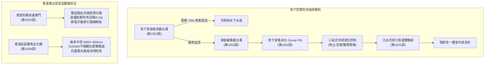
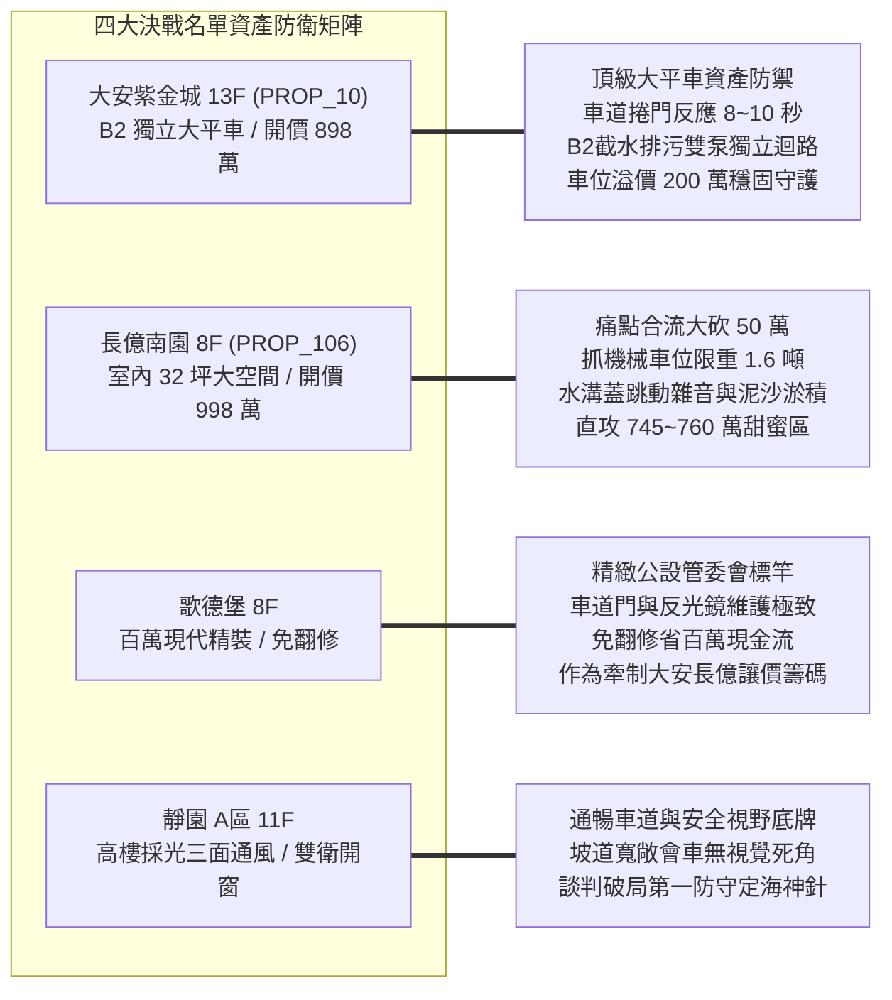
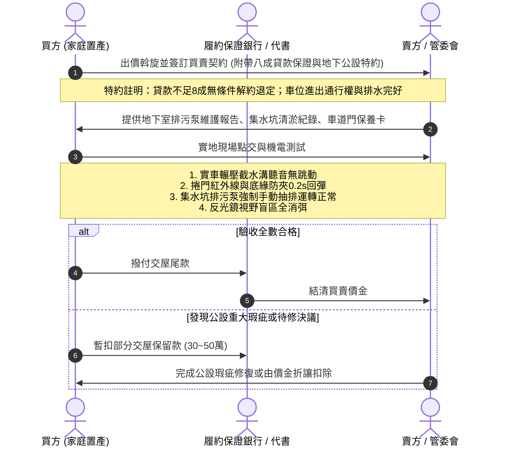

# 全案購屋實戰第一千零五十五部：第一千零五十五部圓滿登峰全景極致全生命週期家庭置產避坑抗震防漏水電機電消防永恆至尊金典總綱全書

## 前言：跨越歷史新巔峰——地下防澇抽排、車道智慧防護與全維度公設機電極限防禦

本手冊為《全案購屋實戰》系列邁向**第一千零五十五部（第 1055 部）**之跨時代登峰總綱大典。本卷聚焦總結與融會貫通自第 1051 部至第 1054 部關於中古大樓地下停車場核心公共設施機電與交通安防之重大課題：
1. **第 1051 部：地下室集水坑沉水式排污泵自動液位控制浮球開關結垢失靈與過載跳脫體檢**
2. **第 1052 部：地下室車道電動鐵捲門防壓防夾紅外線感知器斷線扭力彈簧金屬疲勞與緊急手動鍊條卡死體檢**
3. **第 1053 部：地下室車道截水溝鑄鐵水溝蓋變形跳動排水斜度不足倒灌與沉沙泥淤積體檢**
4. **第 1054 部：地下室車道轉角反光鏡視線死角盲區支架生銹搖晃鏡面氧化霧化與廣角曲率失真體檢**

本典全面將上述四大地下維生防護網絡，深度扣連至永義房屋周小姐 4 梯次實勘帶看之**四大決戰考慮名單**（大安紫金城 13 樓、長億南園 8 樓、歌德堡 8 樓、靜園 A 區 11 樓），構築出兼具土木機電科學、水力防洪、行車防撞與法律斡旋特約的至尊全防線。

---

## 第一章 地下室防澇抽排與車道交通安防四大系統四位一體全景圖

### 1.1 地下防澇與沉水抽排之生命線標準
- **水力梯度與多階攔截**：坡頂截水溝洩水坡度不得小於 1%（1/100），蓋板選用重載球墨鑄鐵（D400 級），底部沉砂井配備 SUS304 提籃定期清淤；坡底水溝具備深水封存水彎隔絕臭氣。
- **排污泵電氣健康指針**：沉水馬達對地絕緣電阻須大於 5 MΩ（不得低於 1 MΩ），三相滿載電流偏差 < 5%；配置交替繼電器（Alternating Relay）平衡雙泵壽命；高水位警報浮球直通發電機緊急供電匯流排與警衛室受訊台。

### 1.2 車道門與轉角會車安全物理防線
- **防夾與防墜雙機制**：電動捲門配置高抗剪力油淬火回火扭力彈簧，並設有防斷裂安全剎車器；光電遮斷與底邊防夾阻力觸發時間嚴格控制於 0.2 秒以內，反彈上升 >= 1.5 公尺；停電狀態下，手動牽引鏈條單人拉力小於 15 kgf。
- **消除視覺黑洞**：轉角剪力牆反光鏡採用 SUS304 不銹鋼鏡面（反射率 >= 80%），上方配置專屬防眩光投光燈（垂直照度 >= 100 Lux），確保車頭突出轉角前 3 公尺完全消除對向來車與梯廳行人盲區。

---

## 第二章 永義房屋實勘四大決戰主力考慮物件全維度適配與談判攻防

### 2.1 大安紫金城 13 樓 (`PROP_10`) —— 頂級獨立大平車的極致守護
- **資產定位**：開價 898 萬。起手 720~730 萬，目標 768~788 萬，封頂 800 萬。扣除套房隔間拆除費 35 萬。
- **車位與地下機電重點體檢**：
  1. **B2 獨立大型平面車位**：是抗跌保值之王（溢價 180~200 萬）。實勘重點鎖定 B2 坡道轉角不銹鋼反光鏡視線是否能完全涵蓋盲區，杜絕倒車出庫擦撞。
  2. **防澇雙保險**：檢視坡頂截水溝與 B2 沉水式排污泵控制盤，確認緊急發電機已自動聯動供電給排污泵，確保豪雨停電時地下二層愛車免於淹水風險。

### 2.2 長億南園 8 樓 (`PROP_106`) —— 32 坪超大空間與公設瑕疵大砍價
- **資產定位**：開價 998 萬。起手 698~720 萬，目標 745~760 萬。
- **公設瑕疵攻防與砍價戰術**：
  1. **機械車位先天硬傷**：機械車位限重僅 1.6 噸（無法停休旅車與電動車），且車道進出需頻繁開閉捲門。
  2. **瑕疵合流砍價 50 萬**：現場實測若發現車道截水溝水溝蓋遭車輛輾過發出劇烈跳動巨響、沉砂池嚴重積泥未清，加上地下排污浮球結垢，現場即向屋主展示專業檢驗照片，將公設修繕維護不足作為強大心理壓制，狠殺開價 50 萬。

### 2.3 歌德堡 8 樓 —— 百萬精裝免工期與公設管理籌碼
- **資產定位**：現代北歐百萬裝潢，省去 80~120 萬翻修現金流與數月工期，作為制衡大安紫金城與長億南園讓價的最佳心理王牌。
- **公設維護標竿**：車道快速捲門開關平順無異音、反光鏡清潔透亮，印證優質管委會之物業管理實力。

### 2.4 靜園 A 區 11 樓 —— 三面採光景觀與無死角動線備援
- **資產定位**：三面採光、雙衛開窗通風極佳，地下室車道寬敞、轉角視野開闊無障礙，作為談判破局時第一安全底牌。

---

## 第三章 買方購屋特約防線與點交驗收標準作業程序 (SOP)

### 3.1 核心購屋合約特約條款範本
1. **金融機構貸款八成保證退定特約**：
   > 「本買賣契約以買方獲得金融機構核貸房屋貸款成數達實際成交總價之八成（80%）為生效與履行要件；若因非可歸責於買方之個人信用瑕疵因素，導致核貸成數不足八成者，買方得逕行主張無條件解除契約，賣方及仲介方應於收受解約通知後三個工作日內，將買方所支付之定金與各期簽約備證款金全額無息退還。」
2. **地下室車位通行權與公共安全保證特約**：
   > 「賣方保證本買賣標的所包含之專用/約定專用車位，擁有完整合法無阻礙之車道進出通行權利；賣方應確保交屋前該車位無任何遭管委會處分限制通行或積欠管理費情事，且地下停車場之車道門、排水截水溝及防汛抽排機電設施均處於正常維護運作狀態。」
3. **租賃終止與現況騰空點交特約**：
   > 「賣方應保證於交屋點交日前，完全終止原有租賃契約並完成租客遷出及廢棄物騰空點交；點交時若仍有租賃占用情事，買方有權拒絕受領點交並順延支付尾款，賣方每逾一日應按買賣總價萬分之五支付遲延違約金。」

---

## 結語

跨入**第一千零五十五部**，本系列典籍已將中古大樓從「地表車道進出、截水溝多階防洪、轉向反光盲區消弭、地下室集水坑沉水排污、浮球微動液位聯防」，乃至「屋頂停機坪與專有部耐震防漏水電」，全方位編織成密不透風的工程科學與法律防護大網。買方攜此總綱出征，定能在台中中古大樓房市談判中進退自如、洞察先機，為全家人守護最幸福、最穩健的百年生涯堡壘！
