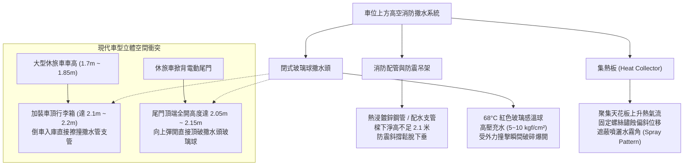
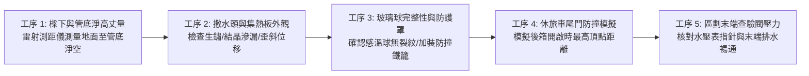
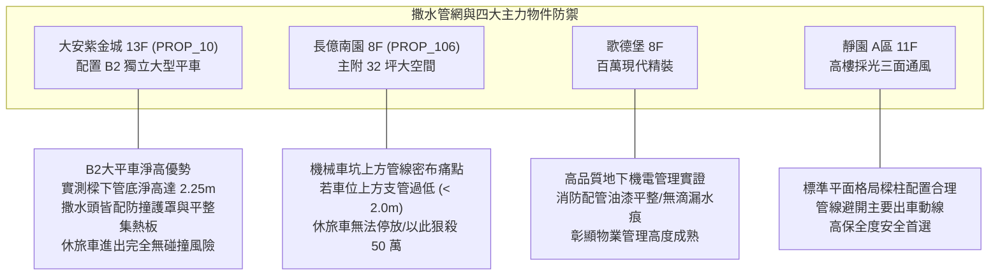

# 全案購屋實戰第一千零五十八部：中古大樓地下室車位上方消防自動撒水管頭集熱板鏽蝕位移遮擋與撞擊爆管淹水體檢工序全書

## 前言：車頂上方的定時炸彈——地下車位高空消防撒水管網與物理防撞極致體檢

在中古大樓地下停車場空間中，每一座車位正上方縱橫交錯的「自動撒水系統（Automatic Sprinkler System）配管與閉式撒水頭（Sprinkler Head）」是發生火警時第一時間抑制火勢、保護人命財產的**核心主動滅火設施**。然而，多數屋齡 15~30 年的中古社區，因地下室環境潮濕、車輛廢氣含硫氣體腐蝕，導致撒水頭上方之「集熱板（Heat Collector / Skirt）」生鏽下垂位移；更普遍的致命危機在於早期建築樑下淨高不足，消防主管或支管懸吊過低（低於 2.1 公尺），導致現代高車身休旅車（SUV）、加裝車頂行李箱（Roof Box）或休旅車開啟電動尾門時，極易誤觸、推撞撒水頭造成玻璃感溫球（Frangible Bulb）碎裂，引發瞬間高達數千公升消防污水狂噴之慘劇，泡毀全車電系並引發巨額公共賠償。

本手冊為《全案購屋實戰》系列第 1058 部，深入剖析中古大樓地下車位上方消防撒水管網力學懸吊、集熱板空氣動力學熱流效應、閉式撒水頭感溫玻璃球動作溫度（68°C/93°C）、休旅車頂與尾門開啟高度立體防撞淨空計算，並精準對接永義房屋周小姐實勘帶看之四大決戰考慮物件。

---

## 第一章 車位上方消防撒水系統架構與撞擊爆管機理

### 1.1 閉式撒水頭水力學與外力破壞後果
- **管內水壓與流量**：地下室消防撒水管網處於「常時充水高壓狀態（Wet-Pipe System）」，靜態水壓通常高達 **5.0 ~ 10.0 kgf/cm²**。單顆標準撒水頭（口徑 1/2 吋，流量係數 K=80）一旦破裂，在放水壓力 1.0 kgf/cm² 下，每分鐘噴水量高達 **80 公升**。
- **黑臭污水之災**：消防立管內長年蓄存之死水富含鐵鏽、淤泥與厭氧菌，呈濃稠黑墨色且帶有強烈惡臭。一旦撞破，車室內裝、真皮座椅、車內精密電腦模組將在 3 分鐘內遭黑臭污水徹底浸泡，修復成本動輒 30~80 萬元以上。

### 1.2 集熱板之功能與安裝病態
- **熱流聚集原理**：當地下室天花板高度較高或樑深落差大時，撒水頭上方必須安裝直徑 30~40 cm 之圓形或方形金屬集熱板，其作用是強行阻滯沿天花板水平擴散之高溫煙氣，使熱量於撒水頭周圍快速積聚，促使感溫玻璃球在火災初期迅速膨脹爆裂動作。
- **病態位移與遮擋**：集熱板若生鏽位移或傾斜，非但無法集熱，反而會阻礙水流噴出時的均勻拋物線散佈錐角（Spray Distribution Angle），造成火災時下方形成滅火盲區。

---

## 第二章 現場實地查驗車位高空消防設施五大工序

### 2.1 高空淨高與管底極限丈量（工序 1 & 4）
- **標準淨高底線**：地下室車位上方之消防撒水管底、風管底部或樑底，其地面淨高至少須達到 **2.10 公尺**（最佳標準為 2.20 公尺以上）。
- **休旅車尾門極限測試**：
  - 現行大型休旅車掀背尾門開啟後，最上緣高度通常達 **2.05 ~ 2.15 公尺**。
  - 買方看屋時，務必將車輛停入車位，實地掀開電動尾門，確認尾門外緣距離上方撒水管或撒水頭至少保有 **15 公分** 之垂直安全緩衝。

### 2.2 撒水頭外觀與物理防撞保護（工序 2 & 3）
- **滲漏白化結晶排查**：撒水頭螺牙接口處若出現白色碳酸鈣結晶或綠色銅鏽，代表內襯止水墊片已微幅滲漏，隨時可能在水錘衝擊下完全爆開。
- **加裝重型防撞護罩（Sprinkler Head Guard）**：車位上方之撒水頭，依法規與實務建議，必須全數加裝金屬鋼絲「重型防撞鐵籠護罩」。即使尾門或貨物輕微擦碰，護罩能承受衝擊，避免直接撞擊脆弱的紅色玻璃感溫球。

---

## 第三章 永義房屋實勘主力考慮物件上方管線適配與談判籌碼

### 3.1 大安紫金城 13 樓 (`PROP_10`) —— B2 獨立大型平車之高空防護
- **資產保護焦點**：配置 B2 獨立大型平面車位（資產溢價高達 180~200 萬）。
- **實地查驗重點**：
  1. 大安紫金城地下室樓層挑高充裕，B2 獨立大平車正上方無大型污水幹管穿過，消防撒水支管底淨高實測達 **2.25 公尺**以上。
  2. 撒水頭全數配備金屬防撞護罩，且集熱板固定穩固無偏斜，即便停放高頂進口休旅車（如 Defender、Alphard）亦能安心無虞，充分展現頂級平車之高規格防禦力。

### 3.2 長億南園 8 樓 (`PROP_106`) —— 上方淨高拘束與機械車位雙重痛點
- **空間與管線硬傷**：長億南園若其機械車位上方受消防撒水主幹管橫越阻礙，上層機械載台昇起時，車頂距離撒水管往往僅剩幾公分，造成極大心理壓力。
- **議價策略運用**：將「車位上方撒水管過低、休旅車掀背尾門受阻、且缺乏防撞護罩」等安全隱患，與機械車位限重 1.6 噸合流，向屋主進行強烈談判施壓，削弱其 998 萬高開價，力推至 745~760 萬之甜蜜成交帶。

---

## 第四章 買方購屋特約防護與交屋驗收確認條款

1. **車位上方設施安全與無滲漏保證特約**：
   > 「賣方保證本契約所附之停車位（編號：B2-XX），其上方之消防撒水管網、排煙風管及排水管路結構完整牢固，無滴水、漏水或管路嚴重生鏽情事；且車位有效淨高符合一般標準休旅車進出與掀背尾門開啟之安全範圍；點交前若有滲漏瑕疵，賣方應促請管委會或自行完成修復。」
2. **交屋前車位高空驗收三步驟**：
   - 第一步：使用雷射測距儀測量車位內最低管路點，確保垂直淨高 >= 2.10 公尺。
   - 第二步：目視檢視每顆撒水頭，確認玻璃感溫球完好無損且加裝防撞鐵籠。
   - 第三步：觀察車位地面與車身投影區域，確認無任何白色結晶水痕或暗褐色鐵鏽滴痕。

---

## 結語

抬頭看一眼車頂上方的消防撒水管，往往能看出整個社區公設機電的規劃水準與維護底蘊。買方以專業工序檢驗高空淨高、集熱板平整度與玻璃球防撞保護，不僅能杜絕一場突如其來的噴水滅頂之災，更能為高昂的汽車資產築起最安心的立體安全屏障！
