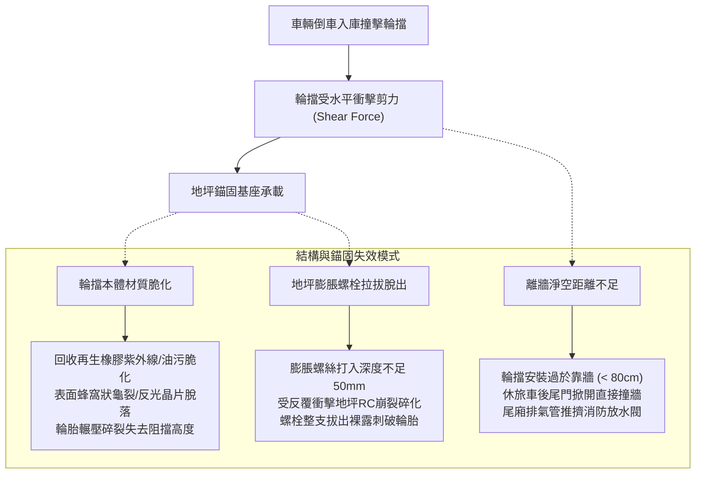
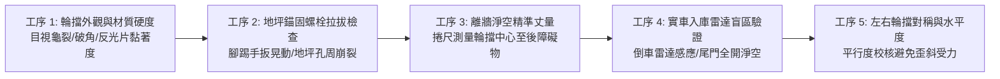
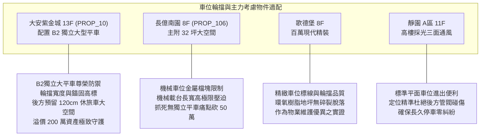

# 全案購屋實戰第一千零五十六部：中古大樓地下室車位輪擋橡膠老化龜裂固定化學膨脹螺栓拔出地坪裂縫與倒車雷達盲區碰撞體檢工序全書

## 前言：停車定位的最後一哩路——車位輪擋結構穩固與車輛倒車安全極致體檢

在中古大樓地下停車場空間中，每一個專用或約定專用車位後方所安裝的「車位輪擋（Wheel Stop / Car Stopper / 車輪定位器）」，是防止車輛倒車時底盤撞擊後方牆面、消防立管、電纜線架或瓦斯管線的**最後一道實體阻隔防線**。然而，多數屋齡 15~30 年的中古社區，因地下室潮濕、輪胎反覆撞擊擠壓，導致橡膠或塑膠輪擋老化龜裂碎化；更嚴重的是，施工時未採用高規格化學錨栓，僅以廉價短膨脹螺絲打入保護層較薄的耐磨地坪或瀝青鋪面，長期受力下螺栓拔出脫落、地坪嚴重崩裂，導致輪擋位移甚至卡死車底懸吊。

本手冊為《全案購屋實戰》系列第 1056 部，全面剖析中古大樓地下停車位輪擋之材質力學耐候性（天然再生橡膠 vs 鑄鐵 vs 高密度聚乙烯 HDPE）、地坪錨固剪力與拉拔試驗、離牆安全淨空距離計算、倒車雷達超音波盲區排查，並精準對接永義房屋周小姐實勘帶看之四大決戰考慮物件。

---

## 第一章 車位輪擋結構力學與失效風險機理

### 1.1 輪擋材質力學特性與耐候對比
1. **高彈性一體成型橡膠（Heavy-Duty Rubber）**：
   - 特性：具備良好衝擊吸收彈性，不傷車胎與輪圈；表面嵌入高亮度菱鏡級黃色反光警示片（Retroreflective Film）。
   - 壽命檢驗：劣質再生橡膠 3~5 年即硬化粉化，合格之原生橡膠輪擋抗壓強度應 >= 200 kgf/cm²，耐油、耐酸鹼且具備抗龜裂韌性。
2. **高密度聚乙烯／聚丙烯（HDPE/PP 複合塑膠）**：
   - 特性：重量輕、顏色鮮豔耐磨。
   - 隱患：低溫或長期重壓下韌性衰減，容易沿螺孔邊緣產生縱向剪切裂紋。
3. **鑄鐵或熱浸鍍鋅鋼管輪擋（Steel / Cast Iron Stopper）**：
   - 特性：剛性最高、抗衝擊力強。
   - 隱患：若缺乏防撞橡膠護墊，輪胎碰撞時容易傷及輪框，且接合焊道在地下室潮濕環境中易生鏽穿孔。

### 1.2 安裝距離與力學幾何極限
- **後懸淨空標準（Rear Overhang Clearance）**：
  - 一般中小型轎車後懸長度約 80~100 cm。
  - 中大型休旅車（SUV）或休旅車電動尾門開啟半徑約 **110~130 cm**。
  - 若輪擋距離後方結構牆或消防管線小於 90 cm，休旅車倒車定位後開啟電動尾門將直接重擊牆面水泥或金屬管閥，造成鈑金破裂。
- **輪擋高度極限**：
  - 標準高度應為 **100 mm ~ 120 mm**。
  - 小於 80 mm 易遭大輪徑休旅車直接越過；大於 130 mm 則極易刮傷跑車或低底盤轎車之後下巴擾流板與排氣消音筒。

---

## 第二章 現場實地查驗車位輪擋五大工序

### 2.1 外觀與錨固穩定度查驗（工序 1 & 2）
- **外觀目視與反光度**：檢查輪擋表面是否有橫向貫穿性裂紋、兩端導角是否破損；夜間或開車燈照射下，反光貼片應具備清晰逆向反射光芒，指引倒車動線。
- **物理晃動與螺栓檢查**：以腳跟用力踩踏或手扳輪擋兩側，合格之輪擋應紋風不動；若螺栓已鬆動翹起超過 5 mm，或螺栓周圍之環氧樹脂（Epoxy）地坪出現放射狀蛛網裂痕，顯示基礎錨固已失效，隨時會整塊掀起。

### 2.2 離牆淨空與尾門干涉測試（工序 3 & 4）
- **實地丈量後方間隙**：以捲尺測量輪擋前緣至後方牆面、樑柱、配電箱或消防栓箱之淨距離：
  - 若後方為平整牆面，淨距離至少需達 **110 cm** 以上。
  - 若後方有管徑 4 吋以上之消防立管、瓦斯管或電纜架，淨距離至少需達 **120~130 cm**，預留安全緩衝。
- **電動尾門防撞模擬**：車輛依輪擋定位停妥後，手動或電動開啟休旅車後尾門，確認尾門外緣距離後方牆面至少保留 **15~20 cm** 之絕對餘裕，杜絕日常取物碰撞傷漆。

---

## 第三章 永義房屋實勘主力考慮物件車位適配與談判籌碼

### 3.1 大安紫金城 13 樓 (`PROP_10`) —— 頂級大平車的極致定位守護
- **資產核心價值**：配置 B2 獨立大型平面車位（資產溢價高達 180~200 萬）。大型平面車位能容納大型進口休旅車（如 Lexus RX、Benz GLE 或 Tesla Model Y）。
- **實勘輪擋檢驗指針**：
  1. 實測輪擋至後方結構柱之淨深，確認休旅車停妥後後尾門能完全自由升起，不刮傷後尾翼與烤漆。
  2. B2 地坪為厚塗環氧樹脂或耐磨地坪，輪擋固定必須為不銹鋼化學錨栓（打入深度 >= 80 mm），避免反覆倒車碰撞震裂地坪防塵漆面。

### 3.2 長億南園 8 樓 (`PROP_106`) —— 機械車位擋塊與空間痛點砍價
- **機械車位致命限制**：長億南園配置之機械車位無傳統橡膠輪擋，取而代之的是金屬載台上的固定焊接角鐵。機械載台長度受限，車長若超過 4.8 米極易超出載台邊界，導致昇降時碰撞鋼索或橫樑。
- **談判籌碼整合**：結合機械車位限重僅 1.6 噸（電車/休旅車無法停）、輪胎定位困難等物理硬傷，作為開價 998 萬強力下殺至 745~760 萬之核心武器。

---

## 第四章 買方購屋特約防護與車位交屋點交清單

1. **車位規格與輪擋地坪無瑕疵點交特約**：
   > 「賣方保證本契約所附之停車位（編號：B2-XX），其地面輪擋固定牢固、地坪無嚴重碎裂掀起，且車位停妥後車輛後方無阻礙後車廂開啟之障礙物；點交時若發現輪擋脫落或地坪嚴重崩壞，賣方應於交屋前修繕完畢或折讓修復費用（新台幣伍仟元整）。」
2. **交屋前車位實測三部曲**：
   - 第一步：親自開愛車實際倒車入庫，測試車輪碰觸輪擋時之阻擋回饋感。
   - 第二步：熄火下車，實測後保桿與尾門距離後方牆面之安全間隙。
   - 第三步：檢查車位兩側白線寬度，確認左右開門均不致碰撞鄰車車門。

---

## 結語

車位輪擋雖是地下停車場中最微小的配件，卻是捍衛愛車鈑金與大樓後方公共管線的定海神針。買方以專業工序檢驗輪擋材質硬度、地坪錨固深度與後方安全淨空，不僅能確保日後每日返家停車優雅從容，更能由小見大，從公設細部品質看清整棟大樓的真正價值！
