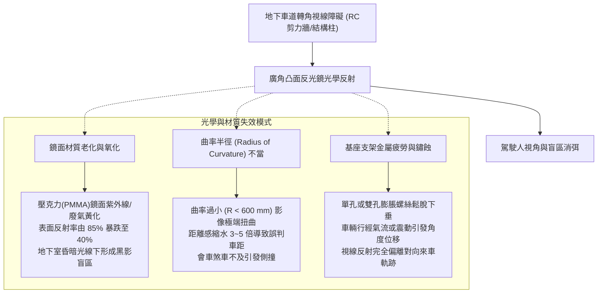
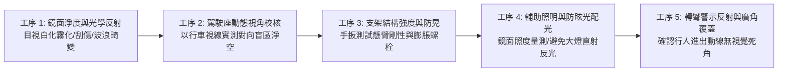
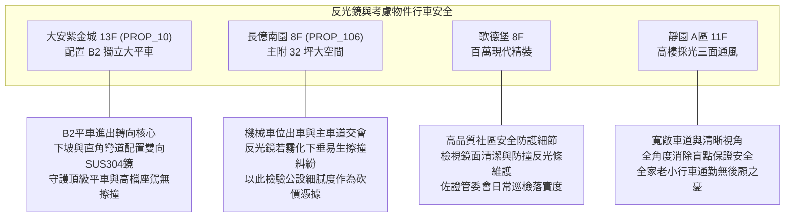

# 全案購屋實戰第一千零五十四部：中古大樓地下室車道轉角反光鏡視線死角盲區支架生銹搖晃鏡面氧化霧化與廣角曲率失真體檢工序全書

## 前言：盲區防禦的千里眼——地下坡道轉向會車與人車動線安全極致體檢

在中古大樓地下停車場交通系統中，地下坡道轉彎處、支道匯入主幹道及進出升降機動線交會點的「廣角凸面反光鏡（Convex Traffic Mirror）」是保障車輛行進、避免迎面對撞與防範轉角死角撞擊行人的**核心被動行車防護設施**。然而，多數屋齡 15~30 年的中古社區，因地下室常年潮濕、汽車排氣含硫氣體腐蝕，導致反光鏡鋼質支架基座膨脹螺栓金屬疲勞鏽蝕搖晃、壓克力（PMMA）或 PC 鏡面嚴重刮痕氧化泛黃霧化，甚至不當採購過大曲率（曲率半徑過小）劣質鏡面，造成倒車或會車時距離感與車速嚴重失真，釀成碰撞事故。

本手冊為《全案購屋實戰》系列第 1054 部，深入剖析中古大樓地下車道凸面反光鏡之光學曲率半徑計算、鏡面材質抗衝擊性（不銹鋼 SUS304 vs 聚碳酸酯 PC vs 壓克力 PMMA）、壁掛與懸吊支架力學錨固標準、光學反射率檢驗，並精準對接永義房屋周小姐實勘帶看之四大決戰考慮物件。

---

## 第一章 車道轉角反光鏡光學力學原理與盲區失效機理

### 1.1 光學曲率半徑與有效可視距離
- **曲率半徑標定（Radius of Curvature, R）**：
  - **R 600 mm ~ R 800 mm**：適合地下室中短距離（5~10 公尺內）轉角會車，影像畸變適中，能精確呈現對向車頭與輪胎動向。
  - **R 1000 mm ~ R 1200 mm**：適合長坡道直線匯流處（15~25 公尺遠距預警），可視視角更廣，但成像較小。
- **反射失真公害**：若社區貪便宜安裝低成本玩具級凸面鏡，鏡面凹凸不平（波浪狀畸變），駕駛人在下坡行進間觀看會產生強烈眩暈感，無法判斷對向車速。

### 1.2 三大鏡面材質特性與耐用度對比
1. **不銹鋼鏡面（SUS304 Stainless Steel）**：
   - 優點：抗衝擊能力最強（耐砸耐撞）、耐地下室潮濕與廢氣酸鹼腐蝕、鏡面歷經數十年永不泛黃、反射率恆定在 80% 以上。
   - 缺點：造價最高、自重較重，要求固定支架具有極高結構強度。
2. **聚碳酸酯（PC / 防爆鏡面）**：
   - 優點：彈性好、受撞擊後可自動回彈復原、重量輕。
   - 缺點：表面耐磨塗層若脫落易產生細密刮痕，5~8 年後可能因燈具照射產生局部霧化。
3. **壓克力（PMMA）**：
   - 優點：成本低廉。
   - 缺點：性脆易碎、硬度低極易刮花、耐候性極差，在中古大樓地下室常呈發黃模糊狀態。

---

## 第二章 現場實地查驗車道反光鏡五大工序

### 2.1 鏡面清澈度與視角覆蓋實測（工序 1 & 2）
- **霧化與反射率檢測**：持強光手電筒以 45 度角照射鏡面，觀察反射光暈是否均勻散射；若鏡面呈現霧狀白斑或泛黃發黑，在地下室昏暗環境中將形同虛設。
- **駕駛座動態盲區校核**：請仲介或家人駕駛車輛停於轉角盲區，買方坐於駕駛座以自然坐姿觀察反光鏡，確認能否「在車頭突出盲區轉角前 3 公尺」，清楚看見對向車道來車車身及地面反光標線。

### 2.2 支架固定錨栓與防晃剛性（工序 3）
- **懸臂基座推拉力測試**：徒手對懸臂支架施加約 10~15 kgf 之水平推拉力，觀察牆面固定法蘭盤是否有位移、縫隙或碎屑剝落；合格之支架應配置 3~4 支 M10 以上不銹鋼化學膨脹螺絲，且具備萬向鎖緊萬向球頭（Ball Joint），經車輛氣流震動絕不垂頭移位。
- **金屬鏽蝕檢查**：檢視抱箍、橫桿螺牙與管件交接處是否有鐵鏽爛穿；若基座已鏽成紅褐色片狀剝落，隨時有脫落砸車之險。

### 2.3 照明配置與防眩光（工序 4 & 5）
- **專屬照度標準**：反光鏡上方 1~2 公尺處應配置防眩光 LED 投光燈，鏡面垂直照度不得低於 **100 Lux**，杜絕「暗處照暗處」之視覺黑洞。
- **行人死角消除**：檢視昇降機廳或樓梯間步出車道處，反光鏡視角是否同時涵蓋行人步行动線，避免車輛轉彎時推撞步出樓梯間之住戶與孩童。

---

## 第三章 永義房屋實勘主力考慮物件車道動線適配與談判籌碼

### 3.1 大安紫金城 (`PROP_10`) —— 頂級大平車的轉向防撞盾牌
- **資產保護焦點**：配置 B2 獨立大型平面車位（市場溢價高達 180~200 萬）。從 B1 順向坡道下至 B2 轉角處為標準直角剪力牆死角。
- **實地查驗重點**：
  1. B2 坡道轉角必須安裝直徑至少 800 mm 之不銹鋼或 PC 高階廣角鏡，且鏡面角度精準反射下坡來車與 B2 車道主線。
  2. 反光鏡下方必須具備醒目之黃黑相間防撞警示反光包角，避免轉彎半徑抓太窄之車輛輪弧擦碰支架。

### 3.2 長億南園 (`PROP_106`) —— 狹窄轉角盲區與公設修繕談判籌碼
- **盲區痛點轉化**：長億南園內部動線若夾帶機械車位進出車流，車輛在倒車出庫時極度仰賴反光鏡輔助。若反光鏡表面氧化泛黃、金屬管生鏽搖晃，每次停車均需提心吊膽。
- **談判籌碼運用**：將地下室反光鏡全數更新費用（每具 SUS304 高規廣角鏡含工料約 6,000~8,000 元）與盲區標線重繪工程列入公設修繕清單，持續削弱屋主 998 萬高姿態，促成 745~760 萬成交區間。

---

## 第四章 買方購屋特約防護與交屋前管委會查驗條款

1. **地下室行車公共安全與視野無死角特約**：
   > 「賣方應促請管委會確保地下停車場車道行車盲區反光鏡鏡面清潔明亮、角度校正完好且無鬆動脫落危險；買方交屋驗收前若發現反光鏡嚴重破損霧化，管委會應於交屋日前完成校正或更換。」
2. **看屋現場必備動態測試程序**：
   - 買方應於實勘時，親自步行走下車道坡道，並站在每一個轉向剪力牆後方，觀察鏡中是否能在 5 秒前察覺下坡車輛車燈與車影，以科學視角守護自身與家人出入平安。

---

## 結語

車道轉角反光鏡是地下室中最容易被忽略、卻攸關全家人每日出入平安的「避險之眼」。買方以專業工序檢視鏡面曲率、清晰度、支架剛性與光學盲區消弭能力，不僅能一眼透視社區物業管理的細膩度，更能為愛車建立無懈可擊的防撞金鐘罩！
