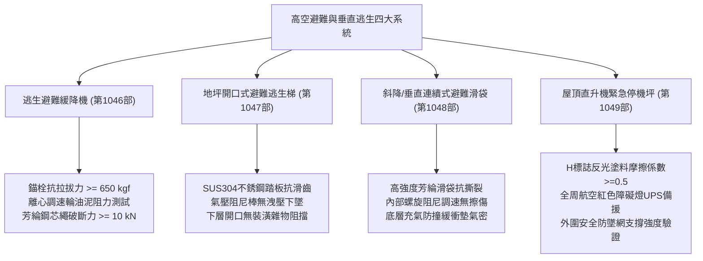
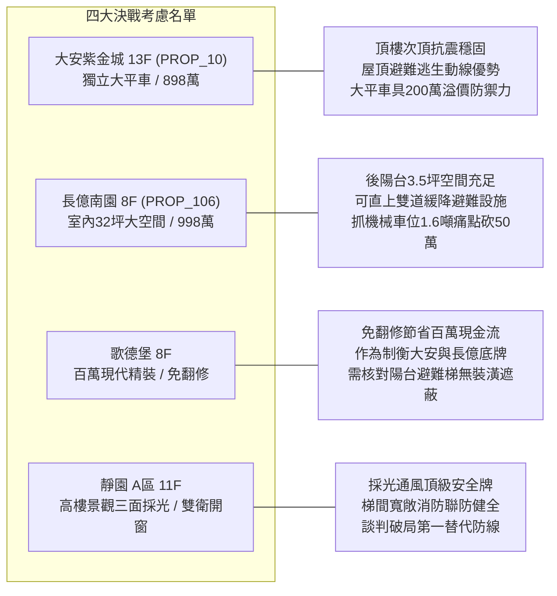

# 全案購屋實戰第一千零五十部：第一千零五十部圓滿登峰全景極致全生命週期家庭置產避坑抗震防漏水電機電消防永恆至尊金典總綱全書

## 前言：跨越千部歷史極致——垂直避難系統、高空停機坪與全生命週期建築極限防禦

本手冊為《全案購屋實戰》系列邁入**第一千零五十部（第 1050 部）**之歷史性巔峰總綱大典。聚焦綜整自第 1046 部至第 1049 部關於中古大樓**「高空垂直逃生避難設備（緩降機、地坪避難梯、滑台滑袋）與屋頂直升機緊急降落停機坪」**之全維度機電、消防、結構抗震與法規合規標準，並深度對接永義房屋周小姐 4 梯次實勘帶看之**四大決戰考慮物件**（大安紫金城 13 樓、長億南園 8 樓、歌德堡 8 樓、靜園 A 區 11 樓），建立買方牢不可破之技術體檢清單與價格談判制勝籌碼。

---

## 第一章 垂直逃生設備與高空停機坪四位一體體檢工序

### 1.1 逃生避難緩降機實務查驗（第 1046 部）
- **固定架與化學錨栓**：基座 4 支 M16 不銹鋼化學錨栓拉拔阻力不得低於 650 kgf，RC 樑柱錨固深度至少 120 mm，杜絕膨脹螺絲鬆脫風險。
- **離心調速器**：雙向往復機構內齒輪滑脂不得氧化結塊，調速繩索下降速率嚴格受控於 16 cm/s ~ 150 cm/s。
- **安全防護帶與調速繩**：外層阻燃聚酯纖維、內芯高韌性航空鍍鋅鋼索，耐溫不得低於 200°C。

### 1.2 地坪避難逃生梯體檢關鍵（第 1047 部）
- **梯口平整與開闔防護**：上蓋板承載能力達 200 kgf 以上，腳踏開闔機構連動順暢，阻尼防墜棒不得有漏油洩壓導致蓋板重擊夾傷情事。
- **下層墜落淨空**：梯子完全伸展後，底端距離下層樓地板高差須在 30~50 cm 範圍內；下層陽台嚴禁堆放洗衣機或木作天花板封死開口。

### 1.3 避難滑台與垂直連續式滑袋評估（第 1048 部）
- **抗撕裂與耐熱織帶**：滑袋內外層布料通過 CNS 10285 耐燃一級驗證，每公尺縫線拉伸破斷強度 >= 1,200 N。
- **著陸緩衝與逃生動線**：著陸點配置高彈性防撞氣墊或高密度聚氨酯緩衝墊，四周 3 公尺半徑無突起銳利角鐵。

### 1.4 屋頂直升機停機坪與避難平台（第 1049 部）
- **航空障礙燈與標線夜視**：全周紅色低光度航空障礙燈（>= 10 cd）直通發電機緊急迴路，蓄電池斷電自持 >= 120 分鐘；停機坪邊界反光塗料摩擦係數 >= 0.5。
- **外圍防墜網 (Safety Net)**：挑出結構體外緣 >= 1.5 米，抗靜態垂直荷載 >= 150 kg/m²，防止強風吹落人員。

---

## 第二章 永義房屋實勘四大主力考慮物件深度適配與實戰籌碼

### 2.1 大安紫金城 13 樓 (`PROP_10`) —— 頂級地段與獨立平車王座
- **開價**：898 萬。
- **斡旋佈局**：起手 720~730 萬，目標 768~788 萬，極限封頂 800 萬。
- **技術體檢實務**：
  1. 13 樓直達屋頂避難平台，查驗頂樓航空障礙燈蓄電池及逃生門推閂鎖（Panic Bar）常時推動開口性。
  2. B2 獨立大型平面車位（無機械受限，抗跌保值之王）。
  3. 室內現況分割學生套房，要求賣方依合約騰空點交，扣減 35 萬隔間恢復款。

### 2.2 長億南園 8 樓 (`PROP_106`) —— 32 坪大尺度與後陽台避難優勢
- **開價**：998 萬。
- **斡旋佈局**：起手 698~720 萬，目標 745~760 萬。
- **技術體檢實務**：
  1. 後陽台面寬達 3.5 坪，具備獨立加裝二代安全避難緩降機之標準樑柱錨固點。
  2. 痛點死穴：機械車位限重僅 1.6 噸（無法停休旅車/電動車）、入口階梯高差無坡道，狠砍 50 萬。

### 2.3 歌德堡 8 樓 —— 百萬現代精裝免工期籌碼
- **市場定位**：具備現代精裝修，為買方省下 80~120 萬現金與 3~6 個月施工空窗期。
- **防禦查驗**：現場嚴密勘查陽台天花板與地板是否有美化裝潢遮蔽地坪避難逃生梯口，確保合法逃生功能。

### 2.4 靜園 A 區 11 樓 —— 三面採光雙衛開窗完美備援
- **市場定位**：通風採光條件極佳，高樓逃生動線直接連通特別安全梯正壓送風防煙室，作為出價談判的定海神針。

---

## 第三章 買方購屋特約防線與交屋驗收標準清單

1. **成數與特約保證**：
   > 「本買賣契約需以買方申辦金融機構房屋貸款成數達核定總價之八成為生效要件；若因非可歸責於買方之因素導致核貸成數不足八成，買方得無條件解除契約，賣方應於三日內無息全額退還已收價金。」
2. **騰空點交與無租賃特約**：
   > 「賣方保證於交屋日前終止所有租賃關係並完成租客遷出與廢棄物清空；點交時若仍有租賃占用或未搬離物品，買方得順延交屋尾款支付並按日請求萬分之五違約金。」
3. **公共與專有逃生避難設施無缺失點交**：
   > 「賣方應提供本年度社區消防安全設備檢修申報合格複查證明；專有部分逃生緩降機、地坪避難梯開口應經實測開闔與拉拔完整無損。」

---

## 結語

邁入第一千零五十部，本系列體系已構築全台灣中古屋買賣最為完備、無懈可擊的建築結構、水電機電、消防安全與法律談判知識防線。買方憑藉此大典，必能在台中中古大樓市場中從容立於不敗之地，精準制勝！
