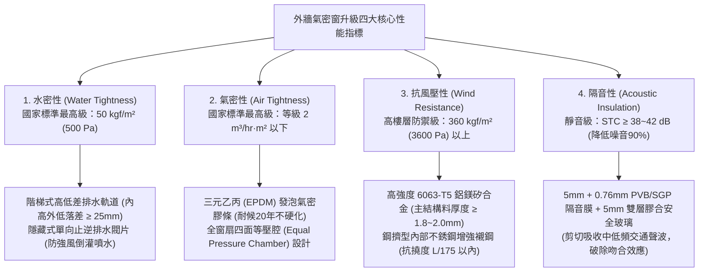
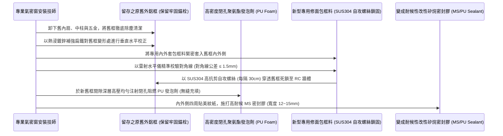
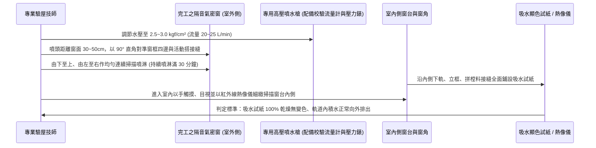

# 全案購屋實戰第一千零五部：中古大樓全室氣密隔音氣密窗更換升級、乾式施工包框法與高水密抗強風結構嵌縫灌漿工序全書

## 導言：高空微氣候屏障與都市繁華噪音阻絕防線

在集合住宅中古大樓之全天候起居品質與耐候防禦體系中，外牆「門窗工程（Exterior Windows & Doors）」是室內微氣候環境與外界大自然極端氣候（颱風暴雨、強烈風壓、日夜溫差、城市交通噪音、PM2.5 懸浮微粒與沙塵暴）之間唯一的物理開口防線。

然而，在屋齡 15 年至 30 年以上之中古大樓中（特別是本案主力候選物件：位處 13 樓頂層、受高空強烈陣風與橫向風壓直接衝擊的 **大安紫金城 13 樓 (`PROP_10`)**，以及室內採光窗面極大、窗框總長度超過 30 米的 **長億南園 8 樓 (`PROP_106`)**），早期建商配置的原裝鋁門窗普遍存在四大致命老化現象：
1. **水密性（Water Tightness）嚴重崩潰與窗框角隅「吐水」**：傳統鋁窗水密等級僅為 $15 \sim 25\text{ kgf/m}^2$（約 150~250 Pa）。每逢中度至強烈颱風來襲，暴風雨在窗扇外側形成強大的動態正風壓，雨水被強行壓入下軌道積水槽，當積水速度大於排水孔排洩速度時，雨水便如湧泉般翻越內軌「倒灌湧入室內木地板」；更致命的是，窗框與 RC 混凝土交界面若早期填縫砂漿粉化，雨水將自外牆角隅毛細滲入牆體，引發全室窗台周邊嚴重壁癌發霉。
2. **氣密性（Air Tightness）喪失與高空「風切哨音（Wind Whistling）」**：窗扇邊緣之 PVC 或橡膠氣密膠條長年受紫外線曝曬發生硫化硬化、收縮脆斷，窗扇與外框之間產生 1mm~3mm 的肉眼可見間隙。冬季東北季風或颱風夜，高壓氣流穿透縫隙激發劇烈空氣共振，發出尖銳刺耳的「鬼哭神嚎」風切聲，嚴重摧毀全家睡眠神經。
3. **隔音等級（Sound Transmission Loss, STC）低下**：早期普通 5mm 單層清玻璃，隔音量僅有微弱的 $20 \sim 25\text{ dB(A)}$。都會區街道車流聲、公車剎車低頻轟鳴、鄰近工地施工與夜間警笛聲長驅直入，使室內背景噪聲長年維持在 $55 \sim 65\text{ dB(A)}$，誘發家庭成員慢性失眠與焦慮。
4. **結構抗風壓性（Wind Load Resistance）不足引發窗體劇烈震顫**：高樓層陣風風壓可達 $360\text{ kgf/m}^2$（約 3600 Pa）以上。老舊鋁窗鋁合金型材壁厚不足（僅 1.0mm~1.2mm），在大風下整面窗戶肉眼可見地凹陷變形、劇烈抖動，甚至面臨玻璃爆裂彈飛之滅頂危機。

為此，在中古屋交屋入住前，實施全面性的「外窗升級改造」是提升居住尊榮感與資產保值性的關鍵一役。本第一千零五部全書深入解構高規格隔音氣密窗之物理性能指標、免打牆破壞結構之「乾式施工包框法（Cover Frame Method）」標竿工藝、高聚合物抗裂嵌縫灌漿技術、以及終極高壓動態噴水驗收標準。

---

## 一、隔音氣密窗四維物理性能國家標準（CNS 3107）與微觀物理學極限

### 1. 雙層膠合玻璃（Laminated Glass）之聲學共振破除機理
- **吻合效應（Coincidence Effect）之聲學缺陷**：普通單層玻璃（如 8mm 或 10mm 清玻）在特定臨界頻率（Critical Frequency，通常為 $1000 \sim 2500\text{ Hz}$，正好是人耳最敏感的車輛噪音頻段）下，會產生板彎曲波與空氣聲波之共振，隔音量會產生高達 $10 \sim 15\text{ dB}$ 的致命「隔音低谷（Sound Transmission Dip）」。
- **PVB/SGP 膠膜之黏彈性阻尼（Viscoelastic Damping）**：
  - 升級為 **$5\text{mm} + 0.76\text{mm PVB（聚乙烯醇縮丁醛）} + 5\text{mm}$ 或 $6\text{mm} + 1.14\text{mm SGP} + 6\text{mm}$ 雙層膠合安全玻璃**。
  - 夾層中間的高分子樹脂薄膜具有極高的阻尼損耗因子（Loss Factor $\eta \ge 0.3$）。當聲波衝擊外層玻璃時，聲能轉化為剪切變形熱能被膠膜瞬間吸收，徹底抹平吻合效應低谷，將室外 $75\text{ dB(A)}$ 的車流吵雜聲瞬間壓制至室內 **$32 \sim 35\text{ dB(A)}$ 的圖書館級絕對寧靜**！

### 2. 水密階梯差與風壓等壓腔（Pressure Equalization Chamber）
- **雨水滲漏三要素**：水（雨水）、縫（窗框縫隙）、力（室外風壓推力）。
- **等壓腔原理**：傳統鋁窗外側風壓大、室內風壓小，壓差 $\Delta P = P_{\text{外}} - P_{\text{內}} > 0$，將水強行推入室內。
- 標竿氣密窗在窗扇外部設置氣密線、內部設置水密線，中間形成一個與室外大氣相通的「等壓腔（Equalized Cavity）」。腔體內部壓力與室外風壓瞬間平衡（$\Delta P \approx 0$），雨水在無壓差推動力下，純粹依靠自身重力順著階梯式斜坡滑入下軌排水孔，徹底終結颱風天窗框倒灌滲水之宿命。

---

## 二、免打牆乾式施工「包框法（Cover Frame Method）」標竿工序

在集合住宅中古大樓中，若採取傳統「濕式泥作打除工法」，必須動用大型電鎬將舊鋁窗連同周邊 RC 外牆與磁磚全部敲碎。這將引發三大毀滅性災難：
1. **破壞外牆結構防水層**：震裂窗框周邊磁磚與防水層，導致外牆大面積滲水。
2. **施工噪音與粉塵引發全棟鄰居強烈抗議並遭管委會勒令停工**。
3. **施工工期長達 1~2 週，雨天完全無法施工**。

因此，現代中古屋高規格翻修工程，全面指定採用 **「乾式施工包框法（一日完工，免拆舊框、不傷外牆、零噪音泥作）」**：

### 1. 閉孔阻燃聚氨酯（PU）發泡填縫之微觀防音防滲
- 新框與舊框之間存在約 $10\text{mm} \sim 20\text{mm}$ 的環形夾層間隙。
- **材料標準**：必須採用 **閉孔率 $\ge 90\%$、阻燃等級達 B2 級之高密度單組份聚氨酯發泡膠**。
- **作用**：發泡劑在間隙內部膨脹固化，微觀閉孔結構徹底阻斷聲波空氣傳播途徑，形成兼具「高強隔熱、極致吸音、完全彈性防水」的緩衝夾層，消除金屬框體共振。

### 2. 外部雙重修飾面蓋板（Capping）與耐候密封
- 外側包框料具備專利階梯型擋水垂檐（Drip Edge），並配置專用鋁合金扣合修飾蓋板。
- 外側與建築外牆交界處，嚴禁使用酸性或普通中性矽利康，必須全面採用 **改性矽烷聚醚高耐候密封膠（MS Polymer Sealant，位移能力達 $\pm 50\%$，耐紫外線照射 20 年不龜裂、不析出矽油污染外牆磁磚）**。

---

## 三、終極性能檢驗：現地動態高壓淋水試驗（Water Hose Spray Test）標準 SOP

氣密窗安裝並打膠養護 48 小時後，**必須在裝修木作進場前實施嚴格之現場動態噴水驗收**：

### 1. 噴水檢驗參數底線（參照 AAMA 501.2 國際規範）
- 噴水壓力：噴嘴水壓穩定維持在 **$0.25 \sim 0.30\text{ MPa}$（約 $2.5 \sim 3.0\text{ kgf/cm}^2$）**。
- 噴淋時間：每樘窗戶受檢區域連續噴水不得少於 **30 分鐘**，模擬 12 級強烈颱風夾帶暴雨直擊窗面之極限工況。

### 2. 滲漏判定與合格標準
- **合格（綠燈）**：
  - 窗扇活動搭接處、外框四邊接縫、窗台下側牆體混凝土均完全乾燥無任何水珠浸潤。
  - 窗框下軌道積水槽內部的水位未超過內軌防溢擋水肋的高度，並由單向排水閥迅速向室外排空。
- **不合格（紅燈）**：
  - 內軌溢水、窗扇底部滴水、或窗台外框拼角處出現微滲濕痕。此時必須全數清除密封膠、重新補打發泡劑並施打結構密封膠，**重新自零開始淋水測試 30 分鐘**，直至滴水不漏！

---

## 四、四大主力候選物件氣密窗翻修專項預算與施工攻防

### 1. 👑 大安紫金城 13 樓 (`PROP_10`)：高空抗風壓防哨音標竿工程
- **現況挑戰**：本物件為 **13 樓頂層景觀戶**，高空無任何遮蔽，東北季風風壓巨大。前屋主套房改裝時未曾更換外窗，老舊鋁窗在大風下窗框劇烈震顫、下雨天窗框角隅有乾涸水漬。
- **翻修方案**：
  - 客廳景觀窗全面採用 **頂級重型雙層氣密斷橋鋁窗（料厚 2.0mm，抗風壓 3600 Pa）**，搭配 **$5\text{mm} + 0.76\text{mm PVB} + 5\text{mm}$ 雙面強化膠合隔音玻璃**。
  - 全室 4 樘大窗採用乾式包框法更換，預算約 **18 萬 ~ 22 萬元**。此筆費用完全可由買方談判斬獲之 **「35 萬套房拆除翻修折讓款」** 充分支付，完美將老舊套房蛻變為高檔靜音奢華豪宅！

### 2. 🌟 長億南園 8 樓 (`PROP_106`)：超長開窗面深度降噪工程
- **現況挑戰**：室內實坪達 32 坪超大空間，客廳陽台、三間主臥次臥之窗面開闊（總計達 6 樘大窗），外界生活噪音對室內起居影響明顯。
- **翻修方案**：
  - 全室外窗升級為 CNS 最高級氣密窗（水密 50，氣密 2），玻璃配置 $5\text{mm} + 5\text{mm}$ 膠合玻璃。
  - 預算約 **20 萬 ~ 25 萬元**，由買方談判砍價爭取之 **50 萬讓價款** 充裕分攤。

---

## 五、全案總結：氣密窗驗收五大不可妥協鋼鐵防線

1. **查型材厚度**：以數顯游標卡尺量測主受力鋁料壁厚，必須 **$\ge 1.8\text{mm}$（高樓層 $\ge 2.0\text{mm}$）**，嚴禁採用單薄軟弱之 1.0mm 廉價料。
2. **驗 EPDM 膠條**：窗扇四周密封膠條必須為 **原廠 EPDM 耐候發泡橡膠**，手感柔軟有彈性，嚴禁使用容易硬化斷裂之普通 PVC 塑膠膠條。
3. **查玻璃鋼印**：雙層膠合玻璃角落必須具備國家安全玻璃標準認證之 **「CNS 強化玻璃高溫烤漆鋼印（Tempered）」**。
4. **包框發泡充實**：新舊框內部必須以高密度 PU 發泡膠 100% 填滿，用手敲擊框體聲音必須沉實堅硬，嚴禁有空洞共鳴音。
5. **高壓噴水 30 分鐘無滴漏**：現場實施 2.5 kgf/cm² 高壓水槍直噴 30 分鐘，窗台內側吸水試紙 100% 乾燥，方可通過驗收支付工程款！
