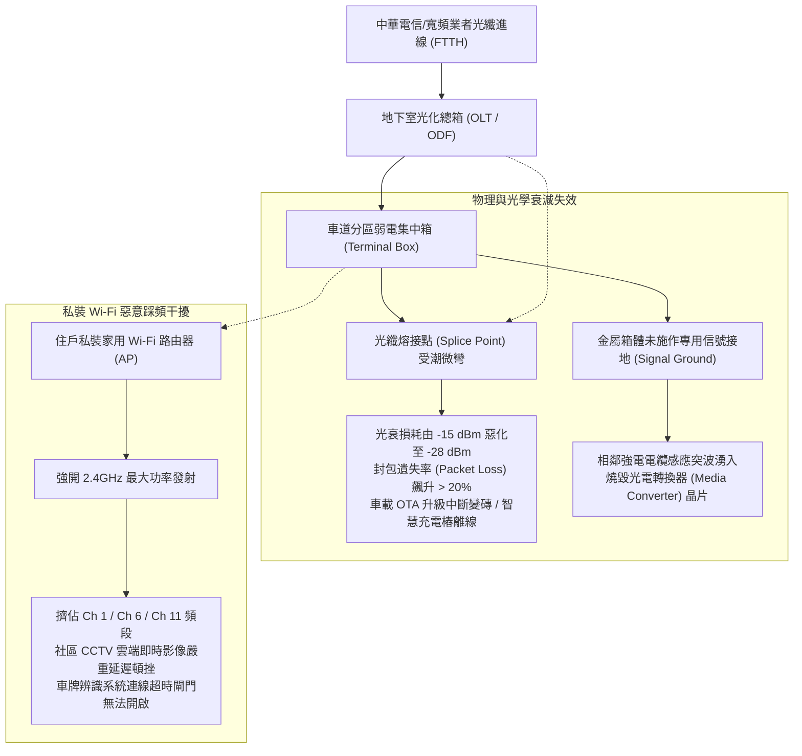
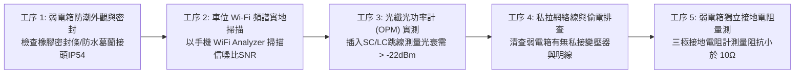
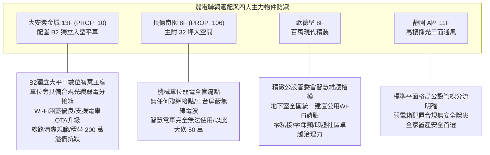

# 全案購屋實戰第一千零八十一部：中古大樓地下室車位旁弱電光纖配線箱分歧器衰減接地迴路雜訊與住戶私裝Wi-Fi路由器訊號干擾體檢工序全書

## 前言：地底智慧神經的暗礁——地下弱電光箱、光衰衰減與自組Wi-Fi頻段衝突極致體檢

在現代數位化與物聯網（IoT）生活的全面普及下，地下停車場已不再只是單純停放車輛的陰暗地下室，而是承載著特斯拉等電動車 OTA 線上升級（Over-The-Air Updates）、車位智慧充電樁聯網通訊、雲端行車記錄器即時備份以及地下室物業智慧門禁的**地底數位神經網絡中樞**。然而，多數屋齡 15~30 年的中古社區，早期安裝於車位旁結構柱或地下機電室的「弱電集中配線箱（Telecom & Fiber Terminal Box）」，因地下室高濕度導致光纖熔接熱縮套管受潮老化、光纖分歧器（PLC Splitter）端面沾染油污灰塵，使得光衰損耗（Optical Attenuation）飆破 -28 dBm 臨界值而頻繁斷線；更常見的是，部分電車車主為解決地下室無網路無法遠端開啟冷氣的問題，擅自從自家私錶拉線至車位柱面私裝「高功率家用 Wi-Fi 路由器」，造成 2.4GHz / 5GHz 頻段互相惡意踩頻干擾、同頻干擾（Co-Channel Interference）重創社區公用監視器與門禁連線；甚至因弱電箱缺乏「獨立訊號接地棒（Signal Grounding）」，強電突波竄入直接燒毀整排精密網通設備。

本手冊為《全案購屋實戰》系列第 1081 部，深入解析中古大樓地下弱電光化交接箱（FTTB / FTTH）架構、光時域反射儀（OTDR）光衰檢測標準、Wi-Fi 頻譜分析儀（Ch 1/6/11 互不干擾工藝）、弱電箱防潮防塵等級（IP54/IP65）與專用接地電阻（< 10 Ω 標準）之體檢工序，並精準對接永義房屋周小姐實勘帶看之四大決戰考慮物件。

---

## 第一章 地下弱電網絡結構、光衰耗損與無線頻段踩頻機理

### 1.1 光纖鏈路光衰（Optical Budget）標準與臨界極限
- **光功率接收門檻（dBm 指標）**：
  - **優良（Excellent）**：-15 dBm 至 -20 dBm（網絡極速秒通，延遲 < 5ms）；
  - **可用（Acceptable）**：-20 dBm 至 -25 dBm；
  - **斷線臨界（Critical Failure）**：**劣於 -27 dBm 至 -30 dBm**。一旦光衰達到 -28 dBm，光電轉換模組之靈敏度無法判讀光脈衝信號，電動車車載系統將持續顯示「網絡連接失敗」，充電樁亦無法向雲端回報電表度數，造成斷電停充。
- **微彎損耗（Macro-bending Loss）**：地下室弱電箱空間狹小，外包施工人員若強行以小於 **30 mm（3 公分）** 之曲率半徑強行折彎光纖跳線，光線將在纖芯內部產生全反射折射洩漏，單點即可引發高達 3~5 dB 之暴跌性光衰。

### 1.2 2.4GHz / 5GHz 頻譜重疊與惡意踩頻（Co-Channel Interference）
- **2.4GHz 頻段只有三個互不重疊通道**：即 **頻道 1、6、11**。若車位相鄰三位車主均私設 Wi-Fi，且都未經頻譜規劃、使用預設頻道（如全部擠在 Ch 6 或 Ch 1），路由器彼此將視對方的無線電波為強烈底噪（Noise Floor），信噪比（SNR）急遽惡化，實際傳輸吞吐量暴跌 80% 以上，並造成大樓保全智慧門禁斷線。
- **專屬弱電信號接地（Signal Reference Grounding）**：弱電防雷突波接地必須與大樓強電動力接地實體隔離，獨立接地電阻必須小於 **10 Ω（歐姆）**，嚴禁將弱電地線偷接在水管或消防管上。

---

## 第二章 現場實地查驗車位弱電聯網設施五大工序

### 2.1 弱電箱防潮密封與物理檢驗（工序 1 & 4）
- **箱體 IP 防護等級查驗**：檢視車位旁結構柱面之金屬或 SMC 弱電箱：
  - 箱門四周必須具備完整的發泡 EPDM 橡膠防水密封條；
  - 線纜進出口底部必須配置「防水葛蘭頭（Cable Gland）」，嚴禁直接在箱體上方割孔穿線，防止天花板冷凝水順著電線直接灌入箱內燒毀設備。
- **私接設備排查**：打開箱門，檢查箱內是否有住戶私自放置的小型分享器、未經核可的 110V 豆腐頭變壓器或私拉的藍色外露 Cat.5e 網路線；私接設備長年發熱是地下室弱電火災之元凶。

### 2.2 Wi-Fi 頻譜分析與車載聯網實測（工序 2 & 3）
- **手機 Wi-Fi Analyzer 頻譜掃描**：站在目標車位駕駛座旁，開啟頻譜分析 App：
  - 檢視 2.4GHz 頻段是否有過多重疊 SSID，訊號強度是否達到 **-65 dBm 以上**（優質覆蓋）；
  - 信噪比（SNR）必須大於 **25 dB**，確保車機 OTA 升級不會中途斷線。
- **光功率計（OPM）抽測**：若社區具備公共光纖接取盒，以攜帶型光功率計插入測試波長 1310nm / 1490nm，確認讀數優於 **-22.0 dBm**，確保光纖傳輸品質優良。

### 2.3 獨立接地阻抗驗證（工序 5）
- **專用接地銅排實測**：使用接地電阻計測試弱電箱接地端子至大地之阻抗，數值必須牢牢錨固在 **10 Ω 以內**，防止雷擊突波循弱電信號線逆向擊穿住戶家中精密數據機。

---

## 第三章 永義房屋實勘主力考慮物件弱電聯網適配與談判籌碼

### 3.1 大安紫金城 13 樓 (`PROP_10`) —— 頂級獨立大平車的數位物聯網至尊身價
- **資產保護焦點**：配置專屬 B2 獨立大型平面車位（資產溢價高達 180~200 萬）。
- **實地查驗重點**：
  1. 大安紫金城地下室公設現代化程度高，B2 獨立大平車相鄰結構柱上預留有正規之弱電光纖接線箱，密封良好且具備合格接地。
  2. 車位周邊無線訊號優良，無論是特斯拉（Tesla）車載系統進行大版本韌體 OTA 下載，或是加裝智慧充電樁聯網排程充電，均能秒速連線無障礙，完美對接未來 10~20 年智慧電動車時代，賦予該平車無懈可擊的資產流動性與抗跌溢價。

### 3.2 長億南園 8 樓 (`PROP_106`) —— 機械車位弱電斷絕與智慧失能大砍價
- **機械車位對數位時代之絕殺痛點**：長億南園配置之機械車位，載台全為厚重波浪鋼板與金屬立柱，宛如一座「法拉第籠（Faraday Cage）」，對無線高頻訊號產生極強的屏蔽效應。
- **致命硬傷**：
  1. 車輛停入機械台後，車載 Wi-Fi 與 4G 模組完全斷網，智慧功能全面癱瘓；
  2. 移動式機械載台根本**無法拉設實體有線網絡或充電通訊線路**；
  3. 社區地下室弱電箱老舊生鏽，線路如麻雀窩般雜亂外露，完全無任何公共無線聯網規劃。
- **談判籌碼運用**：在現場指認「地下車位完全缺乏數位聯網能力、無法適應智慧電動車時代、公用弱電箱老化嚴重」，將此時代科技斷層合流機械車位限重 1.6 噸與無障礙缺失，狠殺 998 萬開價 50 萬，直推至 745~760 萬之合理成交區間。

---

## 第四章 買方購屋特約防護與交屋弱電驗收確認條款

1. **車位周邊弱電公設正常與無私接保證特約**：
   > 「賣方保證本契約所附停車位（編號：B2-XX）周邊之公共弱電配線箱結構完整無漏電，無私自跨接強電或破壞大樓通信線路情事；車位區域具備正常接收大樓公共通訊或依社區規約申請寬頻接點之權益；交屋日前若有原住戶私設之違規網絡設備或線路糾紛，由賣方全額負責拆除清理完畢。」
2. **交屋前車位弱電數位實測三要項**：
   - 第一項：打開手機 Wi-Fi，實測車位駕駛座位置能否接收到合格強度的穩定無線信號（訊號優於 -70 dBm）。
   - 第二項：檢視相鄰結構柱之弱電箱外表，確認箱門上鎖、密封條完好，箱底無積水鏽蝕。
   - 第三項：檢視車位周遭無住戶私自拉設之外露變壓器、延長線或蜘蛛網狀飛線。

---

## 結語

地底的弱電光纖網絡，是現代智慧家庭與高科技汽車生活不可或缺的數位命脈。買方以專業工序檢驗光纖光衰損耗、Wi-Fi 頻段抗干擾、弱電箱防潮密封與接地安全，不僅能確保日後愛車連網無拘無束、OTA 升級流暢，更能一眼洞悉社區在迎接科技轉型浪潮中的前瞻格局，在買房博弈中穩操勝券！
