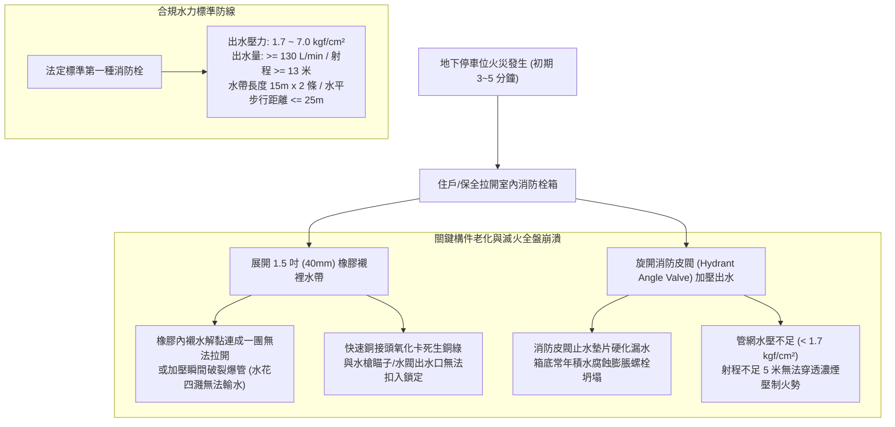
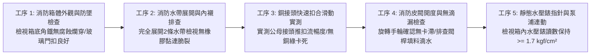
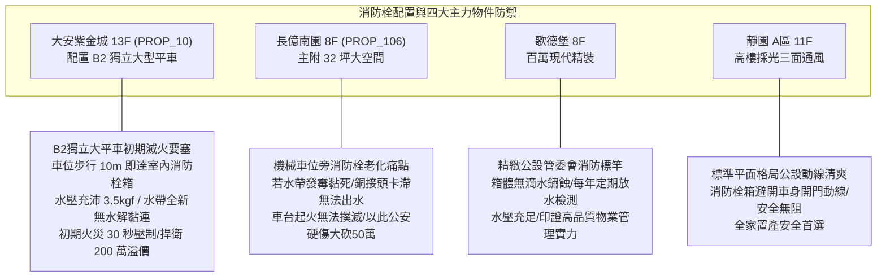

# 全案購屋實戰第一千零八十七部：中古大樓地下室車位旁室內消防栓箱水帶水解發霉銅接頭氧化卡滯皮閥漏水與出水壓力不足體檢工序全書

## 前言：撲滅初起火災的最後防線——地下車位室內消防栓箱、水帶耐壓、銅接頭氣密與靜水壓極致體檢

在中古大樓地下停車場的初期自主滅火體系中，設置於車道轉彎處與結構柱面上的「室內消防栓箱（Indoor Fire Hydrant Cabinet）」，是住戶或大樓保全人員在火災發生初期 3 至 5 分鐘內，迅速拉出水帶、開啟水閥進行近距離高壓射水壓制火勢的**第一線人命救援設施**。然而，多數屋齡 15~30 年的中古社區，因地下室常年潮濕悶熱、車輛廢氣含硫腐蝕，箱內存放的橡膠襯裡麻質水帶（Lined Fire Hose）內部橡膠嚴重水解黏連發霉脆化，一經加壓通水瞬間爆裂穿孔；更致命的是，鋁青銅或黃銅質快速接頭（Machino Quick Coupling）表面生成厚重銅綠氧化層，卡滯咬死根本無法旋入接扣；水栓皮閥（Hydrant Angle Valve）內部止水橡膠墊片老化硬化，長年處於「慢性漏水滴水」狀態導致箱體底座角鐵嚴重鏽蝕爛穿、整座消防栓箱向前傾倒下塌；一旦真有火警，地下室消防加壓泵浦未啟動或管路氣阻，龍頭出水壓力低於法定標準 1.7 kgf/cm²，水流如小便般軟弱無力，完全喪失初期滅火能力。

本手冊為《全案購屋實戰》系列第 1087 部，深入解析中古大樓地下室單口式室內消防栓（第一種/第二種消防栓）水力學規範、水帶耐壓試驗（試驗壓力 >= 16 kgf/cm² / 工作壓力 8~10 kgf/cm²）、快速接頭公母扣操作力學、放水壓力（1.7 ~ 7.0 kgf/cm²）與射程丈量（>= 13 公尺）、消防箱體耐腐蝕與防墜工藝，並精準對接永義房屋周小姐實勘帶看之四大決戰考慮物件。

---

## 第一章 室內消防栓水力學結構、水帶水解與管閥氧化機理

### 1.1 橡膠襯裡水帶之高分子水解與脆裂力學
- **水解黏連（Hydrolytic Adhesion）病態**：消防水帶平時以雙卷式或折疊式長期壓存於通風不良之鐵箱內。地下室高濕度（RH > 80%）使內襯合成橡膠分子鏈發生水解，膠層變黏並與對側橡膠緊緊黏合。火災時若強行拉扯，橡膠層整片撕裂脫落，通水加壓至 4~6 kgf/cm² 時，編織外層瞬間遭水壓刺穿破裂。
- **耐壓與爆破標準（CNS 1020 / 消防標準）**：
  - 合規消防水帶必須通過 **16 kgf/cm²（1.6 MPa）之耐壓試驗**，且爆破壓力（Burst Pressure）必須大於 **30 kgf/cm²**；
  - 超過 10 年之水帶，若未經水壓抽驗且表面發霉黑斑密布，在實戰中爆管率高達 60% 以上。

### 1.2 快速接頭氧化咬死與消防皮閥低壓失能
- **差動式快速接頭（Machino Coupling）卡滯**：消防接頭採用銅合金或高強度鋁合金。在汽車廢氣二氧化硫與水氣催化下，卡爪彈簧與密封滑環表面形成硬質氧化鋁或碳酸銅（銅綠）。卡爪失去彈性回彈，住戶在慌亂中根本無法將水帶接扣「喀嚓」一聲推入鎖定。
- **法定出水壓力與流量底線**：
  - **第一種室內消防栓（口徑 40mm / 1.5 吋）**：瞄子放水壓力必須在 **1.7 kgf/cm² 至 7.0 kgf/cm² 之間**，放水量不得小於 **130 L/min**，水柱有效射程必須大於 **13 公尺**；
  - 壓力若低於 1.7 kgf/cm²，水流無法克服火場上升熱氣流，射水未至火源即被高溫蒸發化為蒸汽；壓力若超過 7.0 kgf/cm²，後座力過大一般住戶無法雙手握持控制。

---

## 第二章 現場實地查驗車位室內消防栓設施五大工序

### 2.1 消防箱結構強度與防墜檢驗（工序 1）
- **箱體與膨脹螺栓牢固度**：手推消防箱兩側，檢視牆面或結構柱之 4 支固定膨脹螺栓（M10 以上）：
  - 箱體必須紋風不動；
  - 檢視箱體底部：若曾長期滴水，箱底鍍鋅鋼板若已鏽蝕穿孔、露出紅褐色破洞，此箱隨時有整座崩塌脫落砸毀相鄰車輛之險。
- **壓克力/玻璃面板破壞錘**：箱門必須配備易碎壓克力板、或附有緊急敲破金屬小錘，確保緊急時住戶能於 2 秒內擊破或旋開門鎖取用水帶。

### 2.2 水帶展開與接頭扣合實測（工序 2 & 3）
- **雙卷水帶完全拉開檢驗**：將箱內 2 條各 15 公尺長之消防水帶完全拖出展開於車道：
  - 撫摸水帶表面，外層合成纖維編織層必須乾爽、無發霉黑斑、無老鼠啃咬破洞；
  - 用手指捏壓水帶內部，橡膠襯裡必須保持高彈性，絕不能有內部膠皮黏死無法充水的現象。
- **銅質接頭卡爪推扣實測**：將水帶接頭與消防栓皮閥出水口、以及直流水霧兩用瞄子（Nozzle）進行實地對接：
  - 插入時必須聽見清脆之「喀嗒」鎖定聲，手拉不得脫脫；
  - 撥動兩側釋放滑環，接頭應能滑順彈開脫離，無卡死頓挫。

### 2.3 靜水壓力與皮閥填料氣密性（工序 4 & 5）
- **靜態壓力表讀數確認**：檢視箱內專屬水壓表指針：
  - 靜水壓力必須穩定指在 **3.0 ~ 5.5 kgf/cm²** 綠色安全帶；
  - 若指針歸零或低於 1.7 kgf/cm²，證實管網失壓、水錘吸收器失效或管線被管委會偷偷關閉總閥。
- **閥桿填料（Packing）無滴漏**：檢視黃銅皮閥之旋轉手輪下方軸封螺母，表面必須乾燥；若長年懸掛水滴、在箱底滴出水窪，證實軸封石墨墊圈已磨損漏水。

---

## 第三章 永義房屋實勘主力考慮物件消防栓配置適配與談判籌碼

### 3.1 大安紫金城 13 樓 (`PROP_10`) —— 頂級獨立大平車的黃金初期滅火守護
- **資產保護焦點**：配置專屬 B2 獨立大型平面車位（資產溢價高達 180~200 萬）。
- **實地查驗重點**：
  1. 大安紫金城 B2 獨立大平車旁結構柱上，配置有標準第一種室內消防栓箱，步行距離僅約 10 公尺，取用極其迅捷。
  2. 箱內配備全新更換之優質橡膠襯裡水帶，接頭光亮無銅綠，實測靜態水壓穩定維持在 **3.5 kgf/cm²**，閥體滴水不漏。一旦車位周遭突發初期電氣或煙蒂火星，住戶能在 30 秒內完成出水壓制，徹底杜絕火燒車浩劫，捍衛百萬豪車資產萬無一失。

### 3.2 長億南園 8 樓 (`PROP_106`) —— 機械車位旁消防設施癱瘓大砍價
- **機械車位遇火災之滅頂死穴**：長億南園配置之機械車位，載台電線密集且存有液壓油；若相鄰之室內消防栓箱老舊發黑、水帶橡膠黏連成一團、水龍頭卡死轉不動。
- **致命安全硬傷**：
  1. 機械載台一旦起火，住戶根本無法及時拉出水帶滅火，只能眼睜睜看著整排機械車台連環燒毀；
  2. 消防箱若常年漏水導致地面地坪起泡打滑，在緊急滅火時工人極易跌倒摔傷；
  3. 逃生時一樓大廳又遭遇「4 階高差無障礙缺失」，滅火與逃生全面潰敗。
- **談判籌碼運用**：在現場指認「地下室消防栓水帶老化嚴重、管路缺乏水壓、存在重大火災失控燒毀車輛隱患」，將此重大公共安全瑕疵合流機械車位限重 1.6 噸，向賣方痛陳大樓公設消防修繕耗資巨大，狠殺 998 萬開價 50 萬，直推至 745~760 萬之合理成交區間。

---

## 第四章 買方購屋特約防護與交屋消防栓公安確認條款

1. **室內消防栓系統性能合格保證特約**：
   > 「賣方保證本契約所屬社區地下停車場之室內消防栓系統（含水栓皮閥、消防水帶、快速接頭、水槍瞄子及消防幫浦連動迴路），符合消防安全法規標準且處於正常有效運作狀態；水帶無橡膠水解黏連破裂，接頭操作順暢無氧化卡滯，管網放水壓力維持在每平方公分一點七公斤力以上；交屋日前若有消防檢修申報不合格項目，賣方應全額負責促請管委會修復完畢。」
2. **交屋前車位消防栓實測三步驟**：
   - 第一步：打開車位旁消防栓箱門，手拉水帶接頭確認能輕鬆彈開與扣合鎖定。
   - 第二步：檢視箱內水壓錶，確認指針讀數在 1.7 kgf/cm² 以上安全範圍，皮閥閥桿無滲水滴漏。
   - 第三步：檢視水帶出廠標籤與有效期限，確認無過期發霉或橡膠硬化現象。

---

## 結語

室內消防栓箱，是地下停車場在突發烈焰時最具決定性的初期近身肉搏武器。買方以專業工序檢驗水帶橡膠水解彈性、銅接頭卡爪順暢度、管網靜態水壓與箱體結構抗腐蝕剛性，不僅能為全家人與昂貴座駕在面對突發火災時爭取到最珍貴的生存生機，更能以最深層的消防公設瑕疵在價格談判中從容制敵，牢牢守護家庭資產的最大勝局！
