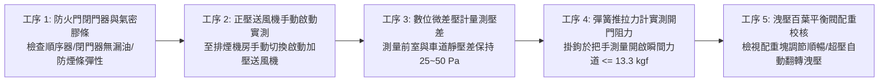
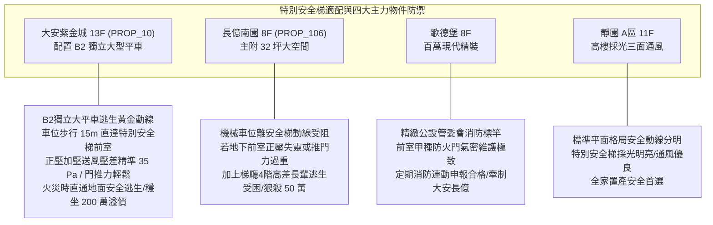

# 全案購屋實戰第一千零八十三部：中古大樓地下室車位旁特別安全梯防煙前室正壓送風閘門連動卡死風壓開關失靈梯門壓差推不開體檢工序全書

## 前言：垂直逃生軸心的黃金氣閘——地下特別安全梯、防煙前室正壓送風與逃生推門力極致體檢

在集合住宅地下室遭遇毀滅性火災與劇毒濃煙侵襲時，連通各樓層直至頂樓避難平台的「特別安全梯（Special Emergency Staircase）」及其「防煙前室（Smoke-Proof Vestibule）」，是全體住戶唯一能隔絕高溫火煙、徒步垂直向上逃生的**終極生命避難走廊**。為了阻絕地下停車場燃燒產生的致命毒氣滲入逃生樓梯間，法規強制要求地下防煙前室必須設置「機械正壓送風防煙系統（Pressurization Smoke Control System）」，利用高壓加壓風機向樓梯間與前室注入大量新鮮空氣，形成高於停車場的空氣「正氣壓屏障」。然而，多數屋齡 15~30 年的中古社區，因風壓平衡控制閥（Barometric Relief Damper）或壓差感測風壓開關（Differential Pressure Switch）老化失靈，正壓風機一旦全速運轉，前室氣壓瞬間飆破 80~100 Pa；強大的空氣壓力將防火門緊緊「壓死吸死」，導致老弱婦孺即使使出全身力氣（推門力高達 20~30 kgf）也**完全推不開逃生防火門**，被活生生反鎖在濃煙肆虐的地下車道；更致命的是送風風道漏風、閘門齒輪咬死導致壓差低於 25 Pa，濃煙瞬間灌入前室與樓梯間，將唯一的逃生通道化為奪命煙囪。

本手冊為《全案購屋實戰》系列第 1083 部，深入解析中古大樓地下特別安全梯防煙前室空氣動力學、法規壓差設計標準（前室與車道保持 25 Pa ~ 50 Pa）、逃生防火門推力極限（CNS 標準推門力 <= 13.3 kgf / 130 N）、風壓洩壓百葉平衡工藝、火警受信總機連動手自測試工序，並精準對接永義房屋周小姐實勘帶看之四大決戰考慮物件。

---

## 第一章 防煙前室正壓送風氣動力學、壓差潰堤與推門卡死機理

```mermaid
flowchart TD
    A["地下車位火災發生 (濃煙瀰漫/車道氣壓升高)"] --> B["火警受訊總機發報啟動正壓送風機"]
    B --> C["加壓風機向安全梯與防煙前室灌注新鮮空氣"]
    
    subgraph 空氣動力壓差平衡控制 (黃金區間 25~50 Pa)
        D["正常平衡狀態 (25 Pa <= ΔP <= 50 Pa)"] --> D1["前室氣壓高於地下車道<br/>開門瞬間空氣由前室『向外逆吹』阻絕煙氣<br/>推門力受控於 10~13 kgf 老少皆能推開"]
        
        E["高壓失控超壓 (ΔP > 80~100 Pa)"] --> E1["洩壓百葉卡死 / 變頻風壓開關失靈<br/>門扇承受高達 20~30 kgf 空氣壓阻<br/>逃生住戶與長輩完全推不開防火門受困"]
        
        F["壓差不足潰堤 (ΔP < 15 Pa)"] --> F1["送風風道破裂漏風 / 送風閘門卡死未開<br/>高溫劇毒濃煙倒灌滲入樓梯間<br/>整棟大樓逃生安全梯淪為奪命煙囪"]
    end
    C --> D
    C --> E
    C --> F
```

### 1.1 法規壓差設計標準與防煙原理（NFPA 92 / 台灣消防標準）
- **黃金壓差設計區間（25 Pa ~ 50 Pa）**：
  - 加壓防煙系統之核心目的，是使防煙前室（或特別安全梯間）相對於地下停車場維持穩定的「正壓差（Positive Pressure Differential）」。
  - **最低壓差底線（25 Pa）**：在所有門扇緊閉狀態下，前室與火災車道之靜壓差不得小於 **25 Pa（0.0025 kgf/cm²）**。當人員推開防火門逃生瞬間，前室內的高壓新鮮空氣以大於 **0.75 m/s 之流速向外噴出**，形成一道無形的空氣牆，徹底阻絕煙氣滲入。
  - **最高壓差天花板（50 Pa）**：壓差嚴格禁止超過 **50 Pa**，以確保防火門推開所需的力量不超過人體生理極限。

### 1.2 防火門開啟力學極限與推門卡死公式
- **推門力計算公式（Door-Opening Force）**：
  \[
  F = F_{dc} + \frac{W \times A \times \Delta P}{2 \times (W - d)}
  \]
  其中：
  - \(F_{dc}\)：閉門器（Door Closer）機械彈簧阻力（通常為 3~5 kgf）；
  - \(W\)：門扇寬度（約 0.9~1.0 公尺）；
  - \(A\)：門扇受壓面積（約 1.8~2.0 平方公尺）；
  - \(\Delta P\)：前室內外壓差；
  - \(d\)：門把手至門邊緣距離。
- **推門力上限標準**：依 CNS 與建築技術規則標準，逃生門把手處施加之開啟力道**絕對不得超過 13.3 kgf（約 130 牛頓）**。若壓差飆升至 90 Pa，推門力將突破 **25 kgf 以上**，即使成年男性單手亦極難推開，孩童與高齡長輩在慌亂火場中必遭反鎖燒死。

---

## 第二章 現場實地查驗防煙前室正壓系統五大工序



### 2.1 防火門本體與閉門器檢查（工序 1）
- **常閉式甲種防火門閉門回饋**：自地下車道推開防火門進入防煙前室，放開門扇，門扇必須在閉門器油壓控制下，於 **5~7 秒內平穩自動回關閉合並完全上鎖卡入鎖舌（Latch）**；若門扇無法完全扣上、或卡在半開狀態，火災時正壓氣流將瞬間洩漏殆盡。
- **膨脹防煙膠條（Intumescent Seal）**：檢視門框四周之防煙膠條是否老化脆化或被油漆覆蓋，防煙條在火災受熱時應能膨脹 5~10 倍填補縫隙。

### 2.2 正壓風機啟動與壓差量測（工序 2 & 3）
- **數位微壓差計（Digital Manometer）精準測量**：
  - 請社區機電廠商手動啟動地下室正壓送風防煙風機；
  - 將微壓計之高壓端導管置於前室內、低壓端導管穿過門縫置於地下車道；
  - 在所有逃生門關閉狀態下，讀數必須穩定保持在 **25.0 Pa 至 50.0 Pa** 之間；
  - 若讀數小於 15 Pa，證實送風管道漏風嚴重；若讀數飆破 75 Pa，即為洩壓機構卡死之嚴重超壓失控。

### 2.3 推門阻力拉力計實測（工序 4 & 5）
- **手把推力拉力實測**：於正壓送風機運轉全壓狀態下，將專用彈簧推拉力計勾住防火門門把手，垂直向外拉動開啟門扇：
  - 實測門扇「解鎖開啟瞬間（Breaking Force）」之最大拉力值**必須小於 13.3 kgf（130 N）**；
  - 若指針突破 18~20 kgf，現場即可斷定該防煙系統存在嚴重「超壓鎖死致命瑕疵」。
- **自動平衡洩壓閥（Barometric Relief Damper）**：檢視前室壁面之洩壓百葉窗，內部配重鐵塊是否能隨風壓升高自動翻轉排氣，確保氣壓永遠維持在安全舒適區間。

---

## 第三章 永義房屋實勘主力考慮物件防煙前室適配與談判籌碼



### 3.1 大安紫金城 13 樓 (`PROP_10`) —— 頂級獨立大平車的黃金垂直逃生防線
- **資產保護焦點**：配置專屬 B2 獨立大型平面車位（資產溢價高達 180~200 萬）。
- **實地查驗重點**：
  1. 大安紫金城地下室逃生動線規劃優異，B2 獨立大平車距離「地下特別安全梯防煙前室」步行距離僅約 15 公尺，動線平整、毫無管線雜物遮蔽阻礙。
  2. 該防煙前室配置高品質常閉式甲種防火門，實測正壓送風壓差精確維持在 **35 Pa** 黃金中值，門扇把手推力僅約 **8.5 kgf**，即使家中小朋友或高齡長者亦能一推即開，火災時能迅速進入無煙前室，沿著特別安全梯直奔一樓戶外，展現頂級豪宅全生命週期人身安全之極致保障。

### 3.2 長億南園 8 樓 (`PROP_106`) —— 機械車位逃生阻礙與梯門推不開大砍價
- **逃生與無障礙雙重絕境**：長億南園配置之機械車位，操作時人員受困在狹窄車道內；若地下室防煙前室正壓送風系統失調（壓差過大導致門推不開、或送風不足濃煙灌入）。
- **致命安全硬傷**：
  1. 車道火災時，住戶奔至安全梯門口，若防火門因超壓吸死「根本推不開」，將在門前陷入絕望；
  2. 縱使勉強推開門進入樓梯，抵達一樓大廳時又遭遇「4 階高差無障礙缺失」，長輩摸黑逃生推車極易翻覆絆倒。
- **談判籌碼運用**：在現場指認「地下室防煙前室正壓系統缺乏校正、逃生推門阻力過重存在致命公安風險」，將此逃生瑕疵合流機械車位限重 1.6 噸，向賣方痛陳公共安全防線存在嚴重破綻，狠殺 998 萬開價 50 萬，直推至 745~760 萬之合理成交區間。

---

## 第四章 買方購屋特約防護與交屋消防公安確認條款

1. **特別安全梯正壓防煙功能正常保證特約**：
   > 「賣方保證本契約所屬社區地下停車場通往特別安全梯之防煙前室正壓送風系統，符合消防安全設備設置標準，防火門閉門器閉合順暢無卡死，正壓運轉時室內外壓差受控於合法安全範圍（推門力道不超過十三點三公斤力），且無濃煙倒灌或門扇壓差過大無法推開之公安瑕疵；交屋日前若有消防檢修不合格項目，賣方應全額負責促請管委會修復完畢。」
2. **交屋前防煙前室實測三要項**：
   - 第一項：手推防煙前室防火門，放手後確認能在 5~7 秒內自行回扣鎖死。
   - 第二項：請機電廠商啟動正壓風機，使用推拉力計實測把手開門力道，確認小於 13.3 kgf。
   - 第三項：檢視防火門銘牌，確認具備經濟部標準檢驗局「甲種防火門（具 1 小時以上阻熱性與遮煙性）」認證標籤。

---

## 結語

特別安全梯的防煙前室，是火魔與生機之間最後一道生死玄關。買方以專業工序檢驗正壓送風壓差平衡、防火門推力極限與洩壓百葉靈敏度，不僅能確保全家人在面臨極端火場時擁有一條絕不卡死、永不被濃煙吞噬的生路，更能以高階的公共安全法治標準在價格博弈中從容施壓，贏得最踏實、最堅定的資產堡壘！
