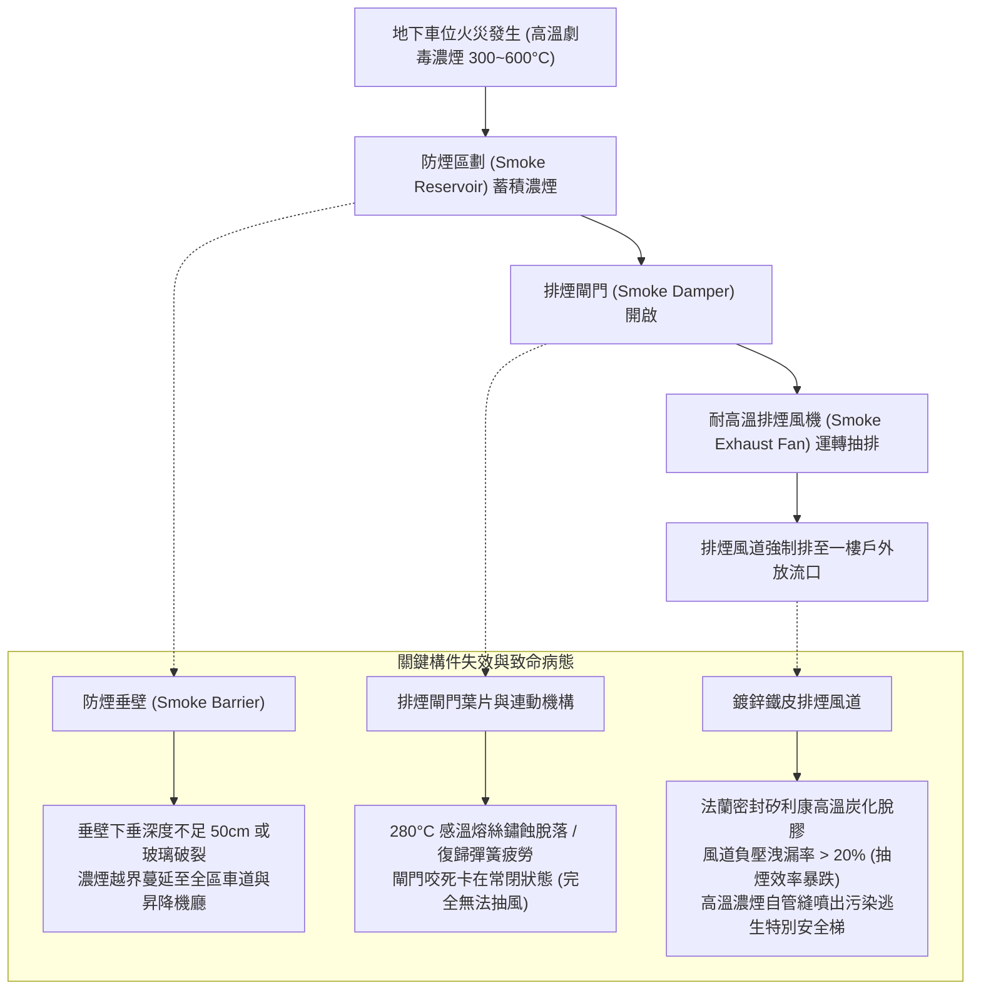
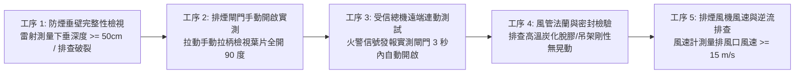
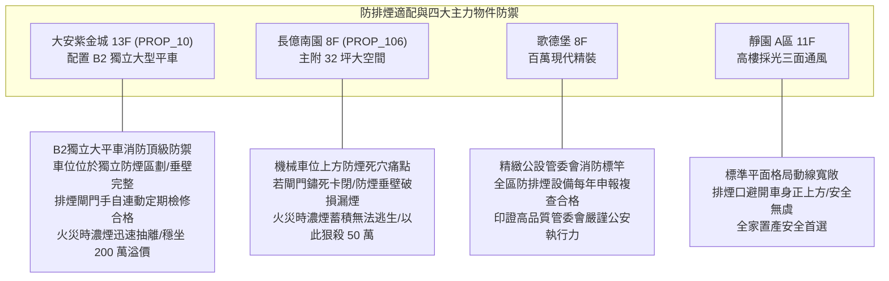

# 全案購屋實戰第一千零八十二部：中古大樓地下室車位旁消防排煙閘門感知熔絲斷裂排煙風道負壓洩漏防煙垂壁破損體檢工序全書

## 前言：密室濃煙的吞噬者——地下車位防排煙系統、防火排煙閘門與防煙區劃極致體檢

在現代集合住宅全生命週期消防防護中，深埋地底、完全封閉且缺乏自然通風窗口的地下停車場，一旦發生車輛自燃、充電樁電氣火災或人為縱火，高溫有毒濃煙（含高濃度一氧化碳 CO、氰化氫 HCN 及氟化氫 HF）將在數分鐘內充滿整個地下室，形成伸手不見五指、高達數百度的高溫「毒氣悶燒室」。此時，安裝於車位天花板與防煙區劃邊界之「排煙閘門（Smoke Damper）」、「排煙風道（Exhaust Duct）」與「防煙垂壁（Smoke Barrier / Hanging Wall）」，是阻絕高溫濃煙水平擴散、將致命煙氣強制抽排至地面的**核心主動防煙生命防線**。然而，多數屋齡 15~30 年的中古社區，排煙閘門內部感溫熔絲（Fusible Link / 280°C）長年受潮腐蝕斷裂導致閘門常閉卡死；驅動馬達齒輪崩齒、防煙垂壁（防煙玻璃或防火垂布）因地震震裂破損形成漏煙大縫；更致命的是排煙風道咬合接縫脫膠，在高壓排風下產生嚴重「負壓洩漏」，抽進的濃煙在半途又灌回車道，直接瓦解地下室唯一的逃生動線。

本手冊為《全案購屋實戰》系列第 1082 部，深入解析中古大樓地下室消防防排煙法規區劃（防煙區劃面積 <= 500 m²）、排煙風機風量風壓計算（風速 >= 15 m/s）、排煙閘門 UL 555S 氣密耐溫認證、防煙垂壁下垂深度（>= 50 cm）與火警受信總機連動手自測試工序，並精準對接永義房屋周小姐實勘帶看之四大決戰考慮物件。

---

## 第一章 地下車位防排煙系統結構、氣動力學與失效機理

### 1.1 防煙區劃（Smoke Reservoir）與防煙垂壁物理學
- **區劃面積與蓄煙空間**：依《各類場所消防安全設備設置標準》規定，地下建築物每 **500 平方公尺（約 150 坪）** 之樓地板面積必須劃設為一個獨立的「防煙區劃」。
- **防煙垂壁之水力封閉效能**：
  - 天花板必須安裝不燃材料（鋼板、夾絲玻璃、防火岩棉垂布）製作之防煙垂壁；
  - **下垂深度嚴格要求不得小於 50 公分**；
  - 其物理原理是利用高溫煙氣向上漂浮之熱浮力（Thermal Buoyancy），將高溫濃煙牢牢鎖定在防煙垂壁形成的「天花板倒置水庫（Smoke Reservoir）」內，防止煙氣向四周車道滾動擴散，為下方人員爭取 1.5 公尺高度以上之逃生新鮮空氣層。

### 1.2 排煙閘門（Smoke Damper）之高溫耐受標準
- **280°C 防火與排煙雙重極限**：
  - 專用排煙閘門平時常閉，火災時由火警受訊總機連動打開進行排煙；
  - 閘門本體及葉片必須通過 **280°C 高溫耐火試驗達 30 分鐘以上**；
  - 當排煙風道內氣流溫度達到 **280°C（高溫即將引燃風機之極限）** 時，感溫熔斷片熔斷，閘門強制自動閉合，阻斷火勢沿風道跨防火區劃蔓延。
- **風道負壓洩漏（Negative Pressure Leakage）**：排煙風機啟動時，風道內部處於強烈負壓（負壓達 -500 Pa 以上）。若風管接縫處密封膠脆化，大量空氣將從裂縫吸入，大幅削弱火災現場排煙口的抽吸能力，導致車位現場濃煙完全排不出去。

---

## 第二章 現場實地查驗車位防排煙設施五大工序

### 2.1 防煙垂壁外觀與尺度丈量（工序 1）
- **垂直下垂深度實測**：使用雷射測距儀測量天花板至防煙垂壁底緣之垂直距離：
  - 讀數必須大於 **50 公分**；
  - 檢視垂壁邊緣：若是防煙玻璃，檢查是否有撞擊裂紋或膨脹螺栓鬆動；若是自動垂降式防火防煙捲簾，實測通電能否平順降至 50 cm 定位點，嚴禁卡滯半空中。

### 2.2 排煙閘門機械動作與電氣連動（工序 2 & 3）
- **手動開啟裝置（Manual Pull Station）操作**：車位旁柱面上通常設有排煙閘門手動操作盒（標示「排煙手動開關」）：
  - 打開保護蓋拉下手柄，天花板排煙口之金屬葉片必須在 **3 秒內流暢翻轉 90 度達到全開定位**；
  - 葉片旋轉軸承若發出尖銳卡死雜音或僅開 30 度即卡住，證實齒輪咬死或彈簧疲勞失能。
- **總機信號連動驗證**：請社區機電廠商於受訊總機手動發送排煙區劃火警信號，檢視目標車位上方閘門是否精準連動開啟，且總機盤面回傳「閘門開啟確認信號（綠燈正常亮起）」。

### 2.3 排風風道與風速抽力實測（工序 4 & 5）
- **耐熱風管接頭查核**：排煙風道必須使用厚度 1.0mm 以上之鍍鋅鋼板，接頭密封墊片必須為耐熱無毒材料（嚴禁使用一般易燃矽利康）；
- **排煙口吸力實測**：排煙風機啟動時，手持風速計置於車位天花板排煙口格柵處：
  - 實測吸入風速必須達到 **15 m/s 以上**；
  - 現場以紙張測試，紙張應被強烈吸附於格柵上，展現足夠排煙負壓。

---

## 第三章 永義房屋實勘主力考慮物件防排煙適配與談判籌碼

### 3.1 大安紫金城 13 樓 (`PROP_10`) —— 頂級獨立大平車的黃金防煙生命防線
- **資產保護焦點**：配置專屬 B2 獨立大型平面車位（資產溢價高達 180~200 萬）。
- **實地查驗重點**：
  1. 大安紫金城地下室消防公安申報制度極度健全，B2 獨立大平車上方之防煙區劃清晰，防煙垂壁（深度 > 50 cm）結構完整牢固無破損。
  2. 車位鄰近之排煙閘門與排煙風道維護良好，手動拉柄與總機連動靈敏無卡滯，且排煙口避開車輛正上方（防止火災時高溫熱輻射直接烘烤車體），一旦地下室突發火警，高溫濃煙能瞬間被導排抽離，為家人爭取充裕的逃生時間，展現頂級資產之深層安全底蘊。

### 3.2 長億南園 8 樓 (`PROP_106`) —— 機械車位上方排煙失能與逃生絕境大砍價
- **機械車位遇濃煙之滅頂危機**：長億南園配置之機械車位，操作時人員必須在載台旁停留較長時間；若地下室防排煙系統年久失修，排煙閘門熔絲斷裂卡死常閉、防煙垂壁缺失。
- **致命安全硬傷**：
  1. 火災發生時，高溫濃煙在地下室迅速下沉至呼吸帶（距地 1.5 米以下），操作機械車位之住戶在數十秒內即會窒息昏迷；
  2. 若排煙風機老舊皮帶打滑風壓不足，地下密室將完全淪為毒氣高溫烤箱；
  3. 一樓梯廳又存在「4 階高差無障礙缺失」，摸黑逃生極易踩空絆倒摔傷。
- **談判籌碼運用**：在現場指認「地下室防排煙閘門故障、防煙垂壁破損缺乏維護、存在重大消防公安致命漏洞」，將此重大公共安全瑕疵合流機械車位限重 1.6 噸，向賣方痛陳大樓公設消防修繕耗資巨大，狠殺 998 萬開價 50 萬，直壓至 745~760 萬之合理成交區間。

---

## 第四章 買方購屋特約防護與交屋消防公安確認條款

1. **社區地下防排煙設備合格運作保證特約**：
   > 「賣方保證本契約所屬社區地下停車場之消防防排煙系統（含排煙閘門、排煙風機、防煙垂壁及火警連動控制機構），符合消防法令規範且處於正常運作狀態，且本年度消防安全設備檢修申報複查合格無重大待修缺失；若交屋前消防主管機關開立排煙設備限期改善單，相關修繕罰鍰由賣方全額負責結清。」
2. **交屋前車位防排煙實測三步驟**：
   - 第一步：親自拉動車位旁排煙手動開關，確認天花板閘門 3 秒內平順全開無卡滯。
   - 第二步：雷射丈量車位四周防煙垂壁，確認下垂深度 >= 50 公分且無大縫破損。
   - 第三步：調閱管委會近兩年消防安全設備檢修申報書，確認「排煙設備項目」列為合格無瑕疵。

---

## 結語

地下停車場的防排煙系統，平時靜默無聲伏於天花板之上，但在火災突發的生死關頭，它就是決定全家人能否平安生還的關鍵守護神。買方以專業工序檢驗防煙垂壁蓄煙深度、排煙閘門連動反應與風道負壓氣密性，不僅能為家庭生命安全構築最堅不可摧的高空防線，更能以深層的消防公設瑕疵在價格談判中一擊制勝，牢牢鎖定資產最大勝局！
