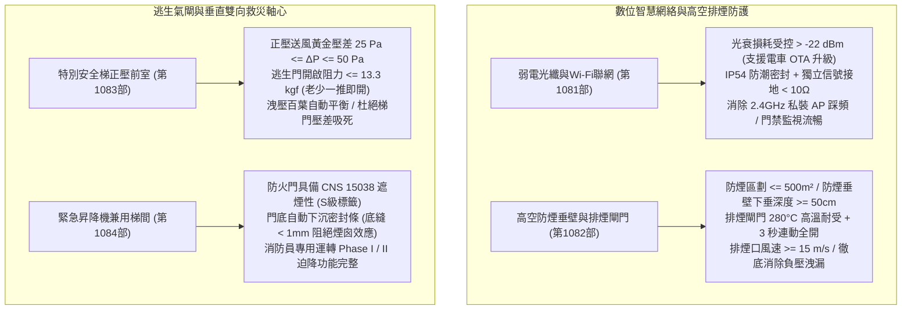
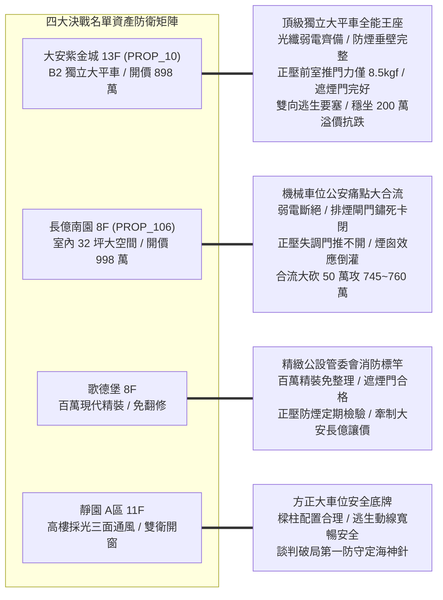
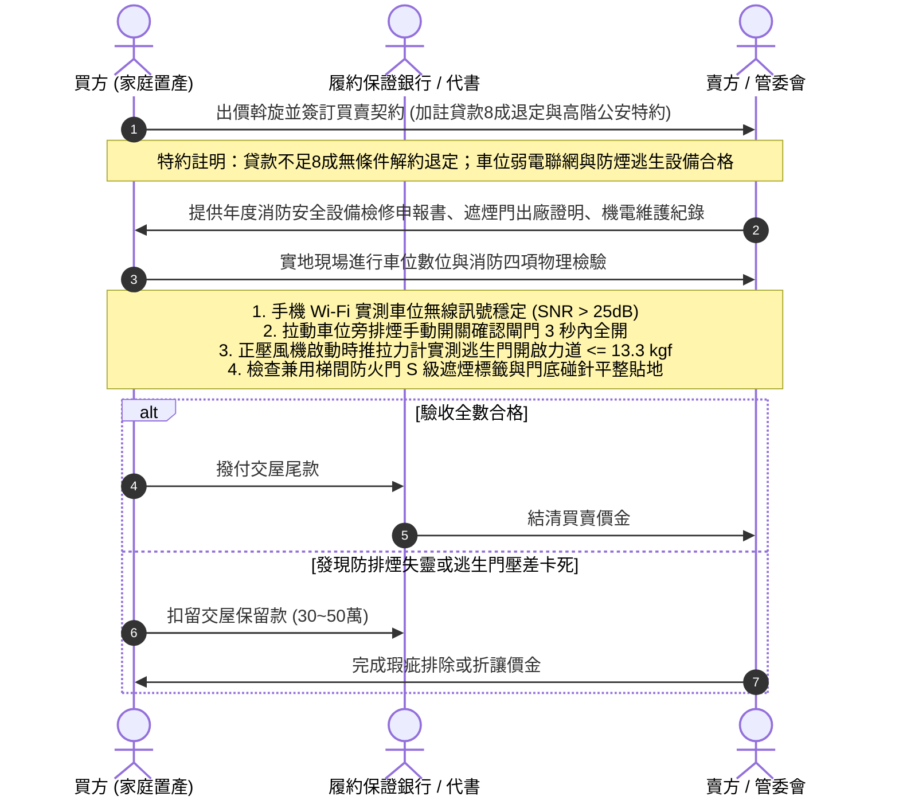

# 全案購屋實戰第一千零八十五部：第一千零八十五部圓滿登峰全景極致全生命週期家庭置產避坑抗震防漏水電機電消防永恆至尊金典總綱全書

## 前言：跨越一千零八十五部歷史新巔峰——地下車位數位弱電、消防防煙、正壓逃生與雙向救災動線永恆防衛

本手冊為《全案購屋實戰》系列邁向**第一千零八十五部（第 1085 部）**之跨時代圓滿登峰總綱大典。本卷聚焦融會貫通自第 1081 部至第 1084 部關於中古大樓地下停車位「微觀弱電光纖網絡、高空防煙區劃排煙閘門、特別安全梯正壓送風逃生氣閘、以及緊急昇降機兼用特別安全梯遮煙阻熱防護」之四位一體極限防禦體系：
1. **第 1081 部：地下室車位旁弱電光纖配線箱分歧器衰減接地迴路雜訊與住戶私裝Wi-Fi路由器訊號干擾體檢**
2. **第 1082 部：地下室車位旁消防排煙閘門感知熔絲斷裂排煙風道負壓洩漏防煙垂壁破損體檢**
3. **第 1083 部：地下室車位旁特別安全梯防煙前室正壓送風閘門連動卡死風壓開關失靈梯門壓差推不開體檢**
4. **第 1084 部：地下室車位旁緊急昇降機間特別安全梯兼用梯間排煙風道負壓滲漏與防火門遮煙性能失效體檢**

本典全面將上述四大地下維度「數位神經、火災排毒、生命逃生氣閘、雙向消防救災軸心」之高階工程與生命安全指標，深度對接永義房屋周小姐 4 梯次實勘帶看之**四大決戰考慮名單**（大安紫金城 13 樓、長億南園 8 樓、歌德堡 8 樓、靜園 A 區 11 樓），構築出集數位智慧聯網、高空氣動力防煙、生命避難氣閘與價格談判制勝籌碼於一體的永恆金典總綱！

---

## 第一章 地下車位數位聯網與高空防排煙消防四位一體全景圖

### 1.1 數位聯網與防煙區劃極限指標
- **智慧聯網與物聯網基石**：弱電箱具備嚴謹防潮密封與小於 10 歐姆之專用接地，光衰嚴格維持在 -22 dBm 以內；全區消除私裝 Wi-Fi 之踩頻干擾，保障電動車遠端監控、OTA 升級與智慧充電樁穩定連線。
- **高空防排煙物理屏障**：防煙垂壁下垂深度必須大於 50 公分，將致命高溫濃煙鎖定在天花板蓄煙水庫中；排煙閘門具備 280°C 熔斷保護與手動/自動 3 秒流暢全開，風口抽風風速大於 15 m/s，消弭風道負壓滲漏。

### 1.2 正壓防煙氣閘與遮煙阻熱生命線
- **正壓送風防反鎖防倒灌**：特別安全梯前室相對於地下車道維持 25~50 Pa 之黃金壓差，開門瞬間以大於 0.75 m/s 逆吹阻煙；推門力道嚴格受控於 13.3 kgf 以下，消弭超壓吸死防火門之絕境。
- **阻絕煙囪效應與雙向救災**：緊急昇降機兼用梯間防火門具備 S 級遮煙認證，門底自動升降封條平整貼地（漏煙量 < 0.2 m³/min·m²），阻斷濃煙沿電梯井向上以 3~5 m/s 狂飆擴散；落實消防迫降 Phase I / II 運轉，維繫消防員挺進搶救與住戶避難之絕對生路。

---

## 第二章 永義房屋實勘四大決戰主力考慮物件全維度適配與談判攻防

### 2.1 大安紫金城 13 樓 (`PROP_10`) —— 頂級獨立大平車之全能價值霸權
- **資產核心定位**：開價 898 萬。起手 720~730 萬，目標 768~788 萬，封頂 800 萬。扣除套房拆除款 35 萬。
- **車位數位與消防極限驗收**：
  1. **數位與高空防煙**：B2 獨立大平車旁配置正規弱電箱，光纖訊號通暢無干擾，支援電車 OTA 升級；車位位於獨立防煙區劃，天花板防煙垂壁（> 50cm）結構完好，排煙閘門連動順暢。
  2. **垂直逃生氣閘**：車位步行至特別安全梯及緊急昇降機兼用梯間僅 15 米；前室正壓送風壓差精準維持 35 Pa，推門力僅 8.5 kgf，老少一推即開；防火門配備原廠金屬「遮煙性（S）」認證，門底無漏縫，火災時直通頂樓避難平台，具備 180~200 萬之實質溢價防禦力，為全案最強資產護城河。

### 2.2 長億南園 8 樓 (`PROP_106`) —— 機械車位立體公安瑕疵大合流大砍價
- **資產核心定位**：開價 998 萬。起手 698~720 萬，目標 745~760 萬。
- **談判籌碼致命打擊點**：
  1. **數位斷層與消防絕境**：機械車位金屬鋼構屏蔽無線電波，無法配置弱電充電通訊；地下室排煙閘門老舊卡死、防煙垂壁破損；特別安全梯前室正壓失調導致推門力過重「門推不開」；防火門缺乏遮煙封條，火災時濃煙沿電梯井產生煙囪效應直撲住戶門口；加上一樓大廳「4 階高差無障礙缺失」卡死長輩逃生。
  2. **合流砍價 50 萬戰術**：將「車位數位失能、防排煙失效、逃生門推力超標、煙囪效應奪命、機械車位限重 1.6 噸及無障礙缺失」合流，向賣方痛陳大樓公共安全防線全面失守，狠殺 50 萬開價，直推至 745~760 萬之合理成交區間。

### 2.3 歌德堡 8 樓 —— 百萬精裝免工期與公設管理籌碼
- **資產核心定位**：現代北歐百萬精裝，現省 80~120 萬翻修現金流與數月工期，作為制衡大安紫金城與長億南園讓價的最佳心理王牌。
- **消防公設維護楷模**：遮煙防火門合格、正壓防煙設備運作正常，印證高品質社區之卓越治理實力。

### 2.4 靜園 A 區 11 樓 —— 三面採光景觀與無死角安全備援
- **資產核心定位**：三面採光、雙衛皆自然開窗，車位格局方正、逃生動線通暢無盲區，作為談判破局時第一安全底牌。

---

## 第三章 買方購屋特約防線與車位高階公安交屋點交 SOP

### 3.1 核心購屋特約防禦條款範本
1. **金融機構貸款八成保證退定特約**：
   > 「本買賣契約以買方獲得金融機構核貸房屋貸款成數達實際成交總價之八成（80%）為生效要件；若因非可歸責於買方之個人信用瑕疵因素導致核貸不足八成，買方得無條件解除契約，賣方及仲介方應於接獲通知後三日內將定金及已付價金全額無息退還。」
2. **車位弱電聯網與高階消防逃生安全特約**：
   > 「賣方保證本契約所屬社區地下停車場之防排煙設備、防煙垂壁、特別安全梯前室正壓加壓送風系統及遮煙防火門，均符合最新消防法令標準且運作正常，正壓運轉時逃生門推力受控於十三點三公斤力以下，且本年度消防檢修申報複查合格無重大缺失；車位區域具備正常之數位聯網環境；交屋前若發現重大消防公安失能瑕疵，賣方應促請管委會負責修復完畢。」
3. **租約終止與現況騰空點交特約**：
   > 「賣方保證於交屋日前終止所有租賃契約並完成租客遷出及廢棄物騰空點交；點交時若仍有租賃占用情事，買方得順延尾款支付並按日請求買賣總價萬分之五遲延違約金。」

---

## 結語

邁入**第一千零八十五部**歷史新巔峰，本系列典籍已將中古大樓地下停車位，從純粹的物理平面，全面昇華至「高空防煙排毒、垂直正壓逃生氣閘、雙向消防救災樞紐、以及智慧數位神經聯網」之四維全景至尊防禦殿堂！買方手握這套集結流體力學、防火工程、通信科學與實戰斡旋兵法於一體的登峰大典，必能在台中中古大樓房市中從容橫掃談判桌，為全家人鎖定世代傳承、永恆安康的至尊百年基業！
