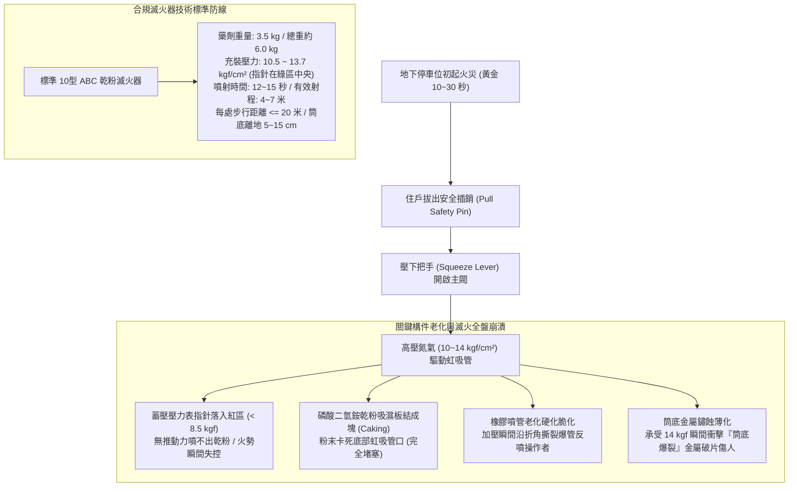
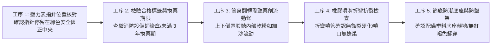
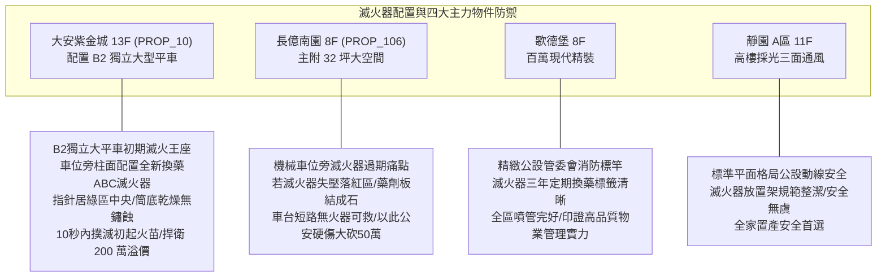

# 全案購屋實戰第一千零八十八部：中古大樓地下室車位旁乾粉滅火器蓄壓壓力表指針失壓落入紅區乾粉藥劑板結結塊與噴嘴橡膠硬化龜裂體檢工序全書

## 前言：手邊最近的保命火器——車位手提式滅火器、蓄壓壓力表、藥劑板結與抗爆噴管極致體檢

在集合住宅地下停車場的超初期火災撲滅體系中，懸掛於車位周邊結構柱或地面滅火器放置架上的「ABC 乾粉滅火器（Dry Chemical Fire Extinguisher / 10型或20型）」與「水性/潔淨氣體滅火器」，是住戶在發現車輛引擎室冒煙、底盤線路短路火花或充電樁初起火苗時，**觸手可及、單人即可在 10 秒內啟動的最後近身防衛火器**。然而，多數屋齡 15~30 年的中古社區，因地下室環境長年潮濕、汽車排氣溫差冷凝水侵蝕，多數滅火器已淪為「徒具外觀的鐵筒廢鐵」：壓力表指針早已失壓「落入左側紅色危險區（Undercharged）」；筒身內部之磷酸二氫銨（Monoammonium Phosphate）乾粉藥劑因受潮嚴重板結成「堅硬石頭般的硬塊」，噴射時完全堵塞虹吸管；高壓橡膠噴管老化硬化龜裂，壓下手柄瞬間噴管爆裂將乾粉朝後反噴操作者雙眼；更致命的是底座鐵圈遭地面洗車積水鏽蝕爛穿，在高壓驅動瞬間引發「筒底金屬撕裂爆破（Extinguisher Cylinder Rupture）」，化為致命金屬破片重傷人員。

本手冊為《全案購屋實戰》系列第 1088 部，深入解析中古大樓地下室滅火器水力學與氣動蓄壓規範、蓄壓壓力表綠區標準（10.0 ~ 15.0 kgf/cm²）、乾粉藥劑 3 年換藥法規週期與吸濕板結機理、筒體水壓耐壓試驗（試驗壓力 >= 20 kgf/cm²）、有效射程（4~7 公尺）與噴射時間（12~15 秒）檢驗工序，並精準對接永義房屋周小姐實勘帶看之四大決戰考慮物件。

---

## 第一章 滅火器氣動結構、藥劑板結與筒體鏽蝕爆破機理

### 1.1 乾粉藥劑之化學特性與受潮板結（Caking）機理
- **主成分化學反應**：ABC 乾粉滅火器主要成分為 **磷酸二氫銨（NH₄H₂PO₄，含量約 70%~90%）** 與硫酸銨。該化學鹽類具備極強的吸濕性（Hygroscopicity）。
- **板結成石之死穴**：地下室相對濕度常態高於 75%~85%，若滅火器密封墊圈微幅老化，微量水氣滲入筒內。磷酸二氫銨顆粒表面溶解並與相鄰顆粒結晶交聯，原本直徑 20~40 微米的細密流態粉末，在 3~5 年未翻轉鬆粉的情況下，會板結成如同「水泥硬塊」般的固體。當高壓氮氣自上方釋放時，氣體直接在粉餅中央衝出一個空洞（Channeling），根本帶不出乾粉，滅火器噴出幾口氣體後即宣告啞火。

### 1.2 蓄壓指針紅區與筒底爆破（Cylinder Rupture）物理學
- **壓力表三色判讀標準（CNS 1387 / 消防標準）**：
  - **綠色區域（Green Zone / 10.0 ~ 15.0 kgf/cm²）**：正常工作壓力帶，指針必須精準停留在綠區正中央（約 12.0 kgf/cm²）；
  - **左側紅色區域（Recharge / < 8.5 kgf/cm²）**：內部高壓氮氣洩漏失壓，推力不足，已喪失噴射射程，必須立即重新充氣換藥；
  - **右側紅色區域（Overcharged / > 17.0 kgf/cm²）**：內部超壓，夏季高溫下有爆裂危險。
- **底部鏽蝕爆破之殺傷力**：滅火器若長年直接放置於地下室潮濕地面或洗車積水處，底部縫合底圈（Base Ring）積水生鏽。鋼板厚度自 1.5mm 鏽蝕減薄至 0.5mm 以下。壓下手柄瞬間，內部承受 14 kgf/cm² 氣浪衝擊，底座沿鏽蝕周圈瞬間撕裂爆開，金屬筒身如火箭般向上飛射，威力足以擊碎人體肋骨甚至致死。

---

## 第二章 現場實地查驗車位滅火器設施五大工序

### 2.1 壓力表與換藥檢驗標籤查核（工序 1 & 2）
- **指針讀數檢測**：手持強光手電筒直射滅火器頭部圓形壓力表，手指輕彈錶面（防止指針因油垢假性卡滯在綠區）：
  - 指針必須真實停留在綠色區域中央；若指針偏左進入紅色「再充填（RECHARGE）」區，該具滅火器已屬廢品。
- **銀色反光檢驗合格標籤**：筒身必須貼有內政部消防署認可機構之「滅火器型式認可檢驗合格標籤」，檢視上方烙印之「下次換藥檢驗日期」：
  - 乾粉滅火器依法**每 3 年必須強制實施全數換藥與水壓檢驗一次**；
  - 若標籤日期已過期數年未檢，現場即可判定管委會存在嚴重公安怠惰。

### 2.2 筒體倒置「聽音辨粉」實測（工序 3）
- **翻轉聽音法（Inversion Test）**：雙手穩固握住滅火器提把與底部，將滅火器快速「上下倒置 180 度」置於耳邊靜心聆聽：
  - 合格未受潮之乾粉，應發出如「乾爽細沙平順滑落流動」的沙沙聲，並能感受到粉末重心轉移之沉降感；
  - 若倒置後「完全無聲音」、或發出「咚」一聲巨大塊狀重擊聲，證實內部藥劑已嚴重板結成水泥塊，火災時必堵死虹吸管。

### 2.3 橡膠噴管與筒底防蝕檢驗（工序 4 & 5）
- **噴管柔韌性手折測試**：將黑色橡膠噴管向反方向彎折 90 度：
  - 橡膠表面應維持高彈性無裂紋；若表面布滿細密蛛網龜裂、或硬化如塑料無法彎折，加壓噴射時必爆裂。
  - 檢視噴嘴開口：確認無泥蜂築巢、蜘蛛網或煙蒂雜物堵塞。
- **防潮塑膠底座與懸掛高度**：合規之車位滅火器必須放置於專用塑料底座上（使金屬筒底距地至少 **5~10 公分**），或壁掛於結構柱面（壓把距地高度小於 1.5 公尺）；嚴禁直接接觸潮濕水泥地。

---

## 第三章 永義房屋實勘主力考慮物件滅火器配置適配與談判籌碼

### 3.1 大安紫金城 13 樓 (`PROP_10`) —— 頂級獨立大平車的即時火器守護
- **資產保護焦點**：配置專屬 B2 獨立大型平面車位（資產溢價高達 180~200 萬）。
- **實地查驗重點**：
  1. 大安紫金城物業消防管理嚴密，B2 獨立大平車相鄰結構柱上，設置有合規之滅火器壁掛架，放置 2 具 10 型 ABC 乾粉滅火器，步行距離僅約 5 公尺。
  2. 壓力表指針全數精準停留於綠區中央，外殼標籤為當年度最新檢驗合格標章，橡膠噴管柔韌完好，筒底乾爽無任何鐵鏽剝落。一旦發生車內線路突發火花，住戶可在 10 秒內單人拔插銷壓把噴射，精準將火苗撲滅在萌芽階段，為百萬豪華座駕築起最堅固的初期安全屏障。

### 3.2 長億南園 8 樓 (`PROP_106`) —— 機械車位旁滅火器失效大砍價
- **機械車位遇火災之滅頂死穴**：長億南園配置之機械車位，載台線路老舊且存有機油；若相鄰柱面放置之滅火器滿是灰塵油垢、壓力表指針早已落入左側紅色失壓區、藥劑板結成塊。
- **致命安全硬傷**：
  1. 機械載台控制盤一旦因短路冒火，住戶在現場拔下插銷壓把，滅火器卻噴不出半點乾粉，只能眼睜睜看著火勢在數十秒內蔓延吞噬愛車；
  2. 滅火器筒底若鏽蝕爛穿，緊急壓下時甚至有筒身爆破炸傷操作者之重大意外風險；
  3. 逃生時一樓大廳又遭遇「4 階高差無障礙缺失」，滅火逃生雙雙陷入絕境。
- **談判籌碼運用**：在現場指認「地下室滅火器長年過期失壓、藥劑板結失能、存在毀滅性初起火災無法自救隱患」，將此重大公共安全瑕疵合流機械車位限重 1.6 噸，向賣方痛陳大樓公設消防管理嚴重脫節，狠殺 998 萬開價 50 萬，直推至 745~760 萬之合理成交區間。

---

## 第四章 買方購屋特約防護與交屋滅火器公安確認條款

1. **社區地下滅火器設備合格有效保證特約**：
   > 「賣方保證本契約所屬社區地下停車場配置之手提式滅火器，符合最新消防法令設置標準（每處步行距離不超過二十公尺），滅火器壓力表指針處於綠色正常安全範圍，藥劑在三年有效檢驗期限內且未板結結塊，噴管無龜裂硬化，筒底無嚴重鏽蝕穿孔瑕疵；交屋日前若有滅火器過期或失壓失效項目，賣方應全額負責促請管委會換藥更換完畢。」
2. **交屋前車位滅火器實測三要項**：
   - 第一項：彈擊並檢視車位周邊 20 公尺內每具滅火器壓力表，確認指針在綠色區域內。
   - 第二項：將滅火器倒置 180 度聆聽藥劑流動聲，確認無水泥硬塊撞擊聲。
   - 第三項：檢視筒身換藥標籤，確認下次換藥日期未過期。

---

## 結語

手提式滅火器，是地下停車場在面臨突發火魔時最平易近人、也最關鍵的保命火器。買方以專業工序檢驗蓄壓指針、藥劑流動狀態、橡膠噴管柔韌度與筒底抗爆強度，不僅能確保全家人與昂貴座駕在面臨初起火苗時擁有 10 秒即滅的絕對自救實力，更能從最微小的滅火器維護細節中看穿管委會的公安靈魂，在價格博弈中從容施壓、穩操勝券！
