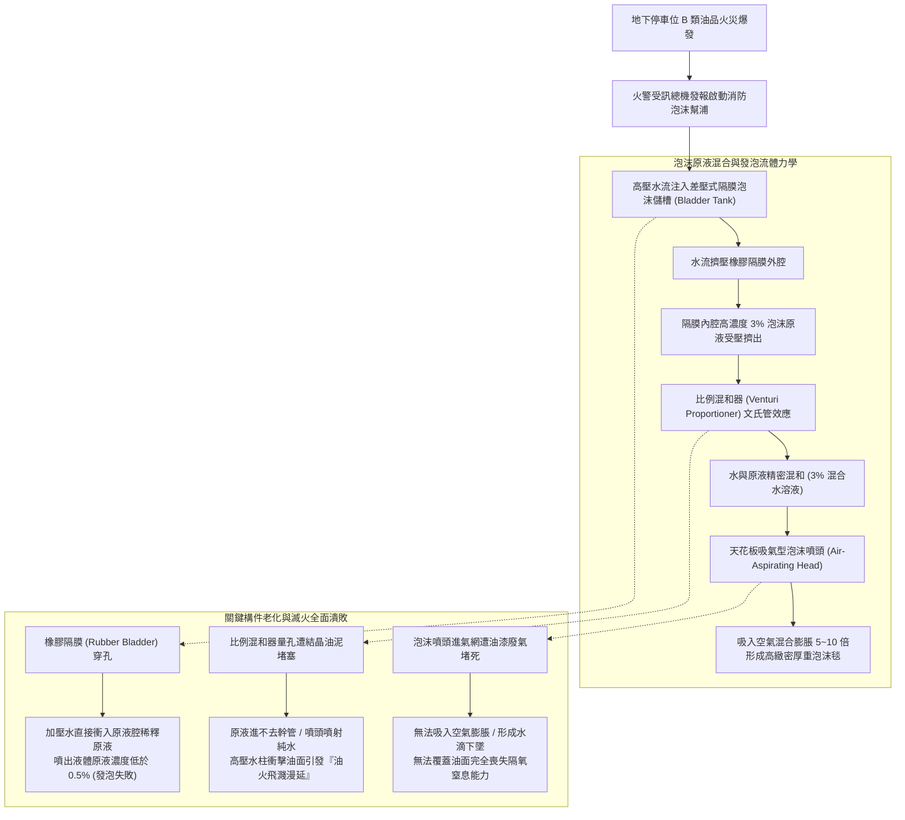
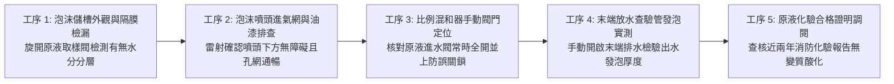
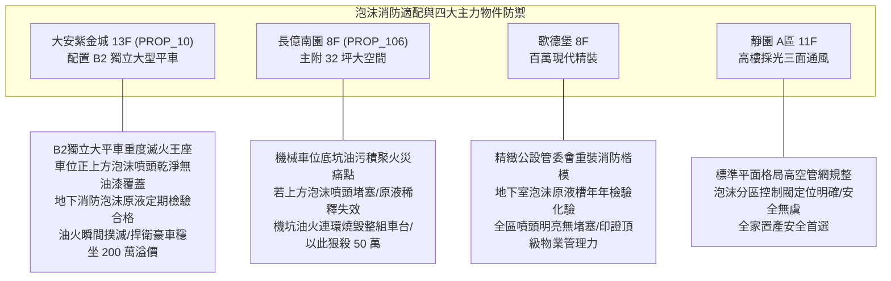

# 全案購屋實戰第一千零八十六部：中古大樓地下室車位旁消防泡沫原液比例混和器齒輪卡死發泡倍率衰減噴頭阻塞與泡沫槽隔膜破裂體檢工序全書

## 前言：油類火災的窒息滅火器——地下車位水成膜泡沫滅火系統、原液混合精度與釋放管網極致體檢

在現代中古大樓地下停車場的重度消防滅火體系中，針對汽車油箱汽油洩漏、底盤引擎機油燃燒以及早期未設充電樁區域之油類火災（B 類火災），天花板縱橫交錯的「水成膜泡沫滅火系統（AFFF Foam-Water Deluge System）」是藉由噴灑微細泡沫覆蓋油面、隔絕空氣中氧氣並吸收熱量以達成窒息滅火的**核心重裝防禦王牌**。然而，多數屋齡 15~30 年的中古社區，因地下室潮濕與長年缺乏加壓測試，其地下消防機房內的「隔膜式泡沫原液儲槽（Bladder Tank）」內部橡膠隔膜嚴重水解老化穿孔，水槽內的高壓水與泡沫原液互相混流稀釋；更致命的是，「差壓比例混和器（Ratio Controller / Proportioner）」內部精密量孔或渦輪齒輪遭結晶原液與泥沙卡死，使得滅火時噴出的根本不是具備 3% 或 6% 混合比例的厚重滅火泡沫，而僅是無滅火效能的稀釋濁水；加上車位天花板泡沫噴頭（Foam Sprinkler Head）常年遭油漆、蜘蛛網與廢氣油泥封死孔洞，一旦油火爆發，系統非但無法壓制烈焰，反而因噴水助長燃燒油滴隨水四處漂浮擴散，引發整座地下車道火海連環蔓延的慘烈浩劫。

本手冊為《全案購屋實戰》系列第 1086 部，深入解析中古大樓地下室泡沫滅火系統水力學原理、NFPA 11 / NFPA 16 泡沫混合比標準（3% AFFF 原液濃度誤差不得超過 +1.0%/-0%）、發泡倍率（Expansion Ratio 5~10 倍）與 25% 析液時間（Drainage Time >= 3 分鐘）、泡沫槽膠囊隔膜耐壓檢驗、末端釋放閥試水工序，並精準對接永義房屋周小姐實勘帶看之四大決戰考慮物件。

---

## 第一章 泡沫滅火系統水力學結構、混合比失調與隔膜穿孔機理

### 1.1 差壓式隔膜儲槽（Bladder Tank）之破壞力學
- **雙腔差壓擠出原理**：碳鋼壓力儲槽內部懸掛一個高強度氯丁橡膠或三元乙丙橡膠（EPDM）隔膜囊袋。水流自儲槽與囊袋之間的環形空間注入，利用進水壓力均勻擠壓橡膠囊袋，將內部儲存的「水成膜泡沫滅火原液（AFFF）」以精確水力差壓擠出進入比例混和器。
- **隔膜水解穿孔與原液稀釋之死穴**：地下室常年潮濕悶熱（25°C~35°C），橡膠隔膜歷經 15 年以上浸泡，聚合物鏈水解斷裂變脆。在消防定期試水或水錘衝擊下，隔膜接縫處撕裂穿孔。儲槽上方進水管的高壓自來水直接灌入囊袋內部，原液遭數十噸清水徹底稀釋。外觀上儲槽壓力指針完好，實則內部原液濃度已衰減至趨近於零。

### 1.2 比例混和器（Proportioner）文氏管效應與發泡倍率
- **文氏管（Venturi）混合比標準（NFPA 11 / CNS 標準）**：
  - 標準 AFFF 原液設定混合比例通常為 **3%（3 份原液混合 97 份水）**；
  - 法規容許誤差範圍極為嚴格，實際混合濃度**必須介於 3.0% 至 3.9% 之間**（濃度低於 3.0% 即無法在油面上形成厚實水膜；若低於 1.5% 則完全無法發泡）。
- **發泡倍率（Expansion Ratio）與 25% 析液時間**：
  - 低發泡噴頭發泡倍率必須達到 **5 倍至 10 倍**；
  - 泡沫毯覆蓋於燃燒油面上，其內部水分流失 25% 的時間（25% Drainage Time）必須大於 **3 分鐘**；若原液變質或噴頭進氣孔堵塞，泡沫在 30 秒內即化為清水破泡消散，油火將瞬間復燃。

---

## 第二章 現場實地查驗車位泡沫消防設施五大工序

### 2.1 儲槽原液取樣與隔膜完整性實測（工序 1 & 5）
- **底部取樣閥現場化驗**：前往地下室消防幫浦機房，找到泡沫原液儲存槽：
  - 旋開儲槽底部專屬取樣閥，以透明量筒接取 100 ml 泡沫原液；
  - 合格原液應為均勻、無沉澱、微黏稠之琥珀色或淡黃色透明液體；
  - 若接出之液體為「清水混濁狀」或有明顯「油水分離雙層分界」，證實隔膜已嚴重穿孔破裂，整槽原液已報廢稀釋。
- **折射計（Refractometer）現場測濃度**：使用手持式光學折射儀，取滴混和液測量折射率，對照原液濃度曲線，確認數值精準落在 **3.0% ~ 3.5%** 標準帶。

### 2.2 比例混和器閥門狀態與管閥定位（工序 3）
- **常時開啟閉鎖檢驗**：比例混和器兩端之原液進口閥門與進水閥門，必須處於**「全開（Fully Open）」**狀態，且必須具備「金屬鏈條加鎖或微動監控開關（Tamper Switch）」；若閥門遭粗心機電廠商誤關，火警啟動時系統只能噴射純水，引發火上加油之災。

### 2.3 車位天花板泡沫噴頭外觀與末端測試（工序 2 & 4）
- **噴頭吸氣網罩目視檢驗**：仰頭使用強光手電筒檢視目標車位正上方之泡沫噴頭：
  - 噴頭本體四周之「吸氣環形網孔」絕對嚴禁遭天花板二次噴漆覆蓋、蜘蛛網油污堵塞；
  - 噴頭導流偏轉盤（Deflector）必須水平平整，無撞擊變形。
- **末端試水閥流體發泡測試**：開啟該停車分區之泡沫末端測試閥（Test Valve）：
  - 噴出之混合液應在數秒內迅速產生雪白細密、如刮鬍泡般濃稠之泡沫層；
  - 泡沫落地後靜置 5 分鐘，表面泡沫毯仍需維持 80% 以上厚度不破裂。

---

## 第三章 永義房屋實勘主力考慮物件泡沫消防適配與談判籌碼

### 3.1 大安紫金城 13 樓 (`PROP_10`) —— 頂級獨立大平車的黃金油火窒息防護
- **資產保護焦點**：配置專屬 B2 獨立大型平面車位（資產溢價高達 180~200 萬）。
- **實地查驗重點**：
  1. 大安紫金城地下室消防機電保養極度嚴謹，B2 獨立大平車上方之水成膜泡沫噴頭乾淨如新，進氣格網完全無裝潢噴漆污染，導流盤平整無損。
  2. 地下室消防泵房內之泡沫隔膜儲槽具備完整的原液化驗合格單與壓力試驗紀錄，混合比例精確維持在 3% 標準，一旦相鄰車位發生車輛油箱漏油燃燒，系統能於 30 秒內噴灑厚達 10 cm 之雪白泡沫毯覆蓋撲滅，徹底消除百萬座駕遭受火燒車波及之恐懼，展現頂級平車無可撼動的極致安全防線。

### 3.2 長億南園 8 樓 (`PROP_106`) —— 機械車位底坑漏油與泡沫失能大砍價
- **機械車位遇油火之連環毀滅災難**：長億南園配置之機械車位，載台液壓油壓缸、傳動鏈條油長年滴落積存於機械底坑水泥地面上，底坑宛如一個「廢油槽」。
- **致命消防硬傷**：
  1. 底坑一旦因電線短路引燃積存廢油，若天花板泡沫噴頭因老舊油泥堵死無法吸氣發泡、或泡沫原液儲槽隔膜穿孔噴射純水，高壓水流將直接把燃燒之油滴沖向四周，引發整棟大樓地下停車場火海蔓延；
  2. 機械車位操作盤電路燒毀，車主愛車直接被鎖在火場中燒燬；
  3. 逃生時一樓大廳又遭遇「4 階高差無障礙缺失」，逃難動線充滿阻礙。
- **談判籌碼運用**：在現場指認「地下室機械車位底坑油垢嚴重、天花板泡沫噴頭堵塞發泡失能、存在毀滅性油類火災隱患」，將此重大公共安全瑕疵合流機械車位限重 1.6 噸，向賣方痛陳大樓公設消防修繕耗資巨大，狠殺 998 萬開價 50 萬，直推至 745~760 萬之合理成交區間。

---

## 第四章 買方購屋特約防護與交屋消防泡沫公安確認條款

1. **社區地下泡沫滅火系統性能合格保證特約**：
   > 「賣方保證本契約所屬社區地下停車場之水成膜泡沫滅火系統（含泡沫原液儲存槽、比例混和器、泡沫噴頭及火警聯動管閥），符合消防安全法規標準且處於正常有效運作狀態；泡沫原液儲存槽隔膜無穿孔滲漏，原液化驗報告濃度符合規定（3% 規範），車位天花板泡沫噴頭暢通無阻塞；交屋日前若有消防檢修申報不合格項目，賣方應全額負責促請管委會修復完畢。」
2. **交屋前車位泡沫系統實測三步驟**：
   - 第一步：使用強光手電筒近距檢驗車位上方每具泡沫噴頭，確認進氣網孔無油漆、無污物覆蓋。
   - 第二步：前往消防泵房檢視泡沫儲槽，要求現場查看近一年原液採樣化驗合格證明。
   - 第三步：檢視比例混和器原液閥門，確認處於全開鎖固狀態，無遭私自關閉。

---

## 結語

地下停車場的水成膜泡沫滅火系統，是抵禦汽機車油料火災最剛猛無情的守護神。買方以專業工序檢驗隔膜穿孔防漏、原液混合精度、發泡倍率與噴頭進氣網暢通度，不僅能確保全家人與昂貴座駕在面對突發油火時免於烈焰吞噬，更能以最高階的消防防護漏洞在價格談判中從容制敵，牢牢守護家庭資產的最大勝局！
