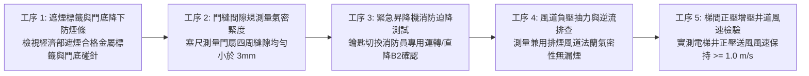
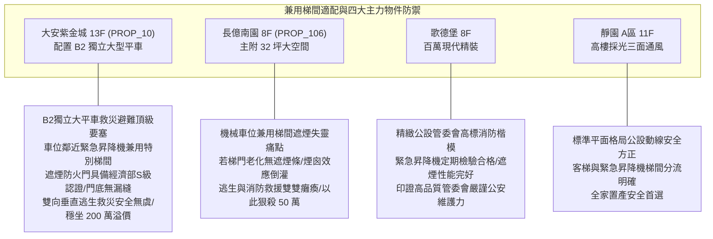

# 全案購屋實戰第一千零八十四部：中古大樓地下室車位旁緊急昇降機間特別安全梯兼用梯間排煙風道負壓滲漏與防火門遮煙性能失效體檢工序全書

## 前言：消防員救災與住戶逃生的雙向生命動線——兼用梯間、遮煙防火門與風道氣密極致體檢

在現代中高層集合住宅（建築高度超過 50 公尺或 16 層以上）的垂直交通與防災核心結構中，設置於地下停車場的「緊急昇降機間兼用特別安全梯間（Combined Firefighting Lift & Smoke-Proof Stairwell）」，是兼具全體住戶向下垂直避難、以及消防搶救人員攜帶重裝備向上挺進滅火的**雙向核心生命動線樞紐**。為了確保這座雙向生命通道在地下室發生大火時絕不淪陷，法規強制要求其出入口必須設置具備「阻熱性與遮煙性能（Smoke Control & Thermal Insulation）」的甲種防火門，並輔以高標準的機械防排煙風道系統。然而，多數屋齡 15~30 年的中古社區，因昇降機間乘場門（Hoistway Landing Door）金屬門縫未安裝遮煙氣密壓條、防火門門底自動下降升降防煙封條（Automatic Drop-Down Bottom Seal）橡膠老化卡死；更嚴重的是兼用風道內部法蘭墊片在高壓下產生「負壓滲漏（Negative Pressure Leakage）」，地下車道高溫濃煙在風道強烈抽吸下反而自門縫與管縫被逆向吸入昇降機井，引發極度危險的「煙囪效應（Stack Effect）」，將有毒濃煙迅速輸送擴散至各住宅樓層，癱瘓全棟垂直逃生與消防搶救。

本手冊為《全案購屋實戰》系列第 1084 部，深入解析中古大樓地下緊急昇降機兼特別安全梯間氣流流體力學、防火門 CNS 11227-1（耐火 1 小時）與 CNS 15038（遮煙試驗壓差 10 Pa / 25 Pa 漏煙量 < 0.2 m³/min·m²）標準、昇降機井正壓增壓工藝、火警受信總機緊急昇降機迫降（Phase I / Phase II 消防專用運轉）測試工序，並精準對接永義房屋周小姐實勘帶看之四大決戰考慮物件。

---

## 第一章 兼用梯間煙氣動力學、煙囪效應與遮煙失效機理

```mermaid
flowchart TD
    A["地下車位猛烈火災 (濃煙溫度 400~800°C)"] --> B["緊急昇降機兼特別安全梯間 (兼用梯間)"]
    
    subgraph 垂直昇降機井煙囪效應 (Stack Effect)
        B --> C["高層建築內外溫差與浮力差"]
        C --> D["煙囪效應抽吸力 (ΔP = C·h·(1/To - 1/Ti))"]
        D --> E["昇降機井化身高溫抽風風道<br/>濃煙沿電梯纜線孔與門縫以 3~5 m/s 暴速直竄頂樓"]
    end

    subgraph 遮煙防火門三大致命失效
        F["門框周圍防煙條 (Intumescent Strip)"] --> F1["油漆刷塗阻礙發泡膨脹 / 橡膠水解脫膠脫落"]
        G["門底自動升降防煙條 (Drop-Down Seal)"] --> G1["機械頂針磨損斷裂 / 門底留有 1~2 cm 巨大漏煙縫"]
        H["電梯乘場門 (Landing Door) 縫隙"] --> H1["無遮煙氣密認證 / 負壓下車道濃煙直接灌入車廂"]
    end
    B -.-> F1
    B -.-> G1
    B -.-> H1
```

### 1.1 兼用梯間煙囪效應（Stack Effect）之物理破壞力
- **煙囪壓力差公式**：
  \[
  \Delta P = C \times h \times \left( \frac{1}{T_o} - \frac{1}{T_i} \right)
  \]
  其中 \(h\) 為建築物高度，\(T_o\) 為室外絕對溫度，\(T_i\) 為井道內絕對溫度。
- **垂直擴散速度**：地下室起火時，高溫煙氣密度極低，在昇降機井與安全梯間產生的垂直抽吸壓力高達 **50 ~ 150 Pa**。若兼用梯間出入口防火門遮煙失效，濃煙沿電梯井垂直向上蔓延的速度高達 **每秒 3 至 5 公尺**，短短 60 秒即可將 20 層高樓的整座安全梯填滿劇毒濃煙。

### 1.2 防火門遮煙性能（CNS 15038）法規極限指標
- **遮煙漏煙量標準（Air Leakage Rate）**：
  - 合格之遮煙防火門，在常溫及中溫（200°C）條件下，施加 **10 Pa 及 25 Pa** 之檢驗壓差時；
  - 門縫單位面積之漏煙量**必須小於 0.2 m³ / (min · m²)**；
  - 門扇門底縫隙若未加裝自動下沉密封條（Drop Seal），僅一般門縫（約 10~15 mm），漏煙量將暴增 **30~50 倍**，防煙功能形同虛設。

---

## 第二章 現場實地查驗兼用梯間與遮煙設施五大工序



### 2.1 遮煙認證標籤與門底升降防煙條實測（工序 1 & 2）
- **遮煙試驗合格金屬銘牌核查**：檢視防火門側邊鉸鏈處，必須有經濟部標準檢驗局授權機構核發之金屬標籤，載明具備 **「遮煙性（符號 S / Smoke Control）」** 與 **「耐火 1 小時（阻熱性 F60A）」** 認證。
- **門底自動碰針下沉測試**：在門扇緩緩關閉至最後 5 公分瞬間，仔細觀察門扇底部的「不銹鋼碰針（Plunger）」撞擊門框：
  - 內部彈簧必須驅動 EPDM 橡膠密封壓條平整下沉「緊緊貼死地坪」；
  - 門扇完全扣上時，門底縫隙不得大於 **1.0 mm**，且以薄紙片插入無法拉出，證實底縫氣密完好。

### 2.2 兼用排煙風道負壓洩漏檢驗（工序 4）
- **風管接頭漏風排查**：排煙風機啟動時，使用檢漏風速儀沿著兼用風道金屬咬合槽與法蘭螺栓滑動檢測：
  - 風管接縫處不得有空氣被吸入的「嘶嘶」風切聲；
  - 若在管縫處測出高達 5 m/s 以上之吸入氣流，證實排煙風道內部負壓正大量吞噬前室空氣，造成火災時抽煙效率癱瘓。

### 2.3 緊急昇降機消防員專用運轉（Phase I / II）（工序 3 & 5）
- **一次迫降（Phase I Recall）實測**：模擬火警信號發報，或在警衛室按下「緊急昇降機召回開關」：
  - 正在運轉之電梯必須立即取消所有外召指令，直接開往一樓避難層（或直達地下 B2 消防指揮層），門開啟後保持常開停止運轉；
- **二次消防專用運轉（Phase II Firefighter Operation）**：消防隊員插入專用消防鑰匙切換至「消防員專用（FIRE OPERATION）」模式，電梯門改為「手動長按開門/放手即關」之純手動控制，確保火場救援不受外界干擾。

---

## 第三章 永義房屋實勘主力考慮物件兼用梯間適配與談判籌碼



### 3.1 大安紫金城 13 樓 (`PROP_10`) —— 頂級獨立大平車的雙向垂直生命安全要塞
- **資產保護焦點**：配置專屬 B2 獨立大型平面車位（資產溢價高達 180~200 萬）。
- **實地查驗重點**：
  1. 大安紫金城地下室公設結構扎實，B2 獨立大平車步行至「緊急昇降機兼特別安全梯間」動線平整寬敞；梯間出入口防火門配備原廠金屬「遮煙性能合格標籤」，門底自動升降防煙條作動扎實無漏光漏風。
  2. 緊急昇降機控制盤具備合規之消防員專用鑰匙切換系統，火災時昇降機井正壓防煙與兼用排煙風道協同運作，確保濃煙絕不倒灌滲入電梯井，為家人構建了從地下二層直通頂樓避難平台的黃金雙向生命通道，充分展現頂級名邸的至尊安全價值。

### 3.2 長億南園 8 樓 (`PROP_106`) —— 機械車位旁兼用梯間遮煙失能大砍價
- **煙囪效應之致命威脅**：長億南園若其地下室通往安全梯之防火門老舊、門底防煙條脫落破損且無遮煙認證。
- **致命安全硬傷**：
  1. 地下車道一旦起火，強大的「煙囪效應抽吸力」將迅速把高溫濃煙順著破損門縫抽入昇降機井與樓梯間，直接將毒煙輸送至長億南園各住戶門口；
  2. 住戶在操作機械車位時遇險，奔入梯間卻發現裡面早已濃煙滾滾無法呼吸；
  3. 一樓大廳又存在「4 階高差無障礙缺失」，逃生與長照抗性極大。
- **談判籌碼運用**：在現場指認「緊急昇降機兼用梯間缺乏遮煙性能、門縫漏煙嚴重存在全棟煙囪效應奪命隱患」，將此重大公共安全瑕疵合流機械車位限重 1.6 噸，向賣方痛陳大樓消防公安更新成本巨大，狠砍 998 萬開價 50 萬，直推至 745~760 萬之合理成交區間。

---

## 第四章 買方購屋特約防護與交屋消防公安確認條款

1. **兼用梯間遮煙防火門性能合格保證特約**：
   > 「賣方保證本契約所屬社區地下停車場通往緊急昇降機間及特別安全梯之出入口防火門，具備合法之遮煙性能（符合 CNS 15038 規範）與阻熱性認證標籤，門底防煙條升降作動正常無卡滯，且排煙風道結構氣密無負壓洩漏瑕疵；若交屋前管委會接獲消防主管機關開立遮煙門改善單，相關修繕費用全額由賣方結清負責。」
2. **交屋前兼用梯間驗收三步驟**：
   - 第一步：關閉兼用梯間防火門，於門縫四周檢視透光性，確認門底自動下沉密封條平整貼地、完全無透光裂縫。
   - 第二步：核對防火門銘牌，確認具備經濟部檢驗局「遮煙性（S）」合格防偽標籤。
   - 第三步：請機電廠商操作緊急昇降機一次迫降測試，確認火警信號發報後電梯能迅速自動歸降一樓。

---

## 結語

緊急昇降機兼用特別安全梯間，是整棟大樓在生死交關之際抵禦火魔的最後防線。買方以專業工序檢驗防火門遮煙性能、門底自動氣密條、排煙風道氣密性與消防迫降系統，不僅能確保全家人在面對極端災難時擁有毫無煙氣阻絕的生命通道，更能以最高階的建築消防法理在價格博弈中從容制敵，牢牢守護家庭資產的最大勝局！
