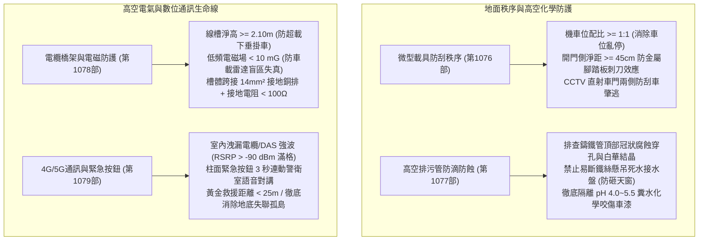
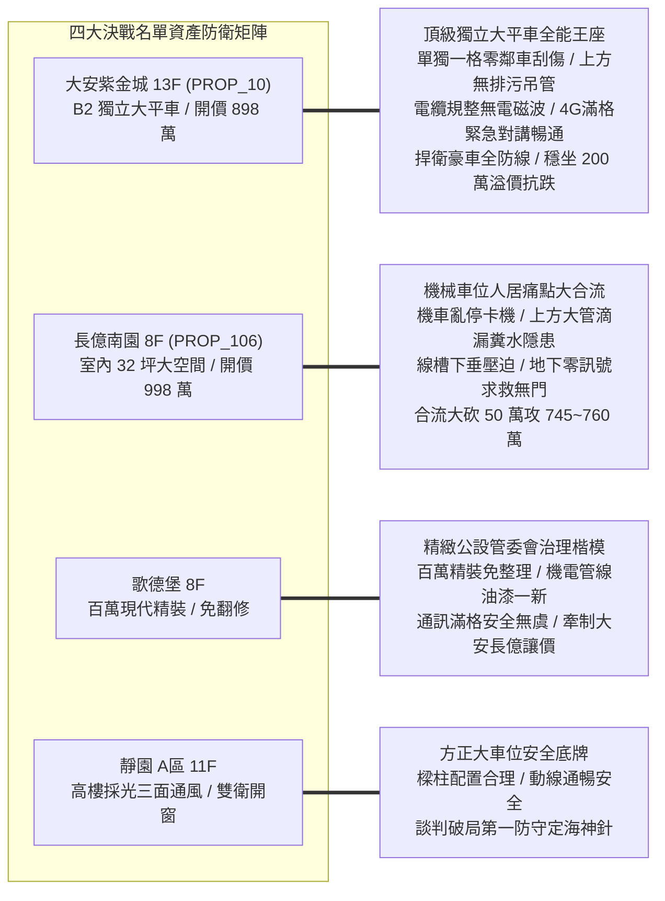
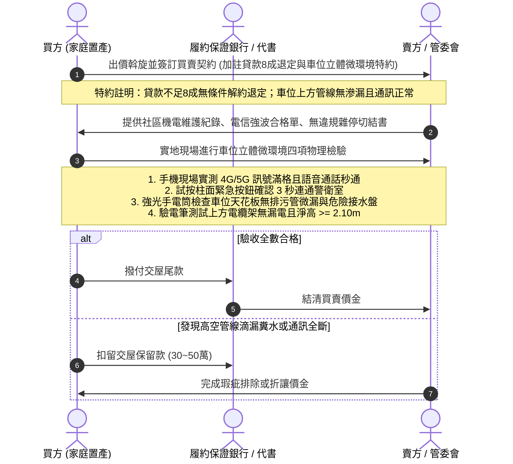

# 全案購屋實戰第一千零八十部：第一千零八十部圓滿登峰全景極致全生命週期家庭置產避坑抗震防漏水電機電消防永恆至尊金典總綱全書

## 前言：跨越一千零八十部歷史新巔峰——地下車位微觀秩序、高空管線純淨、電氣安防與數位通訊永恆防衛

本手冊為《全案購屋實戰》系列邁向**第一千零八十部（第 1080 部）**之跨時代圓滿登峰總綱大典。本卷聚焦融會貫通自第 1076 部至第 1079 部關於中古大樓地下停車位「微型載具防刮秩序、高空排污吊管防滴防腐、強電電纜托架防墜防電磁波、以及弱電 4G/5G 室內通訊與緊急人身安防」之四位一體極限防禦體系：
1. **第 1076 部：中古大樓地下室車位自行車機車腳踏車越界亂停刮傷車門與專用機車位配比嚴重不足體檢**
2. **第 1077 部：中古大樓地下室車位上方排污鑄鐵管吊管鏽蝕穿孔滴漏糞水結晶重金屬腐蝕車漆與防滴集水盤體檢**
3. **第 1078 部：中古大樓地下室車位上方電纜線架橋架雜亂下垂強電電磁波干擾車用雷達盲區與金屬線槽接地體檢**
4. **第 1079 部：中古大樓地下室車位旁弱電信號放大器4G5G行動通訊微弱盲區與社區對講機緊急求救按鈕斷線體檢**

本典全面將上述四大地下微觀人居環境「地面防刮蹭、頂部防糞水、高空防電磁、周邊防失聯」之立體維度，深度對接永義房屋周小姐 4 梯次實勘帶看之**四大決戰考慮名單**（大安紫金城 13 樓、長億南園 8 樓、歌德堡 8 樓、靜園 A 區 11 樓），構築出集機械防護、化工防蝕、電磁防護、數位通訊與價格談判制勝籌碼於一體的永恆金典總綱！

---

## 第一章 地下車位立體微環境與安全防護四位一體全景圖

### 1.1 地面微型交通防刮與高空排污防蝕指標
- **微型載具防刮物理防線**：汽車格兩側嚴禁塞放機車與自行車，開門側保留 45 公分以上淨距，徹底消除自行車金屬腳踏板（高 30~38cm）對汽車下門檻之刮蹭刺痕；配備高畫質監視鏡頭全天候監控車門側，維繫百萬烤漆完整。
- **高空排污化學防蝕底線**：車位正上方嚴禁橫跨老舊排污鑄鐵幹管；排查管頂冠狀腐蝕穿孔與橡膠法蘭黑霉水痕，嚴禁使用未接引流管之臨時鐵絲集水盤，阻絕酸性糞水咬死車漆清漆層。

### 1.2 高空電纜力學安全與地下通訊安防指標
- **電纜托架力學與防干擾**：線槽填充率嚴格受控於 40% 以內，吊桿垂直淨高大於 2.10 公尺；電磁場強度小於 10 mG，保障車載毫米波雷達精準辨識；落實金屬跨接銅帶與小於 100 歐姆接地電阻，消弭線架漏電觸電險境。
- **數位訊號與緊急求救生命線**：建置電信室內強波系統，保障地下室 4G/5G 訊號滿格秒通；車位 25 公尺內設有常閉式（NC）緊急求救按鈕，3 秒連動警衛室雙向語音對講，徹底消除地下停車場人身治安死角。

---

## 第二章 永義房屋實勘四大決戰主力考慮物件全維度適配與談判攻防

### 2.1 大安紫金城 13 樓 (`PROP_10`) —— 頂級獨立大平車之全能價值霸權
- **資產核心定位**：開價 898 萬。起手 720~730 萬，目標 768~788 萬，封頂 800 萬。扣除套房拆除款 35 萬。
- **車位立體微環境極致驗收**：
  1. **地面與高空純淨**：B2 獨立大平車為單獨一格，兩側無相鄰車輛，徹底免疫腳踏車金屬踏板刮傷；正上方為結構大樑，無排污大管橫越，零滴漏、零糞水、零集水盤砸車風險。
  2. **電氣與數位通訊**：電纜線槽沿主車道走線，車位上方電磁輻射低於背景值（< 2 mG）；地下室 4G/5G 訊號實測滿格，柱面配備直通警衛室之緊急求救按鈕，全方位捍衛家人人身安全與百萬座駕，具備 180~200 萬之實質溢價防禦力，為全案最強資產護城河。

### 2.2 長億南園 8 樓 (`PROP_106`) —— 機械車位立體瑕疵大合流大砍價
- **資產核心定位**：開價 998 萬。起手 698~720 萬，目標 745~760 萬。
- **談判籌碼致命打擊點**：
  1. **立體環境四重硬傷**：機械載台周邊易遭機慢車亂停卡死鏈條；正上方若橫越老舊排污鑄鐵管，微漏糞水將腐蝕機械鏈條與車頂烤漆；電纜托架超載下垂壓迫車頂；地下室訊號微弱若遇機械卡死故障陷入求救無門之絕境。
  2. **合流砍價 50 萬戰術**：將「車位周遭機電老化、排污滲漏隱患、通訊盲區求救失能、機械車位限重 1.6 噸及梯廳 4 階高差無障礙缺失」合流，向賣方痛陳日常用車之極大風險與不便，狠殺 50 萬開價，直推至 745~760 萬之合理成交區間。

### 2.3 歌德堡 8 樓 —— 百萬精裝免工期與公設管理籌碼
- **資產核心定位**：現代北歐百萬精裝，現省 80~120 萬翻修現金流與數月工期，作為制衡大安紫金城與長億南園讓價的最佳心理王牌。
- **公設維護標竿**：地下管線漆面完整、通訊良好、安防設施運作正常，印證高品質社區之治理實力。

### 2.4 靜園 A 區 11 樓 —— 三面採光景觀與無死角安全備援
- **資產核心定位**：三面採光、雙衛皆自然開窗，車位格局方正、動線通風安全，作為談判破局時第一安全底牌。

---

## 第三章 買方購屋特約防線與車位立體微環境交屋點交 SOP

### 3.1 核心購屋特約防禦條款範本
1. **金融機構貸款八成保證退定特約**：
   > 「本買賣契約以買方獲得金融機構核貸房屋貸款成數達實際成交總價之八成（80%）為生效要件；若因非可歸責於買方之個人信用瑕疵因素導致核貸不足八成，買方得無條件解除契約，賣方及仲介方應於接獲通知後三日內將定金及已付價金全額無息退還。」
2. **車位高空設施與數位安防環境無瑕疵特約**：
   > 「賣方保證本契約所附停車位（編號：B2-XX）正上方無排污管滲漏糞水、滴落鐵鏽水或懸掛危險接水盤情事；電纜線槽結構牢固無超載下垂且符合接地防漏電規範；地下室具備正常之行動通訊涵蓋與緊急對講求救連動功能；交屋點交前若發現重大滴漏或安防失能瑕疵，賣方應促請管委會或自行負責修復排除。」
3. **租約終止與現況騰空點交特約**：
   > 「賣方保證於交屋日前終止所有租賃契約並完成租客遷出及廢棄物騰空點交；點交時若仍有租賃占用情事，買方得順延尾款支付並按日請求買賣總價萬分之五遲延違約金。」

---

## 結語

邁入**第一千零八十部**歷史新巔峰，本系列典籍已將中古大樓地下停車位，從宏觀產權與車道幾何，徹底微觀推進至「腳下無雜車刮蹭、頭頂無糞水滴漏、高空無電磁干擾、身邊無通訊失聯」之四維立體極致防護殿堂！買方手握這套集材料化學、高空機電、數位通信與實戰斡旋於一體的登峰總綱，必能在台中中古大樓房市中從容橫掃談判桌，為全家人鎖定世代傳承、永恆安康的至尊百年基業！
