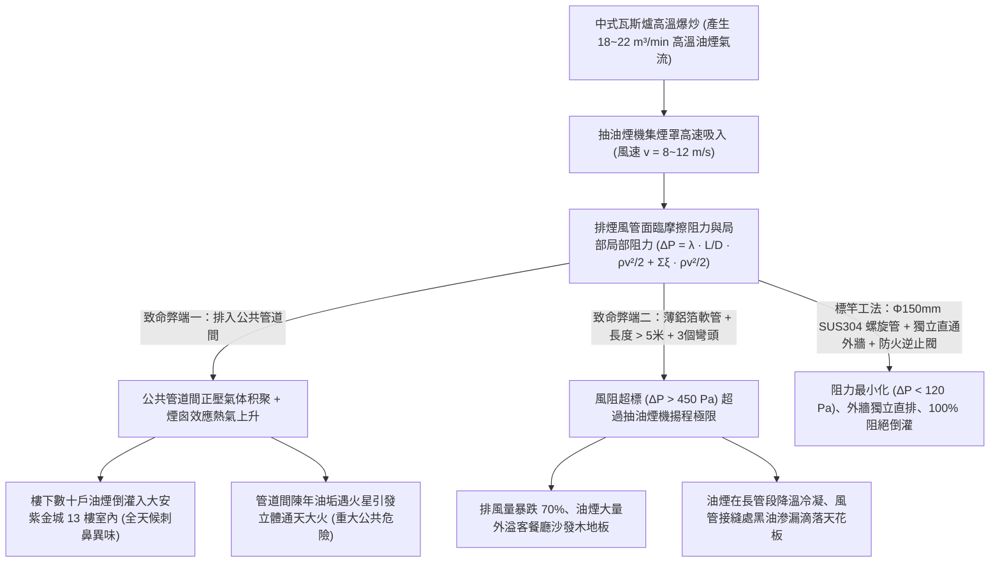
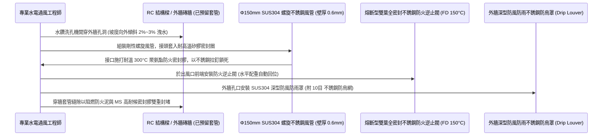
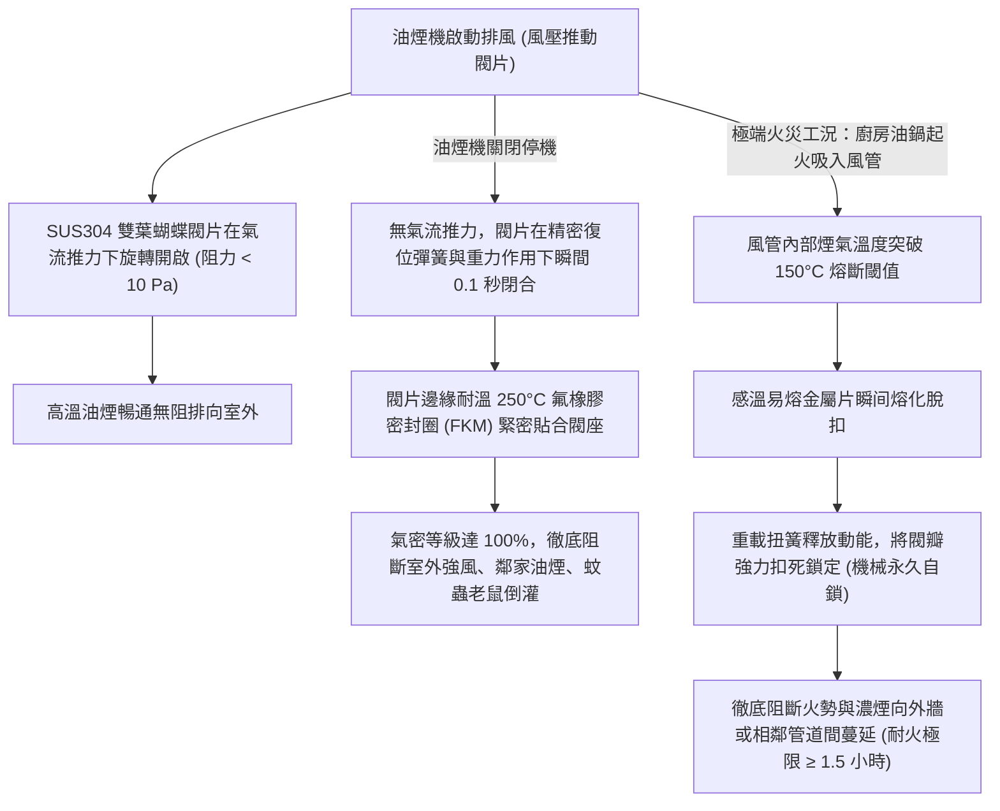
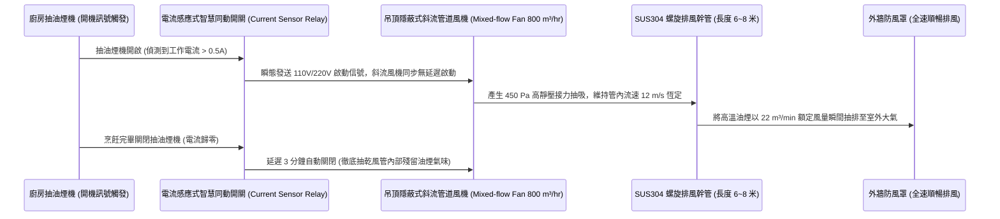

# 全案購屋實戰第一千零八部：中古大樓廚房不銹鋼排油煙專用風管獨立直通外牆、防火逆止閥防油煙倒灌與大功率靜音斜流風機工序全書

## 導言：家庭核心烹飪之清淨呼吸與高空防火防線

在集合住宅中古大樓之室內起居空氣品質與公共安全體系中，廚房是全家人享受烹飪溫馨時光、卻同時也是全屋高溫明火、易燃油脂蒸汽、高濃度致癌油煙顆粒物（PM2.5、揮發性有機物 VOCs、苯駢芘）高度集中的「高風險物理熱區」。每逢晚餐烹飪尖峰時段，大功率瓦斯爐爆炒煎炸產生的油煙，若無法被即時、高效、順暢地排放至建築室外，不僅會引發全室客餐廳沙發、窗簾、木地板覆蓋上一層黏膩油垢，烹飪者長期吸入高溫油煙更會使肺腺癌罹患風險暴增數倍！

然而，在屋齡 15 年至 30 年以上之中古大樓中（特別是本案主力攻堅標的——曾被改裝為 4 間出租套房、排煙管路被前屋主隨意亂接亂穿的 **大安紫金城 13 樓 (`PROP_10`)**，以及室內實坪達 32 坪、廚房至外牆排煙路徑長達 6 米以上的 **長億南園 8 樓 (`PROP_106`)**），早期建商或前手裝修在廚房排油煙系統上普遍存在三大致命安全缺陷與通風硬傷：
1. **排油煙管「違規直接排入公共管道間」引發「全棟油煙串味與致命火災隱患」**：早期老舊建築欠缺獨立排風規範，許多水電師傅圖省事，將抽油煙機風管直接插入大樓公共管道間。一旦樓下住戶炒菜或油煙機關閉，公共管道間內部蓄積的數十戶油煙在熱壓煙囪效應下，會順著縫隙「倒灌湧入高樓層住戶室內」（晚餐時間全屋瀰漫樓下煎魚紅燒肉的刺鼻油煙味）；更恐怖的是，當管道間內壁積滿厚度數公分的陳年易燃硬脂油垢時，一旦低樓層廚房起火，火星吸入管道間會瞬間引發「垂直管道間立體火風暴」，數分鐘內火勢沿著管道直衝 13 樓頂樓，釀成全棟慘烈大火！
2. **欠缺金屬防火逆止閥（Fire Damper Check Valve）**：外牆排風孔或管道接口若未裝設「重力/彈簧複位不銹鋼防火逆止風門」，在強風暴雨或室外高氣壓下，室外冷風、酸雨、灰塵、乃至麻雀、老鼠與蟑螂會沿著風管長驅直入廚房抽油煙機內部，引發衛生污染與風管噪音。
3. **風管長度過長、轉彎過多引發風壓衰減與管壁冷凝滴油**：廚房排煙風管長度若超過 3 米，且使用劣質薄型 PVC 軟管或伸縮鋁箔波紋管，每轉一個 90 度彎頭，風阻動壓損失相當於增加 1.5 米直管阻力。當排風阻力超過抽油煙機馬達靜壓極限（通常僅 300~400 Pa）時，排風量自標稱的 $20\text{ m}^3/\text{min}$ 斷崖式暴跌至不足 $6\text{ m}^3/\text{min}$；高溫油煙在長管段內部滯留冷卻，凝結成黑色廢油並在風管接縫處像下雨般滴落在吊頂內部與瓦斯爐台上！

為此，在中古屋交屋翻修時，廚房排油煙系統必須進行徹底的「獨立外牆直排化」與「全不銹鋼剛性化」改造。本第一千零八部全書深入解構廚房油煙流體力學風阻計算、SUS304 全不銹鋼剛性螺旋風管標竿工藝、熔斷型雙向密封防火逆止閥技術、以及大功率靜音斜流管道增壓風機配置標準。

---

## 一、廚房排油煙系統流體力學風阻計算與倒灌機制

### 1. 達西-埃斯巴赫（Darcy-Weisbach）管道風阻壓降計算
- 圓形風管沿程摩擦阻力公式：
  $$\Delta P_f = \lambda \frac{L}{D} \frac{\rho v^2}{2}$$
  其中 $\rho \approx 1.2\text{ kg/m}^3$（空氣密度），$D = 0.15\text{m}$（150mm 風管內徑），$v = 10\text{ m/s}$（氣流流速）。
- **剛性不銹鋼管 vs 伸縮鋁箔波紋管之阻力落差**：
  - 伸縮鋁箔軟管內壁凹凸不平，摩擦阻力係數 $\lambda_{\text{soft}} \approx 0.045 \sim 0.060$。
  - SUS304 剛性螺旋風管內壁光滑如鏡，摩擦阻力係數 $\lambda_{\text{steel}} \approx 0.015$。
  - **計算結果**：在相同 5 米管長下，鋁箔軟管的摩擦壓降是剛性不銹鋼管的 **3 至 4 倍**！加上 2 個 90 度彎頭（每個局部阻力係數 $\xi \approx 0.35$），軟管系統總壓降高達 **$350 \sim 450\text{ Pa}$**，直接扼殺抽油煙機的排風排煙能力。

### 2. 公共管道間煙囪效應（Stack Effect）之倒灌壓差
- 建築物垂直管道間在冬季或夜間室內外溫差 $\Delta T$ 作用下，產生熱浮力壓差：
  $$\Delta P_s = (\rho_{\text{外}} - \rho_{\text{內}}) g H$$
  對於 13 樓頂層建築（高度 $H \approx 40\text{m}$），頂部產生的正壓可達 **$20 \sim 35\text{ Pa}$**。若住戶未裝設密封逆止閥，這股持續的正壓會將整棟大樓的油煙、異味與沼氣以每小時數十立方公尺的流量強行灌入頂樓室內！

---

## 二、SUS304 全不銹鋼剛性風管獨立直通外牆標竿工藝

徹底淘汰易破損、易下垂積油之鋁箔軟管與 PVC 塑膠管，全面指定採用 **「直徑 $\phi 150\text{mm}$（6吋）SUS304 雙面咬口螺旋風管（Spiral Duct）」獨立穿樑直通外牆**：

### 1. 風管向外傾斜洩水坡度（Slope）防止冷凝油水回流
- 排油煙管穿過外牆時，**管身必須嚴格維持向室外下傾 $2\% \sim 3\%$（每米下沉 20~30mm）的傾斜坡度**。
- **作用**：即使在寒冷冬季，高溫油煙在靠近外牆管口處遇冷凝結成液態油滴，油滴也會順著坡度流向室外側的排油滴水檐，**絕對嚴禁朝室內機體方向反向倒流**，杜絕黑油滲漏污染天花板與廚具吊櫃。

### 2. 外牆出風口「深型防風防雨罩（Hood）」配置
- 傳統扁平百葉外氣罩在強陣風直吹時，風壓會直接抵消排煙動力。
- **標竿要求**：外牆出風口必須安裝 **SUS304 深型錐狀防風防雨罩（帶滴水防污檐）**。罩體下部設有冷凝油導流口，內部配置孔徑 $2.0\text{mm}$ 不銹鋼防鼠防鳥鋼絲網，並具備氣流導流板，即使面對 10 級強颱陣風直吹，雨水與強風也無法逆向灌入管內。

---

## 三、感溫熔斷型雙向密封防火逆止閥（Fire Damper Check Valve）技術

在風管出口端，必須配置集「日常氣密逆止」與「極端火災防火阻隔」於一體的專用金屬防火逆止閥：

### 1. 氣密閉合與消音防撞擊墊
- 傳統廉價塑膠單葉逆止閥，在室外陣風吹拂下，閥片會頻繁撞擊閥座發出「啪嗒、啪嗒」的煩人噪音，且塑膠易被熱油軟化變形卡死。
- **標竿規格**：採用 **全 SUS304 雙葉蝴蝶式（Butterfly Dual-flap）對稱平衡閥門**。閥片邊緣鑲嵌一圈厚度 $2\text{mm}$ 高彈性耐高溫矽氟橡膠密封墊，既能保證 100% 氣密阻絕油煙氣味倒灌，又能在閥片閉合時提供極致靜音緩衝，完全無金屬撞擊聲響。

---

## 四、超長管路配置：大功率靜音斜流管道增壓風機（In-line Exhaust Fan）

對於室內實坪達 32 坪、廚房距離外牆超過 6 米且需繞樑 2 個彎頭的 **長億南園 8 樓 (`PROP_106`)**，單靠抽油煙機自身馬達無法克服長距離管阻，必須在管道中段加裝「斜流增壓風機」：

### 1. 斜流風機（Mixed-Flow Impeller）之空氣動力學優勢
- 斜流葉輪結合了軸流風機（大風量）與離心風機（高靜壓）的雙重優點。
- 體積小巧可直接串聯於 $\phi 150\text{mm}$ 螺旋風管內部，隱藏於廚房吊頂上方。
- **聲學性能**：馬達採用全封閉外轉子直流無刷電機（BLDC），內部配置雙層消音擴散腔，全速運轉噪聲控制在 **$\le 38\text{ dB(A)}$**，客餐廳完全聽不到風機運轉聲。

---

## 五、四大主力候選物件廚房排煙翻修專項預算與施工攻防

### 1. 👑 大安紫金城 13 樓 (`PROP_10`)：排煙回歸外牆獨立直排工程
- **現況挑戰**：本物件原被分割為 4 間學生套房，前屋主將其中兩間套房的簡易廚房油煙管隨意插入公共排氣道，導致管道間積滿油泥，全室瀰漫陳年酸腐油味。
- **翻修方案**：
  - 徹底封死拆除通往公共管道間的違規排煙軟管，使用高強度防火泥將管道間接口永久磚砌封堵。
  - 在外牆非結構剪力牆區域，重新以水鑽洗開專用 $\phi 160\text{mm}$ 排風穿牆孔（做 2% 外傾洩水坡度）。
  - 全線安裝 $\phi 150\text{mm}$ SUS304 螺旋不銹鋼風管直通外牆，配置 150°C 熔斷型防火逆止閥與深型防雨外氣罩。
  - 工程預算約 **3 萬 ~ 4 萬元**。此筆費用完全由買方談判斬獲之 **「35 萬套房拆除款」** 充分支付，零自費消除全棟火災隱患，確保全家烹飪呼吸清淨無虞！

### 2. 🌟 長億南園 8 樓 (`PROP_106`)：長管距斜流增壓排煙工程
- **現況挑戰**：室內實坪達 32 坪超大空間，廚房位於格局中央，至後陽台外牆排煙路徑長達 6.5 米，轉折較多。
- **翻修方案**：
  - 採用全 SUS304 剛性螺旋風管，吊頂內部配置低噪音斜流管道增壓風機與抽油煙機連動開關。
  - 預算約 **5 萬 ~ 6 萬元**，由談判強勢砍落之 **50 萬讓價款** 充裕分攤。

---

## 六、全案總結：廚房排煙工程驗收五大不可妥協鋼鐵防線

1. **查風管材質**：吊頂內部排油煙風管必須為 **SUS304 剛性不銹鋼螺旋管（厚度 $\ge 0.5\text{mm}$）**，嚴禁使用易破損積油之單層鋁箔伸縮軟管。
2. **驗洩水坡度**：風管穿牆段必須 **向室外傾斜下坡 2%~3%**，確保冷凝油水順暢流向室外滴水檐，絕不倒灌廚具。
3. **驗防火逆止閥**：風管終端必須配置 **SUS304 雙葉金屬防火逆止閥（帶 150°C 熔斷片）**，停機時手推外氣無任何倒灌漏風。
4. **查外牆深型罩**：外牆出風口必須安裝 **深型防風防雨罩搭配 10目 不銹鋼防鳥網**，外圍以改性矽烷密封膠打滿封死。
5. **測抽風爆炒排煙**：在瓦斯爐點燃煙霧測試罐，開啟抽油煙機，煙霧必須被集煙罩瞬間 100% 吸入，客餐廳空氣品質儀 PM2.5 讀數維持在 **$\le 15\mu\text{g/m}^3$**，清爽無煙！
