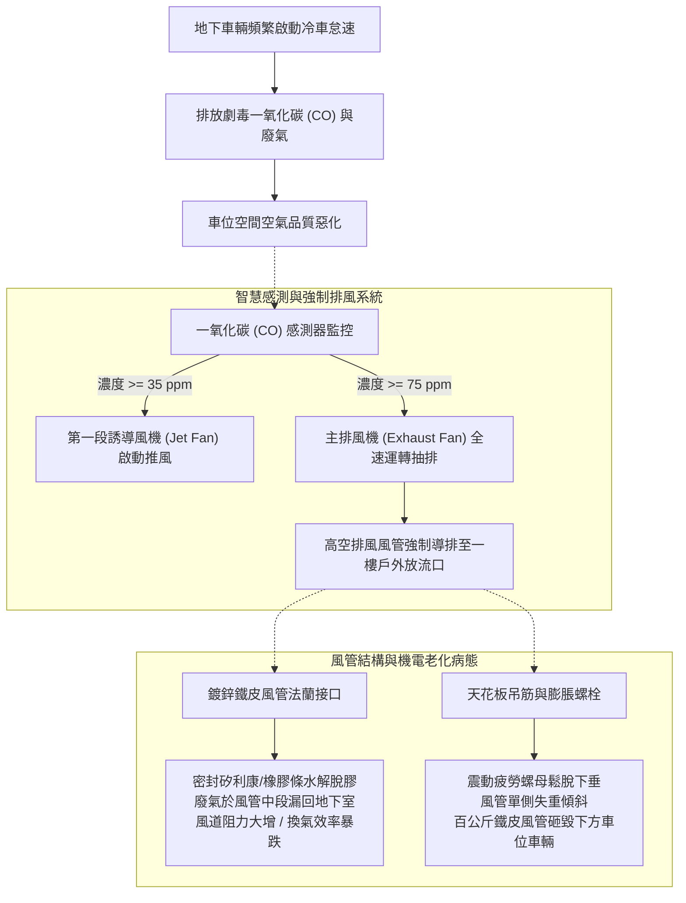
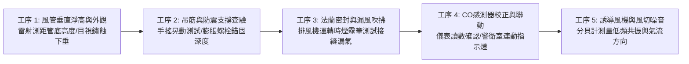
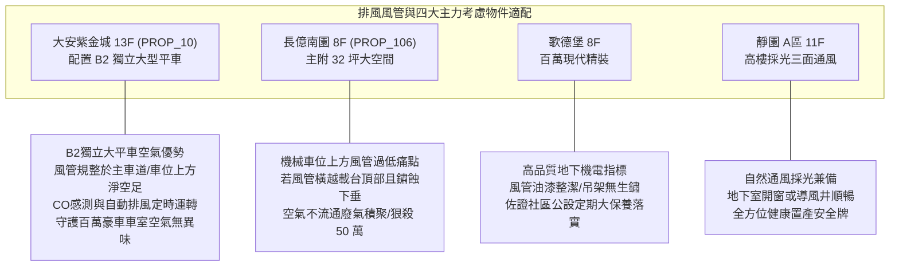

# 全案購屋實戰第一千零六十一部：中古大樓地下室車位上方排風風管鍍鋅鐵皮鏽蝕脫膠吊筋鬆動與一氧化碳CO濃度超標排風體檢工序全書

## 前言：密閉地下城的呼吸之肺——車位高空排風風管、空氣動力與毒氣排查極致體檢

在中古大樓地下停車場的全封閉機電架構中，懸吊於車道與車位上方的「通風換氣與緊急排煙風管系統（Ventilation & Smoke Exhaust Ductwork）」，是抽排汽車引擎排放之劇毒一氧化碳（CO）、非甲烷碳氫化合物（NMHC）與懸浮微粒的**核心呼吸生命線**。然而，多數屋齡 15~30 年的中古社區，因地下室環境潮濕、車輛冷氣冷凝水滴漏與廢氣酸鹼侵蝕，導致鍍鋅鋼板風管法蘭接頭咬合脫膠、玻璃棉保溫層受潮吸水下垂塌陷；更危險的是，風管懸吊吊筋（Threaded Hanger Rod）因長期受風機震動造成膨脹螺栓鬆脫位移，整排數百公斤風管隨時有墜落砸毀車輛之險，且一旦 CO 濃度自動感測器（CO Sensor）老化失靈，地下室將淪為致命毒氣室。

本手冊為《全案購屋實戰》系列第 1061 部，深入解析中古大樓地下車位上方鍍鋅螺旋風管、消音包覆材料、吊架抗震斜撐力學、一氧化碳感測器多點聯動啟動風機（50 ppm / 100 ppm 標準）之體檢工序，並精準對接永義房屋周小姐實勘帶看之四大決戰考慮物件。

---

## 第一章 地下車位排風風管系統架構與毒氣致災機理

### 1.1 一氧化碳（CO）毒理學與換氣法規標準
- **毒理致命性**：CO 無色、無味、無臭，與人體血紅素（Hb）之結合力比氧氣高出 200~250 倍。
  - 當濃度達 **50 ppm** 時，人體暴露數小時即產生頭痛、噁心與暈眩；
  - 當濃度超過 **200 ppm**，數十分鐘內即可導致意識不清、昏迷甚至心肌梗塞。
- **法定通風換氣極限**：依《建築技術規則》與職業安全標準，地下停車場全日平均一氧化碳濃度不得超過 **35 ppm**，瞬間最高濃度不得超過 **75~100 ppm**；每平方公尺樓地板面積每小時換氣量至少需達 25 m³/h 以上。

### 1.2 鍍鋅鐵皮風管之物理與力學破壞
- **共板法蘭（TDC/TDF）脫膠漏風**：風管段與段之間以插接法蘭結合，內部橡膠密封墊片經 15 年廢氣侵蝕容易炭化粉碎，接縫處嚴重漏風（Air Leakage Rate > 15%），排風機馬達徒勞空轉，車位處卻沉積高濃度廢氣。
- **冷凝水集結與超重下塌**：夏季戶外高溫潮濕空氣進入地下室，風管金屬表面產生大量結露水；若風管保溫棉吸水未乾，單段風管重量暴增 2~3 倍，超載拉拔吊筋螺栓。

---

## 第二章 現場實勘車位上方排風風管五大檢驗工序

### 2.1 吊架結構剛性與防墜檢查（工序 1 & 2）
- **垂直淨高量測**：風管底緣距離車位地坪淨高必須大於 **2.10 公尺**（優選 2.20 米以上），確保高頂休旅車倒車無削頂風險。
- **吊筋搖晃與雙螺母防鬆測試**：
  - 吊筋（全牙螺桿）口徑不得小於 3/8 吋（M10），間距不得大於 2.5 公尺。
  - 檢查固定於 RC 頂板處之膨脹螺栓是否配備「彈簧華司與雙螺母（Double Nut）」鎖固；徒手搖晃吊桿，風管不得有超過 10 mm 之水平晃動，杜絕脫錨崩塌。

### 2.2 漏風率與氣流流向實測（工序 3 & 4）
- **煙霧測試接縫氣密**：請管理員手動開啟排風機，使用測試煙霧筆沿著風管咬合接縫移動，煙霧若遭吸入或被吹散，代表管段嚴重漏風破裂。
- **一氧化碳感測器液晶讀數**：車道結構柱上之 CO 偵測器（距地 1.2~1.5 米處）是否正常通電顯示數值；表面若遭厚重灰塵油污阻塞氣孔，感測器將呈「失明」狀態，無法在尖峰時段觸發風機排氣。

### 2.3 噪音與低頻共振排查（工序 5）
- **消音段與防震接頭（Canvas Duct）**：排風機進出口端是否配置耐燃帆布軟管以隔離震動；運轉時站在車位旁測量噪音值應小於 **65 分貝**，且無金屬碰撞轟鳴聲，避免低頻噪音沿結構柱傳導至一樓住戶。

---

## 第三章 永義房屋實勘主力考慮物件排風環境適配與談判籌碼

### 3.1 大安紫金城 13 樓 (`PROP_10`) —— 頂級大平車的空氣品質與高空淨空
- **資產保護焦點**：配置專屬 B2 獨立大型平面車位（資產溢價高達 180~200 萬）。
- **實地查驗重點**：
  1. 大安紫金城地下室樓高充裕，主排風大風管主要沿中央主車道上方走向，B2 獨立大平車上方空間乾淨清爽，管底淨高達 **2.25 公尺**以上，完全無視覺壓迫與碰撞隱患。
  2. 地下二層設有 CO 連動自動排風系統，上下班通勤尖峰空氣流暢無刺鼻廢氣，進一步強化平車資產之頂級尊榮感。

### 3.2 長億南園 8 樓 (`PROP_106`) —— 上方風管壓迫與空氣停滯痛點大砍價
- **機械車位雙重壓迫**：長億南園若其機械車位正上方受早期老式大型鐵皮風管壓過，機械載台昇起時高度受限，且風管表面若有鏽斑或吊筋鬆脫下垂，將構成隨時砸車之安全隱患。
- **談判籌碼運用**：在現場指出「風管年久未修、吊筋搖晃、且地下室缺乏有效換氣導致廢氣積聚」等公設缺失，與機械車位限重 1.6 噸合流，向賣方痛陳大樓公設更新成本巨大，狠壓 998 萬開價，直推至 745~760 萬之甜蜜成交區間。

---

## 第四章 買方購屋特約防護與交屋驗收確認條款

1. **地下室空氣品質與高空風管安全保證特約**：
   > 「賣方保證本契約所附車位上方之通風排氣風管結構牢固，無掉落、劇烈震動或滴漏冷凝水污染車輛之情事；且社區地下停車場一氧化碳監控排風系統處於正常運作狀態；若交屋前管委會有重大風管更新決議，相關公攤維修費用由賣方全額負擔。」
2. **交屋前車位高空排風實測三要點**：
   - 第一點：使用雷射測距儀測量車位內風管最低點，確保垂直淨高 >= 2.10 米。
   - 第二點：徒手輕推風管吊桿，確認雙螺母鎖緊、無鬆動下垂現象。
   - 第三點：在早晨通勤尖峰實勘地下室，感受空氣是否有刺鼻廢氣堆積不退。

---

## 結語

抬頭審視車位上方的排風風管與空氣流動，不僅關乎愛車頂部空間的物理安全，更直接守護全家人每次上下車時吸入肺腑的每口空氣。買方以專業工序檢驗風管吊架剛性、法蘭氣密與一氧化碳聯動排風系統，不僅能杜絕意外砸車與毒氣侵害，更能藉此透視整棟大樓機電維護的深層實力，在價格談判中牢牢主導大局！
