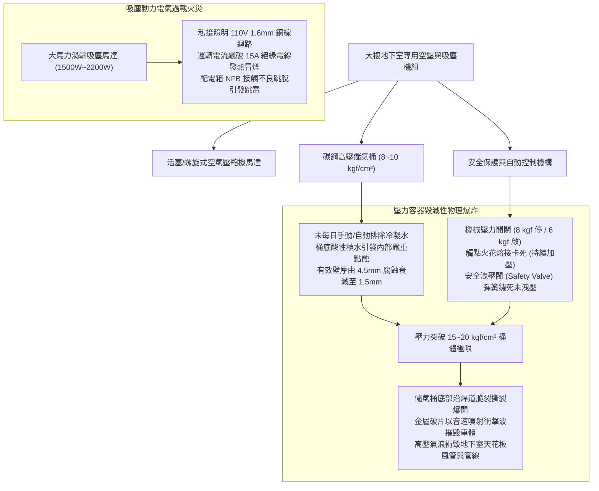
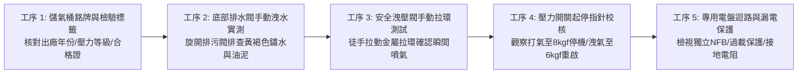
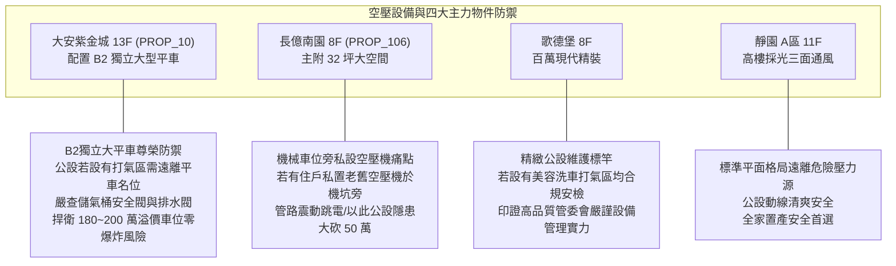

# 全案購屋實戰第一千零六十七部：中古大樓地下室車位吸塵打氣設備馬達空壓機洩壓閥卡死高壓儲氣桶鏽蝕穿孔爆裂與專用電表過載跳脫體檢工序全書

## 前言：五星級公設的暗藏殺機——車位空壓機、高壓儲氣桶與吸塵動力極致體檢

在現代中古大樓地下停車場的尊榮級公設規劃中，部分優質社區於車道轉角或特定洗車美容車位旁，增設了「車位專用打氣機（Tire Inflator Air Compressor）」與「大馬力車用吸塵設備（Central Vacuum System）」，旨在提供住戶日常胎壓補氣、車室內裝清潔的五星級便利。然而，多數屋齡 15~30 年的中古社區，這類高壓機電設備因長年置於地下室潮濕環境中且缺乏專業維護，內部碳鋼高壓儲氣桶（Air Receiver Tank）底部未定期排水導致嚴重「積水內鏽爛穿」；更致命的是，機械式安全洩壓閥（Safety Relief Valve）遭油泥灰塵卡死失去超壓釋放功能，在自動壓力開關（Pressure Switch）觸點熔接時，儲氣桶將化身為一顆威力相當於小型炸藥的「壓力容器炸彈（Pressure Vessel Explosion）」，瞬間撕裂鋼板衝擊波摧毀周圍車輛並造成人員傷亡；此外，吸塵大馬力馬達直接跨接照明插座引發電線發熱、無熔線開關過載頻繁跳脫，更是地下室嚴重的電氣火災隱患。

本手冊為《全案購屋實戰》系列第 1067 部，深入解析中古大樓地下室打氣空壓機之儲氣桶超音波測厚儀（UT）壁厚檢驗、安全洩壓閥 ASME/CNS 認證標定壓力、冷凝水自動排水閥（Auto Drain Valve）、專用分電盤無熔線開關（NFB）容量計算之體檢工序，並精準對接永義房屋周小姐實勘帶看之四大決戰考慮物件。

---

## 第一章 車位打氣空壓機與吸塵系統結構及爆炸失效機理

### 1.1 儲氣桶力學與壓力容器爆炸力學
- **壓縮氣體能量換算**：一個標準 100 公升、充氣壓力達 **8.0 kgf/cm²（約 0.8 MPa）** 之鋼製儲氣桶，其內部蘊含之氣體膨脹能量相當於數十公克烈性炸藥。
- **內部水蝕爛穿（Internal Corrosion）**：空氣中之水氣在高壓壓縮冷卻後液化成冷凝水，若未每日排空，積存於桶底之水呈弱酸性。鋼板表面形成「點蝕穿孔（Pitting Corrosion）」。一旦桶壁厚度因鏽蝕削弱至臨界破裂閾值，桶體將在毫無預警下瞬間炸開，氣浪威力足以掀翻一輛休旅車。

### 1.2 安全洩壓閥（Pressure Relief Valve）之工作標準
- **標定放氣壓力**：安全閥必須具備勞動部危險性機械及設備檢查合格標籤（或 CNS / ASME 標章），其設定起跳壓力嚴格標定為工作壓力的 **1.05 ~ 1.10 倍**（如工作壓力 8.0 kgf/cm²，安全閥必須在 **8.8 kgf/cm²** 瞬間彈開噴氣洩壓）。
- **失靈致死因**：地下室車輛廢氣含硫化合物與飛塵附著於安全閥排氣孔與不銹鋼彈簧，使閥芯緊緊咬死於閥座，喪失最後一道機械洩壓生命防線。

---

## 第二章 現場實地查驗車位空壓與吸塵設施五大工序

### 2.1 儲氣桶銘牌與腐蝕實測（工序 1 & 2）
- **合格設備銘牌核查**：檢視儲氣桶身是否焊接有金屬銘牌，載明「最高容許工作壓力（MAWP >= 10 kgf/cm²）」、製造年份與防腐塗裝；超過 10 年之儲氣桶，若桶身底部有鼓脹、大片紅褐色鏽斑或嚴重脫漆，即屬高危險設備。
- **手動排污洩水排查**：蹲下旋開儲氣桶最底部之黃銅球閥（Drain Valve）：
  - 若噴出之為清澈微量空氣，代表社區有落實定期排水；
  - 若瞬間噴出數公升「濃稠黑褐色鐵鏽泥水」，證實桶內常年浸泡積水，內部鋼板已嚴重鏽蝕減薄，存在自爆高風險。

### 2.2 安全閥防咬死實測（工序 3 & 4）
- **手動拉環排氣測試（Pull-Ring Test）**：在儲氣桶帶壓狀態下（壓力表指針在 5~7 kgf/cm²），用手向上拉動安全閥之金屬圓環：
  - 合格安全閥應能輕鬆拉動，伴隨強大「嘶——」氣流瞬間洩壓，放手後立即回彈密封；
  - 若拉環紋風不動、被油垢黏死，必須立即停機要求更換安全閥。
- **壓力開關自動切斷**：觀察空壓機運轉，當壓力表指針上升至 **8.0 kgf/cm²** 時，馬達必須精準自動斷電停止運轉；若指針突破 9.0 kgf/cm² 仍持續加壓，代表壓力開關觸點熔接失效，必須緊急手動切斷電源。

### 2.3 專用電氣迴路與吸塵軟管（工序 5）
- **獨立 220V 專用電路**：大馬力空壓機與車用吸塵器必須配置獨立之 220V 單相或三相專用配電箱，配備 **20A 以上無熔線開關（NFB）** 與 **高感度高速型漏電斷路器（ELCB，額定動作電流 30mA）**；嚴禁私自插在一般 110V 照明插座上。
- **耐磨抗靜電吸塵軟管**：吸塵器軟管應為導電抗靜電材質，防止吸塵時粉塵高速摩擦產生數萬伏特靜電火花，點燃汽油蒸氣。

---

## 第三章 永義房屋實勘主力考慮物件公設機電適配與談判籌碼

### 3.1 大安紫金城 13 樓 (`PROP_10`) —— 頂級大平車的壓力容器安全防禦
- **資產保護焦點**：配置專屬 B2 獨立大型平面車位（資產溢價高達 180~200 萬）。
- **實地查驗重點**：
  1. 大安紫金城若在地下室設有住戶公用打氣機或吸塵區，其擺設位置必須遠離 B2 獨立大平車至少 15~20 公尺以上，且不得設置在主行車動線之結構柱旁，確保愛車絕無遭受壓力容器意外爆裂波及之風險。
  2. 該機組若由管委會統籌維護，現場檢視安全閥合格標籤與桶身排水閥，確認機具定期排水保養，守護頂級獨立平車之絕對安全性。

### 3.2 長億南園 8 樓 (`PROP_106`) —— 機械車位旁私設危險設備大砍價
- **機械車位安全隱患**：長億南園若有住戶因機械車位保養需要，在地下室角落私自放置未經檢驗之老舊小型空壓機，並私接大樓公共電源插座，隨時有引發總盤過載跳脫或電線起火之危險。
- **談判籌碼運用**：在現場指認「地下室公共用電私接混亂、未經核可之高壓儲氣桶鏽蝕嚴重缺乏防爆管理」等重大公共安全瑕疵，與機械車位限重 1.6 噸合流，向賣方痛陳大樓公設機電缺乏專業維護，狠壓 998 萬開價，直攻 745~760 萬之甜蜜成交帶。

---

## 第四章 買方購屋特約防護與交屋驗收確認條款

1. **地下室公共壓力容器與高功率機電安全保證特約**：
   > 「賣方保證本契約所附停車位周邊無違法設置之高壓氣體容器、未經安檢之空壓機或私接大馬力機電設備；社區地下室所設置之公共打氣吸塵設施符合壓力容器與電氣安全法令規範，無漏電跳脫或爆炸致災隱患；若交屋前管委會發現違規私設機電，賣方應促請管委會強制拆除排除。」
2. **交屋前車位周遭環境安檢三步驟**：
   - 第一步：巡視車位方圓 15 公尺內之柱面與地面，確認無擺放私設無銘牌之老舊空壓機。
   - 第二步：若有社區公用打氣機，拉動安全閥金屬環確認排氣靈敏、底部排污閥無鏽泥噴出。
   - 第三步：檢視配電盤分路標籤，確認大功率設備均具備獨立專用漏電保護開關。

---

## 結語

地下室的車用打氣與吸塵設備，雖為車主提供了無可比擬的日常保養便利，但若缺乏對高壓儲氣桶與電氣安全的嚴格體檢，便可能淪為隨時爆發的定時炸彈。買方以專業工序檢驗儲氣桶防腐排污、安全閥機械動作與電氣負載能力，不僅能將家人與百萬座駕置於絕對安全之地，更能從公設機電的嚴謹度中，精準洞察大樓管委會的真正管理素質，在房市談判中牢牢主宰全場！
