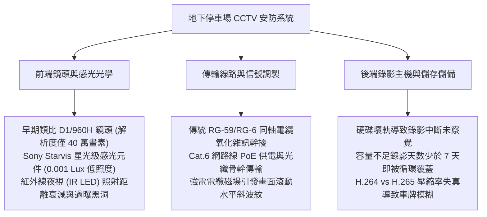
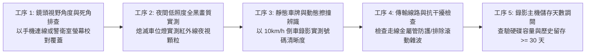
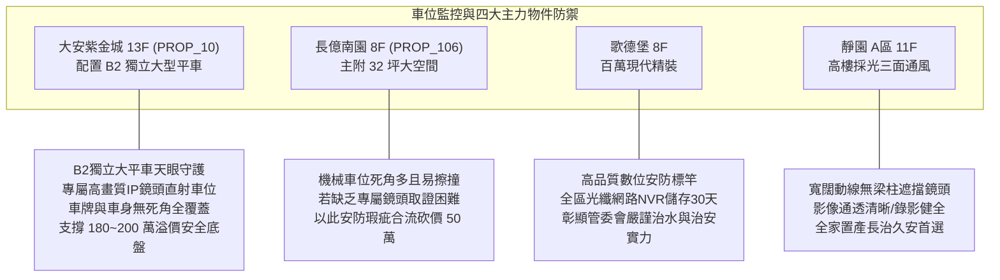

# 全案購屋實戰第一千零六十三部：中古大樓地下室車位監視器CCTV鏡頭死角紅外線夜視顆粒雜訊同軸電纜信號衰減與錄影天數不足體檢工序全書

## 前言：暗處守護的天眼——地下車位安防監控、影像取證與法律證據力極致體檢

在中古大樓地下停車場空間中，全天候運作的「封閉式電視監視系統（CCTV / Closed-Circuit Television）」是保障住戶百萬車輛財產免遭刮傷、防範倒車肇事逃逸、遏止偷竊盜拆零件與釐清責任歸屬的**核心司法取證防線**。然而，多數屋齡 15~30 年的中古社區，早期鋪設之 75-5 類比同軸電纜因地下室潮濕氧化導致信號嚴重衰減、畫面充滿波紋跳動與黑白雪花雜訊；夜間或感應燈熄滅時，劣質鏡頭紅外線夜視（IR LED）功率不足，畫面滿是粗糙噪點完全無法辨識肇事車牌與嫌疑人面孔；更致命的是，社區數位錄影主機（DVR/NVR）硬碟容量嚴重不足，歷史影像僅能保存 3~5 天便遭自動覆蓋，一旦發生刮車糾紛，住戶往往因「死角沒拍到」或「影像早被洗掉」而求償無門、自認倒楣。

本手冊為《全案購屋實戰》系列第 1063 部，深入解析中古大樓地下車位數位 IP 網路攝影機（PoE 供電）、光學鏡頭焦距（2.8mm 廣角 vs 6mm 望遠）、照度感光元件（Sony Starvis 星光級感光）、數位浮水印與法規錄影留存天數（至少 30 天）之體檢工序，並精準對接永義房屋周小姐實勘帶看之四大決戰考慮物件。

---

## 第一章 地下車位安防監控架構與影像失真機理

### 1.1 光學解析度與車牌辨識法律門檻
- **像素密度標準（PPM / Pixels Per Meter）**：
  - **偵測（Detect）**：25 PPM，僅能辨識是否有物體移動。
  - **識別（Recognize）**：125 PPM，能判斷人身輪廓與車輛廠牌。
  - **辨識（Identify / 車牌辨識標準）**：必須達到 **250 PPM 以上**。
- **解析度斷層**：中古社區早期安裝之類比鏡頭解析度僅 700 條線（不到 40 萬畫素），車輛倒車輕微擦碰，放大後車牌號碼全成模糊色塊；合格的現代數位攝影機至少需達 **4K（800 萬畫素）** 或 **500 萬畫素**，才能在夜間精準擷取車牌字樣與防刮傷特徵。

### 1.2 星光級夜視與同軸電纜干涉公害
- **星光級感光（Starvis Sensor）**：具備背照式 CMOS 技術，在 0.001 Lux 之微弱微光環境下仍能呈現清晰全彩畫面，免除傳統紅外線黑白畫面因反光板反光造成車牌全白過曝（Washout）之致命缺點。
- **電磁干擾波紋**：地下室同軸電纜若與 380V 動力電纜共用線槽，50/60Hz 工頻電磁場將感應至視訊線路，在監視器畫面上形成由下往上持續滾動之「橫向條紋與斜紋雜訊」，致使影像失去法庭證據力。

---

## 第二章 現場實地查驗車位監控設施五大工序

### 2.1 視野盲區與角度覆蓋核對（工序 1 & 3）
- **雙向交叉對照覆蓋（Cross Coverage）**：優質車位監控必須具備「雙向對照」視角，即車頭與車尾皆處於不同鏡頭之視訊錐角內；若車位恰巧隱匿在大型結構柱後方，而無專屬補盲鏡頭，該車位即屬「監控盲區死亡之位」。
- **動態車牌擷取測試**：請仲介或家人將車輛開入車位，隨後至警衛室調閱回放畫面，實測車牌反光字樣、車門開啟時門緣是否清晰無殘影，確認具備司法民事侵權求償之完整佐證力。

### 2.2 夜間畫質與噪點實測（工序 2）
- **熄燈極限噪點排查**：於夜間車位微波感應燈熄滅（微亮 20%）時，檢視監視畫面：
  - 畫面是否因增益過高而布滿大量粗糙之「椒鹽雜訊（Snow / Grainy Noise）」；
  - 鏡頭護罩壓克力罩若沾滿油污灰塵，紅外線會產生自體散射光暈（IR Reflection Halo），導致中心畫面霧白一片。

### 2.3 錄影天數與硬碟健康狀態（工序 4 & 5）
- **法定錄影留存天數**：向管委會調閱 DVR/NVR 錄影回放日曆，依內政部公寓大廈防竊指引，歷史錄影天數至少必須維持 **30 天以上**；若日曆顯示 7 天前之日期已呈現灰色無法回放，代表硬碟容量嚴重短缺，一旦長假出國期間愛車遭刮，返國時證據早已灰飛煙滅。
- **硬碟 S.M.A.R.T. 健康檢查**：檢視主機系統日誌，確認無「硬碟讀取錯誤（Disk Read Error）」或跳過錄影之警報。

---

## 第三章 永義房屋實勘主力考慮物件車位監控適配與談判籌碼

### 3.1 大安紫金城 13 樓 (`PROP_10`) —— 頂級大平車的司法級天眼守護
- **資產保護焦點**：配置專屬 B2 獨立大型平面車位（資產溢價高達 180~200 萬）。
- **實地查驗重點**：
  1. B2 獨立大平車上方或對面樑柱上，設有獨立的高畫質網路攝影機（解析度 >= 500 萬畫素），光軸直射車位前方與側面，完全排除結構柱遮蔽。
  2. 警衛室設有大螢幕分割畫面，地下室錄影保存達 30 天以上，讓停放之高價休旅車享有全天候司法取證保護，免除停放豪車遭暗中刮傷之恐懼。

### 3.2 長億南園 8 樓 (`PROP_106`) —— 機械車位監控死角與求償困境大砍價
- **機械車位安防盲點**：機械車位因鋼構載台上下移動，傳統固定鏡頭極難捕捉到下層車輛在移動過程中是否遭上層滴落油污或異物擊傷。若地下室監視鏡頭解析度低、滿是雪花，一旦機械故障導致車頂凹損，常因無影像證據引發住戶與管委會互踢皮球。
- **談判籌碼運用**：將「車位缺乏有效監控覆蓋、歷史刮傷求償無門、錄影天數不足」與機械車位限重 1.6 噸合流，向賣方痛陳日常用車之安防高度風險，力砍開價 50 萬，牢牢鎖定 745~760 萬之合理成交區間。

---

## 第四章 買方購屋特約防護與交屋驗收確認條款

1. **地下室車位安防監控完整性保證特約**：
   > 「賣方保證本契約所附停車位（編號：B2-XX）處於社區公共監視器有效拍攝覆蓋範圍內，監視影像傳輸正常且無重大死角；社區數位錄影設備維持至少二十一日以上之歷史留存紀錄；若交屋前管委會已有全社區監視系統升級之公攤決議，相關費用由賣方全額負擔。」
2. **看屋現場調閱監視影像三步驟**：
   - 第一步：請仲介陪同前往警衛室，指名調閱該車位之即時即時監視畫面（Live View）。
   - 第二步：現場檢視車牌字體是否清澈可辨、畫面有無滾動橫紋雜訊。
   - 第三步：隨機點選二十天前之錄影檔案進行回放測試，確認錄影主機儲存天數達標且無壞軌中斷。

---

## 結語

懸掛在車位高處的監視鏡頭，是保護百萬汽車資產最冷靜而忠實的無聲守衛。買方以專業工序檢驗監視器覆蓋視角、夜間低照度星光畫質、抗電磁干擾能力與錄影天數，不僅能為愛車築起牢不可破的司法防禦網，更能從小小的監視畫面清澈度中，一眼看破社區管委會的治安維護水平，在購屋談判中立於不敗之地！
