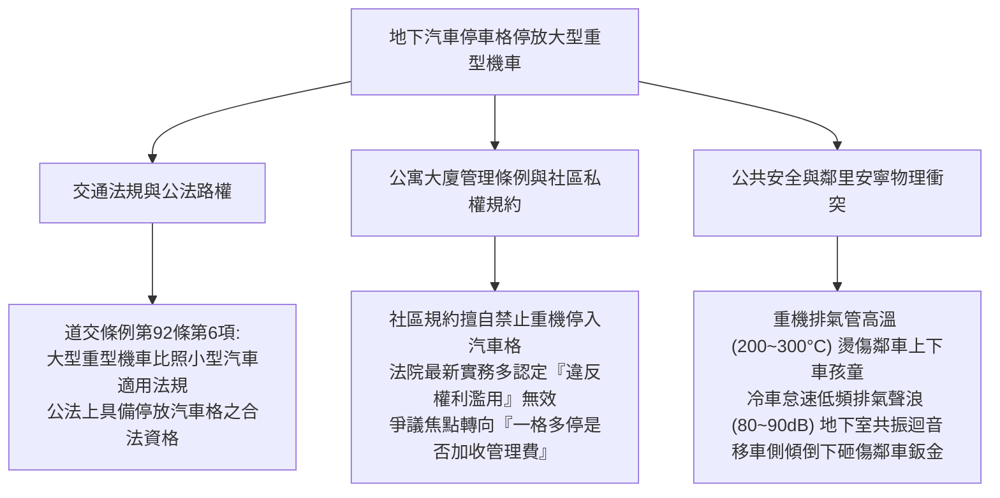
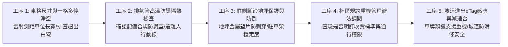
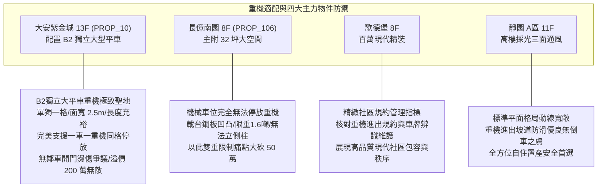

# 全案購屋實戰第一千零六十九部：中古大樓地下室車位重機重型機車停放規約爭議排氣管燙傷行人與一格多停公攤衝突體檢工序全書

## 前言：兩輪路權與四輪資產的碰撞——車位停放大型重型機車、社區規約適法性與通行衝突極致體檢

在近年台灣汽車停車位管理與交通法規演進中，大型重型機車（黃牌 250cc~549cc / 紅牌 550cc 以上）依《道路交通管理處罰條例》比照小型汽車適用停車位之規定，使得越來越多重機騎士住戶選擇將重機停放於自己購買或約定專用的地下汽車停車格內。然而，在屋齡 15~30 年的中古大樓中，這項合法權利卻頻繁引發整棟大樓最劇烈的「鄰里衝突與訴訟戰火」：部分住戶主張「汽車位只能停汽車，重機停放違反規約」；更普遍的爭端在於車主利用車格剩餘空間進行「一格多停（一輛汽車+一輛重機，或停放兩輛重機）」遭管委會加收高額管理費甚至上鎖拖吊；此外，大型重機高溫排氣管（高達 200°C~300°C）在狹窄車位間引發鄰車乘客或孩童燙傷糾紛，以及大排氣量改裝排氣管在地下密室冷車發動時產生的「低頻共振轟鳴噪音」，更是嚴重破壞社區安寧的導火線。

本手冊為《全案購屋實戰》系列第 1069 部，深入剖析《道路交通管理處罰條例》第 92 條第 6 項、《公寓大廈管理條例》規約限制重機停放之法律效力、高等法院關於「一格多停」最新裁判見解、排氣管防燙護蓋合規查驗與噪音分貝防禦，並精準對接永義房屋周小姐實勘帶看之四大決戰考慮物件。

---

## 第一章 車位停放大型重機法規架構與衝突破壞機理

### 1.1 公法路權與私權規約的極限交鋒
- **道交條例強制授權**：依《道路交通管理處罰條例》第 92 條第 6 項規定，大型重型機車比照小型汽車適用其行駛及處罰規定。交通部相關函釋亦明確指出，大型重型機車停放於合法汽車停車格位內，符合法規原意。
- **規約限制之法院實務判決要旨**：
  - 若社區區分所有權人會議（區權會）決議「全面禁止大型重機停入地下室專用汽車位」，多數法院判決認為此舉過度限制專用權人之使用權能，構成《民法》第 148 條之「權利濫用」，認定該禁令無效。
  - **「一格多停」爭議焦點**：車位所有權人若在不妨礙公共通行動線、不超出車位白線之前提下，於同一格位內停放「一輛汽車+一輛重機」或「兩輛重機」，法院普遍認為在物理界線內並未侵占公有空間；但管委會若經區權會合法決議，得以「清潔費、感應磁扣發放成本及共用設施耗損」為由，酌收合理之額外清潔管理費（每月約 200~500 元），若收取不合理之天價懲罰金則屬無效。

### 1.2 高溫燙傷、低頻噪音與倒車物理傷害
- **排氣尾管高溫致灼傷**：大型重型機車（尤其是紅牌公升級仿賽或美式巡航車）行駛返家停妥後，排氣管頭段與尾段溫度高達 **200°C ~ 350°C**，需 30~45 分鐘以上方能完全降溫。若車位淨寬不足，鄰車乘客或孩童開門下車側身走過時，小腿若不慎碰觸未加裝隔熱防燙蓋之金屬管壁，將在 0.5 秒內造成二度至三度深層燙傷。
- **地下室低頻音爆共振**：改裝直通排氣管之重機在地下密閉空間冷車發動時，低頻音壓常突破 **90~95 分貝**，衝擊波沿著剪力牆與排風管道直衝一樓中庭，引發全社區強烈抗議。

---

## 第二章 現場實地查驗車位重機停放設施五大工序

### 2.1 車格幾何與一格多停極限丈量（工序 1 & 2）
- **白線絕對不越界原則**：若車位預計停放重機加汽車，車位長度必須達 **5.5 公尺以上**、寬度達 **2.5 公尺以上**；停妥後，重機龍頭把手、後照鏡及後牌照框均不得超出車位白色邊線（Inside-to-Inside），防止侵占車道遭管委會拍照開罰。
- **排氣管朝向與防燙檢視**：重機停妥後，排氣管朝向應儘量朝向自家牆壁或柱面，避免正對鄰車副駕駛座開門下車處；排氣管全段必須具備合法防燙蓋，表面覆蓋隔熱材料，表面溫度需低於 60°C 標準。

### 2.2 側柱地坪保護與防傾倒（工序 3）
- **側柱單點壓強防破地坪**：重機車重大多在 200~300 公斤，側柱（Side Stand）接地面積僅數平方公分，單點壓強極大。若車位地坪為環氧樹脂 Epoxy，炎熱夏季或長期單點頂壓會將地坪塗層壓碎刺穿。合格車位應於側柱落點處放置一塊 SUS304 不銹鋼金屬墊板或專用橡膠保護墊。
- **駐車架與防側傾安全**：大型重機應優先使用中柱（Center Stand）或駐車架固定，避免地震時車身側傾砸傷相鄰名牌轎車，引發數十萬鈑金求償。

### 2.3 車牌辨識與規約收費審查（工序 4 & 5）
- **車道 eTag 與車牌辨識適應性**：中古社區車道捲門若採前車牌辨識，而重機依台灣法規僅掛後牌，檢視社區是否支援「後牌辨識攝影機」或「eTag 專用感應貼紙/感應磁扣」，確保重機返家進出順暢。
- **規約費用合規性**：調閱規約確認管委會對「一格多停」是否收取合理之清潔費（每月 200~300 元為司法可容忍範圍）；若規約擅自加收每月 1,000~2,000 元之天價懲罰性費用，買方簽約前需評估爭訟成本。

---

## 第三章 永義房屋實勘主力考慮物件重機適配與談判籌碼

### 3.1 大安紫金城 13 樓 (`PROP_10`) —— 頂級獨立大平車的重機停放夢幻天堂
- **資產保護焦點**：配置專屬 B2 獨立大型平面車位（資產溢價高達 180~200 萬）。
- **實地查驗重點**：
  1. 該車位為**獨立大平車**（非夾在兩台車中間的連棟夾心車位），一側靠大柱或牆面，實測寬度達 2.50 米以上、深度充裕。
  2. 若買方身兼重機騎士，該車位具備在停放一輛進口休旅車之同時，於車格靠柱畸零空間「合法停放一輛黃牌/紅牌大型重機」之完美幾何空間；且因獨立靠柱，完全不存在排氣管燙傷鄰車乘客之風險，為全台中南區最夢幻的「四輪+兩輪」保值王座。

### 3.2 長億南園 8 樓 (`PROP_106`) —— 機械車位禁止重機停放之時代死穴大砍價
- **機械車位對重機之絕殺限制**：長億南園配置之機械車位，載台地面為波浪形衝壓防滑鋼板（凹凸不平），重機側柱根本無法穩固支撐，極易滑脫倒車；且機械升降橫移時劇烈晃動，重機必傾倒砸毀，全台各大機械停車廠商均明文標註**「嚴禁停放任何機車與重型機車」**。
- **談判籌碼運用**：在現場向賣方痛陳「若家庭有重機通勤需求，長億南園之機械車位毫無用武之地，需另行在外面花費每月 2,500~3,500 元額外承租重機車位」，將此生活不便與機械車位限重 1.6 噸合流，狠砍 998 萬開價 50 萬，牢牢鎖定 745~760 萬之合理成交區間。

---

## 第四章 買方購屋特約防護與交屋驗收確認條款

1. **車位停放大型重機與規約合規保證特約**：
   > 「賣方保證本買賣標的所附之停車位（編號：B2-XX），依社區現行規約與法令，享有合法停放汽車或大型重型機車之權利；若買方於車位白線內停放車輛符合社區規約規定，管委會不得無端禁止通行；交屋前若該車位因停車種類衍生管理費爭訟或罰款，全由賣方結清負責。」
2. **看屋與簽約前重機環境查核三步驟**：
   - 第一步：向管委會調閱社區規約，確認有無「大型重型機車停放管理辦法」及額外清潔費標準。
   - 第二步：實測地下車道進出坡道之減速反光條與車牌辨識系統，確認重機通行流暢無阻。
   - 第三步：丈量車位靠柱空間，確認重機停放後與汽車車身保有至少 40~50 cm 之人行維護走道。

---

## 結語

大型重型機車與汽車的共處，是檢驗現代中古社區包容性、法治觀念與空間餘裕的最佳量表。買方以專業工序檢驗車位幾何淨寬、防燙隔熱、地坪保護與社區規約適法性，不僅能讓全家的「四輪生活與兩輪夢想」在同一處車位優雅共存，更能一眼識破機械車位的致命局限，在價格博弈中精準出手、一擊制勝！
