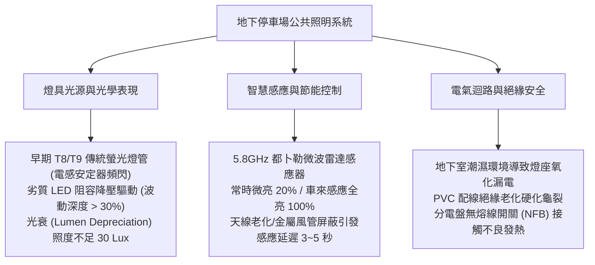
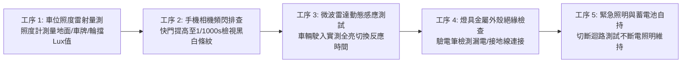
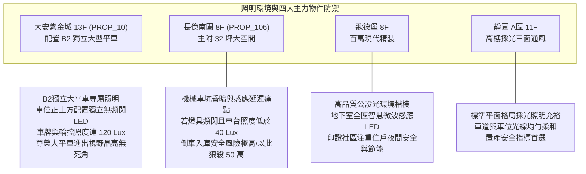

# 全案購屋實戰第一千零六十二部：中古大樓地下室車位照明LED燈管頻閃眩光照度不足感應微波雷達延遲失靈與燈具線路絕緣體檢工序全書

## 前言：驅散地下幽暗的明燈——車位照明光學、微波雷達感應與電氣絕緣極致體檢

在中古大樓地下停車場空間中，天花板懸吊或吸頂安裝的「車位與車道照明燈具（Parking Lighting & Microwave Radar Sensor Tubes）」是維繫駕駛人視覺辨識、行車入庫對位、防範人員跌倒與保障防盜治安的**第一道主動光環境防線**。然而，多數屋齡 15~30 年的中古社區，早期安裝之 T8/T9 傳統螢光燈管因安定器老化發出嗡嗡低頻雜音與肉眼可見之 100Hz 劇烈頻閃；或近期管委會為節省公共電費，換裝劣質低價 LED 微波感應燈管，導致車輛駛入時感應延遲 3~5 秒甚至完全不亮，迫使駕駛人在全黑盲區中摸黑倒車；更嚴重的是，地下室高濕度造成燈具金屬背板生鏽漏電、PVC 絕緣電線氧化硬化，隨時有接地短路引發火花之險。

本手冊為《全案購屋實戰》系列第 1062 部，深入解析中古大樓地下停車場光學照度標準（CNS 12112 車道 100 Lux / 車位 75 Lux）、LED 驅動電源無頻閃（Flicker Free，波動深度 < 5%）、5.8GHz 都卜勒微波雷達感應演算法、燈具絕緣電阻量測（> 1 MΩ）之體檢工序，並精準對接永義房屋周小姐實勘帶看之四大決戰考慮物件。

---

## 第一章 地下車位照明系統架構與光學電氣失效機理

### 1.1 地下停車場光學標準與頻閃危害
- **法定照度基準（CNS 12112 / CNS 15015）**：
  - **地下車道行駛區**：地面水平照度不得低於 **100 Lux**（且均勻度 U0 >= 0.4）。
  - **汽車停車位區域**：車位地面照度不得低於 **75 Lux**，且車牌與輪擋位置需清晰可辨。
  - **行人人行動線與梯廳出入口**：照度不得低於 **150 Lux**，杜絕人行絆倒。
- **光學頻閃（Flicker）之神經毒性**：傳統電感安定器或劣質阻容降壓 LED 燈具，因整流濾波電容不足，產生高達 100~120 Hz 之光輸出波動。長時間處於頻閃環境下，駕駛人易產生視覺疲勞、頭痛、眼球乾澀，在倒車時甚至引發距離誤判。合格燈具必須採用高規格恆流 IC 驅動電源，波動深度（Percent Flicker）需小於 **5%**。

### 1.2 微波雷達感應機制與遮擋盲區
- **5.8GHz 都卜勒雷達（Doppler Radar）原理**：利用發射微波並接收移動物體反射之頻率偏移（Δf），能穿透塑料、壓克力與玻璃，偵測距離可達 6~8 公尺。
- **常見失靈病態**：
  1. **金屬屏蔽遮蔽**：燈具若緊鄰金屬通風管、消防大幹管或厚重 RC 樑柱，微波信號遭金屬全反射，車位區域形成「感應死區」。
  2. **延遲卡頓**：劣質微波模組抗干擾能力差，車輛已駛入車位 3 秒後燈具才亮起，造成「盲開盲停」之險象。

---

## 第二章 現場實地查驗車位照明設施五大工序

### 2.1 照度數值與均勻度量測（工序 1 & 2）
- **專業照度計實測**：於車位中央地面、駕駛座開門側地面及後方輪擋處放置照度計（Lux Meter），三點測量平均值不得低於 **75 Lux**；若數值低於 40 Lux，現場昏暗發黑，即為嚴重照明缺失。
- **手機高速快門防頻閃快篩**：開啟智慧型手機相機，切換至專業手動模式，將快門速度（Shutter Speed）調高至 **1/1000 秒 ~ 1/2000 秒** 對準燈具。若螢幕上出現明顯滾動之「黑白橫向斑馬條紋」，證實燈具存在嚴重低頻頻閃，需全數更換為無頻閃恆流驅動燈具。

### 2.2 微波雷達動態切換反應（工序 3）
- **反應時差（Response Time）實測**：車輛以 10~15 km/h 速度駛入目標車位前方 5 公尺處：
  - 合格燈具應在 **0.5 秒以內** 瞬間自 20% 微亮狀態平滑切換至 100% 全亮狀態；
  - 若車輛已完全停妥、車頭推入車位後燈具仍未亮起，或需大力按喇叭/揮手才亮，即為微波天線角度偏斜或模組老化。

### 2.3 電氣絕緣與接地防觸電（工序 4 & 5）
- **燈殼感應電與漏電排查**：以高靈敏度驗電筆碰觸燈具鍍鋅金屬背板或懸吊鐵鍊，驗電筆不得亮燈或發出警報；燈具外殼必須確實接駁接地線（PE 綠線）。
- **停電緊急照明維持**：車道及重要轉彎處之緊急照明燈，切斷分電盤開關後，內部鋰電池或鎳鎘電池自持照明時間必須大於 **90 分鐘** 以上。

---

## 第三章 永義房屋實勘主力考慮物件車位照明適配與談判籌碼

### 3.1 大安紫金城 13 樓 (`PROP_10`) —— 頂級大平車的晶亮尊榮視野
- **資產保護焦點**：配置專屬 B2 獨立大型平面車位（資產溢價高達 180~200 萬）。
- **實地查驗重點**：
  1. B2 獨立大平車正上方與兩側配備獨立的高照度 LED 燈具，實測地面照度達 **120 Lux** 以上，均勻無陰影死角。
  2. 燈具採用高品質無頻閃微波雷達模組，車輛尚未轉入車位前 6 公尺即提前感應全亮，駕駛座兩側開門動線與後方尾門處光線充沛，讓百萬愛車停靠從容優雅。

### 3.2 長億南園 8 樓 (`PROP_106`) —— 機械車位陰暗與頻閃痛點大砍價
- **機械車位光線致命傷**：機械車位因鋼樑結構、上下層載台與鏈條遮擋，下層車台內部極易淪為「光學黑洞」。若社區燈具老化發黃、照度嚴重不足（低於 40 Lux），車主在窄小機械台上倒車對位極易刮傷輪胎鋁圈。
- **談判籌碼運用**：將「車位照明嚴重不足、感應器失靈摸黑倒車、燈具頻閃危害視覺」與機械車位限重 1.6 噸合流，向賣方痛陳日常停車之高度危險性，力壓 998 萬開價，直推至 745~760 萬之甜蜜成交帶。

---

## 第四章 買方購屋特約防護與交屋驗收確認條款

1. **地下室公共照明與用電安全保證特約**：
   > 「賣方保證本契約所附停車位周邊之公共照明設施完好無損，車位感應照明燈具作動正常，無常態性熄滅、劇烈閃爍或線路漏電之情事；若交屋前管委會已有全社區地下室燈具全面更新之公共攤提決議，相關款項由賣方全額負擔。」
2. **交屋前車位照明實測三步驟**：
   - 第一步：夜間或關閉車燈實地開車入庫，測試車位感應燈是否能在車頭駛入前 0.5 秒即時點亮。
   - 第二步：拿出手機以 1/1000 秒高速快門拍攝燈具，確認螢幕無黑色頻閃條紋。
   - 第三步：以照度計測量輪擋與車位中央，確認讀數維持在 75 Lux 以上安全標準。

---

## 結語

光明的地下停車場，不僅能消除返家時的幽閉恐懼與安全死角，更是全家人出入平安的重要守護者。買方以專業工序檢驗車位照明照度、無頻閃表現與微波雷達反應時差，不僅能確保日後每日停車安全明亮，更能從小小的燈具品質中，透視社區管委會對居住細節的用心程度，在價格談判中牢牢掌握話語權！
