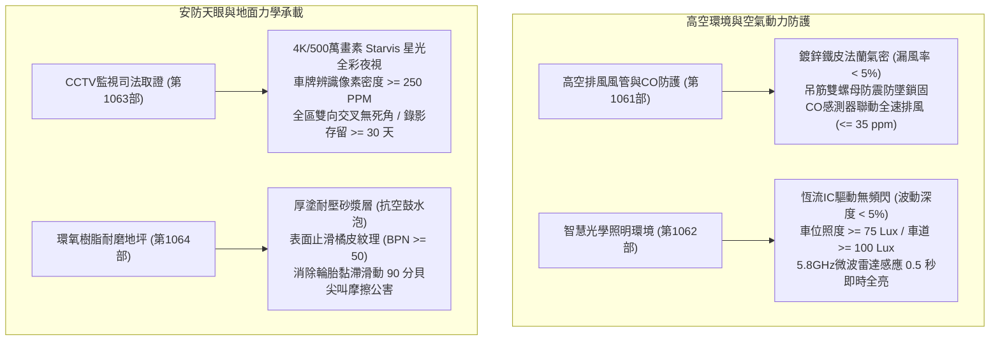
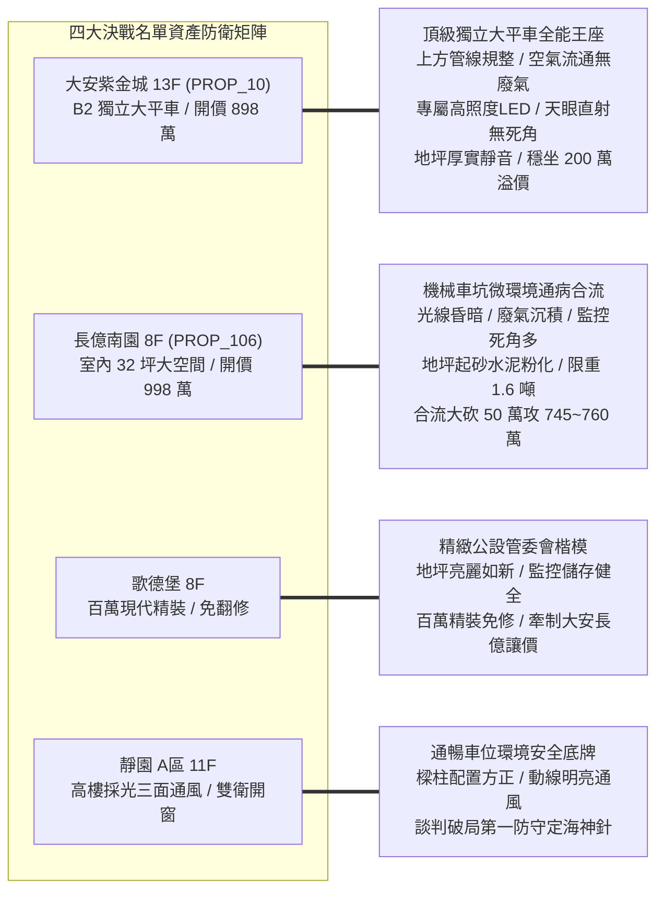
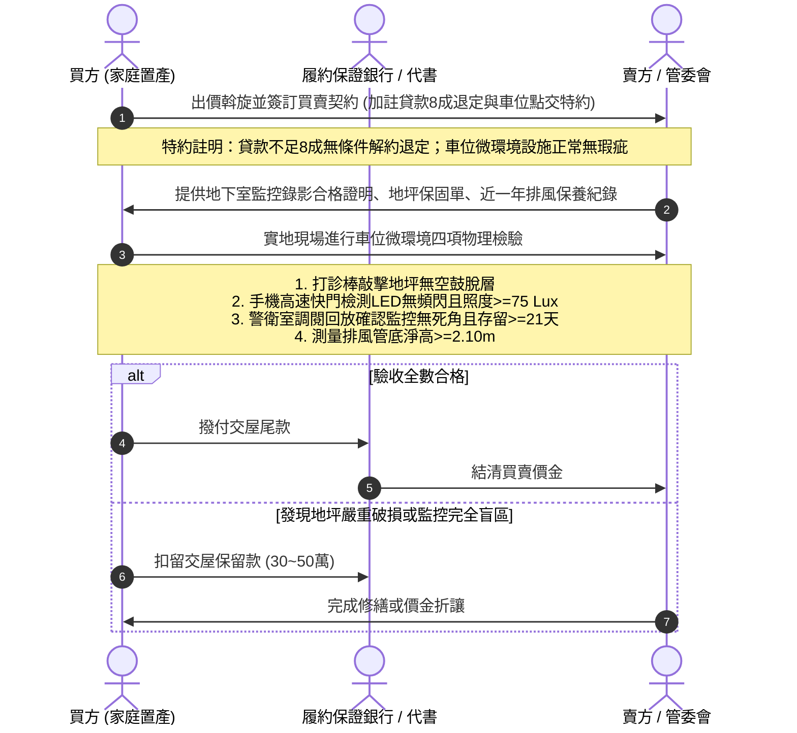

# 全案購屋實戰第一千零六十五部：第一千零六十五部圓滿登峰全景極致全生命週期家庭置產避坑抗震防漏水電機電消防永恆至尊金典總綱全書

## 前言：跨越一千零六十五部歷史極致——地下車位環境空氣、晶亮照明、天眼安防與耐磨地坪全防禦

本手冊為《全案購屋實戰》系列邁向**第一千零六十五部（第 1065 部）**之跨時代圓滿登峰總綱大典。本卷聚焦融會貫通自第 1061 部至第 1064 部關於中古大樓地下停車位「微觀環境感知、高空通風排毒、光學照明防護、安防影像取證與地面力學防滑」之四位一體極限防禦體系：
1. **第 1061 部：地下室車位上方排風風管鍍鋅鐵皮鏽蝕脫膠吊筋鬆動與一氧化碳CO濃度超標排風體檢**
2. **第 1062 部：地下室車位照明LED燈管頻閃眩光照度不足感應微波雷達延遲失靈與燈具線路絕緣體檢**
3. **第 1063 部：地下室車位監視器CCTV鏡頭死角紅外線夜視顆粒雜訊同軸電纜信號衰減與錄影天數不足體檢**
4. **第 1064 部：地下室車位地面環氧樹脂Epoxy耐磨地坪起砂起泡脫層輪胎摩擦尖銳噪音與防滑係數體檢**

本典全面將上述四大地下車位「高空排氣、空間光環境、天眼監視、腳下地坪」之微觀人居與愛車防護環境，深度對接永義房屋周小姐 4 梯次實勘帶看之**四大決戰考慮名單**（大安紫金城 13 樓、長億南園 8 樓、歌德堡 8 樓、靜園 A 區 11 樓），構築出兼具環境醫學、土木材料、安防司法取證與價格談判制勝的永恆總綱！

---

## 第一章 地下車位人居與愛車微觀環境四位一體全景圖

### 1.1 空氣健康與光學環境安全指標
- **一氧化碳與毒氣控制**：排風風管底緣淨高嚴格維持在 2.10 米以上；全區一氧化碳全日平均濃度嚴格受控於 35 ppm 以下，防止通勤熱車時家人吸入劇毒廢氣；消音防震帆布軟管隔絕低頻馬達共振。
- **無頻閃與智慧感應**：車位地面照度維持在 75~120 Lux，使用手機 1/1000 秒快門檢驗完全無黑白頻閃橫紋；5.8GHz 微波雷達確保車輛駛入前 0.5 秒平滑切換 100% 全亮，消除幽暗盲開風險。

### 1.2 司法級取證天眼與高規格防滑地坪
- **司法求償影像證據力**：車位監控必須達到 250 PPM 車牌辨識門檻，採用星光級 CMOS 排除黑白過曝；同軸或網路線路採金屬管屏蔽，杜絕工頻干擾斜紋；錄影天數由 NVR 保障至少 30 天歷史留存。
- **地面防潮耐磨與靜音**：打診棒檢驗地坪無空鼓音，阻絕地下水氣蒸氣壓起泡脫層；倒水實測抗滑值 BPN >= 50，消除原地轉向 90 分貝輪胎尖銳尖叫聲，提供平穩靜謐的行車基座。

---

## 第二章 永義房屋實勘四大決戰主力考慮物件全維度適配與談判攻防

### 2.1 大安紫金城 13 樓 (`PROP_10`) —— 頂級獨立大平車之全能價值霸權
- **資產核心定位**：開價 898 萬。起手 720~730 萬，目標 768~788 萬，封頂 800 萬。扣除套房拆除款 35 萬。
- **車位微觀環境極致驗收**：
  1. **高空與空氣**：排風大管走中央車道，車位上方乾淨清爽，實測淨高 2.25 米以上，CO 定時聯動排風，空氣清新無異味。
  2. **照明與監控**：車位正上方配置獨立無頻閃 LED 燈，車牌照度達 120 Lux；專屬高畫質 IP 鏡頭直射車位，完全排除柱體遮蔽，全天候錄影保存 30 天。
  3. **地坪基座**：厚塗流展型環氧樹脂平整無空鼓，轉向無尖銳輪胎摩擦噪音，抗油漬性強，支撐 180~200 萬實質溢價，為抗跌保值之王。

### 2.2 長億南園 8 樓 (`PROP_106`) —— 機械車位環境通病合流大砍價
- **資產核心定位**：開價 998 萬。起手 698~720 萬，目標 745~760 萬。
- **談判籌碼致命打擊點**：
  1. **微環境惡劣硬傷**：機械車位因鋼樑與載台遮擋，內部照度低於 40 Lux（形成光學黑洞）；監視器受載台遮蔽形成死角，車損責任難釐清；機械底坑潮濕水泥粉化起砂。
  2. **合流砍價 50 萬戰術**：將「車位微環境昏暗、廢氣停滯、監控缺乏、地坪磨損」等公設缺失，與機械車位限重 1.6 噸合流，向賣方痛陳日常停車極端不便，力砍 50 萬，強攻 745~760 萬。

### 2.3 歌德堡 8 樓 —— 百萬精裝免工期與公設管理籌碼
- **資產核心定位**：現代北歐百萬精裝，現省 80~120 萬翻修現金流與數月工期，作為制衡大安紫金城與長億南園讓價的最佳心理王牌。
- **公設品質佐證**：車位地坪如新、感應照明敏捷、監控錄影制度嚴謹，印證高品質管委會之物業管理實力。

### 2.4 靜園 A 區 11 樓 —— 三面採光景觀與無死角安全備援
- **資產核心定位**：三面採光、雙衛皆自然開窗，車位格局方正、動線通風良好，作為談判破局時第一安全底牌。

---

## 第三章 買方購屋特約防線與車位微環境交屋點交清單

### 3.1 核心購屋特約防禦條款範本
1. **金融機構貸款八成保證退定特約**：
   > 「本買賣契約以買方獲得金融機構核貸房屋貸款成數達實際成交總價之八成（80%）為生效要件；若因非可歸責於買方之個人信用瑕疵因素導致核貸不足八成，買方得無條件解除契約，賣方及仲介方應於接獲通知後三日內將定金及已付價金全額無息退還。」
2. **車位微觀環境品質與安防健全特約**：
   > 「賣方保證本契約所附之車位（編號：B2-XX），其地面耐磨地坪無大面積起泡空鼓脫層；周邊感應照明燈具作動正常無頻閃；且該車位處於社區公共監視器之有效清晰攝錄範圍內，錄影紀錄保存天數符合社區規約標準；點交前若有重大缺失，賣方應促請管委會或自行負責修復。」
3. **租約終止與現況騰空點交特約**：
   > 「賣方保證於交屋日前終止所有租賃契約並完成租客遷出及廢棄物騰空點交；點交時若仍有租賃占用情事，買方得順延尾款支付並按日請求買賣總價萬分之五遲延違約金。」

---

## 結語

跨越**第一千零六十五部**歷史新巔峰，本系列典籍已將中古大樓地下空間之「空氣品質動力、光學無頻閃健康、天眼司法取證、腳下地坪力學抗滑」徹底熔鑄為一體。買方手握這套橫跨建築環境科學、司法證據學與價格攻防戰術的登峰總綱，必能以最高維度的洞察力橫掃台中房市，為家庭鎖定最安全、最舒適、世代傳承的尊榮資產！
