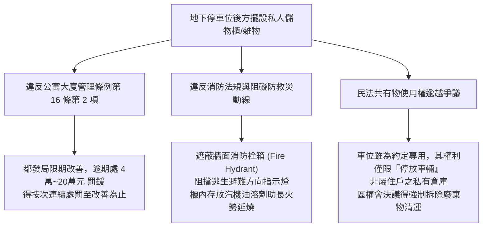
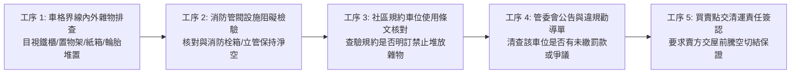
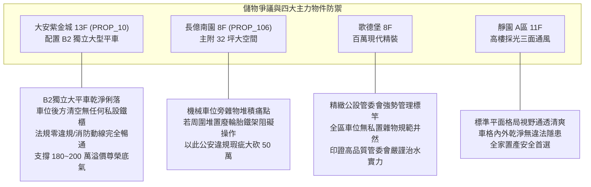

# 全案購屋實戰第一千零六十八部：中古大樓地下室車位後方私人儲物鐵櫃雜物堆積違反公寓大廈管理條例阻礙消防通道開罰與強制清除體檢工序全書

## 前言：佔地為王的隱形雷區——車位後方私人儲物櫃、法規適法性與強制清除極致體檢

在中古大樓地下停車場的管理實務與住戶使用習慣中，許多車主習慣利用汽車停車格位後方靠近結構牆、大柱或輪擋後方的狹小剩餘空間，自行擺放「金屬儲物鐵櫃、置物架、備用輪胎、露營裝備、工具箱乃至裝潢廢料」。表面看似充分利用零星畸零空間，實則直接觸犯了《公寓大廈管理條例》第 16 條「不得擅自堆置雜物阻礙公共安全」之強制性禁止規定，以及《消防法》關於地下室避難動線與防阻火災蔓延的**法律紅線**。一旦主管機關（如台中市都發局或消防局）接獲檢舉或進行公安大稽查，管委會與車位所有權人將面臨新台幣 **4 萬元至 20 萬元之連續罰鍰**；若置物櫃不幸存放油漆溶劑等易燃品引發火災，甚至構成刑法第 173 條公共危險罪與業務過失致死罪之刑事重責；更常見的是買方交屋後，原屋主遺留之巨大儲物鐵櫃遭管委會勒令強制拆除清運，衍生嚴重的交屋糾紛與清運費用求償爭議。

本手冊為《全案購屋實戰》系列第 1068 部，深入剖析《公寓大廈管理條例》第 16 條法定要件、內政部營建署（現國土管理署）關於車位停放車輛以外物品之行政函釋、社區規約制定效力、民事不當得利侵占公設訴訟，並精準對接永義房屋周小姐實勘帶看之四大決戰考慮物件。

---

## 第一章 車位後方違規堆置之法規構成要件與火災風險機理

### 1.1 法定專屬使用權之界限與國土署權威函釋
- **約定專用之限制**：依《公寓大廈管理條例》第 9 條及第 15 條規定，住戶對專有部分及約定專用部分之使用，應依通常使用方法為之，並受規約之約束。
- **內政部台內營字第 0920088523 號函釋明確揭示**：
  > 「停車位之用途係供停放車輛之用，住戶若於車位內或後方堆置雜物、設置固定或非固定之儲物箱櫃，已違反停車位之原法定用途，管委會得依規約制止，主管機關得依本條例第 49 條處以罰鍰。」
- **行政裁罰標準**：直轄市政府都發局接獲檢舉後，現場勘查只要確認車格內堆放非汽車之物品（包括嬰兒車、腳踏車、鐵櫃、鞋櫃等），即開立勸導單；限期未改善者，直接處以 **新台幣 40,000 元以上 200,000 元以下罰鍰**，且得連續開罰。

### 1.2 消防安全障礙與刑事責任
- **阻礙消防搶救設施**：若儲物櫃擺放位置遮蔽了牆面上的「室內消防栓箱、滅火器、火警綜合盤或排煙閘門手動開關」，導致火災初期無法在黃金 3 分鐘內拉出水帶滅火，違規置物之車主將直接承擔延誤救災之共同過失侵權賠償責任。
- **易燃物存放之公共危險罪**：許多車主於鐵櫃內存放機油、WD-40 防鏽劑、高壓打氣瓦斯罐或露營用卡式瓦斯爐。地下室一旦因充電樁熱失控或線路短路起火，鐵櫃內之化學溶劑將產生連鎖氣爆，直接升級為刑法第 173 條「放火或失火燒燬現有人所在之建築物罪」。

---

## 第二章 現場實地查驗車位後方空間五大檢驗工序

### 2.1 實體堆置與空間侵占排查（工序 1 & 2）
- **界線內外違規檢核**：
  - 檢視車位白線後方至牆面、樑柱之間的空間：是否有大型角鐵儲物架、木作鞋櫃、輪胎或塑膠置物籃；
  - 即使物品未超出車位白線，只要不是「合法領牌之車輛（汽車/重機）」，依法均屬違規堆置雜物。
- **消防設施安全淨距**：檢視儲物櫃方圓 **1.5 公尺** 範圍內是否有室內消防栓、連結送水管放水口或自動撒水末端查驗管。若有任何遮蔽，該處置物櫃隨時面臨消防局無預警強制查扣開罰。

### 2.2 社區規約效力與管理稽查（工序 3 & 4）
- **規約罰則條款調閱**：翻閱該社區最新版「住戶規約」：優質中古社區均會明訂「地下室停車位嚴禁停放車輛以外之任何物品，違者每日計收清潔費 500~1,000 元，並由管委會逕行當作廢棄物清除，清運費由車位所有權人負擔」等強硬條款。
- **管委會列管清冊核對**：向總幹事或警衛室查證，該目標車位目前是否已被管委會列入「違規限期清理黑名單」，防止買方簽約後立刻接下一紙高額清運帳單與鄰里官司。

---

## 第三章 永義房屋實勘主力考慮物件車位整潔適配與談判籌碼

### 3.1 大安紫金城 13 樓 (`PROP_10`) —— 頂級獨立大平車的規約純淨優勢
- **資產保護焦點**：配置專屬 B2 獨立大型平面車位（資產溢價高達 180~200 萬）。
- **實地查驗重點**：
  1. 大安紫金城管理制度成熟，實勘 B2 獨立大平車時，確認車格後方與周圍結構柱乾淨清爽，無任何私設置物鐵櫃或雜物堆積，完全符合《公寓大廈管理條例》第 16 條標準。
  2. 車位後方預留之 120 cm 緩衝空間全數保留給休旅車掀背尾門自由開啟，無雜物碰撞愛車之虞，買方接手無任何公法開罰或管委會清運糾紛。

### 3.2 長億南園 8 樓 (`PROP_106`) —— 機械車位周圍雜物阻礙大砍價
- **機械車位堆物致命傷**：機械車位操作盤旁邊或底坑兩側若遭鄰近住戶堆放廢棄鐵架、紙箱或工具桶，不僅在操作升降橫移時極易卡滯機械鏈條引發跳脫，更嚴重阻礙緊急停機按鈕之觸碰。
- **談判籌碼運用**：在現場指認「地下室機械車位周遭堆滿易燃雜物、管委會公權力不彰任由住戶違規佔用公設、隨時面臨都發局 4~20 萬罰鍰」等重大法規瑕疵，與機械車位限重 1.6 噸合流，向賣方強烈施壓，狠壓 998 萬開價，直推至 745~760 萬之甜蜜成交帶。

---

## 第四章 買方購屋特約防護與交屋驗收確認條款

1. **車位騰空無雜物堆置與無裁罰保證特約**：
   > 「賣方保證本契約所附停車位（編號：B2-XX）內外空間，完全符合《公寓大廈管理條例》第十六條及社區住戶規約之規定，無違法堆置儲物櫃、置物架或雜物情事；若有既有物品，賣方保證於交屋日前全數騰空清除運離；點交日前若因該車位堆置雜物遭受主管機關裁罰或管委會追繳清潔費，所有罰款與清運費用均由賣方全額負擔，與買方無涉。」
2. **交屋前車位空間鑑驗三部曲**：
   - 第一步：站在車位後方拍照存證，確認無任何鐵櫃、貨架或箱體殘留。
   - 第二步：前往管委會辦公室確認該車位無違規列管單或待繳清潔罰扣款。
   - 第三步：檢視車位後方牆面與消防設備，確認未遭私自鑽孔破壞或釘掛掛勾。

---

## 結語

車位後方的空間雖小，卻是檢驗社區法治水準與物業管理強度的重要試金石。買方以專業法規工序檢驗車位有無違規雜物堆積、消防阻隔與行政裁罰風險，不僅能徹底避免買屋後立刻捲入鄰里抗爭與政府重罰的泥淖，更能從車位的純淨整潔度中，精準洞察大樓住戶的水準與未來轉手價值，在資產博弈中永遠立於不敗之地！
