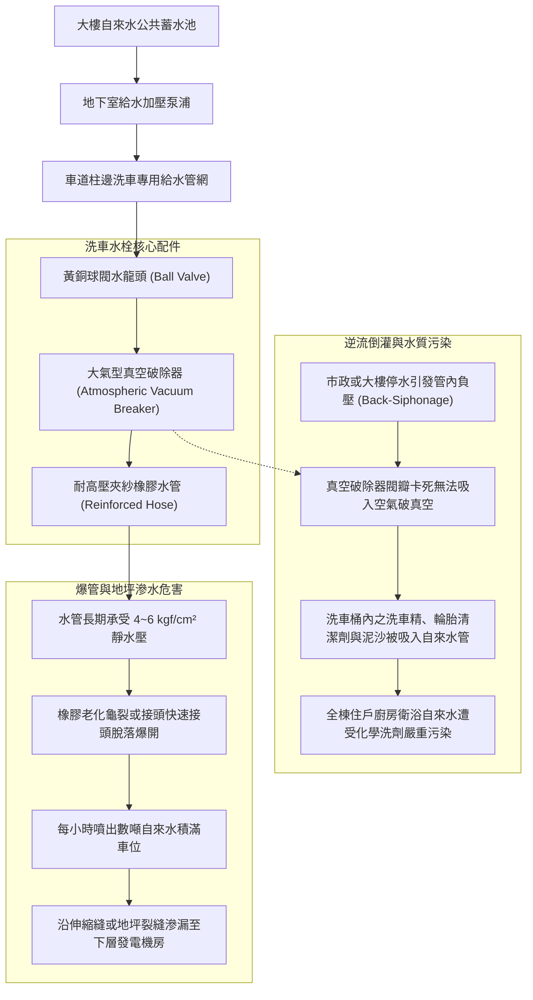
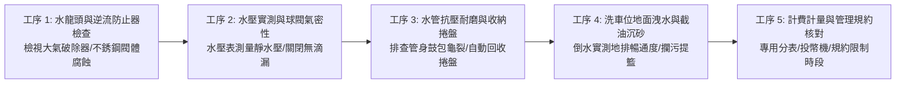
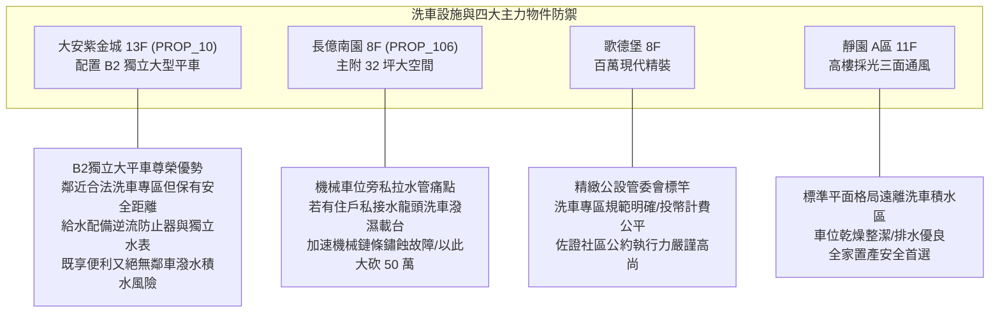

# 全案購屋實戰第一千零六十六部：中古大樓地下室車位洗車專用水龍頭逆流防止器失效橡膠水管老化爆裂地面積水滲漏與公共水表分攤體檢工序全書

## 前言：便利與風險的雙刃劍——車位洗車水栓、逆流防污染與水費公攤極致體檢

在中古大樓地下停車場的管理規約與公共給水系統中，部分社區於特定柱位或專屬車位周邊設置的「地下室洗車專用水龍頭（Car Wash Hose Bibb / Hydrant Outlet）」，是提供住戶清潔愛車、地面沖洗與工務維護的**便民設施**。然而，多數屋齡 15~30 年的中古社區，因給水管路長期未安裝「防虹吸逆流防止器（Backflow Preventer / Vacuum Breaker）」或內部止回閥瓣橡膠老化水解，導致洗車污水、界面活性劑清潔劑與泥沙在供水管網負壓時被「吸入倒灌」回大樓自來水幹管，嚴重污染全體住戶飲用水；更嚴峻的是，高壓橡膠水管長年受日光燈照射與車輪輾壓破裂爆管，引發地下室大面積積淹水甚至滲漏至更下層配電室；此外，因缺乏專用獨立分表或投幣計費機制，更衍生嚴重的「洗車水費公攤不公」與鄰里糾紛。

本手冊為《全案購屋實戰》系列第 1066 部，深入解析中古大樓地下洗車水栓之「真空破除防虹吸逆流工藝」、黃銅抗脫鋅水龍頭球閥（Ball Valve）、耐壓編織鋼絲水管爆裂壓力計算、排水落水頭截油集水井沉澱設計，並精準對接永義房屋周小姐實勘帶看之四大決戰考慮物件。

---

## 第一章 車位洗車給水系統結構與逆流倒灌機理

### 1.1 防虹吸真空破除器（Vacuum Breaker）工作極限
- **虹吸倒流（Back-Siphonage）危機**：當大樓停水、抽水機故障或底層消防栓大量放水時，給水幹管內部瞬間產生劇烈負壓（負水頭）。若洗車橡膠水管浸泡在充滿泡沫清潔劑與油污的洗車水桶中，洗劑將在數秒內沿水龍頭被反吸進入全棟自來水立管。
- **雙重防護標準（ASSE 1011 / CNS 標準）**：洗車水龍頭出水口必須強制加裝「抗回流大氣型真空破除器（AVB）」。當管內出現負壓瞬間，內部彈簧與閥瓣立即下墜開啟大氣孔，引入空氣破壞虹吸真空，嚴防污水逆流。

### 1.2 高壓爆管與地坪防水破壞
- **夾紗編織管爆裂極限**：一般便宜的黃色橘色 PVC 軟管，耐壓僅 2~3 kgf/cm²，在高壓水栓（地下水壓通常達 4.0 ~ 6.0 kgf/cm²）長期蓄壓下，軟管會膨脹形成「假性腫瘤」，最終撕裂爆管。合格之高壓水管必須具備雙層高抗拉聚酯線編織夾層，工作耐壓需達 **10 kgf/cm²** 以上，爆破壓力（Burst Pressure）需大於 **30 kgf/cm²**。
- **無防水層之慘痛代價**：地下室車位地坪通常僅施作環氧樹脂耐磨層，混凝土底板並無夾層防水膜（Waterproofing Membrane）。一旦洗車爆管漏水未及時關閉，積水將順著地坪冷縫、管線套管與柱邊裂縫滲漏，直接滴入下一層配電盤或住戶車頂。

---

## 第二章 現場實地查驗地下洗車設施五大工序

### 2.1 逆流防止器與水龍頭氣密性（工序 1 & 2）
- **大氣型破除器功能實測**：手動旋緊龍頭出水口之真空破除器，在開啟水流瞬間應聽見微弱排氣聲；關閉水閥時，破除器洩水孔應有微量殘水滴出以洩壓，證實內部閥瓣作動靈敏無卡滯。
- **靜態壓力與水錘檢驗**：使用攜帶型水壓表鎖接於水栓出水口，開啟球閥測量水壓：
  - 標準壓力應在 **2.5 ~ 4.0 kgf/cm²**；
  - 若指針超過 **5.5 kgf/cm²** 且關閉時伴隨猛烈水錘金屬撞擊聲，必須在前端加裝減壓閥（PRV）與小型水錘吸收器。

### 2.2 水管本體與自動收納捲盤（工序 3）
- **抗爆與自動捲盤配置**：社區是否配備壁掛式「彈簧自動回收高壓水管捲盤（Auto-Rewind Hose Reel）」；嚴禁水管隨意散落車道任由重車輾壓，水管外皮若有鋼絲外露、橡膠發黏脫膠，隨時有爆管之險。
- **水閥手輪防盜鎖**：為防範非專用住戶或外人偷水洗車，球閥是否具備專用可拆式把手或專用鎖匙（Loose Key Bibb）。

### 2.3 車位周邊排水與截油沉砂（工序 4）
- **專屬洗車槽洩水坡度**：合規之洗車車位地面洩水坡度必須達到 **1.5% ~ 2.0%**，地坪四周應有微幅凸起之截水導流邊檻（Curb），防止泡沫水漫流至相鄰車位。
- **沉砂井與截油過濾**：洗車排水不得直接排入雨水坑，洗車地排下方應配置附有 SUS304 攔污籃之小型沉砂槽，沉澱洗車刮下之泥沙石礫，杜絕排水暗管長年淤積硬化。

---

## 第三章 永義房屋實勘主力考慮物件洗車給水適配與談判籌碼

### 3.1 大安紫金城 13 樓 (`PROP_10`) —— 頂級大平車的尊榮洗車環境防衛
- **資產保護焦點**：配置專屬 B2 獨立大型平面車位（資產溢價高達 180~200 萬）。
- **實地查驗重點**：
  1. 大安紫金城若設有地下室公用洗車專區，其位置應設在獨立角隅或車道末端，與 B2 獨立大平車保持至少 10~15 公尺以上之適度安全間隔，既能享受隨時洗車之便利，又徹底杜絕鄰車洗車時泡沫飛濺污染愛車剛打完蠟之漆面。
  2. 洗車水龍頭具備完整之逆流防止器與專屬投幣定時控水箱，水費使用者付費，無公用水費分攤爭議。

### 3.2 長億南園 8 樓 (`PROP_106`) —— 機械車位旁洗車潑水致命傷大砍價
- **機械車位遇水大忌**：長億南園配置機械車位，機械載台之傳動齒輪、軸承、金屬鋼索與油壓管路最忌水氣侵蝕。若地下室管理鬆散，任由住戶在機械車位旁私接水管洗車，噴濺之泡沫污水將直接流入機械底坑，造成鏈條嚴重生鏽卡死。
- **談判籌碼運用**：在現場指認「地下室私設水龍頭缺乏逆流防止器、洗車地面積水排不掉且機械底坑積泥鏽蝕」等公共衛生與機電瑕疵，與機械車位限重 1.6 噸合流，向屋主進行強烈談判施壓，狠壓 998 萬開價，直推至 745~760 萬成交區間。

---

## 第四章 買方購屋特約防護與交屋驗收確認條款

1. **地下室公共給水與洗車設施安全保證特約**：
   > 「賣方保證本契約所附停車位周邊無私設水龍頭漏水或常態性洗車積水滲漏瑕疵；社區公共洗車給水設施符合飲用水防污染衛生標準，且洗車水費分攤依社區規約專用計量或使用者付費辦理，無積欠水費或違反公約遭管委會處分之情事；交屋前若有水管爆裂滲水爭議，賣方應負責修復排除。」
2. **交屋前車位水管與地坪驗收三要項**：
   - 第一項：檢視車位後方柱面給水管，確認為合法配置金屬管，無私接破爛塑膠水管。
   - 第二項：開啟水龍頭實測水壓，確認龍頭加裝逆流防止器，且關閉後滴水不漏。
   - 第三項：觀察車位地坪四周，確認無長期積水浸泡發黑發霉、塗層水泡破裂之痕跡。

---

## 結語

地下室洗車水龍頭看似微小便利，實則牽動全棟飲用水衛生安全與地下室防汛抗滲的命脈。買方以專業工序檢驗水栓逆流防止器、水管抗壓強度、洩水沉砂槽與水費分攤機制，不僅能確保家庭每日用車優雅便利，更能一眼透視大樓管委會的管理紀律，在房市博弈中精準出擊、穩操勝券！
