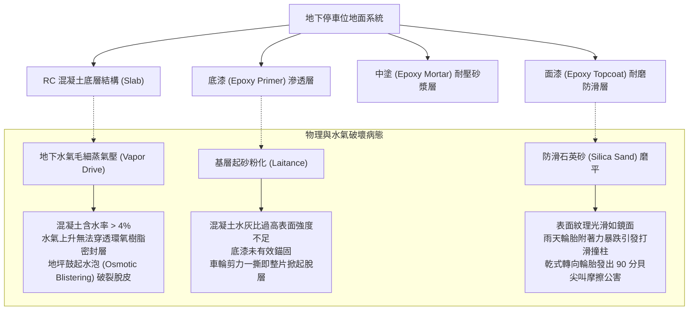
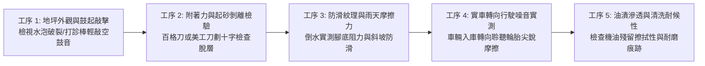
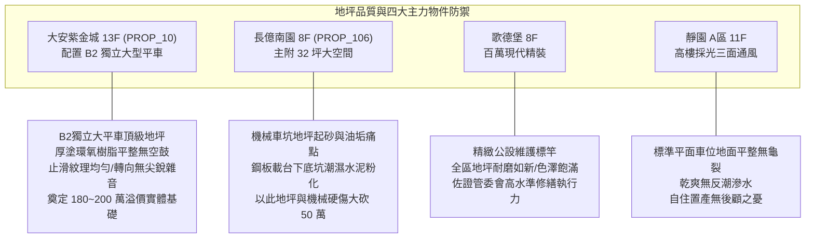

# 全案購屋實戰第一千零六十四部：中古大樓地下室車位地面環氧樹脂Epoxy耐磨地坪起砂起泡脫層輪胎摩擦尖銳噪音與防滑係數體檢工序全書

## 前言：承載萬鈞的基底——車位環氧樹脂地坪、基層含水率與行車防滑極致體檢

在中古大樓地下停車場的土木裝修系統中，鋪設於行車坡道、車道與各停車格位的「耐磨地坪（Parking Epoxy Flooring / 聚氨酯 PU / 金剛砂耐磨地坪）」是承受全天候車輪重載碾壓、阻隔水氣滲透、防塵防砂與維繫行車靜音安全的**核心地面基礎工程**。然而，多數屋齡 15~30 年的中古社區，因地下水氣向上毛細反潮（Vapor Pressure）、混凝土澆置時養護不足表面粉化，導致環氧樹脂塗層大面積鼓起如「水泡（Blistering）」、甚至成片脫落脆化露出粗糙水泥碎石；更常見的是車輛轉向或煞車時，輪胎與地坪劇烈摩擦發出刺耳高頻的「唧唧尖叫噪音（Tire Squeal）」，或雨天車輪帶水入庫時因防滑係數嚴重不足導致車輛打滑失控撞柱。

本手冊為《全案購屋實戰》系列第 1064 部，深入剖析中古大樓地下地坪環氧樹脂施工工法（流展型 vs 止滑滾塗型）、混凝土基層含水率（Moisture Content < 4% 標準）、防滑擺錘抗滑值（BPN / British Pendulum Number）、附著力拉拔試驗（Pull-off Strength >= 1.5 N/mm²）之體檢工序，並精準對接永義房屋周小姐實勘帶看之四大決戰考慮物件。

---

## 第一章 地坪環氧樹脂層架構與起泡脫層破壞機理

### 1.1 環氧樹脂地坪層級工藝標準
1. **底漆滲透層（Primer）**：低黏度雙液型環氧樹脂，深入混凝土毛細孔 2~3 mm，封閉基層毛孔並強化表面微觀強度。
2. **中塗耐壓砂漿層（Intermediate Body Coat）**：環氧樹脂摻混 2~3 倍 7#~8# 精密石英砂，厚度約 1.5~2.0 mm，提供主要之耐衝擊與抗重壓強度。
3. **面漆防滑層（Topcoat）**：
   - **車道與坡道**：採用「撒砂止滑工法」，表面呈現均勻橘皮粗糙紋理，抗滑值 BPN 需達 **55~65 以上**。
   - **停車位內部**：採用「流展型（Self-Leveling）工法」，厚度約 0.5~1.0 mm，平整光亮且易於清潔擦拭油漬。

### 1.2 起泡脫層與刺耳尖叫噪音機理
- **滲透水壓起泡（Osmotic Blistering）**：地下室若未在 RC 結構底層鋪設防潮 PE 膜（Vapor Barrier），地下水氣在溫度上升時氣化膨脹，產生高達每平方公尺數噸之蒸氣壓，將密閉之 Epoxy 塗層硬生生頂起，刺破後流出刺鼻鹼性黃水。
- **輪胎尖叫噪音（Tire Squeal Noise）**：若車位與車道採用完全光滑無砂之亮面面漆，當車輛低速打方向盤時，橡膠輪胎面與光滑地坪因「黏滯滑動效應（Stick-Slip Phenomenon）」產生高頻自激震動，發出高達 **85~95 分貝** 之刺耳尖叫聲，嚴重回音干擾全棟住戶安寧。

---

## 第二章 現場實地查驗車位地坪品質五大工序

### 2.1 鼓起空鼓與基層附著力檢查（工序 1 & 2）
- **打診棒敲擊空鼓（Hollow Sound Detection）**：手持伸縮音響打診棒在車位地面滑動輕敲：
  - 發出清脆「咚咚」高音代表底層結合扎實；
  - 若發出空洞之「啪啪」濁音，證實環氧樹脂層已與 RC 底板完全分離脫層，車輪反覆碾壓必破裂碎裂。
- **邊緣剝離檢查**：檢視脫層破口邊緣，若撕下之環氧樹脂背面沾黏大量白色粉末砂粒，證實混凝土基層起砂嚴重（Concrete Laitance），整格車位必須全面刨除噴砂重新打底。

### 2.2 防滑係數與雨天抗滑實測（工序 3 & 4）
- **局部倒水防滑實測**：攜帶寶特瓶將清水倒於車位入庫動線上，穿著膠底鞋踩踏用力向前推蹬摩擦：
  - 合格之止滑地坪應感到明顯咬地阻力（BPN >= 50）；
  - 若踩上如溜冰般瞬間打滑，車輛雨天回填倒車時極易因輪胎失控側滑擦撞兩側結構柱或鄰車。
- **原地轉向試音**：將車輛開入車位，於原地或低速（5 km/h）轉動方向盤一圈，聆聽是否有尖銳刺耳之金屬撕裂般「唧唧」聲；合格之撒砂止滑地坪僅有橡膠滾動之低沉悶音。

---

## 第三章 永義房屋實勘主力考慮物件車位地坪適配與談判籌碼

### 3.1 大安紫金城 13 樓 (`PROP_10`) —— 頂級大平車的無瑕疵地坪基座
- **資產保護焦點**：配置專屬 B2 獨立大型平面車位（資產溢價高達 180~200 萬）。
- **實地查驗重點**：
  1. 大安紫金城 B2 地坪採用厚塗流展型環氧樹脂搭配止滑車道，車位內部表面平整光潔，無起砂、無空鼓水泡，顏色均勻無修補色差。
  2. 車輛倒車入庫或轉向時完全無刺耳尖叫聲，且地坪表面抗油漬性極佳，機油滴落一擦即淨，展現頂級獨立大平車之高雅質感。

### 3.2 長億南園 8 樓 (`PROP_106`) —— 機械坑底潮濕起砂與鋼板生鏽大砍價
- **機械車位地面硬傷**：長億南園為機械車位，載台下方深達 1.5~2.0 米之機械底坑，多數中古大樓底坑未施作耐磨地坪，僅為粗糙水泥抹光，長年積聚油泥黑水與粉化碎石。
- **談判籌碼運用**：將「車道地坪磨損粉化、機械坑底積泥起砂、雨天輪胎打滑且缺乏高規防滑塗層」等公設現況，與機械車位限重 1.6 噸合流，向賣方痛陳大樓公設整修耗資巨大，狠壓 998 萬開價，直推至 745~760 萬之甜蜜成交區間。

---

## 第四章 買方購屋特約防護與交屋驗收確認條款

1. **地下室車位地面平整無瑕疵保證特約**：
   > 「賣方保證本契約所附停車位（編號：B2-XX）地面之耐磨地坪結構完整牢固，無大面積起泡空鼓、脫皮碎裂或嚴重反潮出水等物理瑕疵；若點交時發現車位內部地坪有大於三十公分平方以上之脫層破損，賣方應於交屋日前完成修復或折讓修繕費用（新台幣伍仟元整）。」
2. **交屋前車位地面驗收三要項**：
   - 第一項：使用打診棒在車位四角及中央滑動輕敲，確認無空洞脫層聲。
   - 第二項：實車開入車位連續低速轉向兩次，確認無刺耳尖銳摩擦噪音。
   - 第三項：蹲下目視地坪接縫與柱腳，確認無白色碳酸鈣反潮結晶（白華現象）。

---

## 結語

車位地面雖踩在車輪之下，卻是每日愛車出入最直接感受的基石。買方以專業工序檢驗環氧樹脂地坪之空鼓率、防滑性能、抗尖叫噪音與基層防潮能力，不僅能徹底杜絕日後車輛打滑失控與地坪脫皮之煩惱，更能從最微小的地面平整度中，精準洞察大樓結構底盤的真正健康狀態，在資產談判中胸有成竹！
