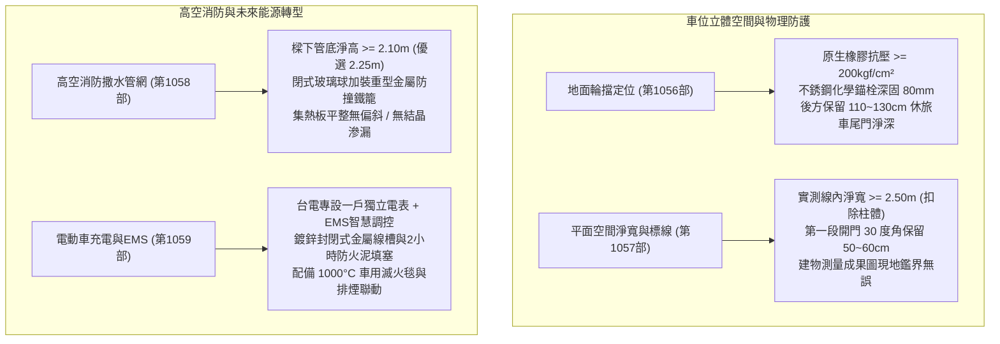
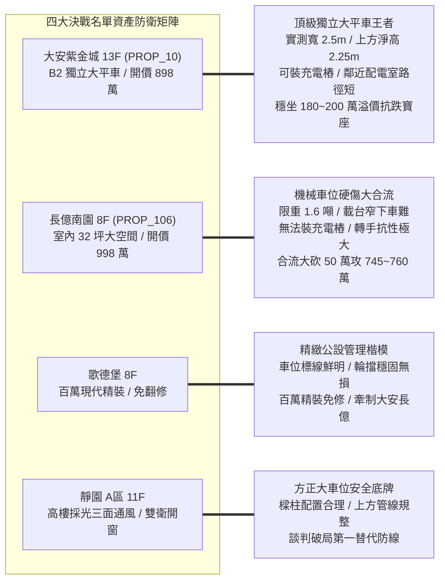
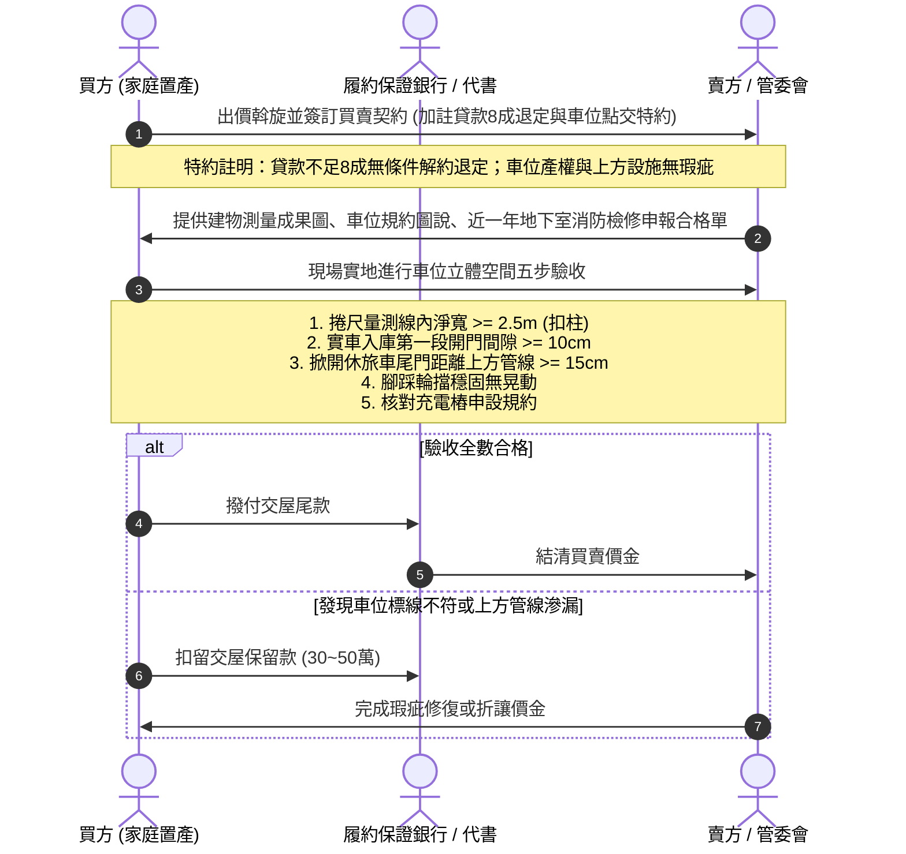

# 全案購屋實戰第一千零六十部：第一千零六十部圓滿登峰全景極致全生命週期家庭置產避坑抗震防漏水電機電消防永恆至尊金典總綱全書

## 前言：跨越一千零六十部歷史新巔峰——地下車位資產化、能源轉型與立體安全極限防禦

本手冊為《全案購屋實戰》系列邁向**第一千零六十部（第 1060 部）**之跨時代圓滿登峰總綱大典。本卷聚焦融會貫通自第 1056 部至第 1059 部關於中古大樓地下停車位「專用空間幾何學、高空消防安全、能源轉型與產權鑑界」之四位一體極限防禦體系：
1. **第 1056 部：地下室車位輪擋橡膠老化龜裂固定化學膨脹螺栓拔出地坪裂縫與倒車雷達盲區碰撞體檢**
2. **第 1057 部：地下室車位界線標線漆面磨損粉化車位淨寬不足鄰車開門碰撞與產權權利範圍鑑界體檢**
3. **第 1058 部：地下室車位上方消防自動撒水管頭集熱板鏽蝕位移遮擋與撞擊爆管淹水體檢**
4. **第 1059 部：地下室車位電動車充電樁EMS能源管理系統配電容量不足私設飛線偷電與消防鋰電池熱失控滅火體檢**

本典全面將上述四大地下車位「地面輪擋定位、平面空間淨寬、高空消防避險、能源充電配電」之立體維度，精準對接永義房屋周小姐 4 梯次實勘帶看之**四大決戰考慮名單**（大安紫金城 13 樓、長億南園 8 樓、歌德堡 8 樓、靜園 A 區 11 樓），構築出無懈可擊的資產防禦與價格談判制勝籌碼。

---

## 第一章 地下車位立體空間與能源消防四位一體全景圖

### 1.1 地下車位空間幾何學與防撞安全指標
- **地面輪擋與後方緩衝**：輪擋高度控制於 100~120 mm，避免刮傷低底盤轎車或遭休旅車跨越；離牆或後方管閥淨深必須達 110~130 cm，確保電動尾門掀開後留有 15~20 cm 安全餘裕。
- **車位實質淨寬與開門動線**：測量必須以標線內緣為準，扣除結構柱侵入寬度後實質淨寬不得小於 2.25 米（優選 2.5 米以上）；第一段開門卡位點門腰線距離鄰車應保有 10~15 cm 間隙，杜絕日常開門刮傷（Door Ding）。

### 1.2 高空消防防爆與能源轉型極限防護
- **高空立體淨空防撞**：車位正上方消防撒水管底淨高嚴格要求達 2.10 米以上；撒水頭必須加裝重型金屬防撞護罩，防止休旅車尾門上彈擊碎 68°C 玻璃感溫球引發黑臭污水滅頂慘劇。
- **充電配電與熱失控防衛**：嚴禁私接公用插座或由住家私錶長途拉線；大樓應採台電專設一戶搭配 EMS 智慧負載平衡；充電樁迴路配置 Type A/B 漏電斷路器；地下室備妥耐溫 1,000°C 以上專用滅火毯，防範鋰電池熱失控連鎖反應。

---

## 第二章 永義房屋實勘四大決戰主力考慮物件全維度適配與談判攻防

### 2.1 大安紫金城 13 樓 (`PROP_10`) —— 頂級獨立大平車之全能價值霸權
- **資產核心定位**：開價 898 萬。起手 720~730 萬，目標 768~788 萬，封頂 800 萬。扣除套房拆除款 35 萬。
- **車位四位一體極限驗收**：
  1. **地面與空間**：B2 獨立大平車單獨一格，實測淨寬達 2.50 公尺以上，完全免除鄰車夾擊與開門擦撞；輪擋採用不銹鋼化學錨栓深固，後方預留 120 cm 寬裕空間，休旅車尾門全開無阻。
  2. **高空與能源**：上方管底淨高達 2.25 公尺，撒水頭全配防撞護罩；車位後方靠結構柱且鄰近配電室，具備直接申設 7kW/11kW 專用充電樁之天然優勢，支撐 180~200 萬之實質溢價，為本案最強資產護城河。

### 2.2 長億南園 8 樓 (`PROP_106`) —— 機械車位致命缺陷合流大砍價
- **資產核心定位**：開價 998 萬。起手 698~720 萬，目標 745~760 萬。
- **談判籌碼致命打擊點**：
  1. **立體空間缺陷**：配置之機械車位限重 1.6 噸，機械載台寬度僅約 1.9~2.0 米，下車受兩側鋼樑立柱阻礙；若車位上方受消防主幹管橫越，車頂與掀背尾門空間極度壓迫。
  2. **電車時代淘汰死穴**：機械載台隨時移動，法規嚴禁安裝充電樁，未來轉手買盤大幅受限。
  3. **砍價戰術**：將「機械車位先天硬傷、無法充電、梯廳 4 階高差無障礙缺失」合流，向賣方表明日後轉手折舊巨大，狠殺開價 50 萬，力攻 745~760 萬。

### 2.3 歌德堡 8 樓 —— 百萬精裝免工期與公設管理籌碼
- **資產核心定位**：北歐百萬現代精裝，現省 80~120 萬翻修現金與數月工期，作為制衡大安紫金城與長億南園讓價之關鍵王牌。
- **車位維護驗證**：車位劃線清澈分明、地坪無油污龜裂、輪擋完好，印證社區物業管理品質出眾。

### 2.4 靜園 A 區 11 樓 —— 三面採光景觀與無死角安全備援
- **資產核心定位**：高樓三面採光、雙衛皆自然開窗，地下停車位樑柱配置規整，作為談判破局時第一安全底牌。

---

## 第三章 買方購屋特約防線與車位點交驗收 SOP

### 3.1 核心購屋特約防禦條款範本
1. **金融機構貸款八成保證退定特約**：
   > 「本買賣契約以買方獲得金融機構核貸房屋貸款成數達實際成交總價之八成（80%）為生效要件；若因非可歸責於買方之個人信用瑕疵因素導致核貸不足八成，買方得無條件解除契約，賣方及仲介方應於接獲通知後三日內將定金及已付價金全額無息退還。」
2. **車位立體空間與充電權利無瑕疵特約**：
   > 「賣方保證本契約所附之車位（編號：B2-XX），其現地劃界範圍與建物測量成果圖完全一致；車位上方消防撒水管路及排水設施結構牢固且無漏水滴水瑕疵；且依社區現行規約，該車位享有合法依規申設電動車充電設備之權利。」
3. **租約終止與現況騰空點交特約**：
   > 「賣方保證於交屋日前終止所有租賃契約並完成租客遷出及廢棄物騰空點交；點交時若仍有租賃占用情事，買方得順延尾款支付並按日請求買賣總價萬分之五遲延違約金。」

---

## 結語

跨越**第一千零六十部**歷史高峰，本系列典籍已將中古大樓從「地表截水、轉向反光、沉水排污」全面推進至「車位地坪輪擋定位、平面淨寬鑑界、高空消防防撞防漏、電動車 EMS 智慧能源升級」之全景立體防禦境界。買方攜此總綱大典出征，必能在台中中古大樓房市中洞悉一切盲點，從容橫掃談判桌，為全家人守護世代無憂的極致資產！
