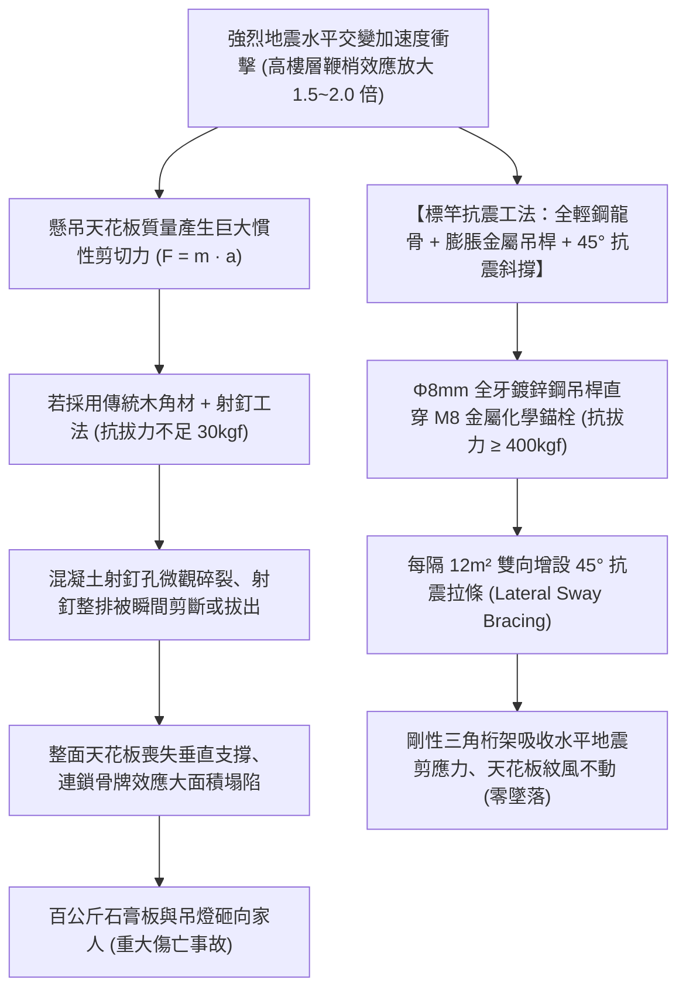
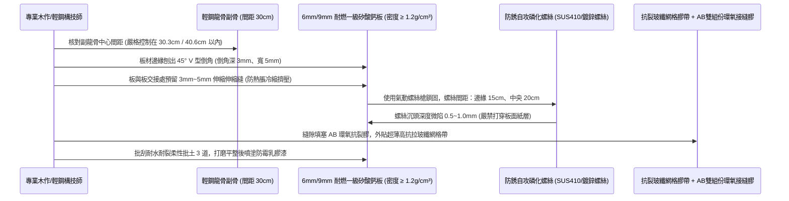
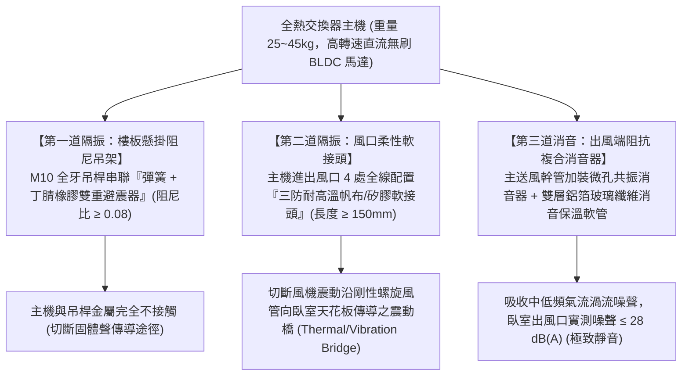

# 全案購屋實戰第一千零六部：中古大樓室內木作天花板吊頂抗震防墜吊筋、防結露矽酸鈣板耐燃一級與全熱交換新風管道消音避震工序全書

## 導言：高空隱蔽空間之生命防護與全天候呼吸品質

在經歷水電管線抽換、衛浴地坪防水與外牆隔音氣密窗全面升級後，中古大樓翻修改造正式進入攸關日常視覺美學、室內空氣品質（IAQ）與地震高空防墜安全的「室內天花板吊頂工程（Suspended Ceiling System）」與「全熱交換新風換氣系統（Energy Recovery Ventilator, ERV）」。

特別是針對本案主力攻堅標的——位處 13 樓頂層、受地震水平加速度鞭梢效應（Whiplash Effect）放大衝擊最劇烈的 **大安紫金城 13 樓 (`PROP_10`)**，以及室內實坪達 32 坪、客餐廳跨距超過 8 米的 **長億南園 8 樓 (`PROP_106`)**，天花板吊頂工程絕非僅僅是「釘幾塊木板遮住管線」的木工裝潢，而是承載著數百公斤重物懸掛於家人頭頂的「抗震懸吊結構工程」！

在台灣處於高頻地震帶的客觀環境下，老舊裝潢天花板普遍存在三大致命安全與健康隱患：
1. **吊頂抗震能力極差，強震下大面積塌陷墜落**：早期木工師傅習慣採用木角材（柳安木或集成木角材）搭配普通排氣射釘槍，將角材直接「打」入 RC 樓板底部作為吊筋。木材在長年溫濕度交變下發生乾裂收縮，射釘周邊混凝土微觀碎裂鬆動。一旦遭遇 5 級以上強烈地震，劇烈的水平反向剪切擺動會使射釘瞬間成排拔出，重達數十甚至上百公斤的石膏板、木作與筒燈整面坍塌，直接砸向熟睡中的家人或客廳沙發上的長幼，釀成非死即殘的滅頂慘劇！
2. **採用劣質氧化鎂板引發結露吸水「吐水反潮」**：部分黑心裝潢廠商為壓低成本，採用廉價的「氧化鎂板（Magnesium Oxide Board）」替代優質矽酸鈣板。氧化鎂板內部游離氯化鎂在空氣相對濕度超過 70% 時，會瘋狂吸收空氣中的水分發生「潮解（Deliquescence）」，板面凝結密密麻麻的黃褐色水珠像下雨般滴落，板體受潮後嚴重變形下垂波浪狀，並引發全室天花板大面積發霉黑斑！
3. **全熱交換新風機吊裝欠缺避震消音，引發「全屋低頻噪聲轟鳴」**：現代家庭為了在氣密窗緊閉狀態下維持室內高含氧量（$\text{CO}_2 < 800\text{ ppm}$）並過濾 PM2.5，普遍加裝全熱交換器或新風機。然而若施工時直接將主機剛性螺栓打在樓板上，風機馬達的高頻運轉微振將透過結構體直接激發整棟樓板產生「共振箱效應」，在深夜發出惱人的 $35 \sim 45\text{ dB(A)}$ 低頻嗡嗡聲；且新風送風管道若未配置消音靜壓箱與消音軟管，氣流在風口處爆發呼嘯風噪，嚴重摧毀臥室睡眠品質。

為此，本第一千零六部全書深入解構輕鋼龍骨抗震吊裝力學、CNS 14705 耐燃一級無石棉矽酸鈣板防護標準、全熱交換新風系統微振隔離雙重避震吊架技術、以及風道消音工程工序。

---

## 一、天花板吊頂輕鋼龍骨抗震懸吊力學與破壞機制

### 1. 膨脹金屬吊桿之錨固力學計算
- **錨栓抗拔力（Pull-out Force）底線**：天花板吊桿嚴禁使用塑膠壁虎或氣動鋼釘！必須使用 **M8 / M10 熱浸鍍鋅內部金屬膨脹螺栓（Drop-in Anchor）**。
- **力學計算**：標準雙層 9mm 矽酸鈣板加輕鋼骨架之自重約 $18\text{ kg/m}^2$，考慮風管、吊燈與 3 倍地震動態放大係數，每根吊點設計載重必須 $\ge 60\text{ kgf}$。M8 金屬膨脹錨栓在 3000 psi 混凝土中的極限抗拔力可達 **$450 \sim 600\text{ kgf}$**，安全係數（Safety Factor）高達 8 倍以上，確保強震下絕不脫扣拔出。

### 2. 45° 側向抗震斜撐（Sway Bracing）配置原則
- 依照美國國際建築規範（IBC）與台灣建築物耐震設計規範，大面積吊頂（面積 $> 15\text{ m}^2$ 或吊頂高度 $> 1.0\text{m}$）必須在主龍骨節點處，設置 **相互垂直的四向 45 度角金屬抗震斜撐**。
- **作用**：將懸吊擺動系統轉換為剛性三角幾何不變體系，限制天花板在強震下的水平位移量小於 10mm，防止天花板邊緣與四周 RC 牆壁發生劇烈「碰撞擠壓碎裂」。

---

## 二、矽酸鈣板耐燃一級防護與防結露標竿工藝

徹底淘汰易吸水發霉之氧化鎂板，全室天花板面板唯一指定採用 **CNS 13745 規範之「100% 不含石棉、耐燃一級日本或台灣原廠矽酸鈣板（Calcium Silicate Board）」**：

### 1. 板材密度與微觀防潮防變形
- **材料指標**：矽酸鈣板密度必須 **$\ge 1.2\text{ g/cm}^3$**，含水率 **$\le 10\%$**，濕氣膨脹率 **$< 0.15\%$**。
- **倒角與縫隙預留防開裂法**：
  - 矽酸鈣板長邊與短邊接縫處，若直接緊密拼貼，在氣候乾濕交替時板材微脹，接縫處之油漆在數月內必爆出突起裂紋。
  - **標竿要求**：板邊必須以專用倒角刨刀切出 $45^\circ$ 斜角，並嚴格預留 **3mm 伸縮空隙**。接縫填補必須使用 **高抗拉雙組份環氧樹脂 AB 接縫膠（Tensile Strength $\ge 15\text{ MPa}$）** 充實，並外貼防裂玻纖帶，徹底根絕天花板開裂宿命。

---

## 三、全熱交換新風系統「微振雙重隔離」與低頻風噪消音工藝

現代集合住宅高空新風系統，吊裝主機必須實施徹底的聲學與微振去耦隔離（Decoupling）：

### 1. 彈簧-橡膠雙回復避震吊架（Spring-Rubber Hangers）
- **隔振效率計算**：風機馬達轉速通常為 $1200 \sim 1800\text{ RPM}$（干擾頻率 $f = 20 \sim 30\text{ Hz}$）。
- 若使用普通鋼製螺栓硬接，振幅傳遞率高達 80% 以上。
- 採用專用複合減震吊鉤，利用低剛度不銹鋼螺旋彈簧隔離低頻震動，搭配高阻尼合成橡膠吸收高頻衝擊，隔振效率達到 **$95\%$ 以上**，天花板樓板完全測不到任何動態微振。

### 2. 送風管道消音保溫與靜壓箱配置
- **送風主管配置**：主送風幹管直徑必須 $\ge \phi 150\text{mm}$（流速控制在 $3.0 \sim 4.0\text{ m/s}$ 經濟流速，嚴禁超過 $5\text{ m/s}$ 誘發氣流嘯叫）。
- **分歧靜壓箱（Plenum Box）**：在送入各房間前，設置內貼 25mm 阻燃吸音棉的「分風靜壓箱」，將高動壓平穩轉換為靜壓，各分歧管全面採用 **內夾雙層無毒無甲醛玻璃棉之消音保溫軟管**，杜絕管壁冷凝結露滴水。

---

## 四、四大主力候選物件天花板與新風翻修專項攻防

### 1. 👑 大安紫金城 13 樓 (`PROP_10`)：頂樓抗震防裂與新風重構
- **現況挑戰**：
  - 本物件為 **13 樓頂樓高樓層**，強震時大樓頂端擺幅最大！前屋主之出租套房天花板採用的是老舊劣質木骨架，天花板表面已出現多處開裂下垂。
  - 頂樓夏天受日曬熱輻射直射，若天花板內部欠缺保溫阻熱層，冷氣電費將極為驚人。
- **翻修方案**：
  - 拆除全部老舊木天花板，全面換裝 **重型抗震輕鋼龍骨 + 雙向 45° 抗震斜撐**，面板採用 **日本原裝 9mm 矽酸鈣板**。
  - 天花板內部空腔鋪設 **50mm 厚高密度岩棉保溫吸音氈（容重 $60\text{ kg/m}^3$）**，大幅阻斷頂樓盛夏熱輻射。
  - 配置全熱交換新風機（風量 $350\text{ m}^3/\text{hr}$），預算約 **16 萬 ~ 20 萬元**。此筆費用直接自買方談判爭取扣除之 **「35 萬套房拆除款」** 中支出，零額外負擔將 13 樓改造成高抗震、恆溫恆濕恆氧的高科技健康宅！

### 2. 🌟 長億南園 8 樓 (`PROP_106`)：大跨距平整度與分區新風工程
- **現況挑戰**：室內實坪達 32 坪超大空間，客餐廳跨距大，大樑貫穿客廳中央（壓樑風水問題）。
- **翻修方案**：
  - 以輕鋼龍骨弧形造型天花順應大樑修飾，吊桿間距加密至 80cm 以內，雷射精確抓平（全室水平公差 $\le 2\text{mm}$）。
  - 新風系統採用集中式分風靜壓箱獨立送風至三間大臥室與客餐廳。
  - 預算約 **18 萬 ~ 22 萬元**，由買方談判砍價爭取之 **50 萬讓價款** 充裕分攤。

---

## 五、全案總結：天花板工程驗收五大不可妥協鋼鐵防線

1. **查吊桿材質**：吊桿必須為 **$\phi 8\text{mm}$ 以上全牙鍍鋅鋼吊桿** 搭配金屬膨脹螺栓，嚴禁使用木角材排氣釘隨意射入樓板。
2. **驗防震斜撐**：大面積客廳天花板中央必須配置 **45 度角抗震金屬斜拉條**，手推天花骨架必須紋風不動，無任何晃動位移。
3. **查面板鋼印**：矽酸鈣板背面必須有清晰之 **「CNS 14705 耐燃一級」與「無石棉（Non-Asbestos）」原廠噴墨鋼印**。
4. **留伸縮倒角**：板邊必須刨出 45° 倒角，預留 3mm 縫隙並以 AB 環氧膠貼玻纖網填平，嚴禁無縫死拼。
5. **測新風風噪**：全熱交換機全速運轉時，主機下方樓板無震感，臥室出風口 1 米處實測噪聲必須 **$\le 30\text{ dB(A)}$**，呼吸清淨如森林！
