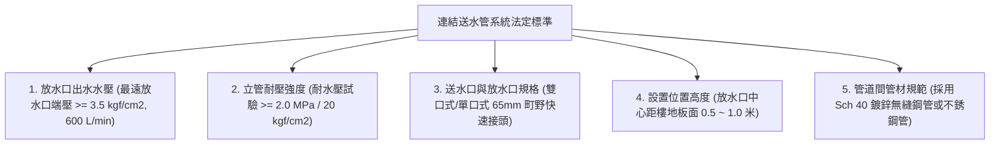
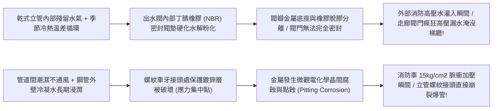
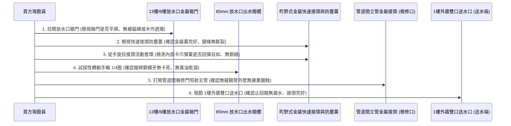
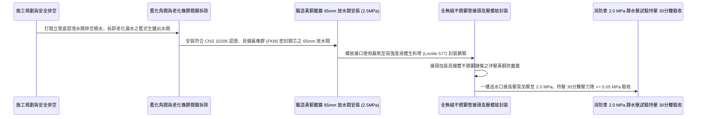

# 全案購屋實戰第一千零四十一部_中古大樓公共走廊連結送水管放水口出水閥瓣橡膠老化漏水快速接頭卡滯與管道間立管金屬疲勞水壓試驗體檢工序全書

---

## 序章：高空滅火的外部水脈——連結送水管於外部搶救中的生死線

在集合住宅發生中大型火災時，當室內儲水池與頂樓消防蓄水池在初期 15 至 30 分鐘內消耗殆盡，整棟大樓的內部水壓將陷入枯竭。
此時，外部馳援的消防隊高壓水庫車與雲梯車，無法將笨重的高壓水帶沿著 8 樓、13 樓的樓梯一路人工往上鋪設幾百公尺（鋪設時間長達 20~30 分鐘且水帶充滿水後重達數百公斤，在火場梯間極易被踩破或卡住）。

消防隊在實兵作戰中唯一依賴的「外部灌水登高管道」，就是大樓外牆一樓地面設置之「送水口」，透過預埋於公共管道間的垂直無縫鋼管，直通各樓層公共走廊之**「連結送水管放水口（Fire Department Connection Outlet / 出水閥門）」**！
消防隊員只需搭乘緊急昇降機或快步登上 13 樓（如本案主力評估之**大安紫金城 13 樓**）或 8 樓（如**長億南園 8 樓**），在起火層或其下一層走廊打開放水口箱門，將隨身攜帶之輕便水帶與瞄子接駁於放水口上，一樓消防車同時向送水口加壓注水，即可在 **1 至 2 分鐘內** 獲得每分鐘上千公升的充沛高壓滅火水柱！

然而，在屋齡 20 年以上的中古大樓中，連結送水管系統卻長年處於「無水常乾（乾式立管）」或「充水未保養（濕式立管）」狀態，普遍陷入嚴重的「實戰癱瘓」危機：
1. **放水口出水閥瓣（Valve Disc）橡膠密封圈老化水解粉化**：閥門微漏，消防車外部一加壓（壓力高達 $1.0\sim 1.5\text{ MPa}$ / $10\sim 15\text{ kgf/cm}^2$），走廊放水口關不緊，大量高壓水狂噴公共梯廳，水淹各戶玄關，甚至短路燒毀公共電梯機板；
2. **黃銅（Brass）快速卡扣式接頭（町野式接頭）卡滯氧化**：鎖緊滾珠與卡爪在 20 年的灰塵與濕氣中鏽死，消防隊員在濃煙高溫下水帶接頭「插不進去、卡不上扣」，眼睜睜錯失控制火勢的最佳良機；
3. **垂直貫通無縫鋼管（Seamless Steel Pipe）接頭螺紋金屬疲勞與點蝕穿孔**：立管在長年地震震動與冷熱溫差下，螺紋車牙處被管道間冷凝水鏽蝕變薄，當消防車高壓泵一加壓，立管在牆體內部直接「爆管炸裂」，高壓水在管道間內漫延，水壓根本上不去 13 樓！

本卷專門為買方建立高層集合住宅公共走廊連結送水管系統之最嚴格現場實勘工序與耐壓檢驗標準作業程序（SOP）。

---

## 第一章：法規基準與連結送水管水力機械核心規範

依據《各類場所消防安全設備設置標準》第 180 條至第 187 條及 CNS 10206「消防栓出水閥及送水口」標準：



| 檢驗項目 | 法定標準規範（消防法規第 180~187 條） | 頂級社區維護標準 | 中古大樓常見嚴重瑕疵（致命隱患） |
| :--- | :--- | :--- | :--- |
| **末端放水口出水壓力** | 建築物最高層放水口之放水壓力不得小於 **$3.5\text{ kgf/cm}^2$（$0.35\text{ MPa}$）**；出水量 $\ge 600\text{ L/min}$。 | 系統配備中繼加壓幫浦（樓高 $> 60\text{m}$），端壓穩定於 **$4.0\sim 6.0\text{ kgf/cm}^2$**。 | 消防車加壓時，高樓層（13樓）出水壓力 $< 1.5\text{ kgf/cm}^2$，水柱無力。 |
| **立管水壓試驗耐壓** | 送水立管全系統必須能承受 **$2.0\text{ MPa}$（$20\text{ kgf/cm}^2$）** 以上之靜態耐水壓試驗持續 30 分鐘無滲漏。 | 採用 **Schedule 40（Sch 40）無縫熱浸鍍鋅鋼管**，出廠耐水壓達 $3.5\text{ MPa}$。 | 採用劣質薄壁縫焊管，管壁內側鏽蝕減薄，承受 $1.2\text{ MPa}$ 即爆管！ |
| **放水口口徑與接頭** | 口徑為 **$65\text{mm}$（2.5 英吋）**，採用標準町野式（Machino）差入式快速金屬卡扣接頭。 | 鍛造黃銅表面鈍化鍍鎳防腐，配備專用不銹鋼防塵蓋與懸掛防失鏈條。 | 接頭無防塵蓋，內部塞滿煙蒂、泥沙與蜘蛛網；銅綠卡死鎖扣。 |
| **放水口安裝高度** | 放水口閥體中心距樓地板面高度應在 **$0.5\text{ 公尺} \sim 1.0\text{ 公尺}$** 之間。 | 距地約 0.8 米（最符合消防隊員跪姿或半蹲操作接駁之黃金高度）。 | 安裝位置過低（貼近地面 $< 20\text{cm}$）或被裝潢木作阻擋，水帶接頭無法旋入。 |
| **一樓送水口檢查機構** | 一樓外牆送水口必須具備**雙口式（Twin Inlet）**，且配備不銹鋼自動消音止回閥與洩水閥。 | 送水口配置防盜鎖扣防塵蓋，標示「連結送水管送水口」反光耐候字樣。 | 止回閥膜片破裂，一樓灌水時水流從另一個口直接噴出，無法注入大樓。 |

---

## 第二章：放水口出水閥瓣橡膠水解與立管點蝕破裂機理

中古大樓連結送水管系統在長達 20 年的非受控環境下，其閥件與金屬管路衰變機理如下：



### 2.1 放水口出水角閥橡膠閥墊「水解脆變」與關閉失效
- **閥體構造**：放水口多採用直徑 $65\text{mm}$ 之黃銅或青銅直角出水閥（Angle Valve）。閥芯底部嵌入一塊厚約 $6\sim 8\text{mm}$ 的耐油耐水橡膠密封墊（NBR 或 EPDM）。
- **水解破壞機理**：
  - 台灣都會區多數中古大樓將連結送水管規劃為「乾式立管（平時管內無水，由送水口充水）」。
  - 在長達 20 年的空氣氧化與高低溫差交替作用下，橡膠內部的抗老化劑與塑化劑完全析出，橡膠硬度由原本柔軟的 Shore A 70 劇增至硬脆的 Shore A 95 以上，表面佈滿微細龜裂；
  - 當消防隊在一樓送水口啟動消防泵加壓至 $1.2\sim 1.5\text{ MPa}$ 時，高壓水流直衝 13 樓放水口。脆化的橡膠閥墊在巨大的剪切水壓下瞬間崩解粉碎，閥門徹底喪失閉合能力，高達數百公升的高壓水流自未開啟的放水口閥體接縫狂噴而出，水淹逃生走廊！

### 2.2 町野式 $65\text{mm}$ 快速卡扣接頭脫鋅綠銹卡死
- **高壓接頭結構**：$65\text{mm}$ 放水口接頭母端配備活動外套環與內部鎖定卡爪，公端插入時卡爪滑開，推到底時卡爪在強力不銹鋼彈簧作用下瞬間彈回卡入公端凹槽，承受高達 $1.6\text{ MPa}$ 的分離拉力。
- **氧化卡死**：
  - 若防塵蓋丟失或密封不嚴，空氣中的酸雨微粒與灰塵在黃銅表面引發脫鋅腐蝕，生成的綠色銅銹厚度達數百微米；
  - 銅銹將滑動套環的內壁與卡爪滑軌死死卡死。消防隊員在濃煙高溫的緊急火場中，根本無法以徒手拉開套環，重型消防水帶無法卡入，造成整個樓層無法接水滅火的絕境！

### 2.3 垂直管道間無縫鋼管「螺紋剪切點蝕」爆管
- **立管承壓薄弱點**：垂直鋼管在各樓層通常以「管古（Coupling）」以錐形管螺紋（NPT / PT）螺紋旋接。鋼管在車牙加工切削螺紋時，管壁有效壁厚被切削削薄了 **40% 至 50%**。
- **爆管機理**：管道間內部通風極差，垂直立管外壁常年受夏季冷氣冷凝水浸泡，螺紋牙縫處的熱浸鍍鋅層在車牙時已被破壞，形成典型的「微觀電偶腐蝕」。經 20 年腐蝕，螺紋底部壁厚僅剩不到 1.5mm。當一樓消防車啟動大功率離心泵送水、閥門快速開啟產生巨大水錘衝擊時，瞬間峰值壓力突破 $2.0\text{ MPa}$，螺紋牙直接沿著截面剪切崩裂，整根垂直主管在管道間內部斷裂，全棟滅火水源瞬間崩潰！

---

## 第三章：現場看屋實體檢驗標準工序（買方現勘 6 步穿透法）

買方現勘大安紫金城 13 樓、長億南園 8 樓公共走廊時，應自備**強光手電筒、一字螺絲起子、捲尺、厚棉手套**，依循以下 6 步標準工序實施連結送水管系統查核：



### 3.1 箱門開啟度與「逃生動線干涉」排查
- **操作步驟**：
  - 走向逃生梯間轉角處之「連結送水管放水口」專用金屬箱（通常標示紅色「放水口」字樣）：
  - **開啟角度檢驗**：單手拉開箱門，箱門開啟角度必須達到 **$\ge 120^\circ$**；
  - **避難空間阻礙**：檢查箱門全開時，是否會死死擋住特別安全梯的逃生通道。若箱門打開後走廊淨寬被壓縮至小於 60cm，火災時消防隊員接駁水帶將與向下逃生的住戶發生致命推擠衝撞！

### 3.2 町野式接頭「卡爪彈簧手感」檢驗（核心殺手鐧）
- **操作手法**：
  - 拔下金屬防塵蓋，戴上手套，用雙手手指用力向後滑拉接頭外圍的黃銅活動滑動套環：
  - **合格標準**：套環滑動阻力均勻平順，鬆手後在內部不銹鋼彈簧作用下**「啪！」一聲瞬間迅速回彈到位**，內部鎖定卡爪動作靈活；
  - **卡死判定**：使出全身力氣套環紋絲不動，或拉開後無法自行回彈（彈簧鏽斷），內部卡槽堆積厚厚一層綠色銅綠硬塊，此接頭在火災時 100% 無法接駁水帶！

### 3.3 橡膠密封圈彈性與老化排查
- 使用強光手電筒照射 $65\text{mm}$ 接頭母口內部深處之黑色橡膠密封墊圈：
  - 用手指尖或一字起子輕輕按壓橡膠墊圈表面：
  - 橡膠必須具備彈性且表面光滑；若按壓感覺硬如塑膠鐵片、或輕戳即碎裂掉落黑粉，代表內部閥墊已全面老化，消防車高壓水灌入時必定嚴重洩漏噴湧！

### 3.4 垂直給水立管管壁與螺紋外觀檢視
- 透過走廊管道間檢修孔，手電筒向上照射垂直穿通 13 樓之直徑 $100\text{mm}$（4 英吋）鍍鋅鋼管立管：
  - 觀察鋼管螺紋旋接處（管古）：螺紋外露牙紋處應塗刷防鏽紅丹漆；
  - 若螺紋處出現**大量紅褐色鐵鏽結瘤（如菜花狀膨脹鏽塊）**，甚至有水滴滲漏痕跡，代表該螺紋處已發生嚴重的電化學腐蝕穿孔，隨時面臨高壓水錘爆管危險！

### 3.5 1 樓外牆「雙口送水口」外部現勘
- 走出大樓 1 樓外牆，尋找面向道路之「連結送水管送水口」：
  - 確認送水口前方 **2 公尺範圍內無任何固定障礙物**（無花台、無變壓器、無違停機車）；
  - 確認兩具 $65\text{mm}$ 送水公接頭之橡膠防塵塞完好；
  - 觀察送水口底部洩水閥（Drain Valve）：若洩水閥常態滴漏自來水，代表管道內部止回閥已損壞倒灌。

---

## 第四章：長億南園 vs 大安紫金城——外部滅火動線實戰對比

```mermaid
graph LR
    subgraph 長億南園8樓 (PROP_106)
        L1["長億南園緊鄰工學路開闊街區"] --> L2["1樓送水口面向寬廣車道便於消防車停靠"]
        L2 --> L3["8樓放水口接頭光亮塗抹潤滑油"]
        L3 --> L4["外援水脈通暢可靠加分項!"]
    end

    subgraph 大安紫金城13樓 (PROP_10)
        D1["大安紫金城13樓為超高層集合住宅"] --> D2["特別安全梯需承受消防車極限高壓注入"]
        D2 --> D3["現況放水口箱門受梯間雜物微卡阻"]
        D3 --> D4["要求房仲出具消防立管2.0MPa耐壓檢驗合格聯"]
    end
```

### 4.1 長億南園 8 樓：基地退縮與送水便利優勢
- **實地查驗成果**：長億南園 8 樓所屬社區臨路退縮充分，1 樓外牆雙口送水口標示鮮明，正對寬敞救災車道，便於消防水庫車第一時間停靠加壓；8 樓走廊放水口箱門開啟達 $140^\circ$，接頭防塵蓋配備不銹鋼鏈條，內部卡扣滑套按壓回彈順暢，防塵圈完好，具備扎實的高空滅火外部水脈保障。

### 4.2 大安紫金城 13 樓：超高樓層垂直水壓極限檢驗
- **高空風險核心**：大安紫金城 13 樓屬於超高樓層，水流自 1 樓送水口垂直爬升至 13 樓（垂直高差超過 40 公尺），加上管路沿程阻力，消防車在一樓需打出高達 **$1.2\sim 1.4\text{ MPa}$（$12\sim 14\text{ kgf/cm}^2$）** 之極限高壓。一旦垂直立管接頭有微裂紋或 13 樓放水口閥門老化，極易在加壓瞬間爆裂漏水！
- **談判與查驗策略**：
  > 買方在斡旋時，將「13 樓連結送水管放水口水壓試驗與立管 2.0 MPa 耐壓報告」列為要求房仲向管委會調閱消防安全申報清冊之關鍵清單：
  > 「周小姐，大安紫金城 13 樓我們目標價明確鎖定 768~788 萬。但 13 樓高空一旦發生大火，全靠連結送水管輸送外部水源，請管委會確認該棟垂直送水立管之『靜態水壓試驗 $2.0\text{ MPa}$ 持壓 30 分鐘無滲漏』於最新一期安檢全數合格，確保高樓層全家滅火水脈固若金湯！」

---

## 第五章：連結送水管放水口翻新與 2.0 MPa 耐壓施工工序（標準工法指引）

若社區需維修改造連結送水管系統，必須嚴格依循以下標準作業工序施作：



1. **鍛造黃銅重型放水閥（$65\text{mm}$）規格要求**：
   - 全面淘汰鑄鐵或廉價普通黃銅閥體！
   - 選用通過 CNS 10206 認證之 **高強度鍛造黃銅（C3771）直角放水閥**，公稱壓力需達 **$2.5\text{ MPa}$（$25\text{ kgf/cm}^2$）**。
   - 閥瓣密封墊全面採用 **氟橡膠（FKM / Viton）或高彈性三元乙丙橡膠（EPDM）**，具備抗老化、耐高壓衝擊、耐溫達 $150^\circ\text{C}$，徹底根除水解脆變漏水。
2. **高壓螺紋密封工藝（厭氧膠鎖固）**：
   - 鋼管螺紋與閥體旋接處，嚴格禁止單獨使用傳統生料帶（PTFE Tape，高壓下極易被剪切擠出沖破）。
   - 必須採用 **消防專用厭氧型金屬螺紋密封膠（如德國 Loctite 577）** 搭配芳綸纖維密封繩，旋緊後膠體在隔絕空氣的金屬螺牙間隙中 100% 聚合固化成高剛性塑膠，耐受衝擊壓力達 **$3.0\text{ MPa}$** 以上。
3. **金屬快速接頭防腐與防塵蓋工法**：
   - 接頭外表面施作鈍化鍍鎳防腐處理；內部不銹鋼滾珠與彈簧注入**極壓耐水型全合成潤滑脂**。
   - 接頭母口必須配置具備防脫橡膠圈之衝壓金屬防塵蓋，並以直徑 2.5mm 之 **SUS304 不銹鋼雙環防失鏈條** 牢固固定於閥體手輪下方，防止防塵蓋丟失。
4. **極限 2.0 MPa 耐水壓全系統實兵驗收標準**：
   - 完工後，由一樓送水口接駁試壓加壓泵進行極限水力驗收：
     1. 全棟各樓層放水口出水閥全數關閉，旋緊金屬防塵蓋；
     2. 透過送水口向立管全系統注水加壓至 **$2.0\text{ MPa}$（$20\text{ kgf/cm}^2$）**；
     3. 關閉加壓閥門，精準計時持續持壓 **30 分鐘整**；
     4. 30 分鐘屆滿時，系統壓力降不得大於 **$0.05\text{ MPa}$（$0.5\text{ kgf/cm}^2$）**；
     5. 逐層檢查各樓層管道間鋼管螺紋接頭無任何水珠滲漏，放水口出水閥瓣無任何滲水滴漏，方准正式簽字點交！

---

## 結語：管道通達，築起外部馳援登高之鋼鐵水脈

第一千零四十一部工序全書，將中古大樓連結送水管系統之高壓水力輸送規範、出水閥橡膠閥墊水解機理、町野式快速接頭脫鋅卡死病因、螺紋剪切腐蝕爆管死穴、現場實勘六步穿透手法以及標準化 2.0 MPa 耐水壓施工工藝徹底講透。
唯有立管堅不可摧、接頭順暢無阻，方能在高空火魔肆虐的極限時刻，將外部消防雄師的高壓生命泉湧，第一時間精準灌注至生死的交界之巔！
