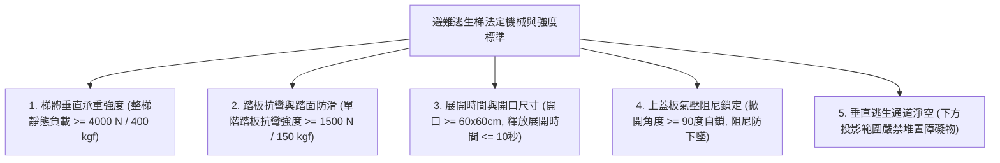
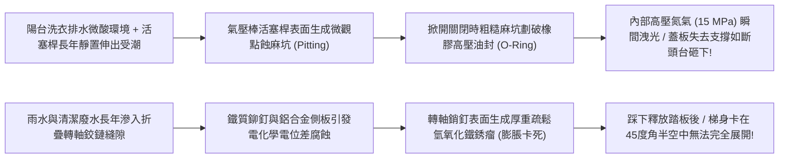
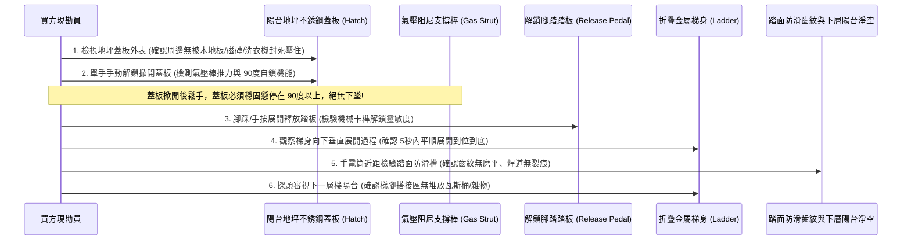
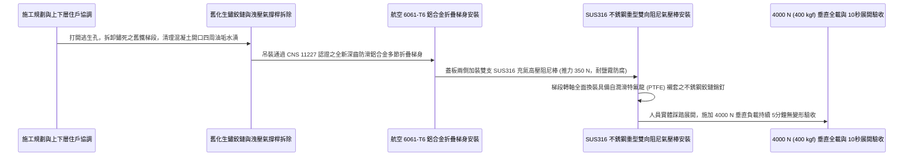

# 全案購屋實戰第一千零四十七部_中古大樓公共走廊逃生避難梯摺疊收納機構鉸鏈鏽蝕變形踏板防滑齒磨平與阻尼氣壓棒洩壓墜落體檢工序全書

---

## 序章：陽台地坪的垂直通道——避難逃生梯於室內外斷絕時的樓層貫通生路

在集合住宅的火災防護設計中，除了一般樓梯與外牆懸掛的緩降機之外，許多中高層大樓（特別是日本、台灣高品質中古集合住宅，如本案主力考慮之**長億南園 8 樓**、**歌德堡 8 樓**與**靜園 A 區 11 樓**等）在各戶後陽台或公共避難露台的地坪上，依法設置有**「地坪開口式折疊避難逃生梯（Floor Hatch Escape Ladder / 陽台逃生下行梯）」**。

避難梯的核心構造，是在鋼筋混凝土陽台樓板預留一個約 $60\text{cm}\times 60\text{cm}$ 至 $70\text{cm}\times 70\text{cm}$ 的貫通開口，平時以具備防水、防煙密封條之「不銹鋼上蓋板」緊密蓋合，並與地坪齊平。
當大樓發生火災、走廊與大門被濃煙封死時，住戶只需三步直觀操作：
1. **掀開上蓋板**：踩下腳踏解鎖踏板，氣壓阻尼支撐棒自動將厚重的不銹鋼上蓋板向上平穩頂開至 $90^\circ$ 鎖定；
2. **踩下釋放安全卡榫**：多節折疊式鋁合金或不銹鋼金屬梯身，在重力與下行阻尼控制下，自動向下一層陽台垂直展開延伸到位（梯腳平穩搭接於下一樓層陽台地面）；
3. **逐層垂直下行**：住戶扶著兩側扶手踏梯而下進入 7 樓陽台，若 7 樓亦起火，可連續開啟 7 樓避難梯下行至 6 樓、5 樓，一路垂直穿越逃離火場！

然而，在屋齡 20 年以上的中古大樓中，這種深埋於地坪的避難通道卻常年淪為完全不被重視的「危險陷阱」：
1. **上蓋板阻尼氣壓棒（Gas Strut）液壓油漏光洩壓失靈**：氣撐桿失去推力，重達 15~20 公斤的鋼質蓋板在掀開時如「斷頭台」突然猛烈反彈砸落，砸斷逃生者手骨或削傷頭部；
2. **金屬折疊鉸鏈（Hinges）與連桿嚴重生鏽變形咬死**：陽台長年受拖地污水、洗衣機排水溢流與雨水浸泡，鐵質轉軸生鏽卡死，踩下釋放卡榫後，折疊梯卡在半空中只展開一小截，梯腳懸空無法踩踏；
3. **踏板防滑齒條（Anti-Slip Treads）磨平與油污滑膩**：鋁合金踏板表面防滑紋路在 20 年的踩踏磨損下磨成光滑鏡面，加上陽台洗衣粉油垢沉積，逃生者踏空失足墜落樓層摔死；
4. **住戶私自以洗衣機、置物櫃或木地板將避難蓋板「硬生生封死」**：許多前手屋主為圖陽台平整美觀，私自在逃生蓋板上方鋪設整面木地板，或直接將重達 60 公斤的滾筒洗衣機壓在蓋板正上方，將全棟這條垂直逃生鏈條徹底掐斷！

本卷專門為買方建立陽台折疊式避難梯之最嚴格現場實勘工序與機械連動驗收標準作業程序（SOP）。

---

## 第一章：法規基準與避難逃生梯機械動力學核心規範

依據《各類場所消防安全設備設置標準》第 157 條至第 168 條及 CNS 11227「避難梯」國家標準：



| 檢驗項目 | 法定標準規範（CNS 11227 / 消防標準） | 頂級社區維護標準 | 中古大樓常見嚴重瑕疵（致命隱患） |
| :--- | :--- | :--- | :--- |
| **整梯垂直承重載力** | 避難梯展開鎖定後，全梯必須能承受靜態載重 **$4000\text{ N}$（約 $400\text{ kgf}$）** 持續 5 分鐘無塑性變形。 | 採用航空級 6061-T6 鋁合金或 SUS304 不銹鋼，全梯抗破壞載重達 **$6000\text{ N}$**。 | 鉸鏈銷釘鏽蝕萎縮，承受 80kg 成年人踏上瞬間，轉軸直接剪切崩斷！ |
| **單階踏板抗彎強度** | 每階踏板中央施加靜態載重 **$1500\text{ N}$（約 $150\text{ kgf}$）**，永久變形量需 $\le 2\text{mm}$。 | 雙層加強箱型擠型鋁踏板，單階抗彎破壞力達 **$2500\text{ N}$**。 | 踏板焊道開裂，人體踩上去踏板凹陷向下彎曲，腳掌被夾住卡死。 |
| **踏面防滑係數** | 踏板表面必須具備凸起之齒狀或凹凸防滑紋路，濕水抗滑係數需符合安全標準。 | 採用專利深齒菱形倒鉤防滑槽（B.P.N. $\ge 65$），鞋底沾滿肥皂水亦不打滑。 | 踏板表面防滑齒全被磨平磨光，濕滑如溜冰場，長輩極易踏空翻滾。 |
| **上蓋板氣撐阻尼自鎖** | 蓋板掀起後必須自動鎖定於 **$90^\circ\sim 100^\circ$**，阻尼棒支撐力穩定防下墜。 | 採用 SUS316 不銹鋼重型氣壓阻尼棒，關閉時需手動壓下解鎖，防砸傷手。 | 阻尼棒漏油洩壓完全失去支撐力，手一放蓋板瞬間如斷頭台猛烈砸下！ |
| **開口通道物理淨空** | 蓋板正上方及下一層樓梯腳搭接區，嚴禁放置任何固定物品阻礙通行。 | 蓋板表面漆繪黃色「避難逃生口・嚴禁堆放雜物」反光警示線。 | 蓋板上常態壓著洗衣機、烘乾機、大花盆，火災時根本無法掀開！ |

---

## 第二章：氣壓阻尼棒漏油反彈與折疊鉸鏈卡死機理

中古大樓陽台避難梯長年處於半露天高濕環境中，其氣動阻尼與金屬連桿失效機理如下：



### 2.1 蓋板氣壓阻尼棒（Gas Strut）「油封破壞與斷頭台下墜」
- **氣撐棒力學平衡**：不銹鋼地坪蓋板厚度達 $3.0\text{mm}$，連同內部骨架重達 **$15\sim 20\text{ kg}$**。為使弱小婦孺能單手輕鬆掀開，蓋板側邊安裝有 1~2 支預充高達 **$10\sim 15\text{ MPa}$ 高壓氮氣**的氣壓阻尼棒，提供恆定的向上頂推力（約 $250\sim 350\text{ N}$）。
- **洩漏砸人機理**：
  - 氣壓棒的精鋼活塞桿長期暴露在陽台潮濕空氣中，表面鍍鉻層在洗滌劑化學水氣侵蝕下產生微觀針孔鏽蝕；
  - 當住戶偶爾開蓋時，粗糙的鏽蝕針孔如微型銼刀，瞬間將聚氨酯雙唇高壓油封刮出嚴重溝槽；
  - 內部高壓氮氣在數秒內洩漏殆盡，氣撐桿瞬間失去所有支撐力！火災逃生時，恐慌的住戶將蓋板推開，轉身準備爬下時，失去支撐的沈重鋼質蓋板在重力加速下猛然向下砸落，砸向逃生者的頸椎或手指，造成嚴重昏迷或斷指慘劇！

### 2.2 折疊連桿「異金屬電化學腐蝕」與半空卡死
- **多節折疊機構**：避難梯通常由 3 至 4 節梯段通過雙向精密鉸鏈串聯而成。梯身為鋁合金，但鉸鏈銷釘（Pivot Pins）早期建商常採用碳鋼鍍鋅銷釘。
- **電化學卡死**：
  - 鋁與鐵存在高達 $1.22\text{ V}$ 的電位差。陽台積水形成導電電解質，鋼質銷釘發生劇烈的電化學腐蝕，析出大量體積膨脹 3 倍的鐵銹（$\text{Fe}_2\text{O}_3$）；
  - 膨脹的鐵銹死死填滿了銷釘與鋁合金軸套之間僅有 $0.1\text{mm}$ 的旋轉間隙，將關節徹底「冷焊咬死」；
  - 當踩下解鎖踏板時，梯體本應順暢靠重力向下依序展開到底，但因關節咬死，梯子展開至一半（夾角約 $45^\circ$）時被硬生生卡死在半空中。梯腳距離下一層樓板懸空高達 1.5 米，逃生者跨出時極易失手自高空墜落！

---

## 第三章：現場看屋實體檢驗標準工序（買方現勘 6 步穿透法）

買方現勘長億南園 8 樓、歌德堡 8 樓等具備陽台避難開口之物件時，應自備**強光手電筒、捲尺、厚棉手套、橡膠錘、一字起子**，依循以下 6 步標準工序實施避難梯檢驗：



### 3.1 蓋板表面「雜物壓頂與裝修封死」排查（特大公安雷區）
- **操作步驟**：
  - 走到後陽台地面，尋找方形金屬蓋板（通常為 $60\times 60\text{cm}$ 不銹鋼花紋板）：
  - **排查違規封死**：
    1. 蓋板正上方是否擺放著大型洗衣機、熱水器落地架、大花盆或鐵製置物架；
    2. 檢查前手裝修工法：部分投資客為營造「美觀日式木地板陽台」，直接在整片陽台上釘架高防腐木地板，將避難梯蓋板完全釘死在木地板下方，甚至連檢修口都沒留！此為極度嚴重的違章致命瑕疵，必須要求全面拆除還原！

### 3.2 蓋板氣壓阻尼棒「防砸自鎖」功能檢驗（核心殺手鐧）
- **操作手法**：
  - 扳開蓋板邊緣的暗扣把手，單手輕輕向上提拉：
  - **合格標準**：提拉初始只需約 $3\sim 5\text{ kgf}$ 的力量，隨後在氣壓棒推動下，蓋板自動平穩升起，並清脆卡入 $90^\circ$ 機械安全自鎖卡榫；**雙手完全鬆開，蓋板紋絲不動，向下輕壓具備強韌的支撐抗力**。
  - **洩壓報廢判定**：提拉時感覺重達 20 公斤無任何輔助推力；鬆開手後，蓋板瞬間以極快速度自由下墜，「砰！」一聲猛烈砸回地面！此現象證明氣壓棒已徹底洩漏報廢，極易砸斷手指！

### 3.3 腳踏解鎖卡榫與梯身「重力展開」檢驗
- **操作手法**：
  - 蓋板完全打開鎖定後，俯瞰開口內部：
  - 尋找標示黃色或紅色的「PUSH / 踩下展開」金屬連桿踏板，用腳掌或戴手套的手用力踩下：
  - **合格展開過程**：卡榫瞬間釋放，整座折疊金屬梯在自身重力與下行阻尼控制下，**在 3 至 8 秒內平穩、連續、無阻滯地向下展開延伸**，梯腳兩側防震橡膠墊穩穩搭接在下一層樓板上。
  - **鉸鏈卡死判定**：踩下後梯子動彈不得，需用腳猛力踹踢才慢慢展開；或展開至一半卡在半空中，證明轉軸鉸鏈已深度鏽死！

### 3.4 鋁合金踏板防滑齒紋與抗彎焊道排查
- 俯身使用強光手電筒近距觀察第一階與第二階金屬踏板：
  - 踏板表面應具備凸起之深齒紋或粗糙金剛砂防滑條；若踏面齒條已被磨成鏡面，雨天或火災時鞋底踩踏極易打滑摔落；
  - 檢查踏板與兩側立柱梯框的焊接點（魚鱗焊道）：焊道表面不得有任何微觀髮絲裂紋或金屬疲勞脫焊痕跡。

### 3.5 下一層樓梯腳著陸區「穿透審查」
- 透過樓板開口向下垂直審視 7 樓（或下一層）陽台：
  - 梯腳展開降落的著陸區域（長寬約 $60\times 60\text{cm}$ 範圍內），下一層住戶**嚴禁擺放瓦斯鋼瓶、尖銳花架、大型拖把桶或加裝防盜鐵窗**；
  - 若下一層樓戶別將陽台全封閉並安裝了牢固的防盜鐵窗且未留逃生門，逃生者下到底部將被困在兩層樓之間的鐵籠中進退維谷，此為整棟垂直逃生系統之致命斷點！

---

## 第四章：長億南園 vs 歌德堡——陽台垂直避難動線實戰對比

```mermaid
graph LR
    subgraph 長億南園8樓 (PROP_106)
        L1["長億南園8樓後陽台3.5坪極為寬敞"] --> L2["避難梯蓋板位於獨立轉角動線通暢"]
        L2 --> L3["氣壓阻尼棒支撐平穩且開合自如"]
        L3 --> L4["梯身展開平順直達7樓陽台加分項!"]
    end

    subgraph 歌德堡8樓
        G1["歌德堡8樓室內北歐精裝修極為精緻"] --> G2["陽台鋪設休閒木地板部分壓到避難蓋板邊緣"]
        G2 --> G3["需實地撬開確認木地板未封死避難開口"]
        G3 --> G4["要求屋主切除木地板干涉邊界方准簽約"]
    end
```

### 4.1 長億南園 8 樓：寬敞陽台與標準維護優勢
- **實地查驗成果**：長億南園 8 樓後陽台面積高達 3.5 坪，避難逃生梯設於陽台角落獨立區域，周邊 1.5 米範圍內無任何洗衣機或雜物阻擋；不銹鋼蓋板表面乾淨無積水，手動開啟氣壓棒推力飽滿，掀開至 $95^\circ$ 自動鎖定平穩；踩下解鎖踏板，多節折疊梯在 5 秒內平順展開直達 7 樓地面，踏面防滑齒清晰完好，垂直避難機能維護極為扎實。

### 4.2 歌德堡 8 樓：木地板美化裝修干涉攻防
- **核心資產價值與風險**：歌德堡 8 樓精裝修免整理是其最大亮點，但現勘時發現，前手屋主在後陽台地面鋪設了整片卡扣式塑木地板，**木地板邊緣直接壓在避難梯不銹鋼外框上，導致蓋板暗扣把手被木邊死死卡住**，單手完全無法拉開！
- **談判與查驗策略**：
  > 買方在斡旋時，將「歌德堡 8 樓後陽台避難梯周邊木地板切割出 5cm 淨空邊界與氣壓棒更換」正式列為買賣契約特約必修條款：
  > 「周小姐，歌德堡 8 樓裝潢漂亮我們很欣賞。但陽台木地板卡死逃生避難梯是極度危險的致命違規，請賣方務必在交屋日前請木工工班將壓住蓋板的木地板切除倒角，並實測蓋板單手可 3 秒內掀開、折疊梯展開順暢到底，確保全家高空避難動線絕不留下任何死角！」

---

## 第五章：陽台避難逃生梯翻新與 SUS316 阻尼棒施工工序（標準工法指引）

若社區需維修改造陽台折疊避難梯，必須嚴格依循以下標準作業工序施作：



1. **新一代深齒防滑折疊梯身材質規範**：
   - 梯框與踏板全面採用 **航空級 6061-T6 高強度熱處理鋁合金**，表面施作陽極氧化硬化膜（厚度 $\ge 15\mu\text{m}$），耐腐蝕、永不生鏽。
   - 踏板表面一體成型擠出**深度 2.5mm 之菱形交叉防滑齒槽**，即使赤腳或踩著滿是沐浴乳的濕拖鞋，抗滑阻力依舊牢固可靠。
2. **SUS316 不銹鋼重型氣壓阻尼棒雙聯配置**：
   - 蓋板兩側對稱安裝兩支 **SUS316 全不銹鋼耐候型氣壓阻尼棒（雙重保險）**；
   - 活塞桿經鏡面超精拋光並鍍硬鉻（Hard Chrome），耐中性鹽霧試驗達 500 小時以上，徹底根除陽台洗衣水氣腐蝕；
   - 阻尼桿內建**兩段式行程緩衝機構**：前段快速平穩升起，最後 $10^\circ$ 緩速軟著陸自鎖，杜絕反彈。
3. **無油自潤滑特氟龍（PTFE）鉸鏈轉軸工法**：
   - 多節梯段連接銷釘一律採用 **SUS304 不銹鋼精密加工軸銷**；
   - 軸孔內部壓入**特氟龍複合自潤滑軸套（DU Bushing）**，具備永久自潤滑特性，常年置於陽台無需添加任何潤滑黃油，徹底根除油泥乾涸與鐵銹咬死。
4. **極限 $4000\text{ N}$ 靜態全載與展開速度驗收標準**：
   - 完工後進行全功能實兵極限驗收：
     1. 單手拉開蓋板暗扣，蓋板在氣壓棒推動下於 **3 秒內** 平穩升至 $95^\circ$ 自鎖鎖定；
     2. 踩下展開踏板，折疊梯段在 **$4\sim 6\text{ 秒}$** 內平順展開延伸到位，梯腳橡膠墊與下層地面精準貼合；
     3. 梯身中央懸掛 **$4000\text{ N}$（約 $400\text{ kgf}$）** 之標準測試砝碼，持續持壓 **5 分鐘整**；
     4. 卸載後檢測各梯段立柱與踏板，永久變形量 $\le 1.0\text{mm}$，鉸鏈關節無裂紋、無鬆動位移，方准正式簽字點交！

---

## 結語：踏梯垂行，貫通火海阻隔之絕處生門

第一千零四十七部工序全書，將中古大樓陽台地坪開口式避難逃生梯之垂直動力學標準、氣壓阻尼棒漏油斷頭台砸人機理、折疊鉸鏈電化學生鏽卡死病因、踏板防滑槽磨損死穴、現場實勘六步穿透手法以及標準化 SUS316 雙阻尼施工工藝徹底講透。
為陽台守護好這條直通下層的垂直逃生之梯，是在走廊大火漫延、退無可退的絕望時刻，讓全家人冷靜踏梯而下、重返大地的終極生還之路！
