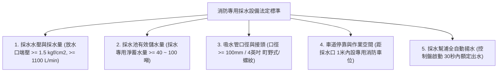
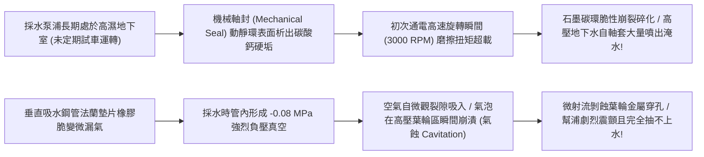
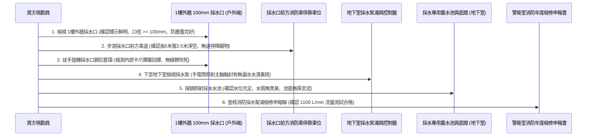
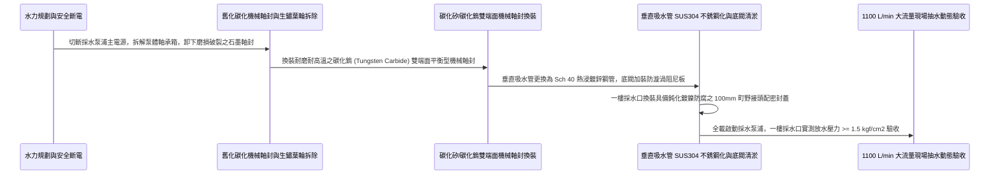

# 全案購屋實戰第一千零四十三部_中古大樓地下室消防採水設備採水幫浦軸封磨損深井採水管漏氣氣蝕與採水口快速接頭鏽死體檢工序全書

---

## 序章：特種大火的地下水源庫——消防採水設備於城市管網癱瘓時的終極依靠

在現代都市集合住宅面臨特大火災、強烈地震震斷自來水市政供水管網、或是區域高壓自來水管破裂停水時，外部馳援的消防車可能面臨「無自來水可用」的毀滅性絕境。
此時，依據建築與消防法規，總樓地板面積較大或超高層集合住宅，必須在地下室或地下水池設置**「消防專用採水設備（Fire Suction Water Supply Equipment）」**。

消防採水設備的核心構造，是利用地下專用大型消防蓄水池（通常為 **$100\sim 300\text{ 噸}$** 以上容量）儲存的專用滅火水源，配備專用固定式「大功率加壓採水泵浦」或配置「深井吸水管與一樓採水口」。
當火場缺水時，消防隊的重型水庫車只需將大口徑（直徑 **$100\text{mm}$ / 4 英吋**）的硬質吸水軟管接駁於一樓地面外牆的**「消防專用採水口（Suction Inlet）」**上，啟動採水泵浦或消防車車載真空泵，即可在數分鐘內直接將地下深處數百噸的清澈水源強力抽吸抽取出來，源源不絕地輸送至雲梯車與高空水砲，展開長達數小時的持續滅火攻堅！

然而，在屋齡 20 年以上的中古大樓（包括本案主力評估之**大安紫金城 13 樓**、**長億南園 8 樓**、**歌德堡 8 樓**與**靜園 A 區 11 樓**）中，這套深藏於地下的終極水源庫卻常年淪為完全無人過問的「沉睡廢鐵」：
1. **加壓採水泵浦機械軸封（Mechanical Seal）石墨環磨損碳化**：水泵常年浸泡於潮濕泵房未運轉，陶瓷動環與碳化矽靜環受水垢結晶卡死，啟動瞬間軸封崩裂，高壓水直接噴射淹沒馬達線圈；
2. **地下深井吸水管路接頭微觀漏氣引發「氣蝕（Cavitation）」**：吸水鋼管在地下水池上方長期受水氣氧化鏽蝕，管法蘭接縫墊片硬化穿孔，消防車真空泵抽吸時吸入大量空氣，泵浦腔體劇烈氣蝕震顫，水根本抽不上來；
3. **一樓外牆 $100\text{mm}$ 黃銅採水口快速接頭嚴重脫鋅鏽死**：接頭常年裸露在戶外風吹雨淋，防塵蓋遺失，內部粗牙螺紋或町野卡爪長滿堅硬綠色銅銹，消防隊水管根本擰不上去；
4. **地下採水專用蓄水池池底淤泥沉積超過 30 公分**：管委會 20 年從未清淤，採水管底部的底閥（Foot Valve）濾網被厚重黏泥完全封死，一抽水瞬間將泥漿抽入消防泵造成葉輪直接咬死！

本卷專門為買方建立地下室消防專用採水設備與外牆採水口之最嚴格現場實勘工序與大流量吸水驗收標準作業程序（SOP）。

---

## 第一章：法規基準與消防採水設備流體力學核心規範

依據《各類場所消防安全設備設置標準》第 175 條至第 179 條及 CNS 10206「消防栓出水閥及送水口」標準：



| 檢驗項目 | 法定標準規範（消防法規第 175~179 條） | 頂級社區維護標準 | 中古大樓常見嚴重瑕疵（致命隱患） |
| :--- | :--- | :--- | :--- |
| **採水幫浦採水流量** | 採水口放水壓力不得小於 **$1.5\text{ kgf/cm}^2$（$0.15\text{ MPa}$）**；採水流量不得小於 **$1100\text{ L/min}$**。 | 配置雙大流量臥式離心泵（互為備用），採水流量達 **$1500\sim 2000\text{ L/min}$**。 | 幫浦老化氣蝕，出水壓力 $< 0.5\text{ kgf/cm}^2$，流量不足法定標準一半。 |
| **採水池專用蓄水量** | 建築物專用採水蓄水量不得小於 **$40\text{ m}^3$（40 噸）**（大型大樓需達 $100\text{ m}^3$）。 | 獨立混凝土蓄水池，配備不銹鋼浮球閥與溢流管，水質清澈無淤泥。 | 蓄水池與生活廢水混用，水面漂浮油污，池底淤泥厚達 30 公分！ |
| **採水口口徑與高度** | 口徑為 **$100\text{mm}$（4 英吋）**，採水口中心距地高度應在 **$0.5\text{ 公尺} \sim 1.0\text{ 公尺}$** 之間。 | 鍛造黃銅鍍鎳重型接頭，配置不銹鋼防塵蓋與反光「消防專用採水口」牌。 | 口徑縮減為 65mm（嚴重違規違法），或離地過高過低，接頭銅綠卡死。 |
| **採水車道停車空間** | 採水口前方必須保留長 **$6.0\text{ 公尺}$、寬 $3.5\text{ 公尺}$** 之消防車專用操作停靠區。 | 地面漆繪黃色「消防採水車位・嚴禁停車」斜紋線，設有防撞阻擋柱。 | 採水口前方長期停滿住戶機車、堆放資源回收大垃圾桶，消防車根本進不來！ |
| **底閥與吸水過濾網** | 吸水管底部必須配置 **SUS304 不銹鋼網目底閥（Foot Valve）**，離池底 $\ge 30\text{cm}$。 | 配置自動逆沖洗自潔濾網，具備防漩渦板（Vortex Plate）防止吸入空氣。 | 底閥金屬片生鏽卡死在開啟狀態（失水），或直接插入池底泥漿中！ |

---

## 第二章：採水幫浦軸封崩裂與吸水立管氣蝕破壞機理

中古大樓地下採水系統長年靜置，其旋轉機械與水下真空管路失效機理如下：



### 2.1 採水泵機械軸封（Mechanical Seal）「水垢膠結與熱崩裂」
- **軸封精密構造**：大功率消防採水泵浦主軸旋轉速度高達 **$1750\sim 2900\text{ RPM}$**。主軸與泵殼之間依靠一對高精度光學級平面（平面度小於 $0.0009\text{mm}$）的「動環（碳化鎢/碳化矽）」與「靜環（浸漬石墨）」緊密貼合，防止泵內高壓水沿主軸洩漏。
- **膠結崩裂機理**：
  - 台灣都會區自來水鈣鎂硬度偏高，水泵長年不運轉，微量滲水蒸發後，在動靜環極其狹窄的接觸縫隙內沉積出硬質碳酸鈣（$\text{CaCO}_3$）晶體，將動靜環死死膠結在一起；
  - 突發火災全壓啟動馬達時，巨大的瞬態啟動扭矩直接將質地較脆的石墨靜環扭斷撕裂，彈簧座變形；高壓水流在數秒內沿主軸呈扇形高速噴湧而出，水花直接灌入後方的三相電動機軸承與接線盒，引發電機相間短路燒毀！

### 2.2 吸水立管負壓穿孔與致命「氣蝕（Cavitation）」
- **真空吸水水力學**：消防採水設備通常需要將地下二樓或地下三樓蓄水池內的水向上抽吸至一樓地面，垂直吸程往往達到 **$4.0\sim 6.0\text{ 公尺}$**。管內絕對壓力急遽降至負壓狀態（真空度達到 $-0.04\sim -0.07\text{ MPa}$）。
- **氣蝕破壞鏈**：
  - 垂直吸水管路在長達 20 年的地下潮濕環境中，法蘭接頭螺栓鏽蝕鬆動，石棉橡膠墊片老化穿孔；
  - 當吸水管內部產生強烈負壓時，外界空氣沿微小孔隙被大量吸入管內，與水流混合形成無數微小氣泡；
  - 氣泡隨水流高速衝入泵浦葉輪的高壓區時，氣泡瞬間被高壓壓潰，產生高達數千大氣壓的「超高音速微射流（Micro-jets）」，如微型重鎚連續轟擊葉輪金屬表面；
  - 數分鐘內，青銅或鑄鐵葉輪即被轟成蜂窩狀穿孔海綿，發出震耳欲聾的「爆豆子」巨響，泵浦劇烈跳動，真空度徹底崩潰，一滴水都抽不上來！

---

## 第三章：現場看屋實體檢驗標準工序（買方現勘 6 步穿透法）

買方現勘大安紫金城 13 樓、長億南園 8 樓公共公設與地下室時，應自備**強光手電筒、一字螺絲起子、捲尺、厚棉手套、金屬探針**，依循以下 6 步標準工序實施消防採水系統檢驗：



### 3.1 1 樓外牆採水口口徑與防塵保護檢核
- **操作步驟**：走向大樓 1 樓臨街外牆，尋找標示「消防專用採水口」之金屬箱或外露管口：
  - **口徑測量**：使用捲尺量測採水口金屬母端口徑，必須嚴格為 **$100\text{mm}$（4 英吋）**，嚴禁以 65mm 送水口魚目混珠充當；
  - **防塵蓋檢查**：確認重型衝壓黃銅防塵蓋以粗不銹鋼鏈條牢固懸掛，密封橡膠圈完好無缺；若無防塵蓋且管口內部塞滿廢紙垃圾，直接列為重大管理疏失！

### 3.2 採水專用車位「阻礙物」現場排查（致命管理黑洞）
- **步測空間**：站在採水口正前方，以大步邁步測量周邊地面空間：
  - 長度必須達到 **6.0 公尺以上**，寬度達到 **3.5 公尺以上**；
  - **違規排查**：許多中古大樓管委會為增加停車費收入，將採水口前方空間私自劃設為「住戶固定機車停車格」或堆放大件垃圾箱。一旦火災發生，數十台機車死死堵在採水口前，消防水庫車完全無法靠近接駁，形同人為廢除整套採水系統！

### 3.3 採水口町野式快速卡爪「靈活度」檢驗（核心殺手鐧）
- **操作手法**：
  - 戴上手套，雙手握住直徑 $100\text{mm}$ 採水口的活動卡扣套環，用力向外旋拉：
  - **合格標準**：套環滑動自如，手感紮實，內部 4 顆重型不銹鋼卡爪受彈簧推動平順張開，無任何卡滯；
  - **銅綠咬死判定**：套環紋絲不動，內部卡槽結滿厚厚一層乾燥硬化之綠色銅銹，此接頭在火災時消防隊員哪怕用鐵鎚敲擊亦無法接駁水管！

### 3.4 地下室採水泵浦主軸「水垢黃斑」檢視
- 走入地下二樓或三樓消防泵浦機房，手電筒近距照射大功率消防採水泵浦：
  - 觀察電機與水泵連接處之「機械軸封漏水收集槽（Drip Pan）」：
  - **合格狀態**：軸套金屬光亮，收集槽內乾燥無積水；
  - **軸封失效死穴**：軸套下方結滿了一圈厚厚的**白色碳酸鈣結晶水垢或黃褐色鐵銹淚痕**，甚至地面已有常態滲漏水窪，證明機械軸封已徹底磨損穿孔，通電運轉必爆！

### 3.5 採水蓄水池水質與底閥位置探查
- 打開地下蓄水池不銹鋼人孔蓋，強光手電筒向深處直射：
  - **有效水位**：水池水位必須維持在浮球溢流線以下 5 公分內，儲水量充足；
  - **水質透明度**：池水應清澈透明、無異味；池底不得有厚度超過 10 公分之黑色厭氧黏泥；
  - **底閥高度**：直徑 100mm 之垂直吸水管末端底閥，其進水濾網距離池底混凝土面必須保留至少 **$30\text{ 公分}$ 以上之懸空淨距**，杜絕吸入沉積泥沙。

---

## 第四章：長億南園 vs 大安紫金城——地下採水水源實戰對比

```mermaid
graph LR
    subgraph 長億南園8樓 (PROP_106)
        L1["長億南園基地退縮且車道寬闊"] --> L2["1樓外牆採水口標示鮮明無障礙"]
        L2 --> L3["地下室配備 150噸獨立消防專用水池"]
        L3 --> L4["外援採水系統通暢可靠加分項!"]
    end

    subgraph 大安紫金城13樓 (PROP_10)
        D1["大安紫金城13樓為超高層集合住宅"] --> D2["特大火災時極度依賴地下消防採水續命"]
        D2 --> D3["現況外牆採水口防塵蓋鏈條脫落需修復"]
        D3 --> D4["要求房仲出具採水泵浦1100 L/min流量合格聯"]
    end
```

### 4.1 長億南園 8 樓：基地退縮與獨立採水池優勢
- **實地查驗成果**：長億南園 8 樓所屬社區臨工學路基地退縮寬闊，外牆 100mm 消防專用採水口前方劃設清晰的黃色禁停區，無任何機車雜物遮擋；地下室設有容量高達 150 噸之獨立專用消防蓄水池，採水泵浦控制盤維持在「自動」待命位置，機械軸封乾燥無滲漏黃斑，底閥懸空良好，具備極強的極限火場外部採水續航能力。

### 4.2 大安紫金城 13 樓：超高樓層極限採水防禦
- **高空風險核心**：大安紫金城標的物位於 13 樓超高樓層，一旦發生高空特大火災，室內初期蓄水消耗極快，消防隊能否持續壓制 13 樓火勢，100% 取決於地下採水泵浦能否源源不絕向雲梯車輸出每分鐘 $1100\text{ 公升}$ 的龐大水源。現勘發現 1 樓外牆採水口防塵蓋鏈條脫落，內部稍有積灰。
- **談判與查驗策略**：
  > 買方在斡旋時，將「13 樓所屬棟別消防採水設備 1100 L/min 實測出水流量合格單與外牆採水口保養報告」正式列為要求房仲向管委會調閱消防安全申報清冊之關鍵清單：
  > 「周小姐，大安紫金城 13 樓我們目標價明確鎖定 768~788 萬。但超高樓層一旦起火，地下採水泵浦是全棟生命的終極水庫，請管委會確認該採水泵浦出水壓力 $\ge 1.5\text{ kgf/cm}^2$、出水量達標於最新一期安檢全數合格，確保高樓層全家滅火生還水源固若金湯！」

---

## 第五章：消防採水幫浦翻新與 $100\text{mm}$ 採水口抗腐施工工序（標準工法指引）

若社區需維修改造消防採水系統，必須嚴格依循以下標準作業工序施作：



1. **頂級碳化鎢雙端面平衡型機械軸封規範**：
   - 徹底淘汰廉價易脆裂之碳化石墨軸封！
   - 全面升級為 **碳化鎢（WC）對碳化矽（SiC）硬對硬雙端面機械軸封**。
   - 密封彈簧一律採用 **SUS316 不銹鋼波形彈簧（Wave Spring）**，即使水中夾帶微量泥沙水垢結晶，硬質端面依然能將微粒直接研磨粉碎而不拉傷接觸面，徹底根除漏水爆軸。
2. **垂直吸水立管防氣蝕全密封工法**：
   - 吸水管全程採用 **Schedule 40（Sch 40）無縫鋼管或 SUS304 不銹鋼厚管**；
   - 法蘭接頭墊片全面採用 **金屬纏繞石墨墊片（Spiral Wound Gasket with Inner Ring）**，杜絕普通橡膠墊片在強烈負壓抽吸下向內吸癟變形穿孔；
   - 吸水管水平走向段向泵浦方向保持 **$\ge 1/100$ 的向上坡度**，嚴禁在管路中段形成倒坡凹槽積存氣囊（Air Pocket）。
3. **外牆 $100\text{mm}$ 採水口防腐與防塵工藝**：
   - 採水口本體採用鍛造黃銅，全表面施作高厚度鈍化鍍鎳防腐塗裝；
   - 內部鎖定滾珠與卡爪採用 **SUS304 不銹鋼**，注入耐海水級全合成氟素潤滑脂；
   - 配置衝壓加厚金屬防塵蓋，以直徑 3.0mm 之不銹鋼鏈條牢固固定，防塵蓋內襯高彈性 EPDM 密封墊圈，徹底隔絕雨水灰塵。
4. **極限 $1100\text{ L/min}$ 大流量實兵抽水驗收標準**：
   - 完工後，於一樓外牆採水口接駁專業便攜式水力流量測試儀（Flow Meter）：
     1. 啟動地下室採水泵浦，馬達在 **10 秒內** 全速運轉投入；
     2. 透過一樓採水口全開排水實測；
     3. 採水口端放水壓力必須維持在 **$\ge 1.5\text{ kgf/cm}^2$（$0.15\text{ MPa}$）**；
     4. 數位超音波流量計測量出水流量必須達到 **$\ge 1100\text{ L/min}$（每秒約 18.3 公升）**；
     5. 採水泵運轉 15 分鐘，軸封處滴水率嚴格限制在 **$< 5\text{ 滴/分鐘}$**（接近絕對零洩漏），水泵軸承溫升 $< 35^\circ\text{C}$，方准正式簽字點交！

---

## 結語：掘深水之泉，鑄滅頂烈焰之生還之源

第一千零四十三部工序全書，將中古大樓地下室消防採水系統之高壓真空吸水水力學、機械軸封水垢膠結崩裂機理、吸水管負壓氣蝕穿孔死穴、外牆 100mm 採水口銅綠卡死病因、現場實勘六步穿透手法以及標準化碳化鎢軸封翻新工藝徹底貫通。
這座深埋於地下百噸的清澈水源庫，是在全城斷水浩劫中，為高樓全家源源不絕注入生還希望的終極生命水脈！
