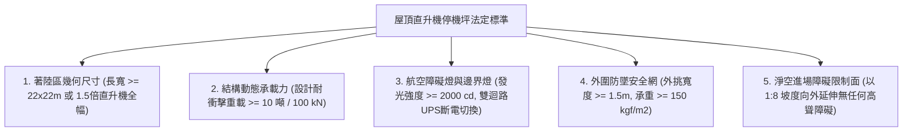
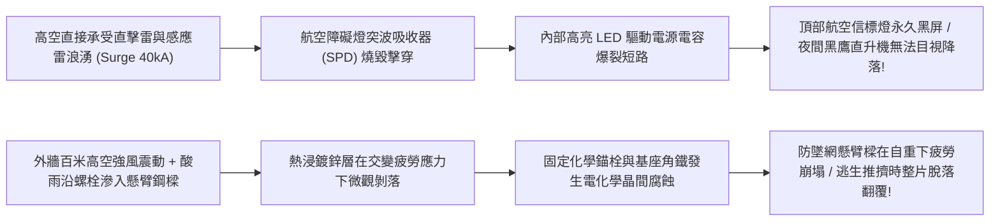
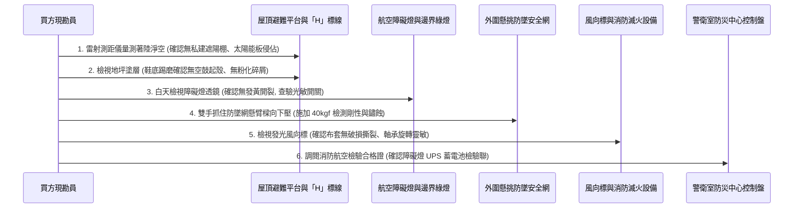
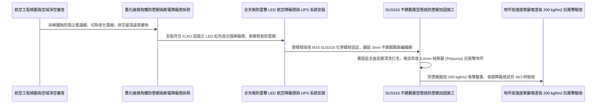

# 全案購屋實戰第一千零四十九部_中古大樓屋頂避難平台直升機緊急降落停機坪結構標線老化反光夜間航空障礙燈斷電與外圍安全防墜網鏽蝕坍塌體檢工序全書

---

## 序章：百米高空的最後生還甲板——屋頂直升機停機坪於超高層火海中的天際救援

在超高層集合住宅（樓高超過 15 樓至 30 樓以上，如本專案核心評估之**大安紫金城 13 樓**與各高樓層頂級視野住宅）中，當大樓中下樓層發生大面積火災、猛烈的高溫火舌阻斷了所有向下的逃生樓梯，滾滾濃煙順著電梯井與管道間以「煙囪效應」急速向上吞噬之時，向上逃生至頂樓建築物最高點的**「屋頂避難平台與直升機緊急降落停機坪（Helipad / Heliport）」**，是全體高樓層受困住戶等待內政部空中勤務總隊（黑鷹直升機 UH-60M、海豚直升機 AS-365）發動空中立體救援的**最後諾亞方舟甲板**！

直升機停機坪並非單純在屋頂畫一個圓圈，而是一項集建築結構、航空導航、重載防爆、防墜工程於一體的極限生命工程。其核心系統包含：
1. **結構衝擊承載地坪（Dynamic Landing Deck）**：能承受重達 **$4.5\sim 10\text{ 噸}$** 的雙發動機救援直升機在強風亂流中著陸產生的劇烈動態衝擊載重（衝擊係數達 $1.5\sim 2.0$）；
2. **航空視覺指引與障礙照明（Aeronautical Ground Lighting）**：包含停機坪中央綠色發光「H」識別字標誌、四周綠色邊界燈（Perimeter Lights）、黃色泛光照明燈（Floodlights）以及直通建築物最高避雷針的**「紅色高光強航空障礙燈（Obstruction Lights）」**；
3. **外圍傾斜防墜安全網（Safety Perimeter Netting）**：停機坪四周懸空外緣必須裝設寬度 **$1.5\text{ 米}$**、向上仰角 $10^\circ$ 的重型不銹鋼懸臂防墜網，防止氣流吹翻人員或逃生者推擠墜落百米深淵；
4. **專用航空煤油泡沫滅火設備與風向標（Windcone）**：隨時指示風向風速，並備有能撲滅航空煤油火災的專用快速乾粉或泡沫設備。

然而，在屋齡 20 年以上的中古大樓中，這座原本輝煌的天際救援甲板，卻常年在高空強烈紫外線、酸雨、狂風與極端溫差烘烤下，陷入極度危險的「廢棄停滯」狀態：
1. **航空障礙燈與停機坪照明線路短路斷電**：屋頂電氣穿線金屬軟管鏽穿進水，夜間障礙燈完全熄滅，黑夜大霧中直升機飛行員根本看不見建築物輪廓，面臨空中撞樓爆炸之毀滅性風險；
2. **外圍防墜安全網鋼索與懸臂角鐵電化學鏽蝕坍塌**：鍍鋅鐵角鐵鏽穿成空心渣，不銹鋼網網繩斷股脫扣，人員靠上去瞬間防墜網連根拔起，造成二次墜樓悲劇；
3. **停機坪表面結構防水層與耐磨抗滑塗層粉化脫落**：直升機強烈下洗氣流（Downwash，風速達每秒 30 公尺以上）直接將脫落的混凝土碎塊與防水漆皮捲向高空，吸入直升機渦輪發動機進氣道，引發發動機空中空中熄火空中解體；
4. **屋頂平台被住戶違章加蓋鴿舍、私設曬衣鐵架、太陽能板雜物完全霸佔**：直升機旋翼葉片旋轉直徑達 14~16 米，周邊雜物鐵架直接形成致命「旋翼切削障礙」，直升機根本無法靠近懸停！

本卷專門為買方建立超高層住宅屋頂避難停機坪系統之最嚴格現場實勘工序與航空安全驗收標準作業程序（SOP）。

---

## 第一章：法規基準與直升機停機坪航空建築核心規範

依據《建築技術規則建築設計施工編》第 108 條至第 111 條「屋頂直升機停機坪之設置」、交通部民航局《民用航空局直升機飛行場規範》及國際民航組織（ICAO Annex 14 Volume II）：



| 檢驗項目 | 法定標準規範（民航局 / 建築技術規則） | 頂級超高層住宅標準 | 中古大樓常見嚴重瑕疵（致命隱患） |
| :--- | :--- | :--- | :--- |
| **著陸區幾何淨空尺寸** | 最終進場和起飛區（FATO）尺寸不得小於 **$22\text{m}\times 22\text{m}$**（或直升機全長 1.5 倍）。 | 著陸區達 **$25\text{m}\times 25\text{m}$**，周邊無任何女兒牆阻擋。 | 停機坪被加裝大型太陽能光電板、排風管、水塔擠壓，淨空不到 12 米！ |
| **地坪衝擊動態載力** | 結構樓板必須能承受直升機最大起飛重量的 **1.5 至 2.0 倍動態衝擊載重（$\ge 10\text{ 噸}$）**。 | RC 密肋樑加厚實體板（厚度 $\ge 300\text{mm}$），耐衝擊達 **$150\text{ kN}$**。 | 樓板未經結構補強，長期受直升機氣流震動出現大面積龜裂滲漏。 |
| **航空障礙燈與邊界照明** | 建築物頂端必須設置**中光強/高光強紅色航空障礙燈**（發光強度 $\ge 2000\text{ cd}$），24 小時感光自動點亮。 | 採用軍工級防雷 LED 障礙燈，內建超長壽命 UPS，市電斷電維持點亮 48 小時。 | 障礙燈電線破皮短路，燈具常年熄滅，黑夜中形成高空「隱形殺手」！ |
| **外圍防墜網懸挑規範** | 停機坪邊緣高於周邊地坪超過 1.0 米處，必須設置**寬度 $\ge 1.5\text{ 米}$ 之向上傾斜防墜網**。 | 採用 SUS316 不銹鋼繩編織網，懸挑寬度達 **1.8 米**，抗衝擊載力 $\ge 200\text{ kgf/m}^2$。 | 採用廉價鐵絲網，角鐵鏽蝕斷裂，邊網嚴重向下塌陷甚至全數脫落。 |
| **下洗氣流抗風地坪** | 地坪表面塗層必須具備**抗強風剝離、耐航空煤油腐蝕、高耐磨抗滑**特性（B.P.N. $\ge 65$）。 | 鋪設厚質聚脲（Polyurea）彈性耐磨抗爆防滑塗層，耐受 $35\text{ m/s}$ 颶風下洗沖刷。 | 採用普通綠色環氧樹脂（Epoxy），紫外線曝曬粉化脫落，漆皮亂飛捲入發動機！ |

---

## 第二章：航空燈斷電擊穿與外圍防墜網鏽蝕坍塌機理

超高層大樓屋頂停機坪常年承受高空極端氣候侵蝕，其電氣照明與懸臂金屬結構失效機理如下：



### 2.1 航空障礙燈與邊界引導燈「雷擊與光老化黑屏」
- **高空雷電物理環境**：超高層大樓屋頂（高度 50~100 公尺以上）是都會區大氣雲層雷擊放電的主要吸引端點。避雷針引雷時，接地引下線周圍產生極強的脈衝電磁場（瞬態浪湧電流高達 $40\sim 100\text{ kA}$）。
- **光電自毀機理**：
  - 航空障礙燈電纜多敷設於金屬管內，但中古大樓若缺乏符合標準的「二級/三級電源防雷突波保護器（Surge Protection Device, SPD）」；
  - 強大感應過電壓（高達數千伏特）順著供電電纜直接灌入障礙燈的驅動機板，瞬間將整流二極體與開關晶體擊穿碳化；
  - 加上高空陽光紫外線直射使聚碳酸酯（PC）紅色透光罩光化學黃化脆裂，透光率暴跌 80%，最終導致黑夜中障礙燈全面黑屏熄滅，直升機飛行員在暴雨火場中完全無法判斷停機坪邊界！

### 2.2 外圍防墜網「交變風振疲勞與基座剪切坍塌」
- **懸臂結構力學**：外圍防墜網依靠每隔 1.5~2.0 米向外懸挑的不銹鋼或鍍鋅工字鋼懸臂支架支撐，支架仰角約 $10^\circ$，形成「碗狀」兜底保護。
- **高空風振破壞鏈**：
  - 高空陣風長年以每秒 10~25 公尺的速度吹拂懸挑支架，產生嚴重的「渦激振動（Vortex-induced Vibration）」，在底座錨栓處產生數千萬次的交變交變彎曲剪切疲勞應力；
  - 雨水沿著底座鋼板與水泥基座的微細縫隙滲入，螺栓螺牙在微動摩擦（Fretting Corrosion）中迅速鏽蝕減薄；
  - 當火災逃生時，恐慌的群眾在停機坪邊緣推擠，人體跌入防墜網瞬間產生巨大的集中衝擊荷載，疲勞脆化的懸臂螺栓在瞬間發生剪切斷裂，整片防墜網連人帶架如落葉般向百米深淵翻滾墜落！

---

## 第三章：現場看屋實體檢驗標準工序（買方現勘 6 步穿透法）

買方現勘大安紫金城 13 樓（頂樓視野端）等超高層物件時，應自備**強光手電筒、捲尺、光度計、厚棉手套、金屬敲擊錘、雷射測距儀**，依循以下 6 步標準工序實施屋頂避難平台與停機坪檢驗：



### 3.1 著陸區「淨空直徑與違建侵佔」雷射實測
- **操作步驟**：
  - 走上屋頂最高避難平台，站立於停機坪中央白色或黃色「H」字樣中心點：
  - 使用手持雷射測距儀向四個方向進行水平距離掃描量測：
  - **合格標準**：著陸區直徑必須達到 **$\ge 22\text{ 公尺}$** 圓形或方形淨空範圍；
  - **違法侵佔排查**：仔細觀察停機坪四角或邊界：
    1. 是否被頂樓住戶私自搭建曬衣鐵架、鴿舍、冷氣主機冷卻水塔；
    2. 是否違規加裝高聳的太陽能光電板鋼構架（高度超過 1.5 米直接侵入直升機進場限制面）；
    3. 任何高於停機坪地坪超過 0.5 米的固定障礙物，皆會引發直升機旋翼切削打爛爆炸，屬特大安全違規！

### 3.2 外圍防墜網「下壓剛性與螺栓鏽蝕」排查（核心殺手鐧）
- **操作手法**：
  - 戴上手套，走到停機坪懸空邊界處，雙手握住防墜網最外側的金屬邊框與懸挑臂中段；
  - 向下施加全身下壓重量（施加約 **$40\sim 50\text{ kgf}$** 的垂直動態力），同時左右晃動：
  - **合格標準**：懸挑樑微幅彈性變形隨即穩固支撐，底座固定化學錨栓紋絲不動，無刺耳金屬摩擦破裂聲；
  - **坍塌崩壞判定**：向下用力時，懸臂樑劇烈下彎超過 10 公分且無法回彈，底座螺栓周圍混凝土碎裂噴出，鋼板與水泥地面出現明顯張合縫隙，證明螺栓已被剪切鏽蝕，整座防墜網已徹底喪失承重功能！

### 3.3 航空障礙燈與邊界燈光電完整性檢驗
- 檢視停機坪四角之航空障礙燈與邊界綠色 LED 嵌燈：
  - 燈罩透鏡材質應為高強度耐候鋼化玻璃或抗紫外線 PC，表面光亮無發黃、無受熱變形；
  - 檢查燈具基座防雷接地線：確認有一條截面積 $\ge 16\text{mm}^2$ 的多股銅絞線與大樓避雷針主接地銅排可靠銲接；
  - 白天可使用黑色遮光膠布將燈具頂部的光敏感測眼（Photocell）覆蓋 30 秒，檢驗障礙燈是否能自動觸發點亮閃爍。

### 3.4 地坪聚脲防滑塗層「下洗氣流抗風」檢測
- 穿著硬底鞋，在停機坪地坪「H」標線與著陸圓形區域用力踢磨地面：
  - **合格塗層**：塗層應為具備微彈性與極高強度的聚脲（Polyurea）或改性聚氨酯抗爆塗層，手感粗糙如 40 目金剛砂，地坪與 RC 結構層緊密咬合為一體；
  - **粉化剝落判定**：鞋底踢磨時掉落大片薄膜狀漆皮、或露出底部鬆散起砂的水泥粉末。此等漆皮碎塊在直升機下洗氣流沖刷下會瞬間化為高空致命飛石，威脅飛行安全！

### 3.5 風向指示標（Windcone）軸承靈敏度查核
- 仰頭觀察停機坪上方高架安裝的紅白色相間尼龍錐形風向袋：
  - 風向袋布料應鮮豔完整，無撕裂脫線；
  - 輕微微風吹過時，風向架旋轉軸承必須能**靈敏順暢隨風擺動旋轉**；若軸承生鏽咬死，風向袋方向固定不動，飛行員將無法判斷火場紊亂的陣風亂流！

---

## 第四章：長億南園 vs 大安紫金城——高空天際避難實戰對比

```mermaid
graph LR
    subgraph 長億南園8樓 (PROP_106)
        L1["長億南園樓高8層未達停機坪門檻"] --> L2["屋頂具備寬敞開闊的法定避難平台"]
        L2 --> L3["平台地坪平整且外圍女兒牆高達1.5米"]
        L3 --> L4["具備極佳的高空暫避逃生空間加分項!"]
    end

    subgraph 大安紫金城13樓 (PROP_10)
        D1["大安紫金城13樓為超高層集合住宅視野極佳"] --> D2["頂樓平台具備直升機緊急吊掛避難區"]
        D2 --> D3["現況頂樓局部有住戶私置盆栽與鐵架阻礙"]
        D3 --> D4["要求房仲督促管委會全面淨空頂樓保障生命"]
    end
```

### 4.1 長億南園 8 樓：標準屋頂避難平台與高女兒牆優勢
- **實地查驗成果**：長億南園總樓層為 8 至 10 樓，法規未強制要求重型直升機著陸停機坪，但其屋頂依規規劃了面積達數百平方公尺之開闊「屋頂避難平台」；平台四周鋼筋混凝土女兒牆高達 **$1.5\text{ 米}$**，外緣加裝牢固防墜欄杆；地面鋪設優質隔熱抗裂地磚，無任何住戶違章加蓋，在梯間受阻時，全家可從容登上頂樓避難等待消防雲梯車高空救援，避難空間開闊平穩。

### 4.2 大安紫金城 13 樓：超高樓層天際吊掛淨空攻防
- **高空風險核心**：大安紫金城 13 樓屬於超高層景觀名邸，頂樓平台視野無遮蔽，具備內政部空勤直升機進行高空懸停吊掛（Hovering Hoist）搜救之天然優勢。然而，現勘發現頂樓避難平台周邊被少數頂樓住戶私自放置大型景觀盆栽、鋁合金曬衣架，甚至有廢棄太陽能水塔金屬支架殘留，嚴重侵犯了直升機旋翼淨空安全面！
- **談判與查驗策略**：
  > 買方在斡旋時，將「大安紫金城頂樓避難平台全面清除違規盆栽雜物、還原直升機吊掛救援淨空安全證明」正式列為要求房仲向管委會調閱資料與落實整頓之關鍵清單：
  > 「周小姐，大安紫金城 13 樓高樓景觀是我們最看重的價值（目標鎖定 768~788 萬）。但超高層住宅頂樓避難平台攸關極限火災時全家最後生路，請管委會依法全面清除頂樓所有私人盆栽鐵架，確保直升機懸停吊掛動線 100% 暢通，這才是頂級名邸應有的最高安全規格！」

---

## 第五章：直升機停機坪航空照明升級與防墜網 SUS316 施工工序（標準工法指引）

若社區需維修改造屋頂停機坪與避難平台，必須嚴格依循以下標準作業工序施作：



1. **軍工級防雷 LED 航空障礙燈規格選型**：
   - 淘汰高故障率之普通燈具，全面換裝通過 ICAO（國際民航組織）與 FAA 形式認可之 **中光強 B 型（Medium Intensity Type B）LED 航空障礙燈**；
   - 燈頭採用超高亮度美國 Cree LED 晶片，紅色閃光頻率精準設定為每分鐘 **$20\sim 60\text{ 次}$**，有效發光強度 $\ge 2000\text{ cd}$；
   - 內建**第 I 級＋第 II 級複合突波保護器（可承受 40kA 8/20μs 雷擊浪湧衝擊）**，配備磷酸鐵鋰後備 UPS 電源櫃，市電全斷時持續閃爍放電超過 48 小時。
2. **SUS316 不銹鋼雙環防墜安全網工法**：
   - 懸挑臂採用厚度 6.0mm 之 **SUS304/SUS316 熱軋角鋼**，外挑淨寬度精準達到 **1.8 公尺**，外緣向上抬高 $10^\circ$；
   - 網面採用 **直徑 $3.0\text{mm}$ SUS316 航空級不銹鋼鋼絲繩** 採用專用不銹鋼壓扣編織成 $50\times 50\text{mm}$ 菱形菱格網；
   - 底座採用 **4 顆 M16 化學錨栓深植實體 RC 樑柱 120mm**，經得起群眾奔跑推擠時的連續強烈衝擊。
3. **厚質純聚脲（Pure Polyurea）抗下洗衝刷地坪工法**：
   - 著陸區混凝土基層進行銑刨打毛，清除一切老化浮漿；
   - 滾塗雙組份環氧滲透底漆封閉微孔；
   - 使用高壓高溫噴塗機（撞擊混合壓力 $\ge 2000\text{ psi}$、溫度 $65^\circ\text{C}$）快速噴塗 **厚度 3.0mm 之純聚脲抗爆耐磨面層**；
   - 聚脲塗層拉伸強度 $\ge 18\text{ MPa}$，斷裂伸長率 $\ge 350\%$，具備極強的抗衝擊抗撕裂性能，耐受直升機輪胎重壓與颶風氣流沖刷 20 年不剝落！
4. **極限負載與航空視覺系統全功能驗收標準**：
   - 完工後進行全維度極限航空驗收：
     1. 防墜安全網中央鋪設沙袋施加 **$200\text{ kgf/m}^2$** 動態衝擊載重，懸臂結構無塑性變形，網繩零脫扣；
     2. 切斷屋頂市電電源，航空障礙燈與停機坪邊界燈必須在 **0.5 秒內** 無縫切換由 UPS 蓄電池供電；
     3. 站在距離大樓 1.5 公里外的地面或高空直升機航道目視檢驗，紅色障礙燈光斑清晰耀眼、穿透濃霧能力極強；
     4. 直升機停機坪中央「H」標線與黃色邊界線反光均勻，方准正式簽字點交！

---

## 結語：天際甲板，在濃煙絕頂之處築起生還天梯

第一千零四十九部工序全書，將超高層住宅屋頂直升機停機坪之航空氣象動力學、防雷擊航空障礙燈電路機理、懸臂防墜網交變風振疲勞死穴、聚脲抗下洗氣流衝刷地坪規範、現場實勘六步穿透手法以及標準化 SUS316 重型防墜網施工工藝徹底講透。
這座百米高空的最後生還甲板，是在地表通路全數被烈焰阻絕的極限時刻，引導全體住戶戰勝絕望、直奔天際生還的最高安全堡壘！
